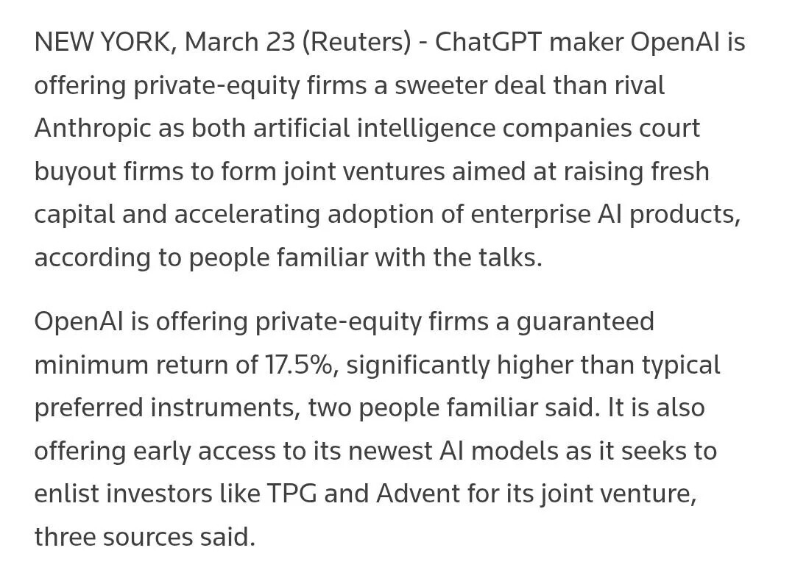
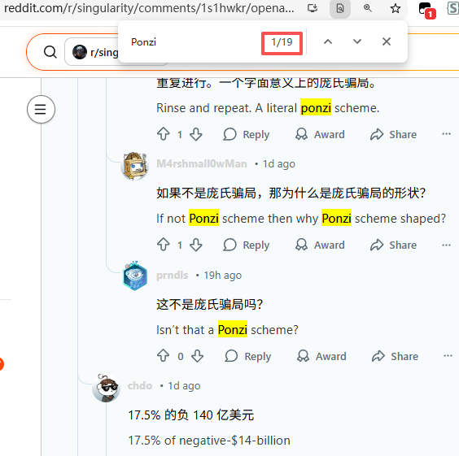

---

id: 1814979

title: "【AI大战短评系列5】OpenAI开始对私募承诺高达17.5%保底年回报的\"高利贷\"，这可能是个危险信号"

created_at: 2026-03-25T15:42:21.252Z

username: dwqxq1

display_username: "dwqxq1"

---

# 【AI大战短评系列5】OpenAI开始对私募承诺高达17.5%保底年回报的"高利贷"，这可能是个危险信号

同时，OpenAI宣布即将关闭上线仅六个月的明星项目Sora，可能为了削减成本

同时，迪士尼宣布25年底与OpenAI达成的10亿美元投资和角色授权计划取消

[Disney Exits OpenAI Deal After AI Giant Shutters Sora](https://www.hollywoodreporter.com/business/digital/openai-shutting-down-sora-ai-video-app-1236546187/)

形式上不是贷款，而是OpenAI承诺给保底收益17.5%或以上的私募

参考美联储无风险利率3.5-3.75%，美国银行贷款利率只有6%

美国私募优先股保底在8%-12%之间，中国私募优先股C轮以后8-10%

不管以哪个标准对比，17.5%都是非常高的

高保底回报，就是投资者对企业风险的估值

---

#### 来自路透社新闻

---

#### Reddit讨论，19个用户提到“庞氏骗局”这个词

.[https://www.reddit.com/r/singularity/comments/1s1hwkr/openal_is_offering_privateequity_firms_a/](https://www.reddit.com/r/singularity/comments/1s1hwkr/openal_is_offering_privateequity_firms_a/)

---

### 我近期其他文章

.[【图像视频系列6】纪念贴，Sora2史诗级溃败，我Sora号排名也永远定格在全球第34【更新：我被观看最多的视频和角色】](https://linux.do/t/topic/1809709)

.[【AI大战短评系列4】GPT在2B市场份额，一年前是Claude9倍，现在缩水到只有Claude一半](https://linux.do/t/topic/1780088)

.[【AI大战短评系列3】真假1m上下文大战开打，CC Max 1m已上线，Antigravity 1m暂未上线](https://linux.do/t/topic/1759655)

.[【AI大战短评系列2】26年2月，Gemini App下载量比ChatGPT多50%](https://linux.do/t/topic/1742735)

.[【AI大战短评系列1】26年2月新增付费用户数，ChatGPT情况不妙](https://linux.do/t/topic/1663076)

---

*来源: https://linux.do/t/topic/1814979.json*

