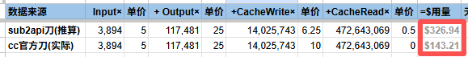

---

id: 1822898

title: ":fire:【省钱系列9】Claude Code Opus额度的秘密：2api的刀，与CC官方刀，此刀非彼刀，又被宰一刀"

created_at: 2026-03-25T20:24:03.001Z

username: dwqxq1

display_username: "dwqxq1"

---

# :fire:【省钱系列9】Claude Code Opus额度的秘密：2api的刀，与CC官方刀，此刀非彼刀，又被宰一刀

以下只是个人研究见解，如与事实不符，感谢指正

这里算法有点绕，这也是没人说这个"秘密"的原因之一，我已经尽我所能，尽量地简化了，听不懂也正常，确实有点烧脑

### 奇怪的直觉，为什么我想要研究额度问题

你如果在用中转站api的opus，或者sub2api拼车，

虽然cc渠道，¥1左右=api1刀，听着挺便宜，但经常一小时好几十刀就干进去了

你是否隐约有种感觉：这api咋这么不抗用？这里是不是有什么猫腻？是否官方直连也这么不抗用？

这里肯定有哪里不对劲！但是又不知道具体哪里不对劲

但sub2api后台使用记录，明码标价，算的很清楚啊，算出来就是这么多，你又无话可说

怀疑，焦虑，烦躁，掏腰包，认命吧

### 此刀非彼刀，不要被名字蒙骗

屠龙刀是刀，菜刀也是刀，显然不能相提并论

举个现实中的例子，咱不能随便见到一个所谓的"刀"，都当是美刀，就像hkd(hk dollar)与usd(us dollar)，都是刀，但汇率差8倍

那么api刀与cc官方刀，其实也根本不是一种刀，也是有汇率的，汇率2-3倍左右

### Claude刀的种类

为了方便理解，我们先定义和命名，注意下面算法里，粗体是区别点

#### 2api刀=cursor刀=ccusage刀

5m算法：Input×$5 + Output×$25 + 5mCacheWrite× **$6.25** + **CacheRead×$0.5**

一般sub2api/cursor/ccusage默认使用5m算法

sub2api拼车：实际缓存一般是1h（因为max本身就是1h)

sub2api中转站：实际缓存就不一定多久了，因为是号池几百个号，虽然算法比较好的中转站，可能尽量保持一个用户session在一个账号内，但账号额度是随时用光轮换的，很难保证1小时之内不换号，换号cache必然要消失重写

cursor：实际缓存是5m

用途：

sub2api，crs中转站通常都是这种算法

A社官方api/OpenRouter api：也是这么算，但基本没意义，没人用cc连官方api吧，实际成本比会员贵了14倍×2-3倍=28-42倍左右

cursor也这么算，用量页面可以导出csv能看到具体算法

sub2api拼车默认应该跟是api算法，除非车主修改

来源：[Pricing - Claude API Docs ︎](https://platform.claude.com/docs/en/about-claude/pricing)

#### cc官方刀

max算法：Input×$5 + Output×$25 + 1hCacheWrite× **$10** + **CacheRead免费**

pro算法：Input×$5 + Output×$25 + 5mCacheWrite× **$6.25** + **CacheRead免费**

max是固定1h缓存，pro是固定5m缓存，算法不一样

用途：Claude Code官方会员的额度体系

来源：严格来说A社官方并未公开过他内部的计算方法，也没有公布过限额是多少刀

#### 怎样证明官方没有计算CacheRead

只有不计算CacheRead，算出来的金额÷5h限额$82.5得到的已用百分比，才能与Claude Code里输入/usage得到的百分比一致

如果计算CacheRead，算出来的金额÷5h限额$82.5得到的已用百分比，是Claude Code里输入/usage得到的百分比数值2-3倍

---

#### 网上公认的cc额度表

一般拼车分额度，都是拿这个表金额÷人数

---

#### 上面表的来源是老外这篇逆向claude web代码的文章

网上所有的关于20x月额度$2700说法的都是基于这篇研究

.[suspiciously precise floats, or, how I got Claude's real limits](https://she-llac.com/claude-limits)

作者自己也按照这个算法开发了Claude web的额度插件

.[GitHub - she-llac/claude-counter: A minimal browser extension that shows token count, cache timer, and usage bars on claude.ai. · GitHub](https://github.com/she-llac/claude-counter)

我下面所有表格，我开发的VSCode CC额度插件，也是基于这个算法

这篇文章里明确写的，cc会员的用量计算方法完全不同于api

cc会员CacheRead免费

---

#### api刀，官方刀算出来结果误差多少？

以我260324一天实际用量为例，上下文为500k左右

输入3894，输出117481，缓存写入14m，缓存读取472m

按三种算法，我分别计算了同一天的消耗：官方143刀，api326刀

汇率是官方1刀=api2刀的关系，上下文越大，差距越大，

---

#### 我用Google Sheets表格算的结果

如果一天算清醒时间全部用来工作，三次5h都用满15h，按公认5h官方82刀额度计算，整车额度 = 官方82刀 × 3次 = 官方246刀

我是直连官网的三人车，如果我一人一天用api326刀，比整车官方上限246刀还高40%，怎么可能呢，工作日其他两个乘客也要用啊，官方143刀算法才是正常的

所以只有一种可能，api刀与ccusage刀算的跟本不靠谱，api刀与官方刀是两个完全不同的东西，差距巨大，api算法根本不应该用于估算cc的用量

### 为什么Cache是用量的主要成本

Input = 上下文 - CacheWrite，一般就是你打的那几个字，容量极小，可以忽略不计

缓存写入比如29% + 缓存读取比如70% = 占了总用量的99%，在1m上下文出来之后，input和output占比已经低到1%

### cc官方刀 vs Cursor刀

因为cursor刀与api刀算法一样

api刀和cursor刀数字都是官方刀的2-3倍，就是Cursor现在所谓的$20CursorPro会员用cursor60刀，只相当于cc官方20-30刀

而$20的ccPro会员，额度是cc官方163刀

### 为什么网上没有人说这个"秘密"，几种可能性

佬们也请发表下自己见解

Ⓐ老外逆向工程原文瞎掰

Ⓑ我在瞎掰

Ⓒ因为算法复杂，没人知道

Ⓓ被官方API算法所误导

但官方从未说过会员也按API的定价计算额度

Ⓔ中转站老板应该知道，但他显然没有动机戳穿秘密，人家赚的就是两种刀之间的"汇率差价"，行规大家心照不宣，偷着数钱，谁也不戳破

### sub2api/crs拼车用的哪个算法？

每车根据车头sub2api的单价设定不同，有几种情况

Ⓐ车头用官方算法计算用量，即CacheWrite$5，CacheRead免费，这种不会浪费，公平

Ⓑ车头不知道API与官方算法的区别，用API算法计算用量，但按照官方算法设定sub2api额度=2700÷人数，自用与乘客用相同的sub2api设置

其实浪费很多额度(可能高达一半)，但他也不知道是否浪费，浪费多少，也不敢随便调高实验，怕翻车

Ⓒ车头用API算法计算用量，CacheRead收费，剩余大量额度给自己用

例如四人车，车主实际分到40%，其他三人各分到20%

sub2api额度是限制乘客的，自己直连官网，或者用sub2api但不限额，官方刀-其余乘客的api刀=自己用的，车头自己多剩点不好么？

而且车头确实也承担了一部分翻车官方万一不退款的风险，组织管理的时间成本，也觉得自己理所应当“捡漏”

Ⓓ车头用API算法计算用量，CacheRead收费，四人车可以卖给八个人

反正乘客又不知道车里到底有几个人，即便拉群，也可以拉两个四人群

### Oauth直连拼车是用的哪个算法？

总额是官方算法

每个乘客没法进行单独的限额，不存在限额造成的浪费，反倒容易抢额度

如果认识，三人车，四人车还行，比较容易自觉，不好意思跟朋友抢

如果不认识，感觉二人车还行，抢额度对方肯定会发现谁干的（废话，就俩人），也就不太好意思抢，三人或以上容易因为所有人都不承认，无法确认谁干的，容易形成猜疑链

---

*来源: https://linux.do/t/topic/1822898.json*

