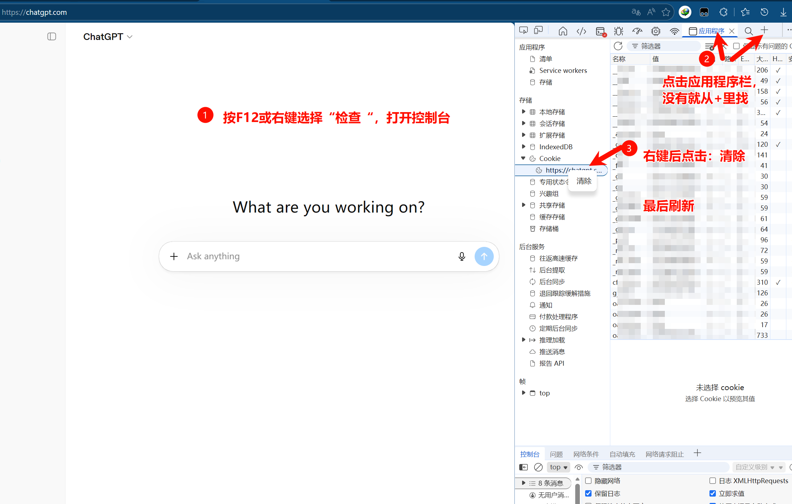
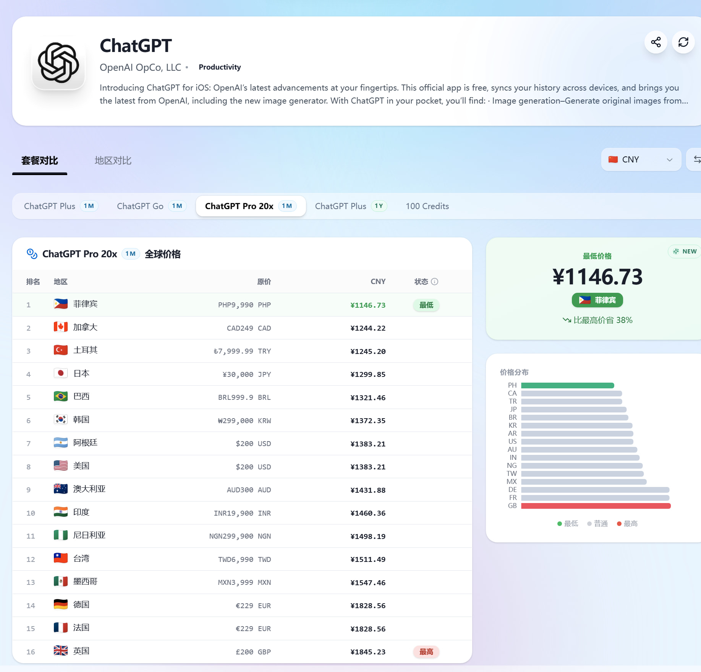

---

id: 1839424

title: ":fire:【省钱系列10】Claude Code Max，Codex Team最新渠道研究"

created_at: 2026-03-28T02:21:53.471Z

username: dwqxq1

display_username: "dwqxq1"

---

# :fire:【省钱系列10】Claude Code Max，Codex Team最新渠道研究

御三家在近期全部开始收口

Claude Code疯狂封max号

Codex疯狂封Team号

Antigravity封反代，砍Ultra的Opus额度

Kiro封反代

以下是最新渠道和风险评估

图标：最稳，较稳，一般，风险高，风险非常高，不确定

以下仅个人见解，不一定对，仅供参考，每天官方政策也在变化，今天可行的可，可能明天就不行了，如与显示不符，感谢佬友更正

---

### Claude Code独享渠道

以下未封/已封统计数据来自于下文，3月21日到现在统计200人总封号率50%左右，这些还是这次封号潮之前的老号，如果新号估计封号率更高

[260321 ⍰【投票调查】【暂时定性】Claude 封号潮，热门虚拟卡真被A出下重拳了吗？或者只是周期性的全面风控？（U卡确实是较重的风险因素）](https://linux.do/t/topic/1790909)

#### 官网 + 没绑过max的海外个人信用卡/储蓄卡

##### 优点

最安全的方式

给退款到卡里

##### 缺点

国内难搞到海外个人卡，海外留学生能搞到

貌似一卡一帐号，不能重复用

#### 官网 + 绑过max的海外个人卡/U卡/虚拟卡/卡台/国内卡/Google Pay

未反代：未封15：已封11

已反代：未封8：已封4

卡再套Google Play也一样

##### 优点

卡好弄

##### 缺点

秒封

[@Harry](/u/harry) ：用了虚拟卡或币卡，短则2-3天长则20天 一定会ban你（但是会退款）

##### 国内卡等+Google Pay套一层，效果一样

A社可以从Google Pay获取卡号前6~8位，可以用号段判断是否中国卡/U卡/虚拟卡

来自佬友  的AI回答[截图](/uploads/short-url/clPcka5YU5bKfePjlS81ABgK2Zg.png)

##### 例子

[@Mikhun](/u/mikhun) ：wise, n26, bitget, okx,中信万事达双币借记卡都不行

[@unisly](/u/unisly) ：虚拟卡秒封，秒退200刀；google pay绑虚拟卡，秒封，秒退200刀

#### A社官网正价礼品卡或代充：5x=¥700，20x=¥1400

发卡密或代充，本质都一样，代充卖家也是拿礼品卡充

想知道实际渠道是否礼品卡，可以通过是否质保反推，没质保的基本都是礼品卡，因为礼品卡官方不退款，卖家收不到退款，怎么可能自己掏腰包退给买家

买卡流程：卖家银行卡买礼品卡 → 发你卡密 → 你自备1个月以上老号，或者稳定3-7天新号 → 自备家宽/指纹浏览器 → 登录官网redeem

代充流程：你把claude账号密码给卖家 → 卖家登录官网用礼品卡充值，需要几分钟 → 你改密码2fa等

成品号流程：卖家已经做好前面流程 → 发你成品号 → 你自己改密码2fa等

##### 优点

可以自备卡号或成品号

少量卖家保，5x额外加150，20x额外加300

##### 缺点

因为官方不退款，所以卖家通常只保订阅，不保封号

你不知道卖家买礼品卡用的卡是否海外个人卡，只能通过咸鱼他最近的评价，间接评估他翻车率，一旦封号，卖家收不到退款，自然也不可能给你退款

#### A社官方低价礼品卡或代充：5x=¥500，0x=¥1000

##### 优点

便宜

##### 缺点

低价礼品卡明显低于汇率，来历不明，通常即不保订阅，也不保封号，封了100%不退款

[260325 ⍰某宝105代充Claude Pro会员的原理是什么？](https://linux.do/t/topic/1810258)

#### A社礼品卡 + 海外个人卡充

##### 优点

不容易封

##### 缺点

中国人不容易搞到海外个人卡

如果能弄到海外个人卡，就没必要用礼品卡了，反倒增加不退款风险

#### A社礼品卡 + 国内/U卡/虚拟卡充

##### 缺点

烂卡 + 礼品卡不退款，buff叠满

##### 例子

[@unisly](/u/unisly) ：google pay绑定虚拟VISA，官网购买MAX礼品卡，领取礼品卡，第二天凌晨2点左右被封，截至目前已经超过3天，礼品卡和虚拟VISA均未收到退款，发邮件也不鸟

[claude这次3月封号，好像和支付方式有关，VISA支付秒退，礼品卡超3天未退 - 搞七捻三 - LINUX DO](https://linux.do/t/topic/1799890)

#### AppStore/PlayStore成品礼品卡，或自己虚拟卡/U卡/国内美金卡买礼品卡

这是应用商店礼品卡，不是a社礼品卡

一个AppleID只能内购一个Claude 账号

##### 优点

退款到苹果/谷歌账户余额（不是退到信用卡）

理论上A社无法获取买礼品卡的信用卡号段

##### 缺点

苹果/安卓税25%：5x=$125，20x=$250

一个苹果账号只能买一个max

退款只能退到AppStore/PlayStore余额，不能再买max，多次卖可能不退，容易用不掉烂手里

##### 例子

[260319 Mikhun ⍰记录一下美区 Apple 礼品卡开通 Claude Pro](https://linux.do/t/topic/1780072)

#### AppStore/PlayStore + 绑自己国内卡/U卡/虚拟卡

未反代：未封11：已封2

反代：未封7：已封5

##### 优点

封号退款到卡里

##### 缺点

也会封号

苹果/安卓税5x=$125，10x=$250

一个苹果账号只能买一个max

##### 例子

[@FatNew](/u/fatnew) ：我就是用的 家宽 国内卡套谷歌 指纹浏览器。死的透透的

#### 尼区AppStore + 闲鱼礼品卡

##### 优点

价格便宜

##### 缺点

礼品卡容易封号

[▤Claude by Anthropic 哪个国家订阅最便宜？2026 全球价格表 | Find Cheap Subs](https://www.findcheapsubs.com/zh/app/6473753684/claude-by-anthropic-price?subscription=Claude+Max+20x+-+Monthly)

#### 尼区AppStore + 自己信用卡买礼品卡

##### 优点

价格便宜

##### 缺点

需要尼区信用卡，手续复杂

[@ITOTI](/u/itoti) ：我自己是Claude code max 5x，尼日利亚Appstore+尼日利亚信用卡(用的我自己的卡)。没有任何反代，自己用。要一套BVN，NIN身份证明+一张尼日利亚电话卡。不要去买闲鱼上的成品虚拟卡，很容易被找回

---

### Claude Code封号因素

#### 主要因素

卡：只能海外个人卡，其他卡都不太行

不能反代：很容易封

[@xiaomao](/u/xiaomao) ：sub2api的握手指纹与Claude Code不一样

#### 次要因素

注册账号： [@0xkk](/u/0xkk) Gmail就行，Outlook不行

注册手机号验证： [@0xkk](/u/0xkk) HeroSMS应该发过，不能港澳台和+86手机号

指纹浏览器： [@0xkk](/u/0xkk) RoxyBrowser free plan可以

线路：不一定非要家宽，机房ip纯净度在50%以下也行，当然家宽更好

号申请过程比较重要

Oauth多设备或多人拼车，最好ip一致或同一城市，不要飘

max比pro更容易封

不要使用被封禁过的设备

[@xiaomao](/u/xiaomao) ：不要在有封禁记录的设备上去登录和注册账户，我翻出来的老iphone注册付款，safari登录账户，全程不碰之前的电脑，全部操作在手机上完成。

[@Harry](/u/harry) 说拼车或2api行为要合理

发消息间隔：如果总是两个消息同时发就很反常，人打字需要时间

连续工作时间：如果拼车一天总是20多个小时就很反常，人需要睡觉

并发短时间突发高一点没关系 测试max似乎可以跑10并发。但持续高并发会让你的威胁值猛烈提升。

ab账号同时在同一台设备跑请求不正常，先后跑可以，多机同一ip可以

#### 不太重要因素

时区，环境最好与ip一致

中文：浏览器的语言/Claude Web的语言

来源：[260327 Zz ⍰Claude 订阅 家宽是否真的有必要？](https://linux.do/t/topic/1835294/15)

---

ChatGPT渠道

#### Team渠道

佬友说一个5小时大约25刀，周限消耗30%，就是一个周限一个team大约值83刀，真实性未知

260327起估计50~80%的号被集中封号

260328L站跳蚤市场涨价四倍左右，无质保¥10~15，有质保¥25~30，母号¥90

##### 如何注册Team新号

大概率无效：0刀1刀卡/虚拟卡/U卡

有效：佬友 [@iyyyy](/u/iyyyy) @源星光子 说PayPal地区选德国有效，

paypal iphone注册都要身份验证

##### Team被封后，登录ChatGPT退不出Team怎么办

清除浏览器缓存 重新登录

或F12里清除

#### 已有Team号如何不被封

前提是卡基本正常的

##### 多个Team成员 + 2api自建中转 + 同一家宽

基本都在

估计买或注册母号，自己一车不拼车，需要几个小号自己拉，自建中转或直连，同一家宽，是被封概率最小的方案

中转站如果还能运营的，估计也是这种方式

##### 多个Team成员 + 直连 + 同一家宽

不清楚

##### 多个Team成员 + 2api自建中转 + 同一机场

基本全封

##### 多个Team成员 + 直连 + 同一机场

基本全封

##### 多个Team成员 + 直连 + 不同机场

基本全封

##### 连坐机制

一个Team要封就封母号，所有乘客全掉，不会只封其中一个成员的team权限，也不会封乘客个人账号

来源：[260327 杨 ⍰关于 OpenAI Team 风控，这周拿几十个号做了点测试](https://linux.do/t/topic/1834149)

#### Plus渠道

佬友实测Plus的Coding额度是team的2-3倍，但是team每月有15次gpt-pro，Plus没有

美区AppStore¥140

土区AppSotre¥80，风控比较严，并不需要换到土区的ip

以前尼区有半价，现在已经没有

L站有卖¥15-20带质保，卡Bug渠道，要弄到英区去

#### Plus大兵号

就是网上美军烈士纪念网站上找编号姓名一类的，官网申请低价gpt plus会员，拿出来卖，貌似最近很少了

#### Pro积分号独享

佬友说pro账号，周限大约值1500刀，真实性未知

L站跳蚤市场有，¥800带质保的，¥500无质保

#### Pro积分号拼车

三人车¥250-300带质保

#### Pro正价

#### Pro开发者号6个月

¥2000-3000

---

### Antigravity渠道

#### Antigravity Ultra 拼车：¥150-180

现在御三家里Antigravity最宽松，只要不反代，极少有被封的，封了一般也会退钱，没有实质损失

但从260320开始砍额度，原来没有周限，现在增加了周限

以前是可以使劲用也用不光opus额度，现在重度用会用光

看到一个说法，真实性待验证，Antigravity ultra现在是分时段，有时候消耗快，有时候消耗慢，速度差四倍

晚上24点-早上9点正常额度，5小时 大概600-800次 opus。

10点钟准时杀ultra反代。

中午12点-16点，5小时 大概400次左右opus

16点-24点 5小时 160-180次opus

次数是指request次数，不是agent(planning)次数，一次planning可能消耗5~20次request，所以普通非编程提问可以用fast模式节省消耗

---

*来源: https://linux.do/t/topic/1839424.json*

