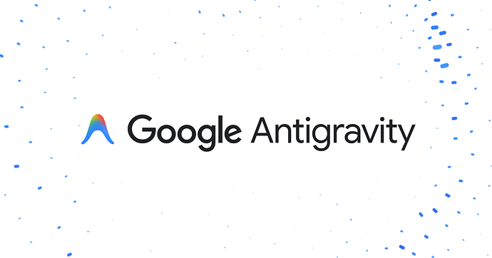
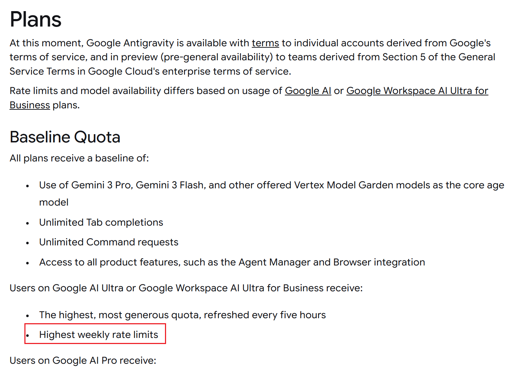

---

id: 1839995

title: "[赛博史官] 谷歌把 AI Ultra 订阅的 Antigravity 额度改成有周限了"

created_at: 2026-03-28T03:57:30.455Z

username: Cells

display_username: "Cells"

---

# [赛博史官] 谷歌把 AI Ultra 订阅的 Antigravity 额度改成有周限了

现在 Ultra 订阅的 Antigravity 模型也有周限了。之前的描述是 “No weekly rate limit”，现在改成 “Highest weekly rate limits”.

这不是第一次改了，三月初的时候改成过 “Highest weekly rate limits”，后来又偷偷改回 “No weekly rate limit”。看来谷歌是铁了心要削额度了，不知道 A\ 那边会怎么行动。

### [Google Antigravity](https://antigravity.google/docs/plans)

Google Antigravity - Build the new way

---

*来源: https://linux.do/t/topic/1839995.json*

