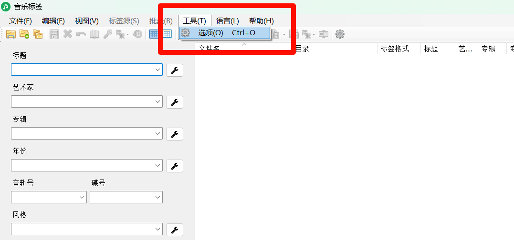
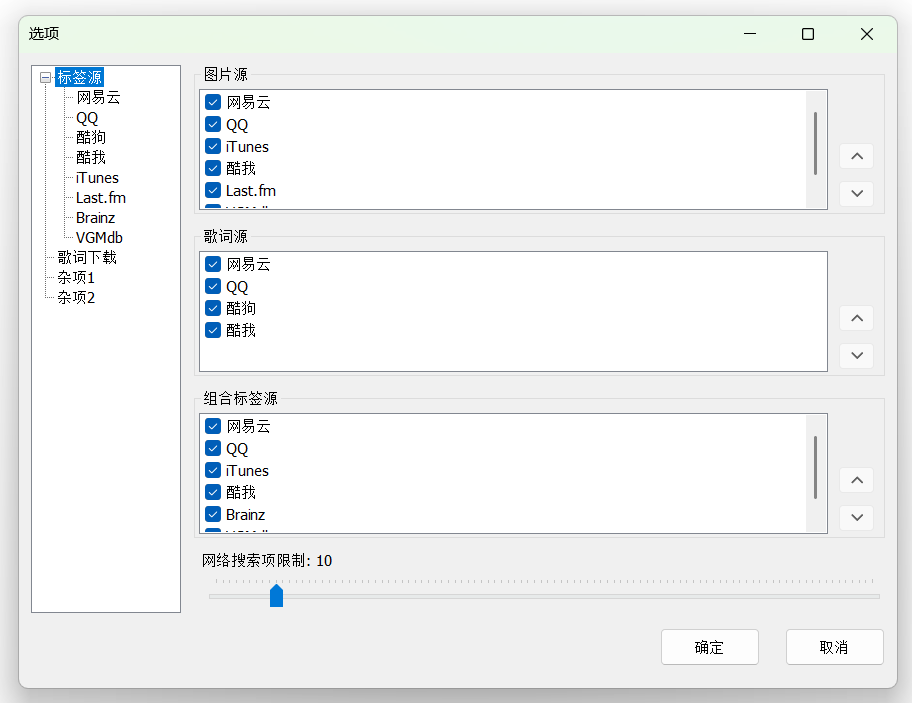
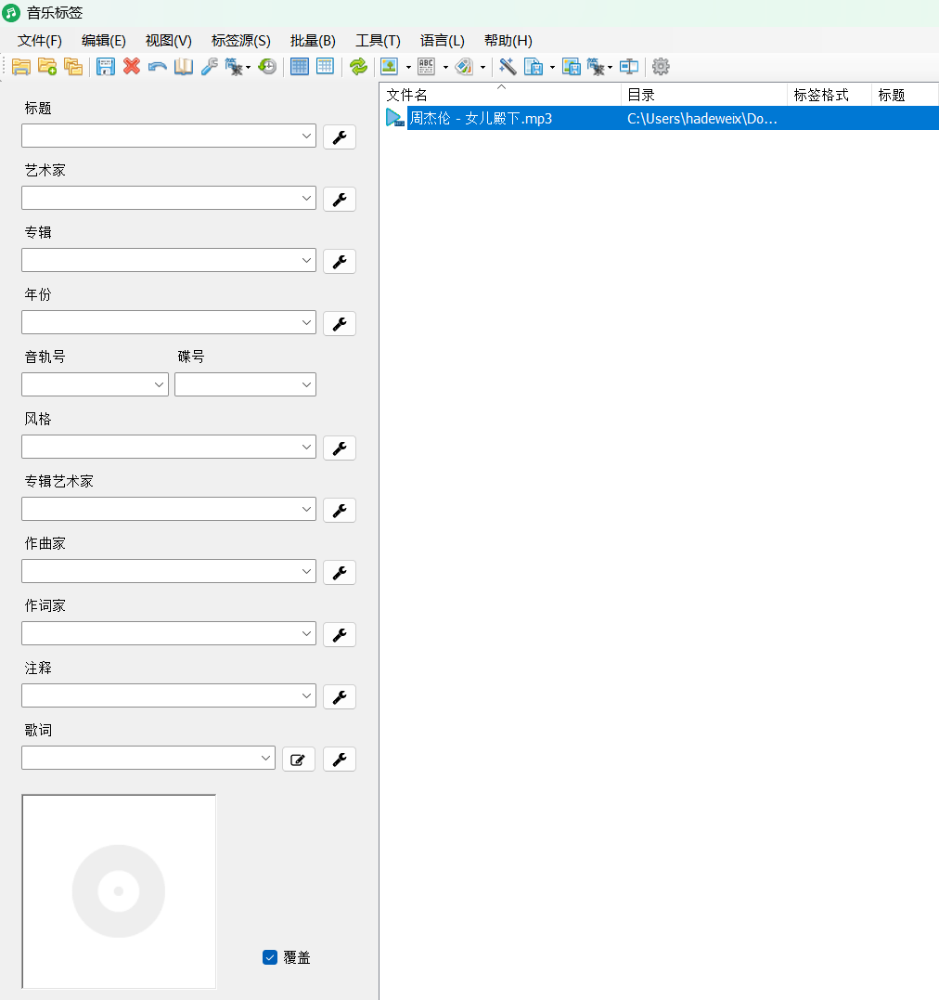
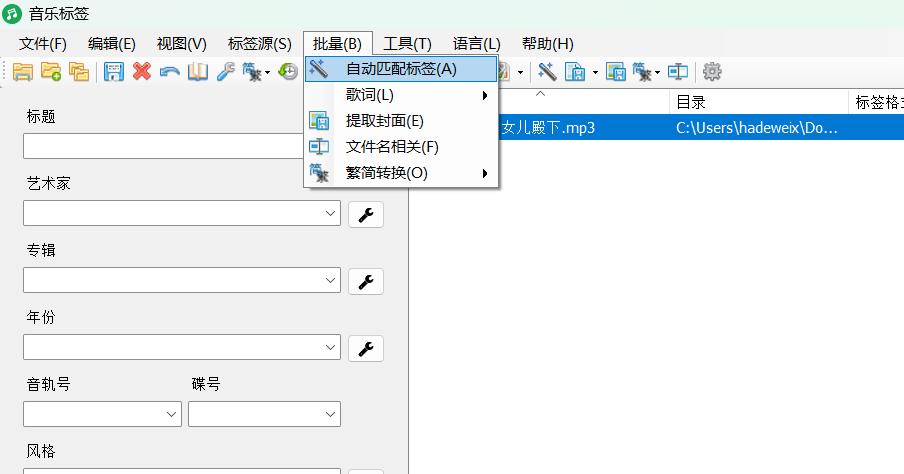
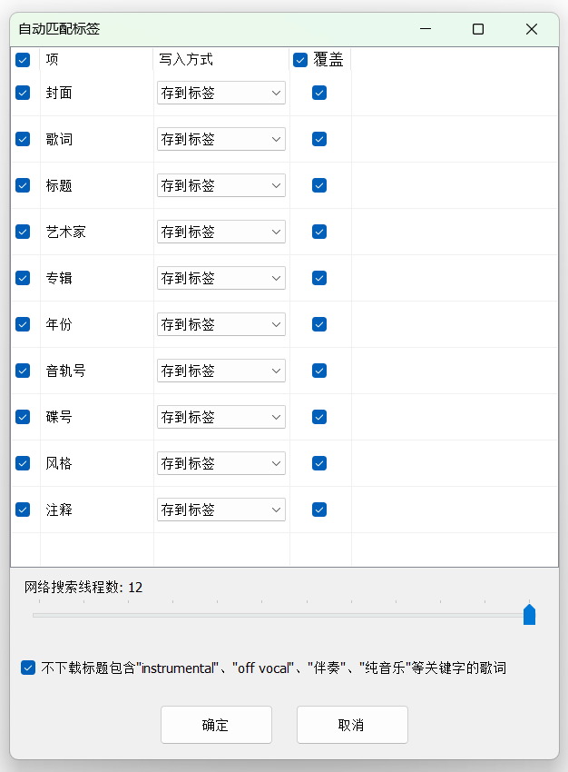
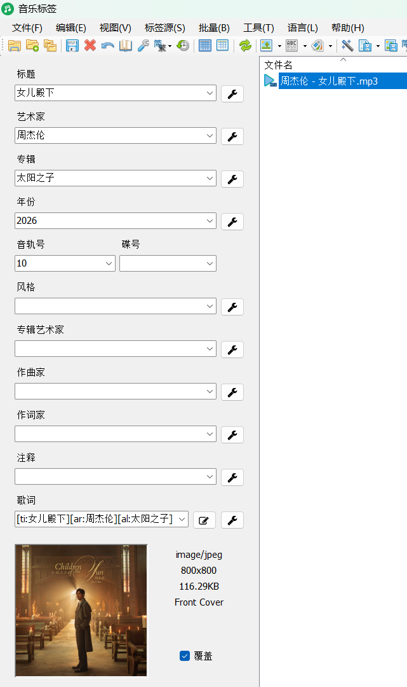

---

id: 1844644

title: "来给你的歌曲 mp3 加上标签吧（利用 MusicTag v1.0.9.0 加专辑、年份、音轨、歌词、封面等信息）"

created_at: 2026-03-29T04:12:21.616Z

username: hadeweix

display_username: "比一个peace"

---

# 来给你的歌曲 mp3 加上标签吧（利用 MusicTag v1.0.9.0 加专辑、年份、音轨、歌词、封面等信息）

在用 PotPlayer 或 Salt Player 等一些本地播放器打开下载好的 mp3 歌时，很容易缺失封面、歌词等元数据，这个时候就可以用这种打标签的软件来完善歌曲信息。

## 1. 软件下载

[音乐标签pc版 - vinlxc - 博客园](https://www.cnblogs.com/vinlxc/p/11347744.html)

## 2. 设置标签源

## 3. 拖入正确命名后的歌曲

## 4. 开始匹配标签

## 5. 完成

如果下载的mp3本身就有一些错误的标签，可先右键清除歌曲的标签（或在匹配标签时选择覆盖）

---

*来源: https://linux.do/t/topic/1844644.json*

