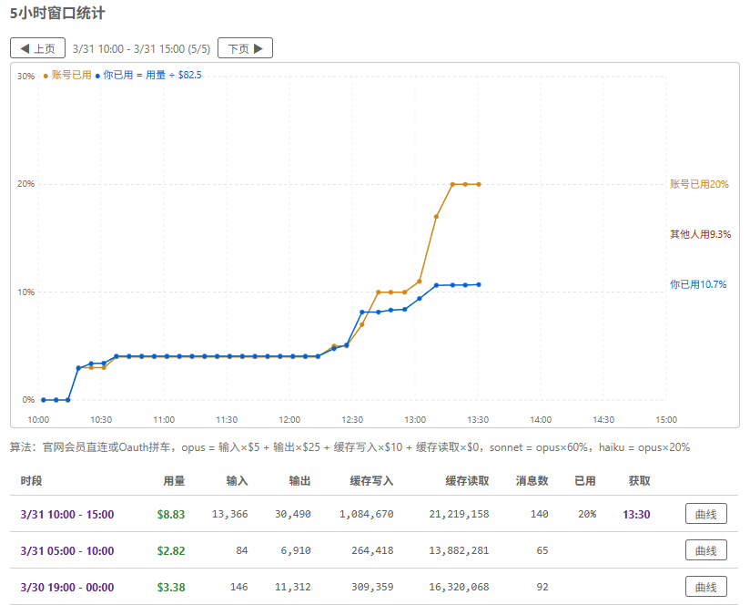
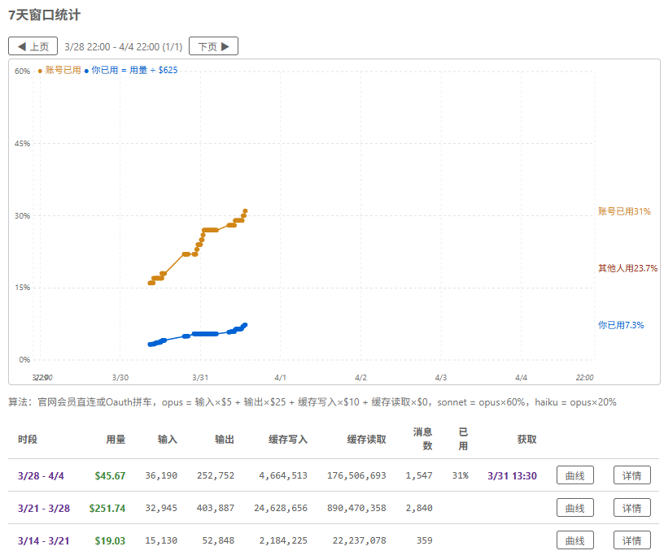
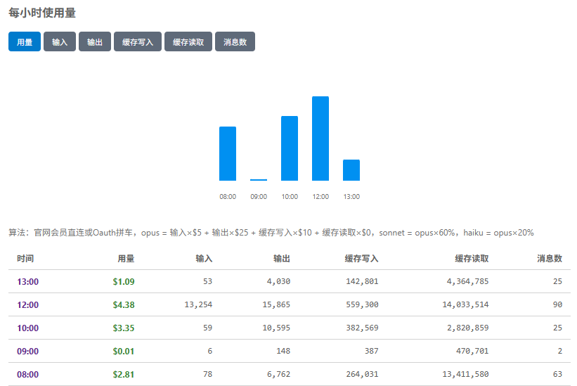
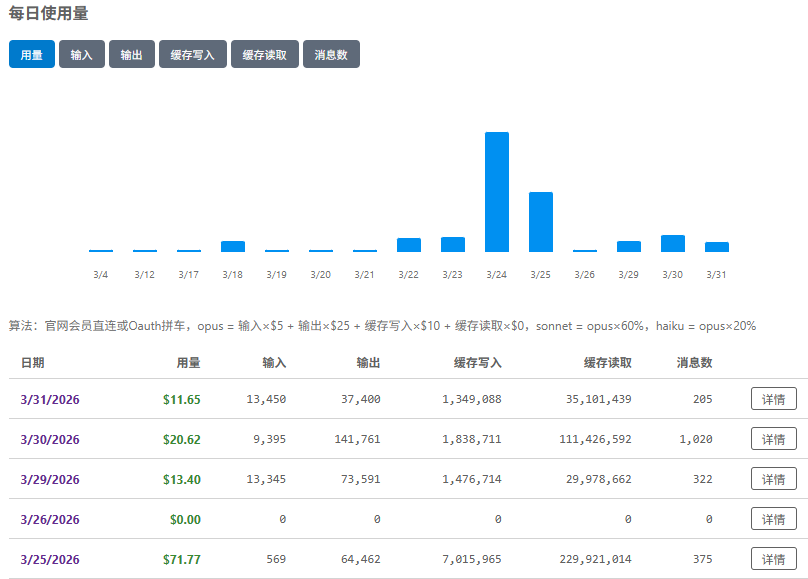
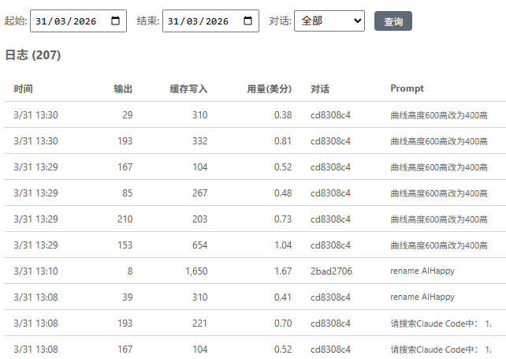
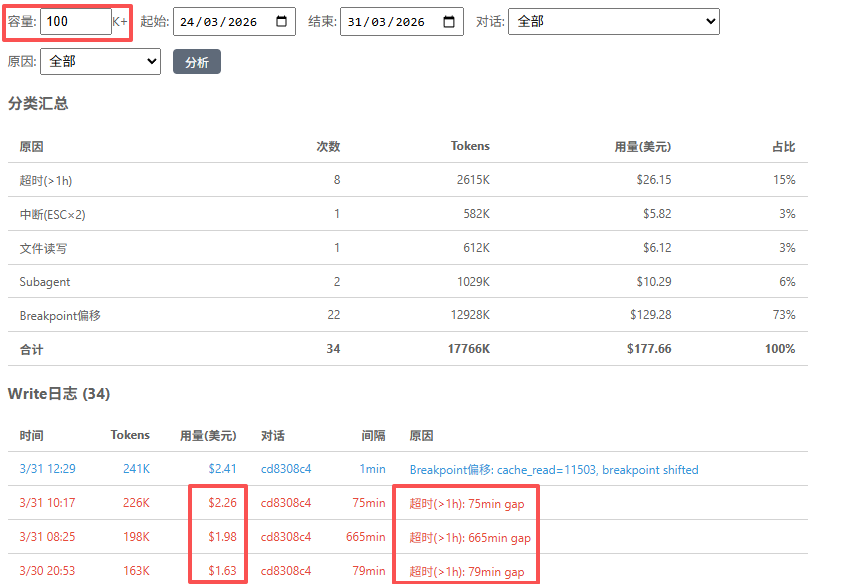
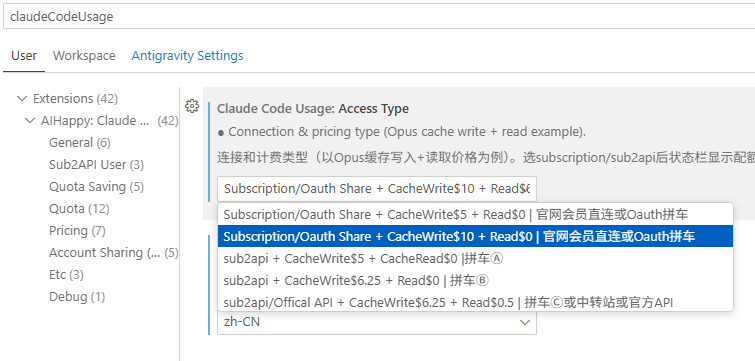

---

id: 1860161

title: ":fire:【省钱系列11】我做的Claude Code Saver，争取做最强CC额度监控+省钱插件【预告贴】"

created_at: 2026-03-31T05:44:24.856Z

username: dwqxq1

display_username: "dwqxq1"

---

# :fire:【省钱系列11】我做的Claude Code Saver，争取做最强CC额度监控+省钱插件【预告贴】

我之前在插件市场里安装一堆额度统计插件，都不好用，要么就是停更烂尾，要么就是金额算法不对

那个ccusage cli算出我一天用$52720x一天总额度顶天也就$200多，我还是拼车，他算出来比官方上限还能高一倍，要多不靠谱有多不靠谱

算了自己开发吧，还在调试，先发个预告，欢迎佬友反馈需求和痛点

一半自己原创，一半fork别人烂尾停更代码库

### 安装环境

兼容所有VSCode系IDE，例如Cursor，Antigravity，Windsurf，Trae，Lingma，CodeBuddy

vsix或插件市场安装(近期发，暂未上线)

### 监控对象

Claude Code的VSCode插件版GUI

Claude Code的VSCode插件版CLI

Claude Code的桌面CLI

### 已开发

#### ①5小时用量统计和曲线

下图是20x，Oauth方式二人拼车

---

#### ②7天用量统计和曲线

---

#### ③每小时用量

---

#### ④每天用量

---

#### ⑤每月用量

---

#### ⑥所有消息记录

---

#### ⑦大额缓存写入

用来跟踪大额消费，知道钱都花拿去了，哪些可以避免

例如缓存是1小时，同一对话两次提问之间超过1h，立即引起CacheWrite，如果500k上下文，CacheWrite一次就$5

---

### 开发中

对话导出markdown

对话内正则搜索

导出对话内图片，按日期命名

---

### 接入方式和算法

以下几种接入方式使用不同算法，可以自己选择算法

算法具体见：[🔥【省钱系列9】Claude Code Opus额度的秘密：2api的刀，与CC官方刀，此刀非彼刀，又被宰一刀](https://linux.do/t/topic/1822898)

#### 自己独享cc的

算法：input$5 + output$25 + cacheWrite$5或10 + CacheWrite$0

有cc官方账号统计，可以了解自己浪费了多少等

#### oauth方式拼车的

算法：同独享

有cc官方账号统计

可以统计自己用量，其他人用量，总用量

因为oauth拼车没有额度管理功能，插件可观察是否有人抢额度

#### sub2api方式拼车的

算法A：同独享

算法B：同sub中转站算法，金额是官方算法的2~3倍左右

没有cc官方账号统计

#### sub2api中转站的

算法：input$5 + output$25 + cacheWrite$6.25 + CacheRead$0.5

算出来金额是官方算法的2~3倍左右（就是余额不抗用）

没有cc官方账号统计

---

*来源: https://linux.do/t/topic/1860161.json*

