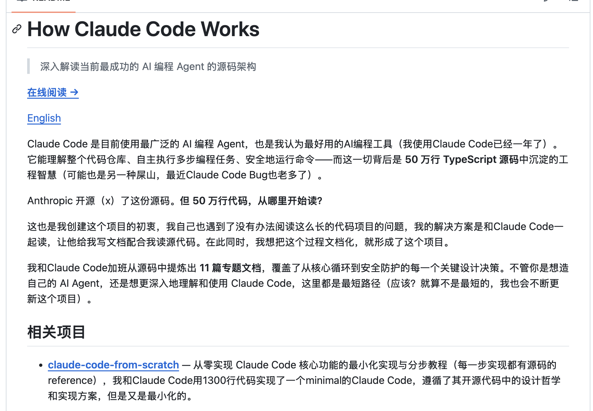
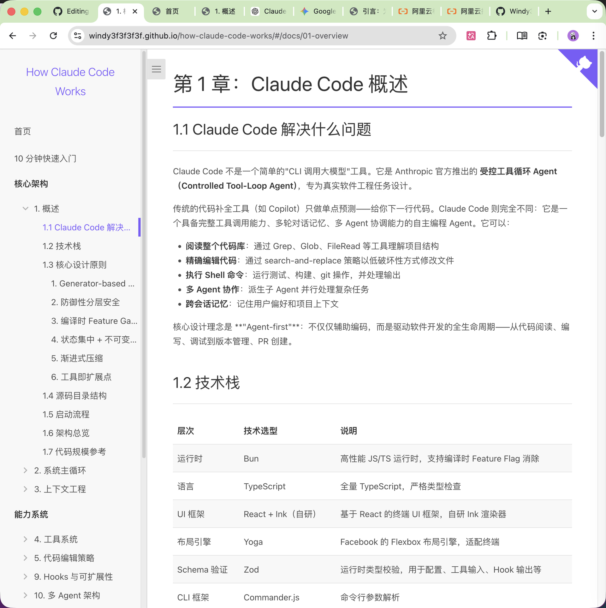

---

id: 1873380

title: "清华北邮团队700 star的Claude Code源码分析&1300行代码最小复现"

created_at: 2026-04-01T06:25:01.679Z

username: wind666

display_username: "wind666"

---

# 清华北邮团队700 star的Claude Code源码分析&1300行代码最小复现

#### 本帖使用社区开源推广，符合推广要求。我申明并遵循社区要求的以下内容：

- **我的帖子已经打上 开源推广 标签：** 是

- **我的开源项目完整开源，无未开源部分：** 是

- **我的开源项目已链接认可 LINUX DO 社区：** 是

- **我帖子内的项目介绍，AI生成、润色内容部分已截图发出：** 是

- **以上选择我承诺是永久有效的，接受社区和佬友监督：** 是

*以下为项目介绍正文内容，AI生成、润色内容已使用截图方式发出*

---

来给我们的Claude code代码分析项目做一个宣传啦，计划做成最深刻的分析项目之一 （长期更新维护）

Claude Code 源码昨天下午开源（x）了，claude code一定是最好用的coding agent框架！

作为LLM Agent的researcher，出于兴趣尝试进行代码阅读，遇到了没有办法快速阅读这么长的代码项目的问题，我们的解决方案是和Claude Code一起读，让他给我们写文档配合我读源代码。在此同时，我们想把这个过程文档化，就形成了这2个项目。

1. 源码分析：把 50 万行代码整理成 11 篇文档，每篇画了架构图和对比表，还有个 10 分钟速读版，并且部署到了github page有web界面方便阅读。

2. 从零构建教程：从零实现 Claude Code 核心功能的最小化实现与分步教程（每一步实现都有源码的reference），我和Claude Code用1300行代码实现了一个minimal的Claude Code，遵循了其开源代码中的设计哲学和实现方案，但是又是最小化的

[github.com/Windy3f3f3f3f/how-claude-code-works](https://github.com/Windy3f3f3f3f/how-claude-code-works)

[github.com/Windy3f3f3f3f/claude-code-from-scratch](https://github.com/Windy3f3f3f3f/claude-code-from-scratch)

---

*来源: https://linux.do/t/topic/1873380.json*

