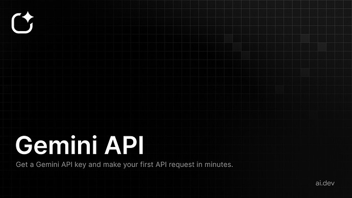

---

id: 1879760

title: "Gemini Web 和 API 服务区域分析 (2026年4月2日的数据)"

created_at: 2026-04-02T01:01:03.138Z

username: Uiharu_Kazari

display_username: "初春饰利"

---

# Gemini Web 和 API 服务区域分析 (2026年4月2日的数据)

数据来源：

### [Gemini Web 应用支持的语言和国家/地区 - Gemini 应用帮助](https://support.google.com/gemini/answer/13575153)

Gemini Web 应用目前支持 40 多种语言，已在 230 多个国家/地区推出。 我们会依照当地法规和我们的 AI 原则，逐步在更多国家/地区推出该服务。 重要提示： Gemini 移动应用是否可使用此模型取决于该移动应用

### [Google AI Studio 和 Gemini API 的适用区域  |  Google AI for Developers](https://ai.google.dev/gemini-api/docs/available-regions?hl=zh-cn)

### 1. 能用网页版 (Web) 却不能用 API 的地区名单

根据交叉对比，以下地区的用户可以使用 Gemini 网页版，但无法申请和使用 Gemini API 进行开发：

- **亚洲地区**：

香港 (Hong Kong)

澳门 (Macau)

缅甸 (Myanmar)

中国大陆 (Mainland China) —— 注：仅限 Google Workspace 用户

- **法国海外领地**：

法属波利尼西亚 (French Polynesia)

法属南部和南极领地 (French Southern and Antarctic Lands)

瓜德罗普 (Guadeloupe)

马提尼克 (Martinique)

马约特 (Mayotte)

法属圣马丁 (Saint Martin)

- **其他地区**：

荷属圣马丁 (Sint Maarten)

斯瓦尔巴和扬马延 (Svalbard and Jan Mayen)

### 2. 能用 API 却不能用网页版 (Web) 的地区名单

- **排查结果：不存在。**

- 经过交叉对比，Web 版的支持范围是 API 版的超集。谷歌的策略是：如果某个地区连基础的 Web 对话服务都不开放，底层 API 接口也绝对不会向该地区开放。

图表版：

[image1877×1270 346 KB](https://cdn3.ldstatic.com/original/4X/3/8/f/38fb9044eb6765b5c3e4880adc110bdbbf7829e6.png)

---

*来源: https://linux.do/t/topic/1879760.json*

