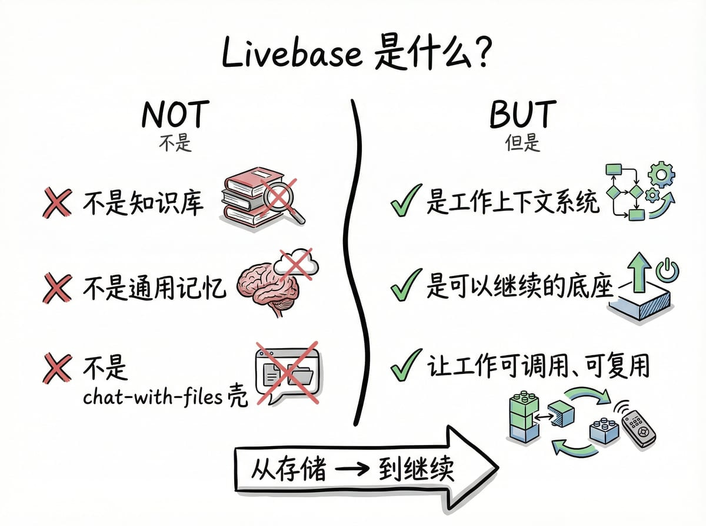

---

id: 1884948

title: "开源项目Livebase：不是知识库，是工作底座"

created_at: 2026-04-02T12:54:13.130Z

username: Yuzx

display_username: "Yuzx"

---

# 开源项目Livebase：不是知识库，是工作底座

#### 本帖使用社区开源推广，符合推广要求。我申明并遵循社区要求的以下内容：

- **我的帖子已经打上 开源推广 标签：** 是

- **我的开源项目完整开源，无未开源部分：** 是

- **我的开源项目已链接认可 LINUX DO 社区：** 是

- **我帖子内的项目介绍，AI生成、润色内容部分已截图发出：** 是

- **以上选择我承诺是永久有效的，接受社区和佬友监督：** 是

*以下为项目介绍正文内容，AI生成、润色内容已使用截图方式发出*

---

做了个东西，继续保持开源态度，做分享给社区。

我们有很多工具可以存文档、检索知识、chat with files。但有个问题一直没被解决：

**上次做任务时的判断标准、处理逻辑、上下文，这次为什么用不上？**

不是因为没记录，是因为那些工具的中心是“存储”和“检索”，不是“继续工作”。

Livebase 想做的是后者。

它不是另一个知识库，不是通用记忆，也不是又一个本地文件聊天壳。它是把工作过程中的上下文、标准、判断、residue 沉下来，变成下次可以直接继续的“工作底座”。

两层结构：

- **Document layer**：人类可读的来源层，保材料可见、可读、可改

- **Context layer**：把材料提升成 durable working context，保工作可调用、可连接、可复用

主循环：保存材料 → 沉淀标准和逻辑 → 下次直接调用继续

适合那些会反复发生、而且每次都需要回忆“上次怎么做的”、“为什么这么判断”、“有什么特殊情况”的任务。

Livebase 是工作上下文系统，不是执行器。它可以调用 execution adapters（比如用 grasp 做浏览器操作）。

目前 v0.1 专注本地核心。

代码：[GitHub - Yuzc-001/livebase · GitHub](https://github.com/Yuzc-001/livebase)

还在早期探索，很多问题没想清楚。想听听大家的想法：

- 你们遇到过“上次的工作状态这次用不上”的问题吗？

- 现在怎么处理的？

- 如果有这样一个工作底座，你觉得应该长什么样？

欢迎反馈、吐槽，也欢迎提 issue 或 PR。

---

*来源: https://linux.do/t/topic/1884948.json*

