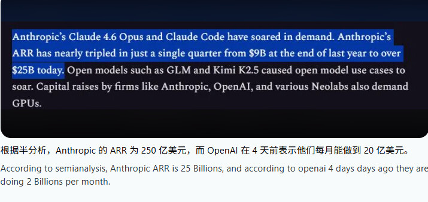

---

id: 1907473

title: "【AI大战短评系列7】OpenAI跌落神坛，年化营收被Athropic反超"

created_at: 2026-04-06T09:22:50.590Z

username: dwqxq1

display_username: "dwqxq1"

---

# 【AI大战短评系列7】OpenAI跌落神坛，年化营收被Athropic反超

来源：[https://www.reddit.com/r/singularity/comments/1sd411i/anthropic_surpasses_openai_in_arr/](https://www.reddit.com/r/singularity/comments/1sd411i/anthropic_surpasses_openai_in_arr/)

不过每个企业计算ARR方法可能不完全相同，但是至少已经追平

知道这一天会来，但没想到来得这么快，也不是OpenAI不努力，最近为了追编程，codex进步还是挺明显的，OpenAI营收也在增长，是A社年化营收涨得太猛了，一个季度涨了三倍！

---

*来源: https://linux.do/t/topic/1907473.json*

