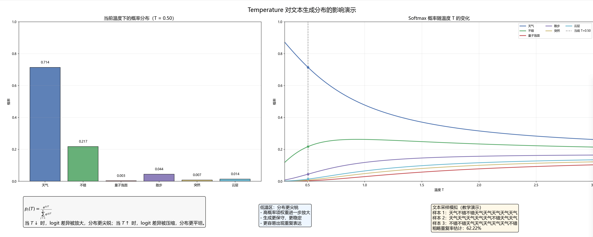

---

id: 1924492

title: "大语言模型采样参数"

created_at: 2026-04-08T11:05:26.632Z

username: SYNTAX0XA

display_username: "zhixin chen"

---

# 大语言模型采样参数

# 模型采样参数

在使用 cherryStuidio 这类软件时，我们经常看到 Temperature 之类的可配置参数。我们可以调整这些参数来调整大语言模型的输出，其本质是通过调整模型的概率分布的采样策略。

我们以经典的 SoftMax 为例。

p_i = \frac{e^{z_i}}{\sum_{j=1}^{k}e^{z_j}}

## Temperature

Temperature 参数控制模型输出的随机性。

其原理是引用了参数 T > 0，改写 SoftMax 为

p_i = \frac{e^{\frac{z_i}{T}}}{\sum_{j=1}^{k}e^{\frac{z_j}{T}}}

当 T 变小时，分布更加陡峭，高概率 token 的权重优势放大，模型偏向生成更确定的内容。

当 T 变大时，分布跟加平缓，高概率 token 的权重优势被压缩，进而低概率 token 被选中的概率提升，模型更容易生成发散的内容。

- 低温度 0 ~ 0.3 适合：事实性任务，问答、计算、代码生成、学术概念解释。

- 中温度 0.3 ~ 0.7 适合：日常对话、聊天机器人。

- 高温度  > 0.7 适合：创意性任务，头脑风暴

## Top-k

Top-k 的原理是将所有 token 按概率分布从高到低排序，选出前 k 个 token，然后对这 k 个 token 的概率分布进行归一化处理。也就是说 Top‑k 采样只保留概率最高的 k 个 token，然后在这 k 个里面随机采样下一个 token，其余全部视为概率 0，不再考虑。

p^{'}_{i} = \frac{p_{i}}{\sum_{j\in{S}}{P_{j}}}

当 k 小时，候选 token 基本都是概率分布高的，模型输出更稳定，确定性高。

当 k 大时，候选 token 多，包含一些中低概率分布的 token，模型输出更多样。

与 Temperature 参数的区别在于，temperature 会影响所有 token 的概率分布，不改变候选 token 数量，Top-k 候选 token 限制为 k 个。

## Top-p

Top-p 的原理和 Top-k 类似，将所有 token 从高到低排序后，从第一个 token 开始累加每个 token 的分布概率，当累加和大于等于阈值 p 时，停止。将累加过程中包含的核内 Token 进行归一化，在这堆 token 里随机采样一个作为下一步输出，核外 token 概率视为 0。。

当 p 小时，模型输出更保守。

当 p 大时，模型输出更随机。

通常情况下，我们会使用 temperature 参数调整整体分布，再使用 top-k 选出 k 个候选 token，最后从这 k 个 token 中使用 top-p 进一步筛选，采样。

---

*来源: https://linux.do/t/topic/1924492.json*

