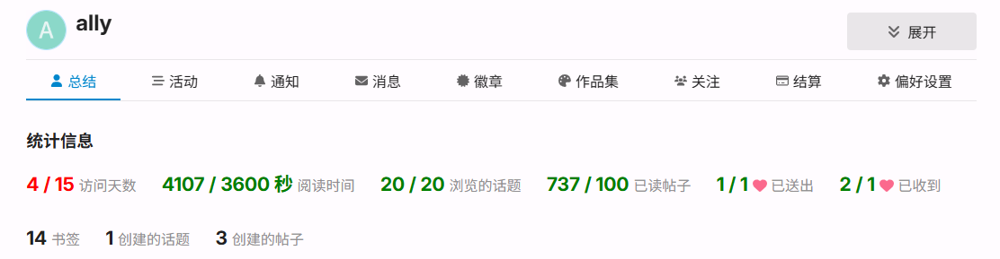
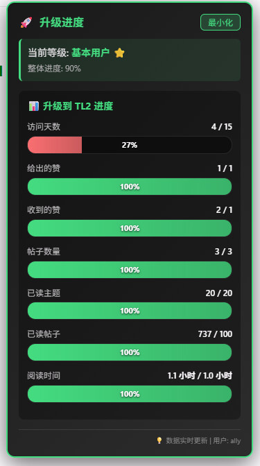
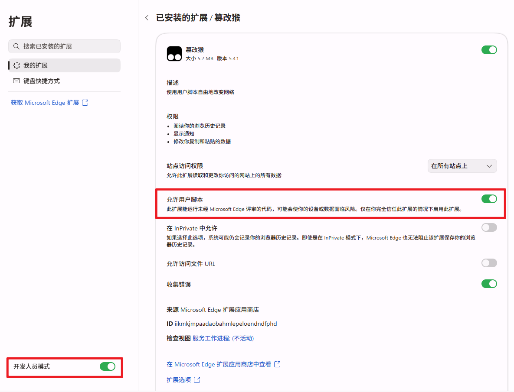

---

id: 1926979

title: "【新手指南】使用篡改猴脚本查看距离下一级的差距"

created_at: 2026-04-08T17:33:00.797Z

username: ally

display_username: "ally"

---

# 【新手指南】使用篡改猴脚本查看距离下一级的差距

参考两位佬的帖子：

# 方法一

效果如下：

[【油猴脚本】Linux do 查看距离下一级大体差距](https://linux.do/t/topic/29204) [

资源荟萃](/c/resource/14)

> 前言

> 本脚本基于一下两位的脚本基础上 添加了 从0级到1级，1级到2级的显示

> 注：

>

> 0级到1级 没测过（因为没找到0级用户）(已测试)

> 2级到3级以及3级 请使用始皇接口来查看 [connect.linux.do](https://connect.linux.do/)

>

> 感谢

> 感谢 [@_y1](/u/_y1) 担任1级-2级的显示测试（虽然他自己不知道）

>

>

> 升级条件

>

>

> 脚本

> 脚本如何使用在这不做阐述

> 

> 脚本

# 方法二：

效果如下：

[我也发个LD信任级别进度脚本吧](https://linux.do/t/topic/1295100) [

开发调优](/c/develop/4)

> 全部由AI编写完成，我只负责启发AI

> // ==UserScript==

> // @name         Linux.do 信任等级升级进度提醒

> // @namespace    http://tampermonkey.net/

> // @version      3.6

> // @description  实时显示 linux.do TL0→TL1→TL2 升级进度，还差什么一目了然，支持最小化…

# 具体步骤

1. 在浏览器安装【篡改猴】扩展程序

2. 进入【篡改猴】的管理扩展，添加脚本

3. 复制粘贴上面的任一脚本，ctrl s保存

4. 打开开发者模式和允许用户脚本权限

5. 重启浏览器

# 注意事项

记得开启这两个选项，之后重启浏览器

---

*来源: https://linux.do/t/topic/1926979.json*

