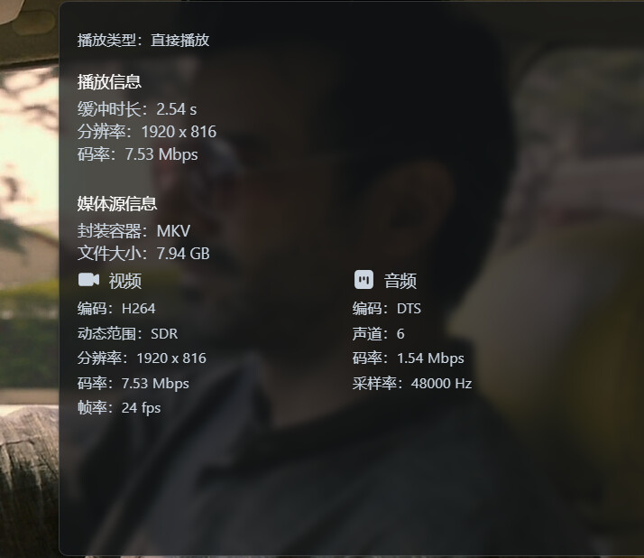

---

id: 1937196

title: "飞牛os挂载夸克网盘观看电影卡顿的解决办法。"

created_at: 2026-04-10T05:56:28.135Z

username: k452b

display_username: "干啥啥不行"

---

# 飞牛os挂载夸克网盘观看电影卡顿的解决办法。

前提：我夸克网盘的会员是88VIP，非SVIP。

问题：直接使用飞牛的文件管理中的夸克网盘远程挂载，打开视频资源基本上就是不可看的状态，使用飞牛影视后也只能看超清的画质，原画画质播放极度卡顿（网速在几百k左右）。

解决办法：安装openlist，用openlist挂载夸克网盘，openlist打开webdav功能，用飞牛的文件管理挂载openlist的webdav，最后飞牛影视中的网速能跑到十多M一秒，完全达到流畅观看的水平。

---

*来源: https://linux.do/t/topic/1937196.json*

