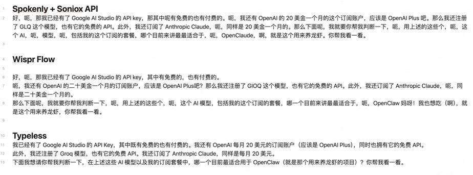

---

id: 1940014

title: "【十倍速写作系列10】Typeless：不是另一个语音输入法，而是第一个意图输入法"

created_at: 2026-04-10T12:29:08.591Z

username: dwqxq1

display_username: "dwqxq1"

---

# 【十倍速写作系列10】Typeless：不是另一个语音输入法，而是第一个意图输入法

注：小标题右上角数字为权重，负5分到正5分

本文就是用Typeless写作 + IDE修改

---

## What（定义）

Typeless是一个华人创业者在硅谷推出的，面向海外的AI语音输入法软件，最近比较火

官网：[https://www.typeless.com/](https://www.typeless.com/)

听说是拿到真格基金投资了，甚至请得起全球第一网红MrBeast给他做推广

对标国内豆包输入法，闪电说，LazyTyper

对标国外Spokenly，SuperWhisper，VoiceInk，WisprFlow

Typeless表面上与这些语音输入法差不多，实际上是完全不同设计哲学的产品

以上所有输入法的核心哲学是**忠实记录用户语言**，而Typeless的设计哲学是**准确理解用户意图**，走这个线路的产品非常少

就是对Typeless来说，用户说什么不重要，用户的想表达什么更重要

**颠三倒四，磕磕巴巴，口头禅多，词不达意，反复修改**，才是大多数普通人的口头表达常态

在国区AppStore没有上市，需用海外区苹果或PlayStore账号下载

Windows版可以官网直接下载

注册免费不限量试用一个月，换号注册，貌似可以试用三个月，佬友说实测第四个月起换号也没用了(识别机器码)

### Typeless vs Spokenly vs WisprFlow

---

## Major Pros（主要优点）

### 速度快⁵

官方未公布它用的是什么模型，一般短文3，长文5秒上屏（含听写+LLM）

Spokenly用soniox或elevenlabs-scribe一般2-3秒，开realtime速度回更快但识别率下降

Spokenly开LLM例如gemini-3-flash-none-thinking需要8-10秒

Typeless在速度方面下了很大功夫，无论是识别速度还是大模型的处理速度都非常快。

相比之下，Spokenly即使使用ElevenLabs Scribe，虽然ElevenLabs本身挺快（大约两三秒），但如果加上Flash模型就比较慢，Pro模型就更慢了，要几十秒到几分钟

豆包可能更快，但豆包没有LLM润色，而LLM润色是最费时间的，用不带润色的豆包与带润色的Typeless或Spokenly比速度，也不公平

### 全平台支持⁵

Typeless版本最全，有iOS/macOS/Windows/安卓版，而且手机版比PC版功能没有缩水，还比Windows版略强

选区修改功能只有手机有，Win没有

Ask anythiing功能(类似ChatGPT提问)，只有PC有，iOS没有，不过这个功能替代品很多

有的语音输入法只有macOS，没有Windows版，例如Spokenly，豆包

有的语音输入法虽然有Windows版或iOS版，但比Mac版缩水很严重，例如SuperWhisper，VoiceInk。

全平台有几个好处：

节省费用：如果不同平台使用不同的软件，你可能需要支付多次费用。

体验一致性：跨平台使用可以保证使用体验的一致。

数据同步：你的词典和自定义内容不需要在各个平台不同输入法上分别定义。

### 可以选区编辑正文⁵

其他的模型输入法基本都是一锤子买卖，写错了只能删除重录，或者打字修改而Typeless手机版可以直接修改内容，PC版暂无此功能

但iOS版修改有字数限制，选区最大三千字左右，安卓版不确定限制多少，这是合理的限制，因为一般模型输出字数限制也就2-4k

在iOS版的Spokenly里虽然也能修改正文，但它的字符捕获功能只能获取光标前后几十个字，无法实现全文修改；即便你在设置里开启了相关选项也没有用，它依然无法做到全文排序等操作。

对于错别字修改，可以原文 张三 → 选择"张三"或"三" → 点编辑说"山峰的山" → 会改为"张山"，不会显示"山峰的山"

### 去口头禅效果最强⁵

它的"去口头禅"效果明显强于其他软件，在这方面应该是下了大功夫。

其他的软件不是不能去，而是去得不彻底。

这个软件去得非常彻底，比如"这个、那个"这种。

有些口头禅介于"有含义"和"非口头禅"之间，甚至带有一点意义。

如果你用正则之类的去处理，比如"这个人"里的"这"就是有用的，而连续说"这个、这个、这个"就是口头禅。

它在处理这些微妙的差别时，效果非常好。

其他软件把"去口头禅"当成一个附属功能，而Typeless是把它当成最核心的功能去做。

虽然从底层原理来讲，其他软件如果加上提示词去模仿Typeless的话，也能达到完全相同、或者起码类似的去口头禅效果。

在向AI提问之前，它已经把错别字改掉了，否则如果错别字太多，AI会直接按照错误的语义来回答。

### 格式整理功能⁴

它有格式整理功能。

当然，理论上来讲，用Spokenly也可以加上提示词，或者干脆想办法获取Typeless的提示词，应该也能得到差不多的结果，但是速度就不一定有Typeless快了。

### 内容树状化、大纲化³

它能将内容树状化、大纲化。

### 录音不需要讲究顺序⁴

iOS想到哪句说哪句 → 全选 → 要求重排序，但有3000字限制

PC不能重排序，字数会缩到30%

### 说话时可以修改⁴

可以在说话的时候修改，删掉前面的字（例如：“今天是星期四，不对，星期五”）。

### 自动加空行、分段、数字

它会在文章里加空行、加分段、加数字，这会使文章的可读性增强，自己看着也赏心悦目。

同时，AI理解的错字也会变少。

还有一点很重要：虽然平时录音时并不常看之前录的内容，但偶尔也会回看。

普通输入法或像豆包这种工具，如果不加润色，通常是不换行的，所有字都连在一起，看起来很乱。

这样当你想要读一下刚才写的内容，或者忘了说到第几点、说到哪儿时，回看的时候肯定没有Typeless方便。

### 工作流可以少一个步骤²

以前录音时，实际上不整理也无所谓，在Chat App里面AI也能看懂，有点错字也能识别。

所以通常是把整理步骤放在最后，等录完后再集中处理。

用Typeless则是把整理步骤放到了前面。

虽然理论上步骤并没有减少，但因为它合并到了录音过程中，会节省一些时间。

不过它的质量未必比后面用高级模型处理的更高，因为它用的模型比较快（大概是Flash一类的模型），肯定不会像推理模型那么慢。

### 直接输出的场景优势³

在写邮件、论坛发帖、微信或QQ聊天等需要直接输出的场景下，Typeless不需要再经过一次大模型转译。

这些场合（尤其是聊天）对速度要求极高，如果速度太慢，用户宁可不进行润色。

比如我用Spokenly时通常都不开润色功能，虽然识别挺准，且支持通过正则替换来修正不准的词或口头禅，但它缺乏自动润色和分段功能。

### 专有名词识别能力强³

它的识别能力非常出色，不一定是单纯靠语音识别，很可能是通过大模型推算出来的。

测试说：“Claude、豆包、Gemini、搜狗、ChatGPT、讯飞、Copilot、百度、Grok等AI模型”。

Typeless完全没错，其他输入法都有错的

虽然AI说它的模型是以Whisper为基础的，但识别率远高于原生的Whisper。

我不确定这是否完全靠大模型实现，因为Whisper有其固有的特征（比如"明镜"和"一点点"这类幻觉），Typeless出现过"欢迎观看…"

当然，这些也可以通过后置的提示词来修复或删掉，减少出现概率。

### 自动词典模式³

在录音后，手动修改同音词，过数秒钟，Typeless检测到输入框字变了，就会自动同步到字典

实测对PC微信，Obsidian，Antigravity聊天框有效，对Antigravity编辑器无效

有自动词典功能的：貌似只有Typeless

有手动非正则词典的：一般语音输入法都有，例如AutoGLM，Superwhisper，VoiceInk，Spokenly

有手动正则词典的：Spokenly有正则替换功能，适应性更强

没有词典功能的：豆包

### 有录音历史³

不管任何原因停了，可以到历史里找到录音

---

## Major Cons（主要缺点）

### 编辑时字数限制和缩水⁻⁴

iOS 版的编辑会有少量的缩水。编辑了几轮，从 3800 字缩到 3600 字，还可以。

PC 版的 Ask Anything 功能看似跟 iOS 版的编辑差不多，实际上完全不一样，这个缩水一般到 30%。

不过好在 PC 上这种能编辑和调整顺序的 Agent 非常多，并不靠它来编辑。

### 缺乏自定义功能⁻⁴

无法修改任何内容，没有自定义功能。

无法预设提示词（例如列表格式），只能通过"全选"的方式手动修改，且每次都需要重复操作。

系统提示词无法被修改。

### 有单词10分钟录音限制⁻³

到了10分钟自动停止并上屏，但是没有任何声音提示

如果你不看屏幕一直录，10分钟之后玖佰说

### 有时识别会识别错字，或曲解用户意图⁻³

办法：可以在历史里点击重新识别

### 容易断录音⁻²

如果你说了一大堆内容，结果程序被杀后台了，或者因为其他原因导致中断。

后面这些软件才慢慢完善的，所以可能以后Typeless也会去完善这方面吧。

#### 丢录音可以找回的语音输入法

Typeless History里面有中断前的录音，中断后就没有了

Spokenly类应用没有这个问题，因为它们保留了原始音频，你可以随时重新识别。

豆包虽然也有类似风险，但影响很小，因为它采取的是边说边上屏的模式，即使中断，损失也有限。

最常见的断开情况通常是不小心碰到了停止按钮，或者在删除文字后忘了重新开启录音。

#### 丢录音无法找回的语音输入法

其实所有输入法类的产品多少都有点这种毛病

我去年在安卓上用的输入法CleverType也是这个毛病。

早期版本的VoiceNotes，一关机或者发生什么意外，录音就丢了，现在这个问题已经修复。

#### 实测以下情况会导致停止录音

杀进程，切换App，切换输入法，切换到桌面。

点击离开输入框也会导致丢录音，比如在Gemini里面，你随便点击一个菜单栏的地方，一旦离开输入框，它就开始丢录音。

#### 实测以下情况不会停止录音

熄屏再打开，这个时间短没问题，时间长就不知道了。

#### 尚未测试

来电是否会造成误触，估计会受影响，因为来电通常会强制切换软件。

断网

#### 办法

##### 屏保锁屏防误触

在安卓系统上（iOS不一定有），有些软件可以实现锁屏功能——它会挡住屏幕，解锁前无法操作其他软件，这样就能防止手贱误触到其他程序。

##### 手持手机防止误触

移动时尽量用手拿着手机，或者室内放桌上，不要放兜里或挂脖子，很容易误触掉录音

##### 分段录音上传

建议录音时不要"一录到底"，最好录一段就上传一段，这样即使断掉，损失也会小一些。

### 手机版没有键盘⁻³

只有空格、@、回车和Backspace四个按键。

在这点上豆包肯定更方便，支持拼音键盘输入。

Spokenly是纯英文键盘，不支持拼音

### 润色模型速度快，智商不高，不能更换模型⁻²

也不知道当前正在使用的是哪种听写模型和润色模型。

AI说推测是whisper

### 价格比较贵⁻²

一个月是30美元，一年是144美元。

年费比月费便宜很多（月费30美元 × 12个月 = 360美元），年费仅相当于月费的4个多月，连5个月都不到。

这种比例非常不合理，通常比较可疑。

这种定价策略可能是为了圈钱跑路，或者是对产品长期发展没信心才会这么搞。

一般情况下，年费通常是月费的10倍左右。

### 会删减内容⁻²

它会把你的内容进行删减。

而且因为你改不了提示词，删减的幅度也没法控制。

其他的输入法基本还是维持原意、原话的，而它会进行大幅度的修改。

### 没有实时字幕⁻²

它没有实时字幕，说话的时候你是看不见的。

不过因为他自己修正能力比较强，看不见的地方他通常也都能自己改对，并不需要人盯着改。

### 不能直接输出markdown⁻²

虽然在编辑模式可以提少量要求，但无法对抗系统提示词

这意味着它输出的内容不可能完全符合你的规范。

比如你想用Markdown格式，或者用"###"这种三级标题，它的编辑器是不支持输出这些Markdown标记的。

不管你怎么要求，它最多只输出Bullet List和Number List，其他的像粗体、斜体或者井号标题，它都不会输出。

如果要求用bullet list，Typeless一般会遵从

它非常喜欢用number list（其实这也不是Markdown专属，普通的TXT也可以这样用），bullet list倒不怎么用。

然后它还喜欢在首字母加空格，这些其实并不符合我的规范（我的规范是禁用number list，也不用空格）。

当然，它的系统情绪词可能比较强，你的口头情绪词未必压得住，所以这些都可以放到最后，等你的书面稿转正式稿或者发布稿的时候，统一去修这些小细节，这也没什么太大的影响。

还有就是，它有些地方会在中英文之间加空格，这也不符合我的规范。

### History不同步⁻¹

PC与手机之间，安卓与iOS之间，历史应该不同步

词典是同步的

### 录音状态下无法编辑⁻¹

在录音状态下是无法编辑的。

因为录音时所有按钮都隐藏，你最多只能通过剪切和粘贴，系统语音指令，来实现一定的删除功能。

### 在微信等场景，输出太格式化，一眼AI

中英文之间加空格，所有话句号结尾，123等序号

---

## How（方法）

#### 优惠

学生优惠：使用学生邮箱给官方写信可以申请半价优惠码。

早鸟质疑：闲鱼有卖所谓"早鸟"优惠，说是半价8年，但我怀疑其实是利用学生身份办理的，后面7年未必有保障

买个学生邮箱可能也就二三十块钱，而且是一次性的，不需要长期持有。

关于价格和优缺点，我觉得还可以。

折后是72美元，也就是500元一年，合每个月40元左右。

这个价格跟其他录音软件相比，甚至还稍微便宜点（其他软件可能要80美元一年），而且它的功能目前还是领先蛮多的。

#### 薅羊毛

使用一个月会员是有时长限制的，大约一周限10小时4万字左右

试用换邮箱，mac绑定设备id，有3次次数限制，其他版不清楚

mac版可以用软件重置设备标识，无限试用

[⊚typeless-reset-device：解除 Typeless 设备登录数量限制，重置设备标识](https://github.com/estarpro1022/typeless-reset-device/)

### 二次润色

当你需要一份正式稿件时，肯定还要再手动润色一遍。

这相当于把润色分成了两步：第一步是软件把口头语润色成书面语；第二步是你再把书面语润色成可以发布的稿子。

### 加前缀辅助分类

为了确保整理不出错，建议在语音开头加个前缀（例如"下一个优点"、“下一个例子”），将其作为分类的开头，以免系统乱分，

如果直接说"1、2、3"，第三个优点，也可以，但经常数一半忘了数到几

### 结合iOS语音命令

方法技巧可以与iOS里的语音命令结合，安卓里应该也有相应的功能。

比如最常见的Select All，在iOS里可以设置一个快捷键来启动。

我设的是"敲击后盖两下"，这是最简单的启动方法。

#### 语音命令的模式

语音命令有三个模式：听写模式、命令模式和拼写模式。

我们一般就说"命令模式"或"Command mode"，这样它不会识别你说的话，只会识别你的命令（因为它识别说话不怎么准）。

长时间关掉语音命令再打开，就会默认回到听写模式，还要再进入命令模式

#### 快速启动语音命令

这个命令模式比较费电，因为它要一直监听语音。

所以最好用的时候双击打开，不用的时候关掉，缺点是容易误触。

虽然也可以设成双击电源键或音量键，但因为触点比较小，没有双击后盖方便。

#### Select All（选择全部）

结合修改功能，可以更改整篇文章的内容或顺序。

在手机上文章长了之后，虽然可以手动拖动屏幕全选，但速度很慢，有时拖到一半不小心按错就又掉了，得重新拖。

#### Undo（撤销）

如果你对输入不满意，可以用Undo。

这个功能在菜单和输入法里都没有，打不出来。

#### 语音命令语言设置

在设置页面可以选择识别中文还是英文命令，这与系统语言无关。

我感觉识别英文命令更准一些，而且它不涉及冲突问题。

如果你开着中文录音同时又开了中文语音命令，可能会出现两边都识别的情况。

如果是英文命令，即使它被识别到了Typeless里，因为中英文差别很明显，也很容易发现并剔除，或者让AI剔除。

另外，在Typeless里只有几个按钮，而且你在录音的时候，连这几个按钮都用不了（录音时只有录音按钮可用），但通过语音命令就可以直接使用Select All。

### 注释同音字

例如说：“张山，括号，工长张，山峰的山，不显示括号里的字” → 只显示"张山" → 效果不稳定

## References（参考）

[⊚opentypeless](https://github.com/tover0314-w/opentypeless)一个开源替代品，性能不如Typeless

[260401 数码君的频道 ▷用最强语音输入做 Vibe Coding：Typeless 凭什么让我心甘情愿掏钱？](https://www.bilibili.com/video/BV1Qn9VB9E3D/)

[260224 PAPAYA电脑教室 ▷嗯啊口头禅全部自动消失！Typeless 语音神器直接淘汰传统输入法，讲错直接改口它也听得懂喔！](https://www.bilibili.com/video/BV1KUf1BWEk6/)

[260120 开一下小差 ▷【AI产品红黑榜】第2期：AI语音输入法让键盘消失？对比智谱AI，superwhisper，typeless，Spokenly](https://www.bilibili.com/video/BV1pEkgBuERE/)

[260106 福菲门特 ▷AI输入法理解能力测评](https://www.bilibili.com/video/BV1aUqPBdE6a/)闪电说完全没有修正功能，ChatGLM有部分修正功能，Typeless修正功能最强

---

*来源: https://linux.do/t/topic/1940014.json*

