---

id: 1984117

title: ":fire:【大模型系列31】关于Claude Opus-4.7，你想知道的一切【260418更新LMArena评分】"

created_at: 2026-04-16T18:04:13.832Z

username: dwqxq1

display_username: "dwqxq1"

---

# :fire:【大模型系列31】关于Claude Opus-4.7，你想知道的一切【260418更新LMArena评分】

## 基本资料

官方文：[https://www.anthropic.com/news/claude-opus-4-7](https://www.anthropic.com/news/claude-opus-4-7)

官方文档：[What's new in Claude Opus 4.7 - Claude API Docs](https://platform.claude.com/docs/en/about-claude/models/whats-new-claude-4-7)

官方模型卡：[https://cdn.sanity.io/files/4zrzovbb/website/037f06850df7fbe871e206dad004c3db5fd50340.pdf](https://cdn.sanity.io/files/4zrzovbb/website/037f06850df7fbe871e206dad004c3db5fd50340.pdf)

价格：输入$5/输出$25与4.6一样

上下文：1m，与4.6一样

最大输出：128k，与4.6一样

输出速度：50tps左右，比4.6快30%

4.7 vs mythos：性能提升但明显不如mythos

切换回4.6的方法：/model claude-opus-4-6[1m]

---

### 优点：自主编程能力显著提升

能搞定更难、更长链的任务，还会主动验证输出再汇报。

### 优点：视觉处理能力显著提升

支持长边最高2576像素，即2.5k，是4.6三倍

### 新功能：/ultrareview

在线review，额外收费，Pro和Max用户可以免费试用三次

### 新功能：auto模式，自主决策、连续执行

首次向Max用户开放

### 新功能：在high和max之间增加xhigh

个人感觉实用性没多大，更多是一种营销策略，用来对用户认知作战，证明max比xhigh(映射codex)大

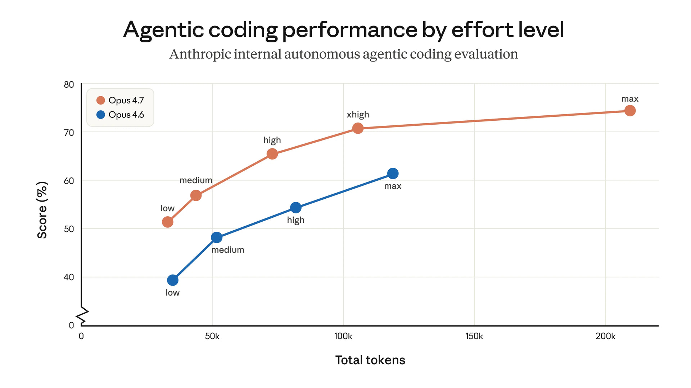

---

### 缺点：费token

因为分词器调整，4.7比4.6多费Token

来源：[来自官方System Card的Claude Opus 4.7牙膏倒吸实证](https://linux.do/t/topic/1983983)

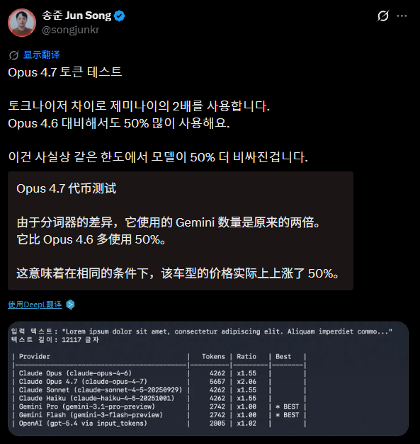

---

中文多费6%，英文多费59%，python多费21%，中国用户也别偷笑，你的代码还是英文的

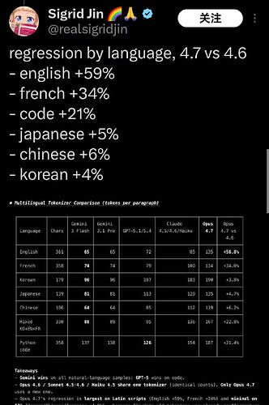

---

官方说max会员额度可能有增加，对应分词器问题

来源：[为了应对Opus4.7更长的上下文，CC订阅配额永久提升](https://linux.do/t/topic/1984150)

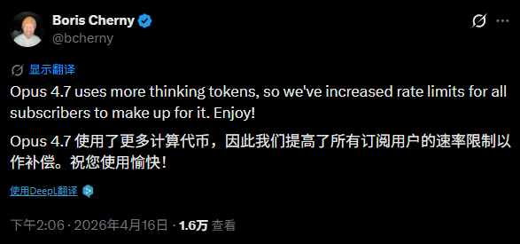

---

### 缺点：长上下文注意力差

MRCR长上下文测试，1m上下文性能比4.6有了大幅下降

来源：[https://www.reddit.com/r/ClaudeAI/comments/1sn6eyd/](https://www.reddit.com/r/ClaudeAI/comments/1sn6eyd/)

.[来自官方System Card的Claude Opus 4.7牙膏倒吸实证](https://linux.do/t/topic/1983983/)

.[opus4.7注意力和gemini3.1pro坐一桌？？](https://linux.do/t/topic/1983616/)

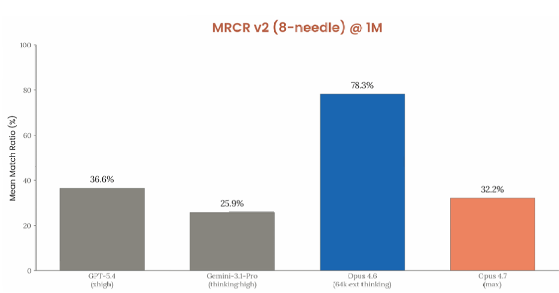

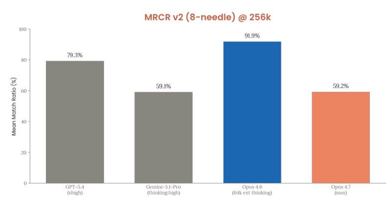

---

### 缺点：说话风格像GPT

.[怎么感觉Opus 4.7 语气有点像GPT](https://linux.do/t/topic/1984103/)

---

## 评测

### 官方自评

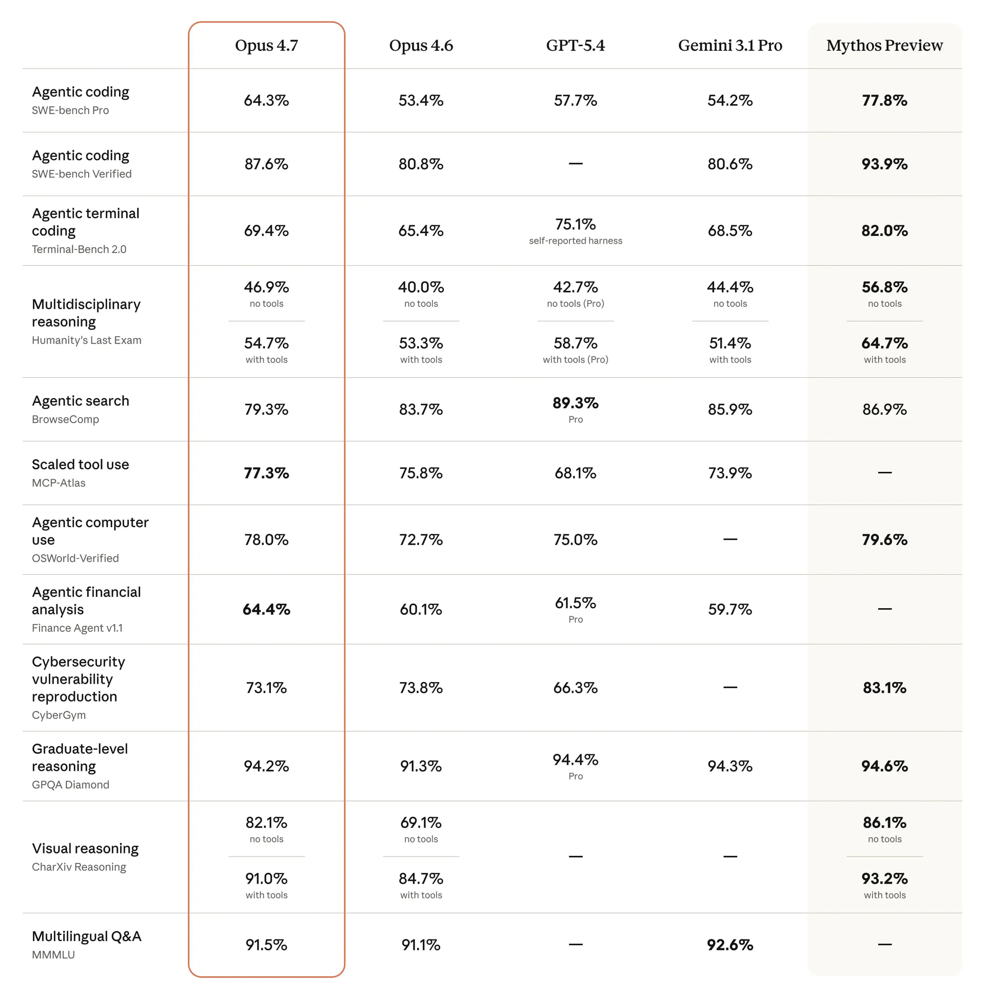

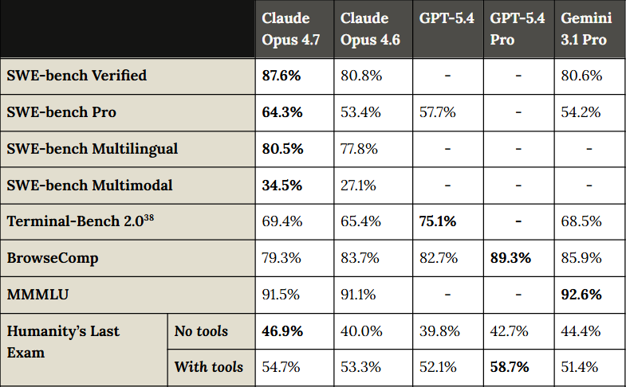

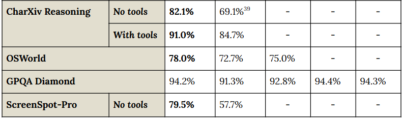

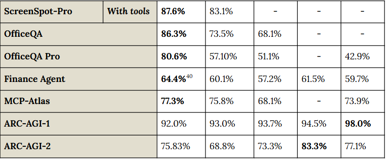

---

### LMArena评分

来源：[Arena Leaderboard | Compare & Benchmark the Best Frontier AI Models](https://arena.ai/leaderboard/)

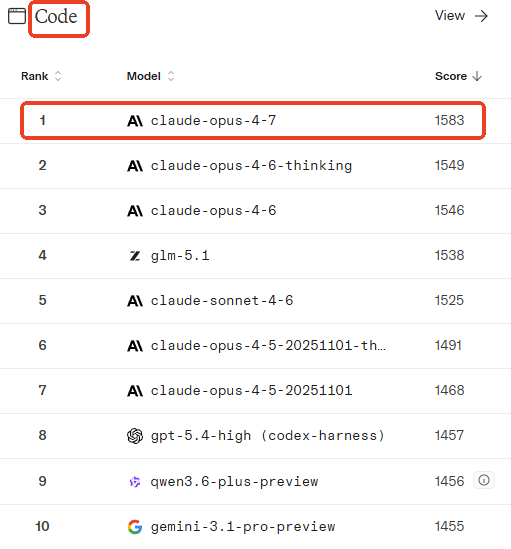

---

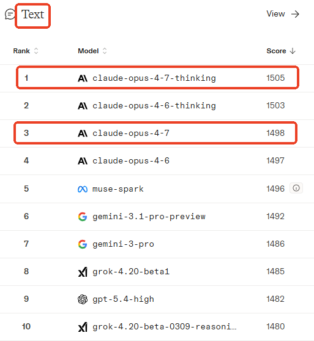

---

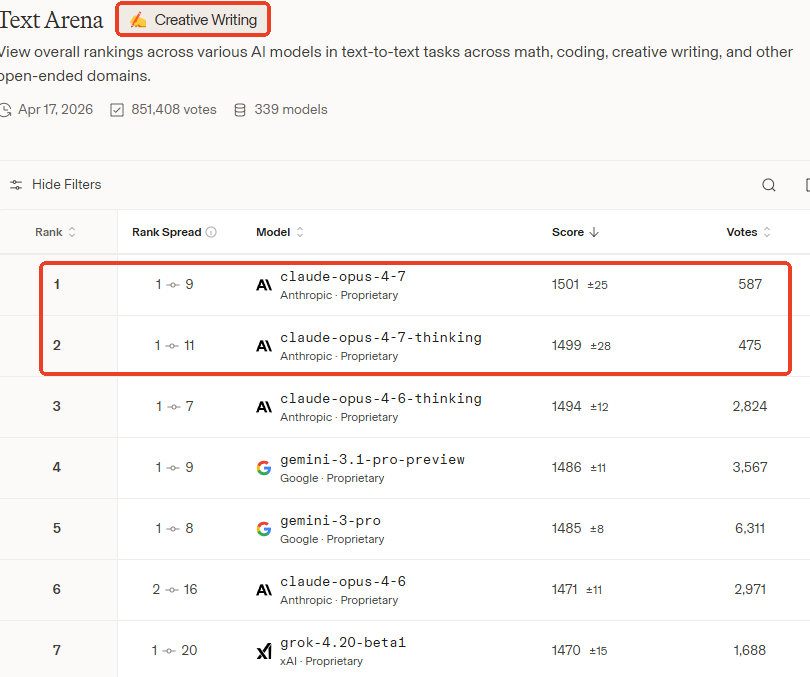

---

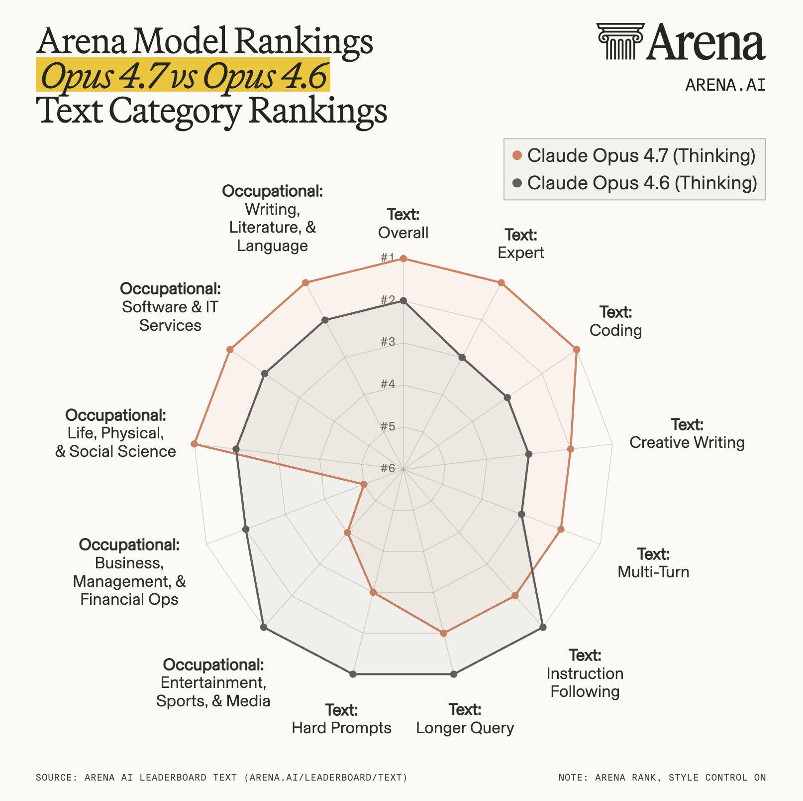

---

### LiveBench评分

来源：[https://livebench.ai](https://livebench.ai)

暂无opus-4.7-max

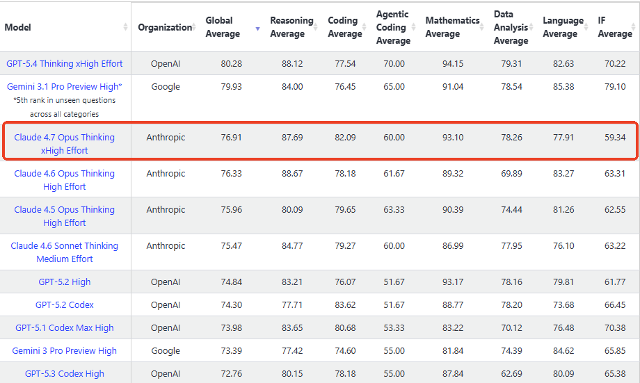

---

### ArtificialAnalysis评分

来源：[https://artificialanalysis.ai/](https://artificialanalysis.ai/)

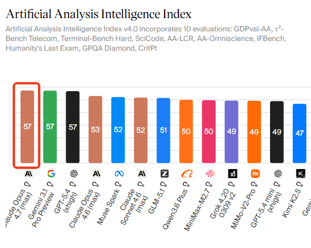

---

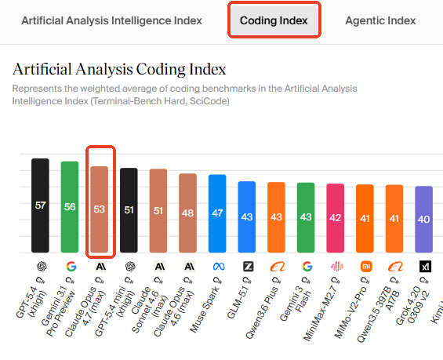

---

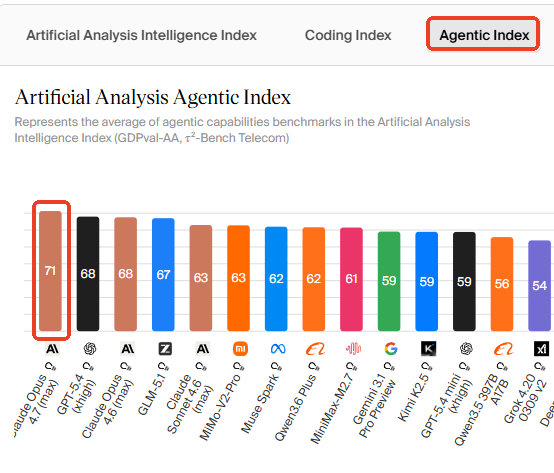

---

### ARC-AGI评分

来源：[ARC Prize - Leaderboard](https://arcprize.org/leaderboard)

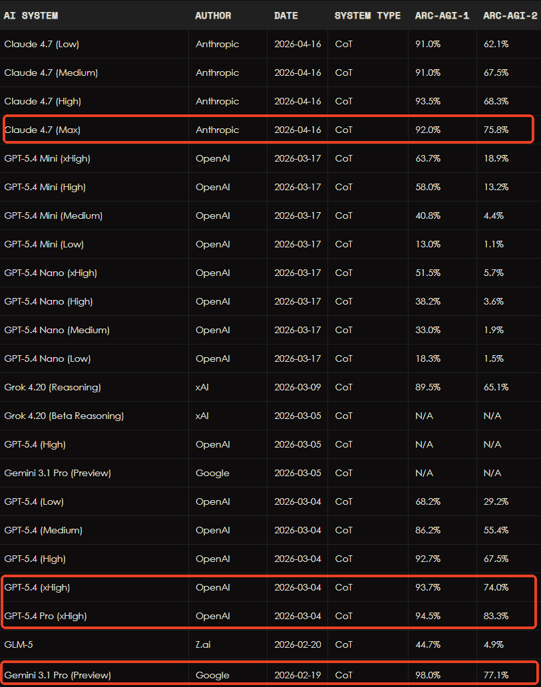

---

### Humanity’s Last Exam (HLE)

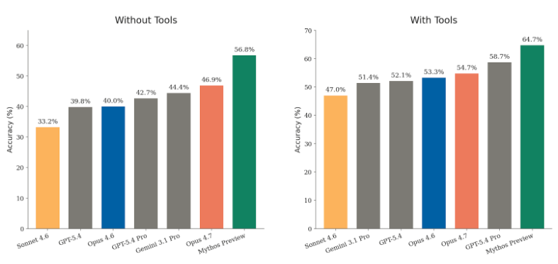

---

### 门萨智商测试，未上线

来源：[IQ Test | Tracking AI](https://www.trackingai.org/home)

---

### vals.ai评分

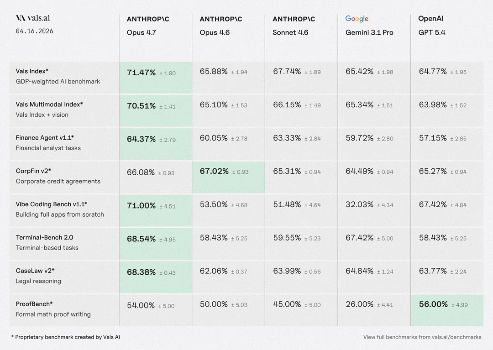

---

### FrontierMath评分

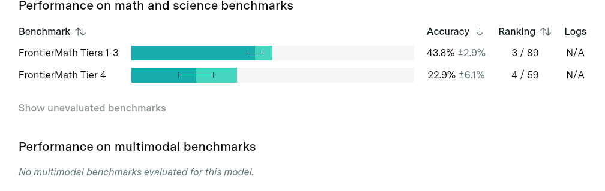

---

### NYT Word Coonections纽约时报填字游戏

4.7分数只有4.6一半不到

来源：[GitHub - lechmazur/nyt-connections: Benchmark that evaluates LLMs using 759 NYT Connections puzzles extended with extra trick words · GitHub](https://github.com/lechmazur/nyt-connections/)

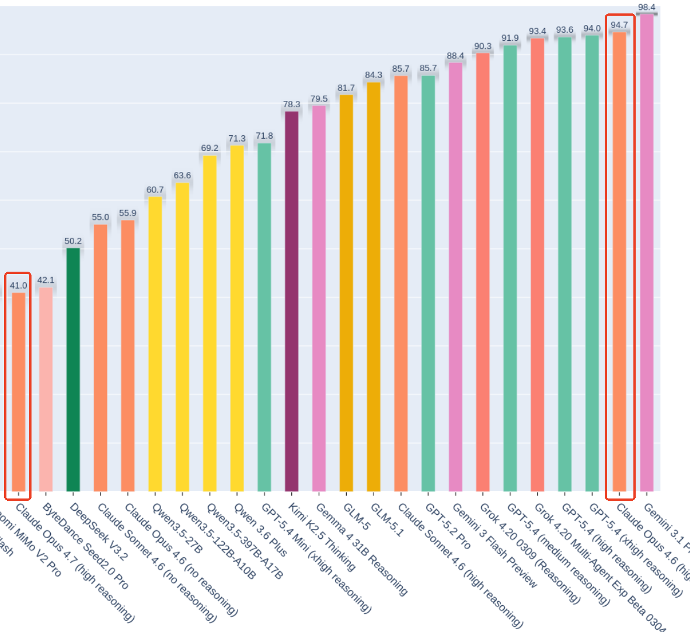

---

### Chat渠道

#### 官网/app已上线

#### LMArena Driect Chat

估计不会上线，opus系列都没上线

#### OpenRouter ChatRoom已上线，用自己余额

来源：[AI Chat Playground - Compare AI Models Side by Side | OpenRouter](https://openrouter.ai/chat?models=anthropic/claude-opus-4.7)

### API渠道

#### 官网

#### OpenRouter已上线

来源：[Claude Opus 4.7 - API Pricing & Providers | OpenRouter](https://openrouter.ai/anthropic/claude-opus-4.7)

### Code渠道

#### Claude Code已上线

同时重置所有会员周限额，从17号起，从0%开始重算1周

#### Cursor已上线

限时半价

#### Augment已上线

260430前半价

#### Windsurf已上线

试用号也能用

#### droid已上线

倍率1x

#### Copilot已上线

4.7是7.5x倍率(260430后可能15x)，按条数收费，最大medium，上下文200k，需pro+会员($10pro会员没有4.7)，参考4.6是3x

#### Antigravity暂未上线

---

*来源: https://linux.do/t/topic/1984117.json*

