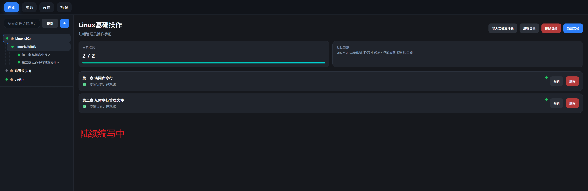
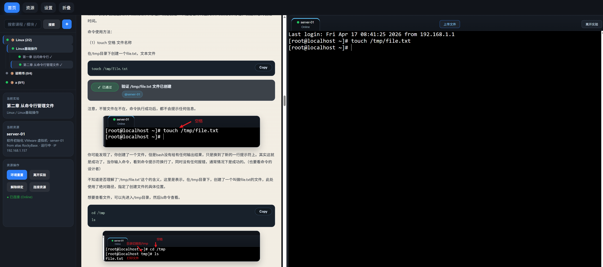
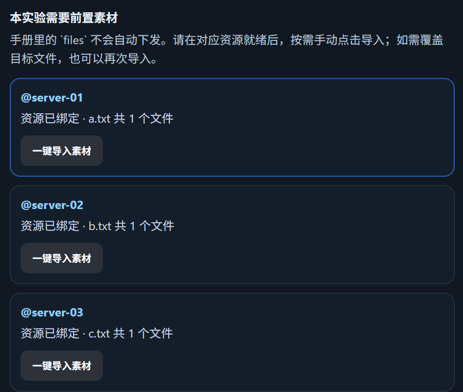
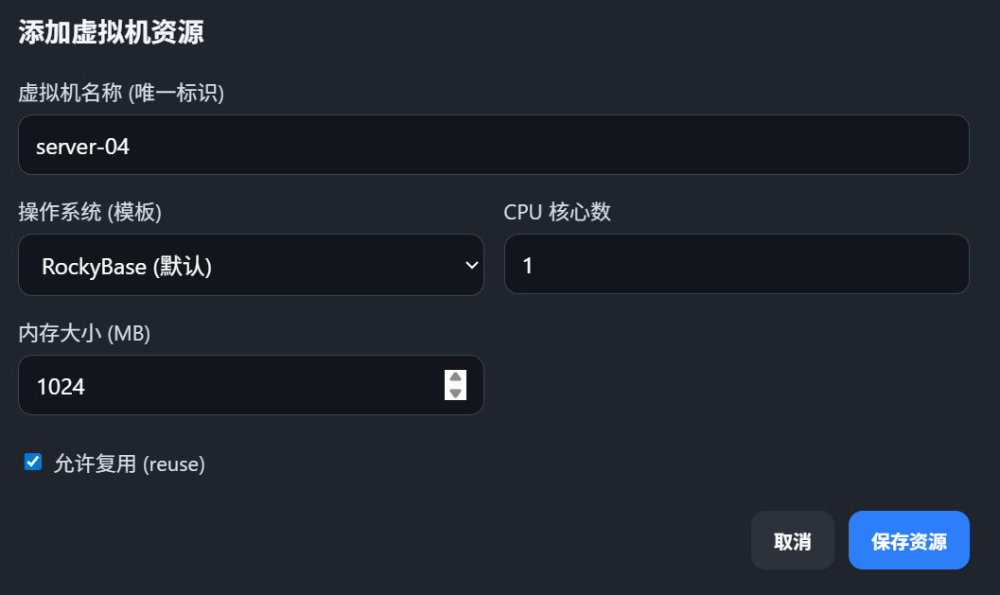
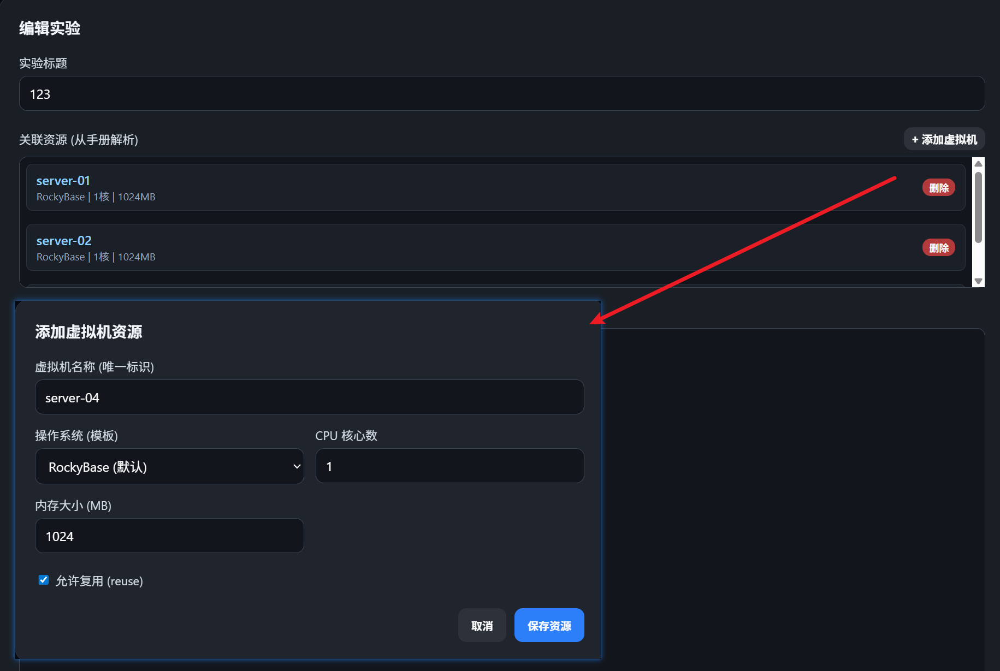
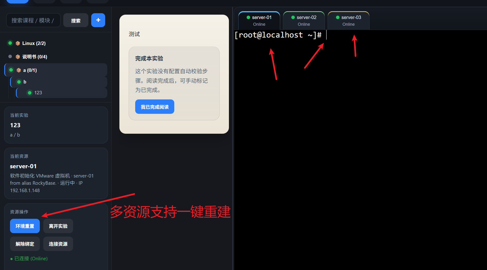
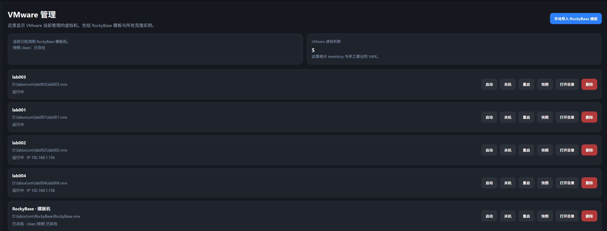

---

id: 1996113

title: "linux红帽教程-labbox实验盒子"

created_at: 2026-04-18T11:53:40.165Z

username: create1997

display_username: "create1997"

---

# linux红帽教程-labbox实验盒子

介绍：一个能基于vmware自动创建实验环境，检测代码执行结果的Linux教学平台。

基于红帽的linux教程，做了配置的手册和实验环境。

需要搭配vmware使用，针对实验步骤做了一些验证，帮助初学者检验结果。

环境支持重置，弄错了就重头来。

## 软件介绍

### 课程导入

软件依赖于实验手册，导入实验手册后就能看得到课程，具体操作在说明中有写。

### 实验区域

左侧功能菜单，中间实验手册，右侧ssh资源，ssh资源基于vmare自行创建，自动连接实验手册对应的虚拟机资源。

### 环境重置

环境弄坏了，点击左侧"环境重置即可"，基于快照机制，10秒崭新如初。中间实验手册，目前展示的内容基于红帽编写，（累啊）纯手工制作，右侧是实验手册对应的ssh资源。

### 实验步骤检测

实验手册针对当前必要的步骤进行检测，辅助确认命令有效执行。

未通过：

通过：

### 实验文件一键导入

如果实验手册绑定文件（任意类型），支持一键导入，避免实验中缺失素材。

### 资源自定义

除了实验手册定义的资源，可自行定义虚拟机。

在首页中新建课程，课程中新建目录，然后即可创建实验，在实验中，可自行添加实验资源。

假设说你需要弄个集群，可根据个人需要创建虚拟机，只要你本地资源足够就行。

此处演示创建三台虚拟机。

### 虚拟机管理

可自行管理课程所创建的虚拟机。

其他介绍在说明书中，可前往查看。

## 软件下载安装

github限制100M的软件，目前暂时放到百度网盘，有其他更好的佬可以告知下。

链接: [百度网盘 请输入提取码](https://pan.baidu.com/s/1l5PtiP-e9LmixzB0NBYvkA) 提取码: p8mh

课程资料也在网盘中，一起下载即可。

双击"LabBox-1.0.0-Portable.exe"直接运行，免安装。

---

*来源: https://linux.do/t/topic/1996113.json*

