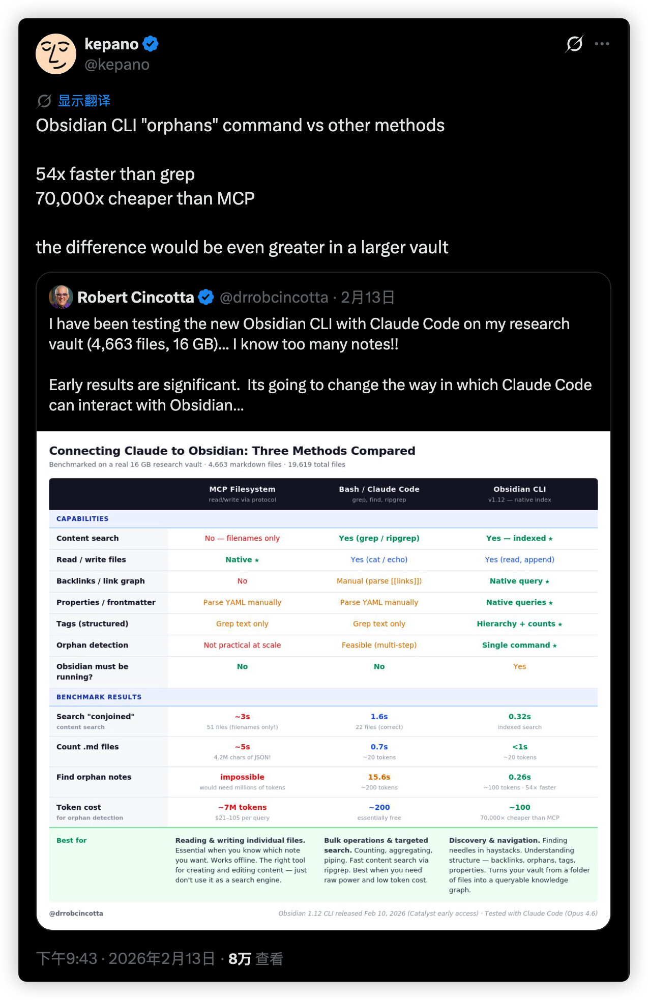
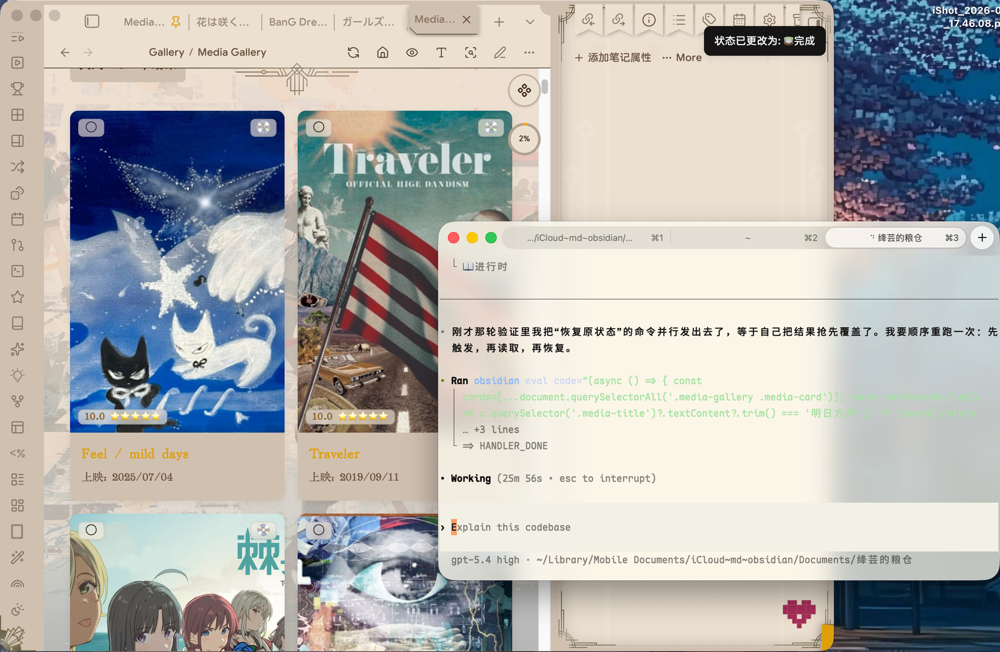

---

id: 2034509

title: "Obsidian CLI配合Agent写脚本，真的可以左脚踩右脚了"

created_at: 2026-04-23T01:53:35.723Z

username: ProudBenzene

display_username: "ProudBenzene"

---

# Obsidian CLI配合Agent写脚本，真的可以左脚踩右脚了

作为代码小白，最近写代码的时候被最新的编程 Agent 再次震惊到了…

2022年底 GitHub Copilot 刚出来的时候，在那个还没有 AI 的时代，代码自动补全在我看来简直惊为天人，太方便了！

此后 AI 代码助手一路进步，从最简单的对话到可以向量化索引代码库、修改代码，再到能够调用工具执行简单的任务……终于随着 Claude Code 的横空出世，我们来到了 CLI Agent 的时代。

这段时间想起来库里还有很多 dataviewjs，平时打开对应笔记的时候一卡一卡的，听闻 datacore 对性能的优化很大，改写后性能甚至可以比 dataviewjs 高出 2-10 倍，遂尝试让 Codex 帮我写。

> 要我说 datacore 这个拖更真是拖对了 ，从几年前 AI 编程还没完全普及的时候就开始测试，直到前段时间上架 Obsidian 官方插件市场公测，刚好赶上 CLI Agent 的发展势头，原本对普通用户使用而言最高的门槛——编写 JavaScript 代码立马就被削低了一大截，利好发展与传播。

我让 AI 编写 Datacore 的过程很简单，想好想法，然后直接丢给 Codex，让它利用 Obsidian CLI 与 datacore 的相关 skills，给我撰写对应的 datacorejsx 脚本，之后 Codex 就会铆足劲闷头大干了

其中最值得说道的其实是 Obsidian CLI，Kepano 曾经说过 CLI 相对于 MCP 的优势，而现在我也清晰地感受到了这点：CLI 中不仅包含了记笔记、日记等日常功能，甚至还有各种开发调参指令（查看终端、执行 JavaScript、开发截图等）：

于是就出现了下图中的场景：Codex 左脚踩右脚，自己改完代码后立刻自己调用 Obsidian CLI 进行调试，看到 Obsidian 界面右上角的那个提示状态更改的通知了吗？那就是 Codex 自己按下了 datacore 组件中的按钮而触发的预期反应：

于是借助 Codex、Obsidian CLI 及相关 skills，我把自己学术库中的文献状态仪表盘、卡片文献笔记展示面板、粮仓库中的媒体索引与查找面板等全部用 datacorejsx 改写了一遍，而且过程几乎全自动，AI 自动编码自动调试根本不用我插手的，真的很舒服。

现在我的粮仓库中已经关掉 dataview 插件了，普通的 dataview 查询用 Bases 替代，复杂的 dataviewjs 用 datacore 改写，不知道这么说佬友们懂不懂，就是库里有一种“万物竞发、勃勃生机”的感觉。

最后推荐一下最近使用体验较优的 Obsidian 相关 Skills：

- [Obsidian 官方 Skills](https://github.com/kepano/obsidian-skills)

- [Obsidian 三大视觉化视图](https://github.com/axtonliu/axton-obsidian-visual-skills)

- [Obsidian 基石插件 Skills](https://github.com/sunnyhasija/obsidian-plugin-skills)，我用到的 datacore skill 即来自这个仓库~

感谢 Obsidian CLI，感谢 datacore 及其 skills，感谢 Codex，感谢这个 AI Agent 的时代！

---

*来源: https://linux.do/t/topic/2034509.json*

