---

id: 2042455

title: ":fire:【大模型系列32】关于GPT 5.5，你想知道的一切【速度/价格2倍，性能超Opus4.7】"

created_at: 2026-04-23T21:53:33.184Z

username: dwqxq1

display_username: "dwqxq1"

---

# :fire:【大模型系列32】关于GPT 5.5，你想知道的一切【速度/价格2倍，性能超Opus4.7】

## 资料

官方文：[https://openai.com/index/introducing-gpt-5-5/](https://openai.com/index/introducing-gpt-5-5/)

系统卡：[GPT-5 System Card - OpenAI Deployment Safety Hub](https://deploymentsafety.openai.com/gpt-5)

价格：[Pricing | OpenAI API](https://developers.openai.com/api/docs/pricing)

### GPT-5.5

价格：输入$5，输出$30，比5.4翻倍

上下文：api：总992k，输出128k，同5.4

Free：暂时没有5.5

plus网页：总256k，输出128k

pro网页：总400k，输出128k

codex：总400k(手动改1m无效)，输出128k，而5.4可手动改1m，但性能差

训练知识日期：25年8月，参考4.7是26年1月

### GPT-5.5-pro

价格：输入$30，输出$180不变

在pro会员的app，web里有，codex没有

5x实测一周50次GPT-5.5-pro，20x不限次数

### 优点

性能SOTA

终于说人话了

速度快

1m上下文性能接近4.6，远好于4.7和5.4

### 缺点

价格翻倍，相当于额度减半，Plus用户用5.5很快就没了

因为速度接近翻倍，如果只看可用时间只有原来1/4

等到260601 pro用户优惠结束，10x → 5x，25x → 20x，会感到不够用

## 评测

### 官方自评

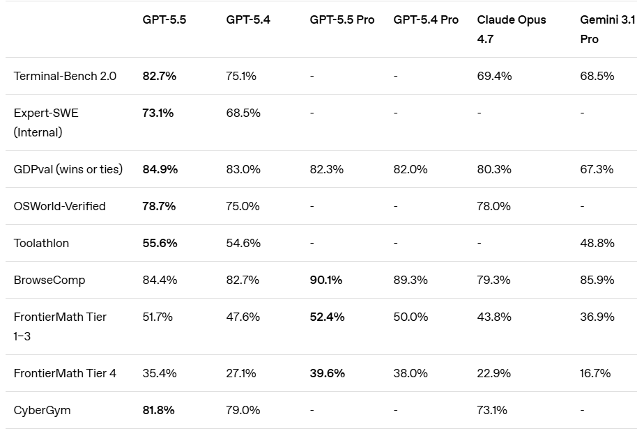

---

> 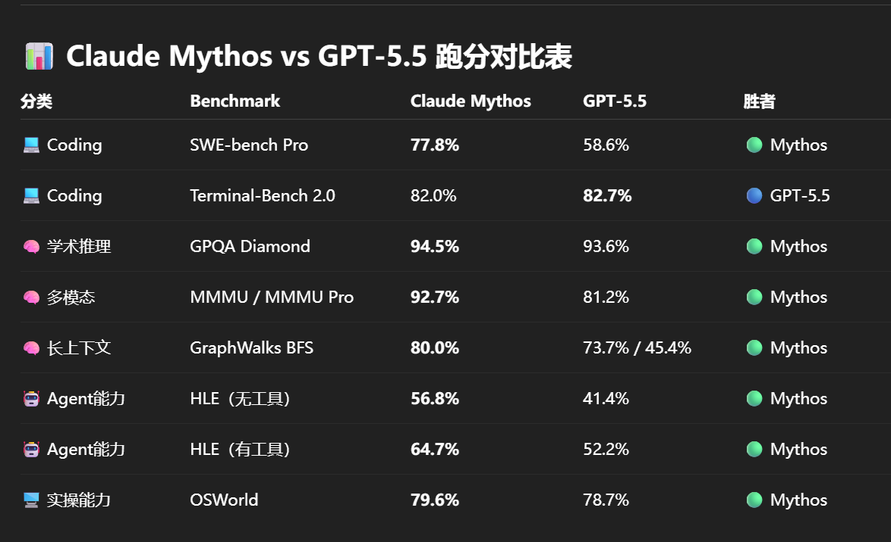

---

### LMArena评分

来源：[Arena Leaderboard | Compare & Benchmark the Best Frontier AI Models](https://arena.ai/leaderboard)

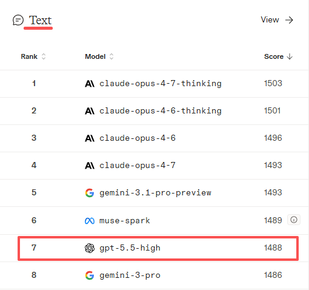

---

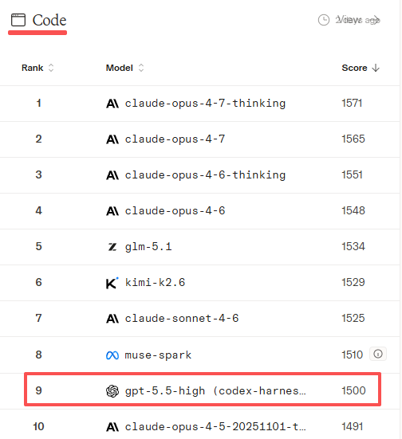

---

### LiveBench评分

来源：[LiveBench](https://livebench.ai/#/)

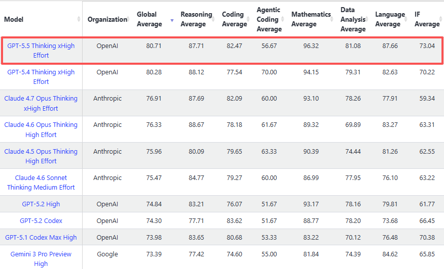

---

### ARC-AGI评分

来源：[ARC Prize - Leaderboard](https://arcprize.org/leaderboard)

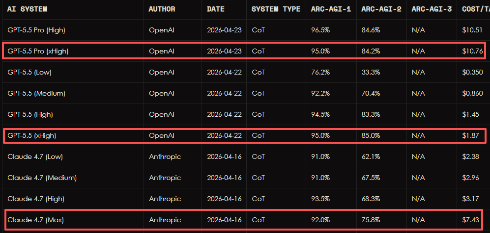

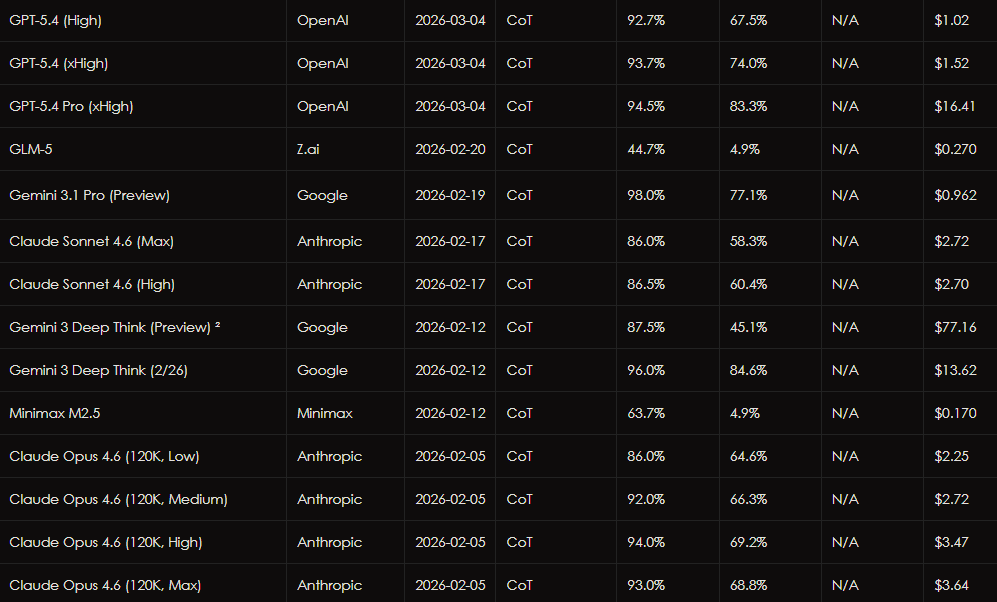

---

### ArtificalAnalysis评分

来源：[GPT-5.5 (xhigh) - Intelligence, Performance & Price Analysis](https://artificialanalysis.ai/models/gpt-5-5)

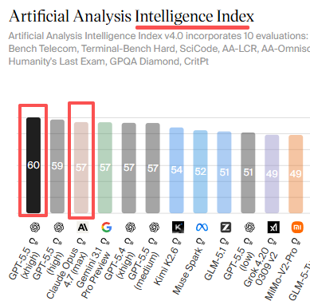

---

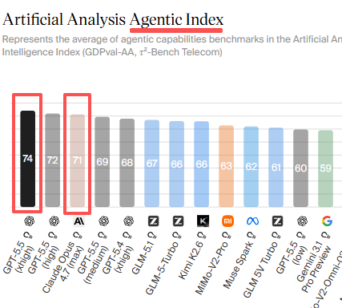

---

### Humanity’s Last Exam评分

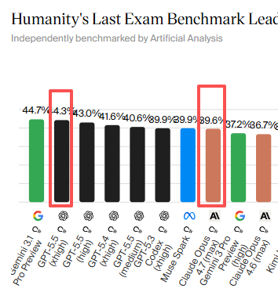

---

### 上下文

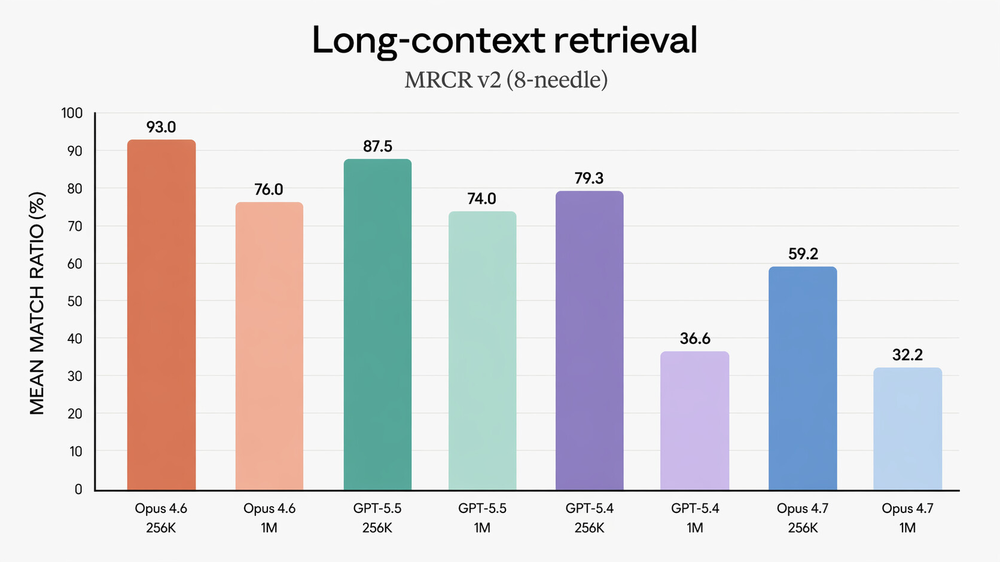

> 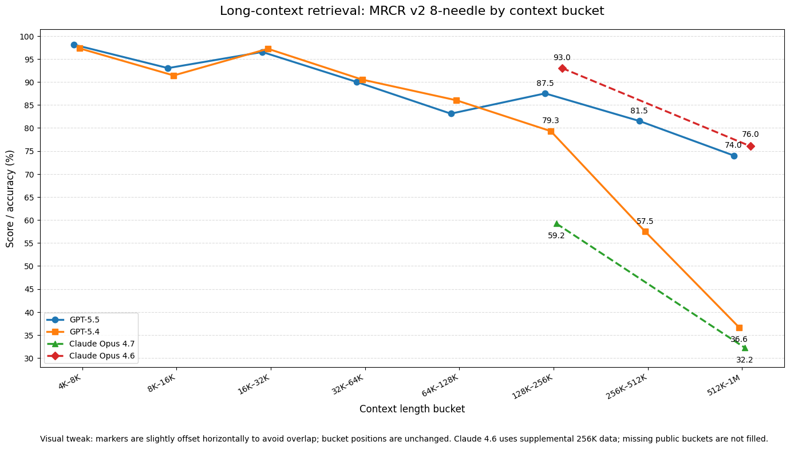

>

> 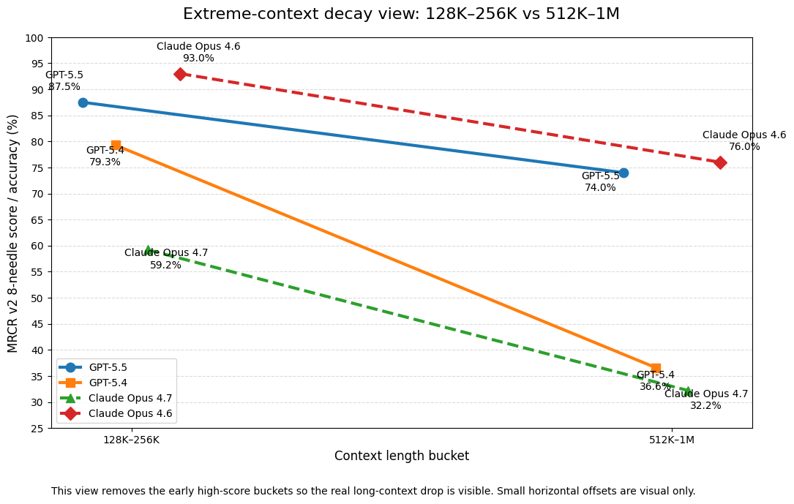

---

## Chat渠道

### ChatGPT app/web已上线

Plus/Business/Pro都有

### LMArena Direct Chat未上线：免费

### OpenRouter Chatroom未上线：消耗自己余额

## API渠道

### 官网API未上线

### OpenRouter API未上线

## Code渠道

### Codex已上线

## 最后来张梗图，祝佬友与GPT-5.5愉快地玩耍

---

*来源: https://linux.do/t/topic/2042455.json*

