---

id: 2047184

title: "bitwarden（Vaultwarden）普通人能看懂的（大概吧）自建教程！"

created_at: 2026-04-24T09:20:35.186Z

username: WSXYT

display_username: "我是小鸭头"

---


# bitwarden（Vaultwarden）普通人能看懂的（大概吧）自建教程！


可能有佬发过了？但是发一个简单版的，不需要域名，只要服务器即可（好像还有cf版，但我没看）

### 准备设备/工具

1,你需要一台**可以访问互联网**的服务器/搭载Linux操作系统的电脑（系统推荐ubuntu,服务商推荐）

2,你需要一个SSH连接工具

3,你的Linux系统应当在发行商维护范围内，若不在，出现故障请自行寻找解决方法

## 介绍

[Bitwarden](https://bitwarden.com/download/)是一款广受欢迎的**开源密码管理器**。它的主要作用是帮助你安全地生成、存储和管理各种网站及应用的密码与敏感信息。

特别安全，天王老子来了你不泄露密码也看不了

自部署可以不用花官方的订阅哦，而且速度更快

## 安装1Panel

运行

```
bash -c "$(curl -sSL https://resource.fit2cloud.com/1panel/package/v2/quick_start.sh)"
```

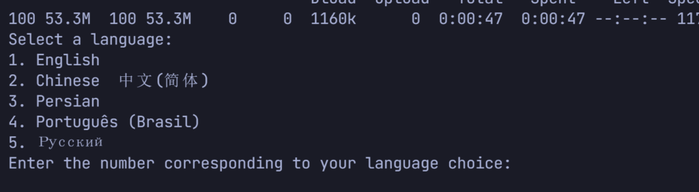

输入2，回车

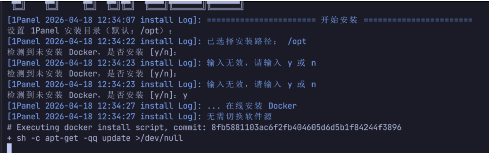

输入回车，y

后面也是一直回车

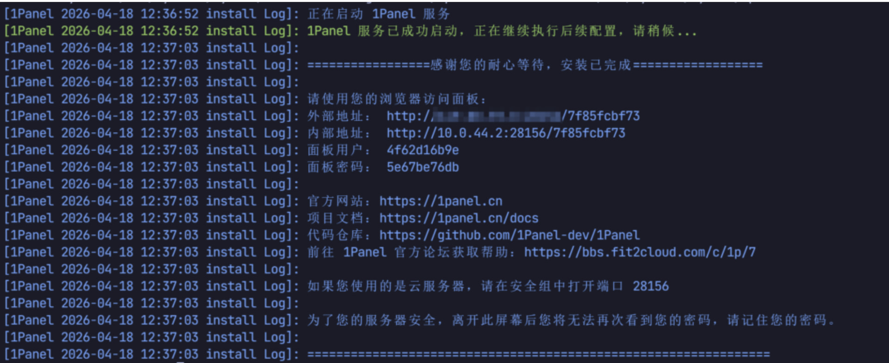

显示这个就安装1panel成功了！打开外部地址访问，输入上面的用户和密码，点击登录

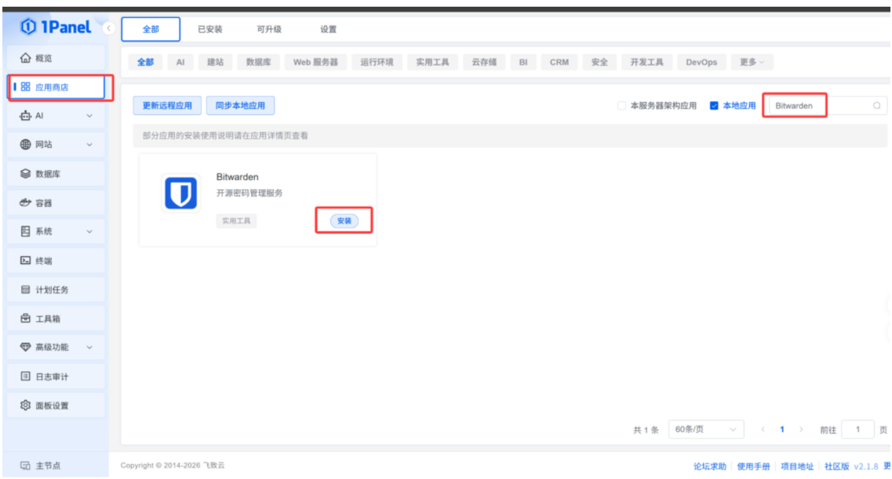

点击应用商店-搜索"Bitwarden"-点击安装

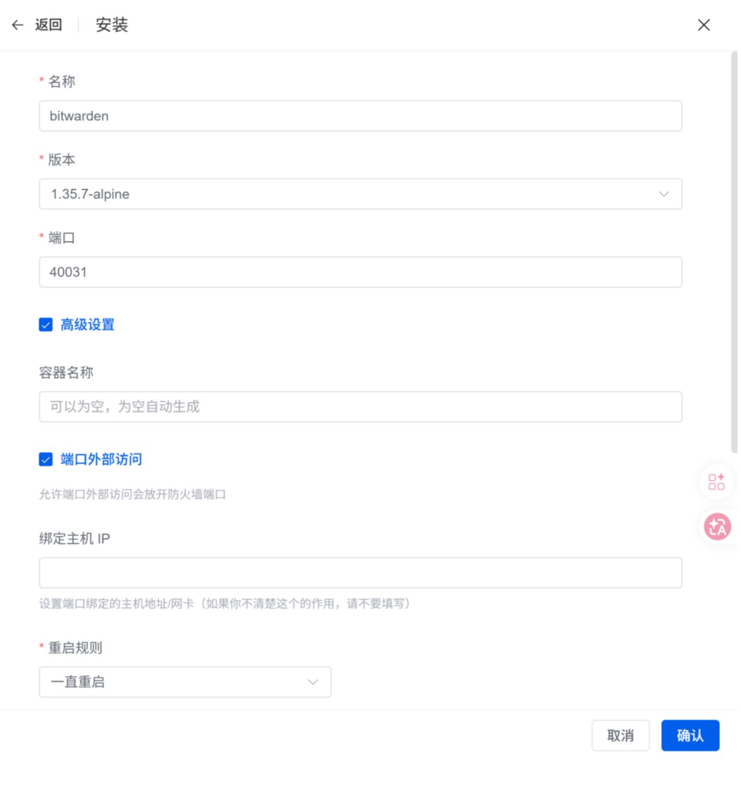

勾选端口外部访问后，点击确认

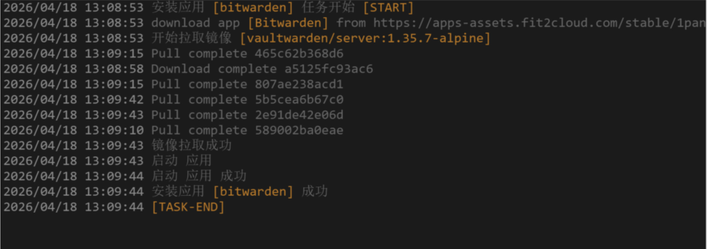

显示这个就代表成功了

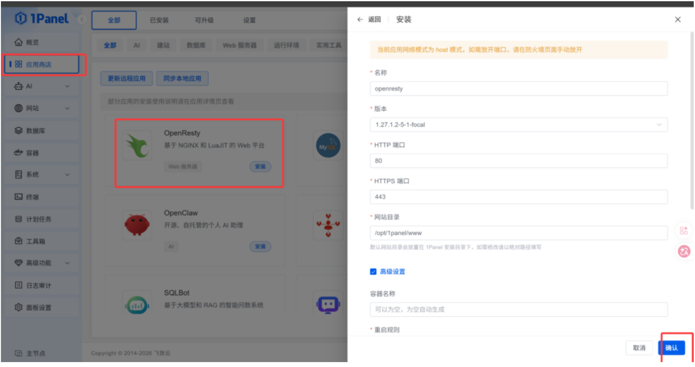

因为官方强制要求SSL证书，所以还得反代，点击：应用商店-OpenResty-安装-确认

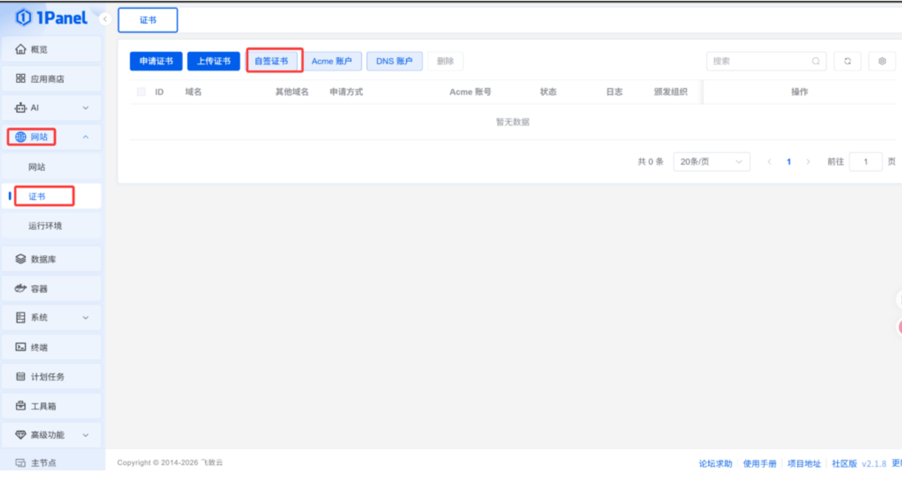

等待安装完成后，打开网站-证书-自签证书

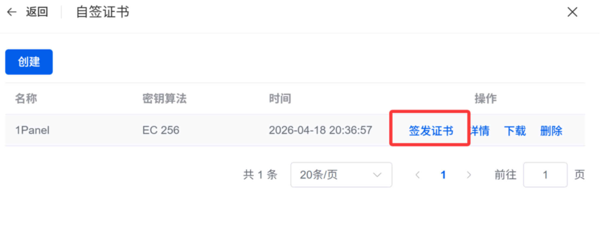

点签发证书

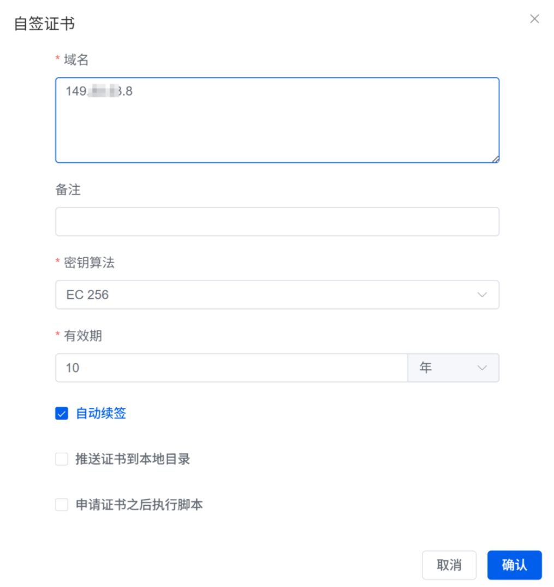

输入你的IP地址，点确认

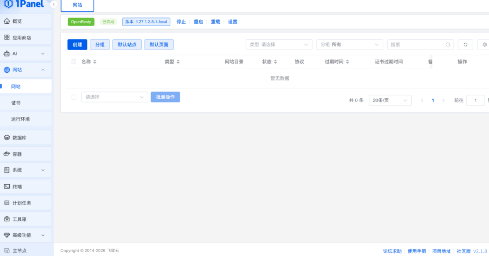

点击网站-网站-创建

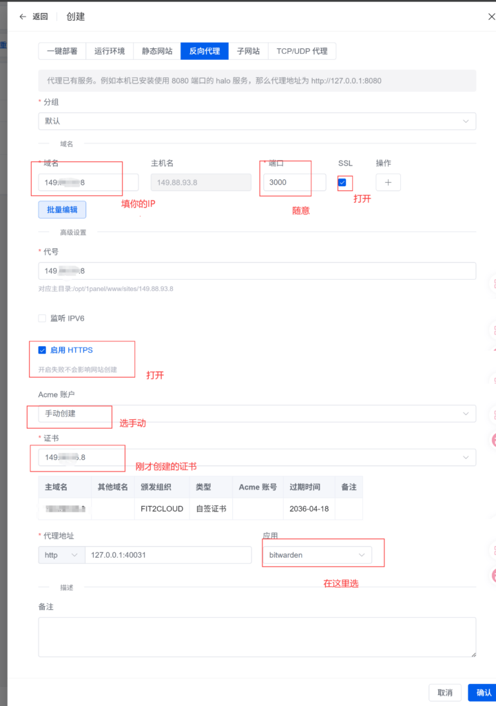

按照图片修改后，点击确认

访问：你的IP地址:你刚才填的端口（我填的是3000，所以是IP地址3000)

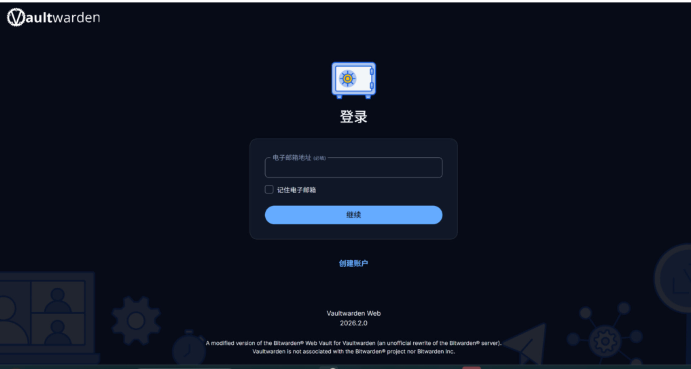

就成功了！像官方网站一样去操作它吧

插件/客户端也只需要更改一下地址（自定义地址）到你自建的就可以了


---


*来源: https://linux.do/t/topic/2047184.json*

