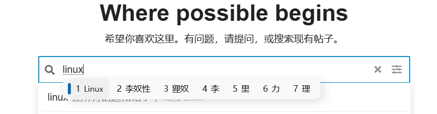
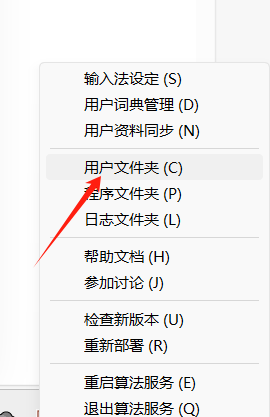
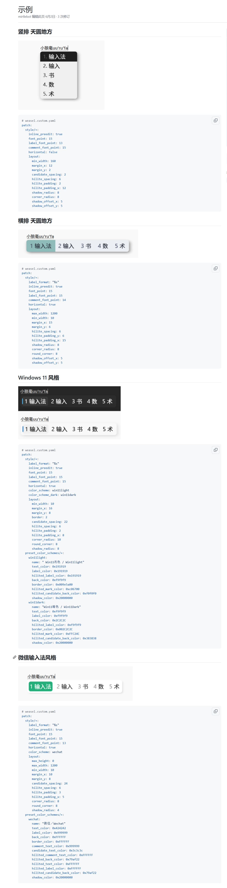

---

id: 204863

title: "Rime 中州韻輸入法引擎 + 雾凇拼音"

created_at: 2024-09-13T03:21:17.291Z

username: 91smile

display_username: "91smile"

---


# Rime 中州韻輸入法引擎 + 雾凇拼音


# Rime 中州韻輸入法引擎 + 雾凇拼音

先看效果



> 前提，作者一直使用Windows自带输入法，但是windows自带输入法和CSGO冲突所以寻求第三方输入法，遂找到这个（妈的一样不可以，但是发现这个输入法还挺好用的），有关这个的介绍可以 [Rime 从了解到入门 - 少数派 (sspai.com)](https://sspai.com/post/73634)参考这个

## 1.  [下载安装 | RIME | 中州韻輸入法引擎](https://rime.im/download/)

全部下一步下一步即可

## 雾凇拼音介绍与安装

> 简介和官方文档  [雾凇拼音](https://dvel.me/posts/rime-ice/)

- 简体 | 全拼 | 双拼

- 主要功能


[melt_eng](https://github.com/tumuyan/rime-melt) 英文输入

[优化英文输入体验](https://dvel.me/posts/make-rime-en-better/)

[部件拆字方案](https://github.com/mirtlecn/rime-radical-pinyin) 反查、辅码

自整理的 Emoji

[以词定字](https://github.com/BlindingDark/rime-lua-select-character)

[长词优先](https://github.com/tumuyan/rime-melt/blob/master/lua/melt.lua)

[Unicode](https://github.com/shewer/librime-lua-script/blob/main/lua/component/unicode.lua)

[数字、人民币大写](https://wb98.gitee.io/)

日期、时间、星期、[农历](https://github.com/boomker/rime-fast-xhup)

常见错音错字提示

置顶候选项

所有标点符号直接上屏，/ 模式改为 v 模式，/ 直接上屏

增加了许多拼音纠错

- 简体字表、词库


[《通用规范汉字表》](https://github.com/iDvel/The-Table-of-General-Standard-Chinese-Characters)

[华宇野风系统词库](http://bbs.pinyin.thunisoft.com/forum.php?mod=viewthread&tid=30049)

[清华大学开源词库](https://github.com/thunlp/THUOCL)

[《现代汉语常用词表》](https://gist.github.com/indiejoseph/eae09c673460aa0b56db)

[《现代汉语词典》](https://forum.freemdict.com/t/topic/12102)

[《同义词词林》](https://forum.freemdict.com/t/topic/1211)

[《新华成语大词典》](https://forum.freemdict.com/t/topic/11407)

[腾讯词向量](https://ai.tencent.com/ailab/nlp/en/download.html)

- 词库修订


校对大量异形词、错别字、错误注音

全词库完成注音

同义多音字注音

### 2.1  [github下载](https://github.com/iDvel/rime-ice)

1. github下载，解压

2. 打开用户文件夹

3. 全部复制进去

4. 右击选择重新部署


5.右击选择输入法设定选择雾凇拼音




### 2.2 命令安装

1. 点击输入法设定

2. 更多输入设置

3. 执行 `iDvel/rime-ice:others/recipes/full`

4. 回车确认，随即 RIME 会自动下载

5. 稍等片刻，命令提示符出现「`Updated xxx files...` 」的提示（黄色字样），表示安装完成。此时可以直接关掉该窗口。

6. 右击选择重新部署

7. 右击选择输入法设定选择雾凇拼音

### 2.3 Rime输入法安装脚本快捷安装

[Mark24Code/rime-auto-deploy: Rime输入法安装脚本，让一切更轻松。Make using Rime easy. (github.com)](https://github.com/Mark24Code/rime-auto-deploy)

## 3. 同步设置

本人选择使用OneDrive同步

1. 右击选择用户文件夹

2. 找到 `installation.yaml`

3. 编辑 sync_dir 和 installation_id

```
distribution_code_name: Weasel
distribution_name: "小狼毫"
distribution_version: 0.16.1
install_time: "Tue Sep 10 14:01:19 2024"
installation_id: "Win NUC8"  # 同步的ID，在同步文件夹作为文件夹名称显示
rime_version: 1.11.2
sync_dir: C:\Users\y\OneDrive\Rimeuser # 同步文件夹位置
```

1. 右击选择用户资料同步

## 4. 皮肤设置

[示例 · rime/weasel Wiki (github.com)](https://github.com/rime/weasel/wiki/%E7%A4%BA%E4%BE%8B#windows-11-%E9%A3%8E%E6%A0%BC)



> 分享本人基于官方windows11修改的皮肤设置

```
patch:
  "preset_color_schemes/+":
    win11dark: {back_color: 0x2C2C2C, border_color: 0x002C2C2C, hilited_candidate_back_color: 0x383838, hilited_label_color: 0xf9f9f9, hilited_mark_color: 0xFFC24C, label_color: 0xf9f9f9, name: "Win11暗色 / Win11Dark", shadow_color: 0x20000000, text_color: 0xf9f9f9}
    win11light: {back_color: 0xf9f9f9, border_color: 0x009e5a00, hilited_candidate_back_color: 0xf0f0f0, hilited_label_color: 0x191919, hilited_mark_color: 0xc06700, label_color: 0x191919, name: " Win11浅色 / Win11light", shadow_color: 0x20000000, text_color: 0x191919}
  "style/+":
    color_scheme: win11light
    color_scheme_dark: win11dark
    comment_font_point: 10
    font_point: 10
    horizontal: true
    inline_preedit: true
    label_font_point: 10
    label_format: "%s"
    layout: {border: 2, candidate_spacing: 22, corner_radius: 10, hilite_padding: 8, hilite_padding_x: 8, hilite_spacing: 6, margin_x: 16, margin_y: 8, min_width: 10, round_corner: 8, shadow_radius: 8}
  "style/color_scheme": win11light
```

## 5.词库增强和自定义词库

1. 下载 [词库](https://github.com/Iorest/rime-setting)，解压

2. 移动到用户文件夹

3. 挂载词库

```
# rime_ice.dict.yaml

---
name: rime_ice
version: "1"
import_tables:
  - mydict            # 挂载配置目录下的 mydict.dict.yaml
  - cn_dicts/mydict2  # 挂载 cn_dicts/ 目录下的 mydict2.dict.yaml
...
```

自定义词库


在 `custom_phrase.txt` 中可以放置一些特定的词汇与编码，比如输入 vmail 得到自己的邮箱，输入 vphone 得到手机号，输入 vuser 得到用户名等等。

## 优化设置

1. 修改候选词数量  `default.custom.yaml` 中 `patch.menu.page_size: 5`

2. [修改中英文切换提示图标] ([Rime 输入法配置问题 - #5，来自 91smile](https://linux.do/t/topic/201789/5)) `weasel.yaml` show_notifications 为false

*最后表达歉意，本文章按照个人想法编写，没有携带较多图片教程，可能不太适合电脑小白，因为本人方便文章迁移，本人没有图床，所以尽可能的少使用图片*


---


*来源: https://linux.do/t/topic/204863.json*

