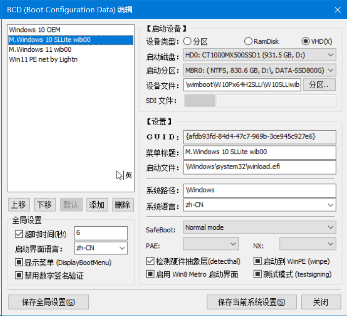
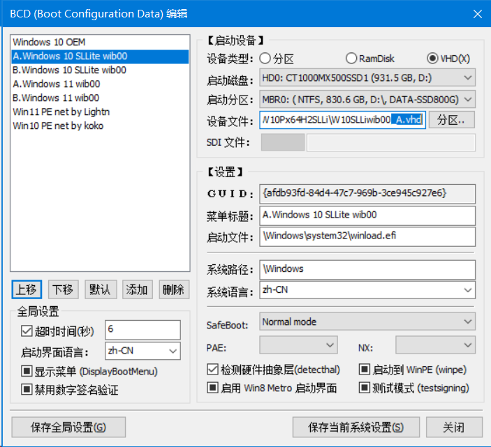

---

id: 205602

title: "安利wimboot_vhd系统（基于wimboot技术的vhd系统）原理及实操（保姆级教程）"

created_at: 2024-09-13T14:28:18.054Z

username: xclimbing

display_username: "蟹叫兽"

---


# 安利wimboot_vhd系统（基于wimboot技术的vhd系统）原理及实操（保姆级教程）


从Windows 8开始，微软推出wimboot技术，最早用于平板电脑硬盘空间比较小的情况，让Windows系统基于高度压缩的wim文件运行，可以极大减小硬盘空间占用，正常情况下，Windows系统分区一般空间占用不小于10G，如果使用wimboot技术，则可以压缩一半，极限情况下，5G+1G=6G即可运行一个Windows系统，当然，硬盘空间现在并不是瓶颈。用这种方法，我可以在一个16G的ssd硬盘上部署win7+win10双系统（我指的是ThinkPad x240，原机内置了一个16G的小固态硬盘用于机械硬盘的缓存，我单独拿出来装系统）。

关于vhd系统我想很多人应该比较熟悉，就是不再给系统分区，而是将Windows系统安装到一个vhd文件中，相当于将硬盘虚拟化了。vhd系统的优点是可以差分，安装一个母系统的vhd，然后可以无限差分（类似于虚拟机的快照技术），在差分系统中随意操作，不用担心损坏母系统，也就避免了给系统做克隆的情况（客观上也节省了硬盘空间）。本质上vhd系统跟安装到分区的系统没有区别，只不过vhd系统用vhd文件代替了分区。另外，使用vhd系统后，由于不再需要分出系统分区，原则上硬盘也不再需要进行分区操作，所有硬盘只要一个分区即可。

而wimboot+vhd系统，就是将两个技术结合起来，安装基于wim文件的vhd系统（下面简称为wimboot_vhd系统）。经过我实践，发现基于wimboot的vhd系统跟实体系统在运行效率上并没有什么损失（当然，固态硬盘性能肯定更好，其实主要表现在启动速度上），完全可以用来代替常规的系统安装方法，而且部署起来更为灵活。大部分时候，部署一个基于wimboot的vhd系统，所用时间不超过1分钟（不包括安装驱动和定制应用软件的时间），重装系统的时间几乎可以忽略不计。由于不再需要分区，你甚至可以基于同一个wim文件部署N个完全独立的系统。

另外，在我的实践中，wimboot_vhd系统完全可以使用grub4dos(UEFI) + ntboot/ntloader直接启动，不需要再考虑Windows引导修复、bcd文件编辑这一类的复杂问题。由于 Windows 10 不再限制是否从usb设备启动，甚至可以用这种方法直接从移动硬盘启动一个完整系统（类似于Windows to go），当然，从移动硬盘启动多个系统也完全没有问题，甚至跟从硬盘上启动也没有本质区别。

当然，wimboot_vhd系统并不要求一定要新装系统，完全可以将你当前正在运行的系统转成wimboot_vhd系统。

目前发现的wimboot_vhd系统的缺点主要是偶尔可能会出现兼容性问题，有些应用软件不适合运行在wimboot_vhd系统中，但我也只是听说过，实际应用中未曾遇到过这种情况。但其实这个问题也好解决，遇到这种情况，直接将wimboot_vhd所使用的wim文件中的系统按常规方法部署到分区即可，跟正常安装系统没有区别。

wimboot_vhd系统的原理基本上就是这样。下面介绍详细的操作步骤。

**前言**


由于定制一个通用的wimboot系统步骤比较复杂（将自己原来的系统转换为wimboot系统并在本机部署相对来说比较简单），所以我们最好先从我个人定制的系统开始尝试。

[AFF](/tag/AFF) [AFF](/tag/AFF) [AFF](/tag/AFF) **醒目**


网盘下载链接:  提取码:0123  [AFF](/tag/AFF) 这个链接我设置了打赏，所以加上 [AFF](/tag/AFF) 标签（我其实就是想试试AFF标签  ）

所有跟wimboot_vhd有关的下载在上述共享链接的wimboot目录下，这个共享目录下还有很多其他的工具，例如我常用的便携软件包：Portable.App.7z，还有常用的WinPE：WinPE、NetPE，大家可以按需自取。关于本帖涉及到的所有内容，都在wimboot目录下。

由于wimboot_vhd系统不需要再考虑为系统分区，所以，你只需要在本机硬盘上随便找个有足够空间(每个系统15G左右空间）的盘符即可（当然，我建议在固态硬盘上），为了便于后面讲述假设我们在本机的工作目录是d:\wimboot目录，而这个目录的下一级目录结构跟网盘上的目录结构是完全对应的。如下（#号后面是说明）：

```
D:\WIMBOOT
├─W10Px64H2SLLi      # Win10系统目录
    W10RestoreABC.bat         # 用于自动恢复ABC三个子系统的批处理，其实就是自动解压下面的7z文件。
    W10SLLiwib00.7z             # 这个7z是ABC三个差分文件的原始备份，用于快速恢复系统的，解压覆盖即可恢复。
    W10SLLiwib00.vhd           #win10系统所使用的母系统vhd文件，关键文件，可以通过WinntSetup工具从下面的wim文件中生成
    W10SLLiwib00_A.vhd       # 差分出来的ABC三个子系统，这三个文件完全一样，复制粘贴可以无限扩展
    W10SLLiwib00_B.vhd
    W10SLLiwib00_C.vhd
    wd3W10SLLi_TF3G.wim     #win10系统所使用的wim文件，最关键的文件
    双击还原WIN10系统（AB系统互相还原）.lnk     # 上面批处理对应的快捷方式，放在桌面上便于操作。
├─W11PWSX               # Win11系统目录
└─WibTools                 # 相关工具集
    ├─dism++
    └─Xorboot_grub2_grub4UEFI@UNI_20230712
```

请按上述目录结构建立你本地硬盘的目录结构。下面的操作你完全可以在当前运行的系统上进行（Win10以上的系统或者Win10PE）。

1、下载我定制的Win10系统的wim文件。也就是网盘上wimboot\W10Px64H2SLLi\wd3W10SLLi_TF3G.wim，下载完成后放到：D:\wimboot\W10Px64H2SLLi\wd3W10SLLi_TF3G.wim。

有人可能关注这个wim文件如何制作，其实非常简单，对于win10系统，只要使用dism++的备份功能将当前系统备份成wim文件即可。至于win7系统，由于win7并不原生支持wimboot启动，所以需要使用chenall的wimboot 2.5工具进行魔改，这个操作略复杂，暂不考虑，有兴趣的再单独讨论。

2、下载wimboot\W10Px64H2SLLi\W10SLLiwib00.vhd。然后放到：D:\wimboot\W10Px64H2SLLi\W10SLLiwib00.vhd。 这个是我用WinNTSetup工具从上面下载的wim用wimboot方式部署到vhd的母系统，当然经过了通用化处理（操作略复杂，防止恢复到异机蓝屏失败等情况），可以顺利在大部分电脑上运行，反正我部署这个系统好几年了，几乎没有遇到过失败的情况。

3、将2中下载的vhd与1中下载的wim文件进行关联操作。在资源管理器中双击上面这个D:\wimboot\W10Px64H2SLLi\W10SLLiwib00.vhd文件，按windows的默认情况，应该会加载到本机一个盘符上（假设是X:），如果没有加载成功，而是被当成了压缩文件打开，那么你就需要使用右键“打开方式”，使用资源管理器打开。加载到盘符X后，进入管理员模式的命令行下，执行如下命令：


`DISM.exe /Update-WIMBootEntry /Path:X:\ /DataSourceID:0 /ImageFile:D:\wimboot\W10Px64H2SLLi\wd3W10SLLi_TF3G.wim`


然后继续执行：


`DISM.exe /Get-WIMBootEntry /Path:X:\`


确认当前打开的vhd已经与D:\wimboot\W10Px64H2SLLi\wd3W10SLLi_TF3G.wim建立关联，类似下面的结果就是成功了：

```
部署映像服务和管理工具
版本: 10.0.19041.746

数据源 ID: 0
图像文件: D:\wimboot\W10Px64H2SLLi\wd3W10SLLi_TF3G.wim

操作成功完成。
```

到这一步，这个系统其实就已经安装完成了，下面的步骤是给这个系统在Windows的启动菜单中建立启动项。

4、在当前Windows系统的BCD启动菜单中添加本wimboot_vhd系统的启动条目。这个有两种方法，你如果熟悉命令行，可以使用bcdedit来进行操作。我个人推荐使用D:\wimboot\WibTools\BOOTICEx64.exe这个工具，用它直接导入D:\wimboot\WibTools\BCD.wimboot10+11+PE+OEMv3这个我定制的BCD文件到你当前的BCD中，然后稍加修改即可。

BOOTICE中设置完成后大概是这个样子：



```
S:\> bcdedit  /enum

Windows 启动管理器
--------------------
标识符                  {bootmgr}
device                  boot
path                    \EFI\MICROSOFT\BOOT\BOOTMGFW.EFI
description             Windows Boot Manager
locale                  zh-CN
inherit                 {globalsettings}
default                 {default}
resumeobject            {e5f532a0-6eba-11ec-8326-808eaf904235}
displayorder            {e5f532a1-6eba-11ec-8326-808eaf904235}
                        {default}
                        {7f53a95e-80ae-4a25-8951-fc34c2f34a93}
                        {b8556002-af29-40e2-b711-b6fcd34624c1}
toolsdisplayorder       {memdiag}
timeout                 6

Windows 启动加载器
-------------------
标识符                  {e5f532a1-6eba-11ec-8326-808eaf904235}
device                  partition=D:
path                    \Windows\system32\winload.efi
description             Windows 10 OEM
locale                  zh-CN
inherit                 {bootloadersettings}
recoverysequence        {e5f532a2-6eba-11ec-8326-808eaf904235}
displaymessageoverride  Recovery
recoveryenabled         Yes
isolatedcontext         Yes
allowedinmemorysettings 0x15000075
osdevice                partition=D:
systemroot              \Windows
resumeobject            {e5f532a0-6eba-11ec-8326-808eaf904235}
nx                      OptIn
bootmenupolicy          Standard

Windows 启动加载器
-------------------
标识符                  {default}
device                  vhd=[D:]\wimboot\W10Px64H2SLLi\W10SLLiwib00.vhd
path                    \Windows\system32\winload.efi
description             M.Windows 10 SLLite wib00
locale                  zh-CN
osdevice                vhd=[D:]\wimboot\W10Px64H2SLLi\W10SLLiwib00.vhd
systemroot              \Windows
resumeobject            {db532a7f-b5af-11ec-9569-806e6f6e6963}
detecthal               Yes

Windows 启动加载器
-------------------
标识符                  {7f53a95e-80ae-4a25-8951-fc34c2f34a93}
device                  vhd=[D:]\wimboot\W11PWSX\W11PWSXwib00.vhd
path                    \Windows\system32\winload.efi
description             M.Windows 11 wib00
locale                  zh-CN
osdevice                vhd=[D:]\wimboot\W11PWSX\W11PWSXwib00.vhd
systemroot              \Windows
detecthal               Yes

Windows 启动加载器
-------------------
标识符                  {b8556002-af29-40e2-b711-b6fcd34624c1}
device                  ramdisk=[D:]\WINPE\11PEnetLtn.WIM,{ramdiskoptions}
path                    \Windows\system32\boot\winload.efi
description             Win11 PE net by Lightn
locale                  zh-CN
osdevice                ramdisk=[D:]\WINPE\11PEnetLtn.WIM,{ramdiskoptions}
systemroot              \Windows
detecthal               Yes
winpe                   Yes
```

5、至此，所有操作步骤完成，确保BCD设置没有问题以后，即可重启进行新装系统的测试。 重启选择咱们新增的这个：M.Windows 10 SLLite wib00项进入，不出意外，很快你就会看到Win10的启动画面及扫描设备的提示，然后就会看到系统自动登录进入桌面。进入桌面后会有一个Windows to go的提示，因为这种安装方式非常像Windows to go系统，系统会提示你不要拔出U盘，无视这个提示即可。后面的操作就跟你正常安装系统没有太大差别了：数字激活系统和Office（我建议用MAS）、改计算机名、安装硬件驱动，安装常用软件等。可以下载我网盘上的Portable.App.7z便携软件包，然后解压到D:\Porable.App目录，那么你就有了便携版的Chrome和火狐，以及便携版的WPS、TC等常用软件。这个便携包里还有360驱动助手和驱动精灵9.7，可以用来给系统安装硬件驱动。

6、差分子系统的使用。在确认母系统安装设置完成后，就可以启用差分子系统了，把母系统保护起来。

1. 将“D:\wimboot\W10Px64H2SLLi\双击还原WIN10系统（AB系统互相还原）.lnk“快捷方式发送到桌面，如果你的wimboot目录没在D盘，则需要修改一下快捷方式的属性，改成你对应的盘符，同时还要修改一下“D:\wimboot\W10Px64H2SLLi\W10RestoreABC.bat”批处理中这一行的内容：


set arch=D:\wimboot\W10Px64H2SLLi\W10SLLiwib00.7z


将D修改为你实际的盘符。

2. 仿照第4步中的操作步骤，将A、B、C差分系统加入当前系统的BCD，下图只演示了A、B两项，其实只需要复制原来的 M.Windows 10对应的条目，然后稍加修改，将设备文件指向A、B、C三个VHD文件即可。如下图所示：



修改好以后别忘了保存BCD文件。然后就完成了。

这样，正常情况下，使用A系统作为日常使用系统，当A系统出现故障后，重启进入B系统，执行桌面上的恢复快捷方式，就会将A系统还原成初始状态。**注意：** 如果你损坏的A系统的C盘保存有重要数据，你可以在恢复之前，将D:\wimboot\W10Px64H2SLLi\W10SLLiwib00_A.vhd文件改名一个其他的名字（例如D:\wimboot\W10Px64H2SLLi\W10SLLiwib00_A0.vhd），双击这个文件即可将A0.vhd挂载到当前系统下某个盘符上，然后你就可以备份数据了（备份完成后，可以删除这个A0文件节省空间）。为了避免出现这种情况，在日常使用中，尽量避免在C盘存放任何数据，尤其是重要的数据，然后安装新软件，也尽量避免在C盘安装。对于某些软件，可以使用软链接的方式将它迁移到其他盘。由于我习惯不在C盘保存数据，所以我基本上在恢复系统之前不会考虑备份数据。

7、使用grub4dos+ntboot方式启动。


上面演示了使用Windows Boot Manager加BCD方式启动wimboot_vhd系统的方法，其实使用grub4dos启动更为灵活。

```
iftitle [find /wimboot/W10Px64H2SLLi/W10SLLiwib00.vhd] M.Windows 10 Pro WS 20H2 x64 SLLite wimboot00@VHD(NTBOOT)
savedefault
find --set-root /boot/ntboot/NTBOOT
set NTBOOT=%@root%/boot/ntboot/NTBOOT
find --set-root /wimboot/W10Px64H2SLLi/W10SLLiwib00.vhd
command %NTBOOT% NT6=/wimboot/W10Px64H2SLLi/W10SLLiwib00.vhd

iftitle [find /wimboot/W10Px64H2SLLi/W10SLLiwib00.vhd] A.Windows 10 Pro WS 20H2 x64 SLLite wimboot00@VHD(NTBOOT)
savedefault
find --set-root /boot/ntboot/NTBOOT
set NTBOOT=%@root%/boot/ntboot/NTBOOT
find --set-root /wimboot/W10Px64H2SLLi/W10SLLiwib00.vhd
command %NTBOOT% NT6=/wimboot/W10Px64H2SLLi/W10SLLiwib00_A.vhd

iftitle [find /wimboot/W10Px64H2SLLi/W10SLLiwib00.vhd] B.Windows 10 Pro WS 20H2 x64 SLLite wimboot00@VHD(NTBOOT)
savedefault
find --set-root /boot/ntboot/NTBOOT
set NTBOOT=%@root%/boot/ntboot/NTBOOT
find --set-root /wimboot/W10Px64H2SLLi/W10SLLiwib00.vhd
command %NTBOOT% NT6=/wimboot/W10Px64H2SLLi/W10SLLiwib00_B.vhd
```

由于grub4dos只兼容传统的bios+mbr模式，如果你的电脑是UEFI+GPT模式，则可以使用 grub4dos_UEFI来代替，相应菜单则修改为：

```
iftitle [find /wimboot/W10Px64H2SLLi/W10SLLiwib00.vhd] M.Windows 10 Pro WS 20H2 x64 SLLite wimboot00@VHD
savedefault
find --set-root /wimboot/W10Px64H2SLLi/W10SLLiwib00.vhd
uuid ()
find --set-root /efi/grub/ext/ntloader
kernel /efi/grub/ext/ntloader uuid=%?%  file=/wimboot/W10Px64H2SLLi/W10SLLiwib00.vhd
initrd /efi/grub/ext/initrd.lz1

iftitle [find /wimboot/W10Px64H2SLLi/W10SLLiwib00.vhd] A.Windows 10 Pro WS 20H2 x64 SLLite wimboot00@VHD
savedefault
find --set-root /wimboot/W10Px64H2SLLi/W10SLLiwib00.vhd
uuid ()
find --set-root /efi/grub/ext/ntloader
kernel /efi/grub/ext/ntloader uuid=%?%  file=/wimboot/W10Px64H2SLLi/W10SLLiwib00_A.vhd
initrd /efi/grub/ext/initrd.lz1
```

至于Grub4dos的详细用法，本帖不再细讲，有兴趣的咱们可以再开新主题进行讨论。

**增补内容：关于VHD系统的缺点**


基于下面佬友的回复，我追加这些关于VHD系统缺点的内容，让大家更全面的了解vhd系统，从而根据自己的实际情况决定是否采用vhd系统。而我在前面的内容中之所以没有介绍这些，主要原因就是由于我自己在实际应用中并不关注这些缺点或者根本接触不到。

**1. VHD系统不支持休眠和睡眠，但支持待机模式。**

VHD系统没有休眠文件，也就是 **c:\hiberfil.sys** （实际上也没有c:\pagefile.sys，也就是内存交换文件，系统会自动在物理硬盘上建立pagefile.sys）。也就是说，VHD系统不支持睡眠、休眠（深度睡眠），但支持待机模式（我理解就是内存供电的休眠模式）。而我之所以不关注这个，是因为我一般没有移动办公需求，所以我的电脑大部分时候都是连接电源甚至24小时开机。对于笔记本，合上盖子进入待机模式就足够了。所以，我个人习惯，就算不是基于vhd的系统，我也会使用：powercfg -h off将休眠功能去掉。当然，这是我个人的使用偏好。对于休眠有需求的人来说，慎重考虑使用VHD系统，待机模式会加快电池的消耗速度，减少笔记本续航时间。

**2.VHD系统不支持Win10/11的大版本更新。**

*VHD支持常规的系统更新，但不支持那种跨版本的系统更新*（也即相当于系统版本升级、系统重装那种更新）。我个人对微软Windows更新的偏见就是：微软的更新大部分属于负优化，弥补一个漏洞的同时增加更多的漏洞，或者重现以前的漏洞。其实就是屎山代码上再加一坨屎。执着于Windows更新的人属于某种程度上的强迫症，跟消除图标角标、红点属于一类，  。当然，这是**我个人的偏见**。对于严肃的生产环境，安全是第一位的，为了不让自己背锅，还是该干嘛干嘛。总之VHD系统不适合于这种要求严格的生产环境。话说我也没有接触过这种生产环境，它是否真的不适合（没准可能还更适合）我也不确认。

在日常，我对Windows更新见过最多的吐槽就是，当你开会打开笔记本准备讲ppt时，它开始自动更新，经过漫长的等待，它提示你更新遇到问题，需要回滚，然后，又是漫长的等待。。。这个过程有时候还会反复上演。所以，我日常使用的系统都是选择那种精简掉更新和Defender组件的精简系统，例如上面这个用于演示的系统就是不忘初心的精简版本，或者我会使用专门的软件（或手段）禁用掉Windows更新和WD。我们使用系统是为了工作或者是爽的，而不是给自己添堵。我们不是系统的奴隶，我的系统就要我做主。其实，Windows新版本出来了，使用新版本重新做一个VHD系统也并不麻烦。现有的系统迁移成为传统的分区系统也不复杂（其实就是克隆然后恢复克隆到分区，使用ghost甚至可以直接将vhd文件恢复到分区。），待大版本更新完成后，再重新转换回VHD系统即可。

**3. VHD系统相较于常规的安装于分区的系统更容易损坏。**

由于VHD系统是用硬盘上的一个文件来模拟硬盘，所以整个系统依赖于常规硬盘上的一个巨大文件，这一点跟虚拟机类似。而一个大文件面临损坏的机率总是高于一个小文件。关于这个问题，wimboot技术的vhd系统，可以使vhd做到很小，一般不会超过1个G。另一方面，VHD系统也可以备份，既可以直接备份vhd文件，也可以使用常规的备份技术。在磁盘介质正常的情况下，文件的损坏都是小概率事件。

**4. VHD系统有可能存在应用兼容性问题。**

我在上面的帖子中曾经提到过，我也只是道听途说，实际应用中并没有遇到过。当然，我本人的应用环境比较简单，接触面很窄。解决办法也很简单：遇到这种情况，不要用就行了。


---


*来源: https://linux.do/t/topic/205602.json*

