---

id: 2060490

title: "各 Markdown 编辑器的使用体验【UPDATED 2026-05-23T22:23:41+08:00】"

created_at: 2026-04-26T09:09:51.955Z

username: Karlbaey

display_username: "Seroton Karlbaey"

---


# 各 Markdown 编辑器的使用体验【UPDATED 2026-05-23T22:23:41+08:00】


### [各 Markdown 编辑器的使用体验 | Haku](https://re.karlbaey.top/articles/markdown-editors-recommend/)

前情提要 以前写过一篇 Markdown 编辑器推荐（已经删了，换成了这一篇）。因为以前用的图床爆炸了，里面的图片荡然无存。思来想去，换了个更稳的图床，重新写一篇。

在本机上编写 Markdown，除非纯文本，否则绝对逃不掉浏览器和 Web，因为 Markdown 本身就是 …

> [!NOTE]前情提要

>

> 以前写过一篇 Markdown 编辑器推荐（已经删了，换成了这一篇）。因为以前用的图床爆炸了，里面的图片荡然无存。思来想去，换了个更稳的图床，重新写一篇。

在本机上编写 Markdown，除非纯文本，否则绝对逃不掉浏览器和 Web，因为 Markdown 本身就是 HTML 的超集。有两条路，一条是微软在推的 Electron，打包了整个 Chromium 内核和 Node.js 环境，安装包及内存占用都极大；另一条是 Tauri，用 Rust 实现的，调用系统的 Webview，尽可能实现 Web 功能的同时保住了性能。

本篇评测采用 Notepad4 写成。正经人谁用 Markdown 编辑器写博客啊。

本文不考虑 iOS/macOS 环境，因为我买不起这些设备。

## Notepad4

这不算是一个 Markdown 编辑器，而是一个纯文本编辑器。它并没有传统意义上编辑 Markdown 所需要的所有热键，哪怕是 Ctrl + B  **加粗**这样的热键都没有。实在是非常的原始。

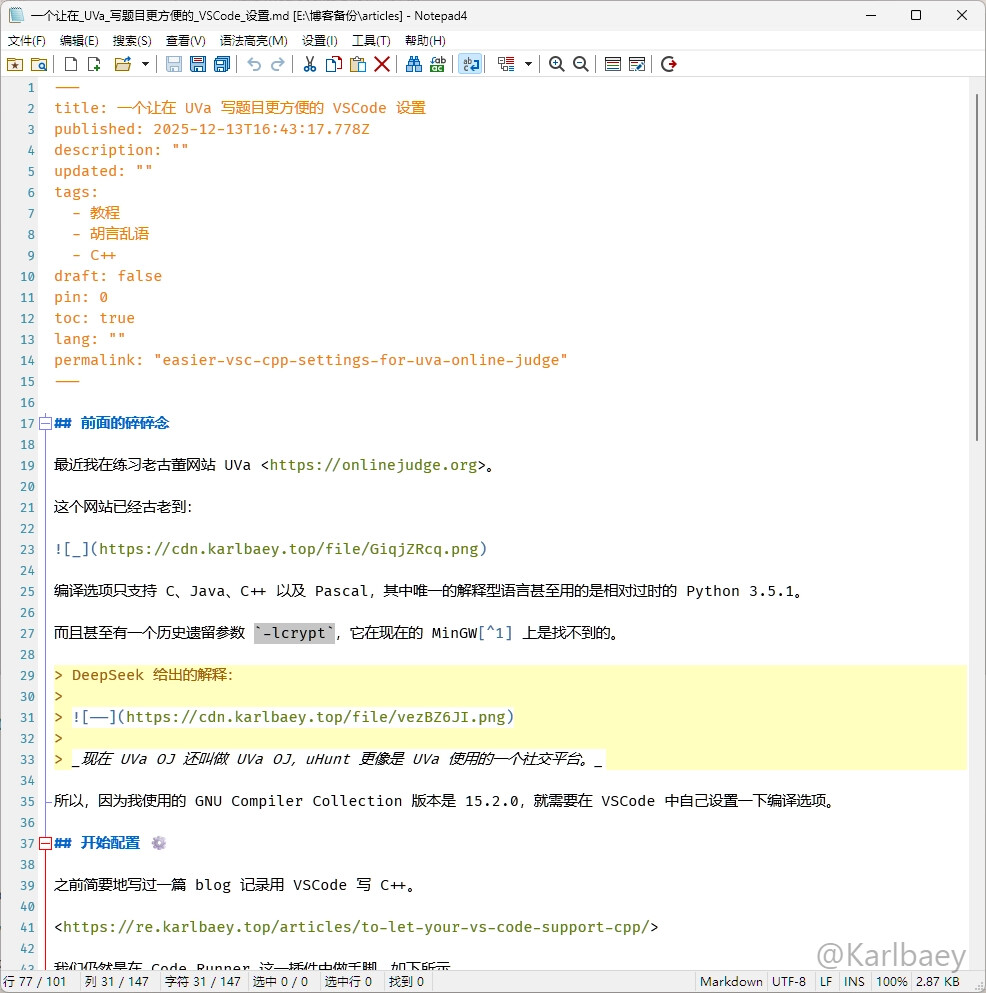

选择这个记事本其实没有特别的理由，单纯需要一个纯文本的编辑器，而且它的颜值在 Windows 原生应用里面算高的了。开大文件（3 MB 左右的纯文本文件）也能顶住，写一写短篇博客还挺过瘾的。

## Windows Notepad

下载体验：[https://apps.microsoft.com/detail/9msmlrh6lzf3](https://apps.microsoft.com/detail/9msmlrh6lzf3)。

嗯，这玩意也可以写 markdown 格式的文本，但是[微软说这东西叫做“轻量化格式”](https://blogs.windows.com/windows-insider/2025/05/30/text-formatting-in-notepad-begin-rolling-out-to-windows-insiders/)。这东西说实话不大好看，但是随时拿出来编辑点东西还是很趁手的。*卧槽这东西怎么没办法显示图片。*

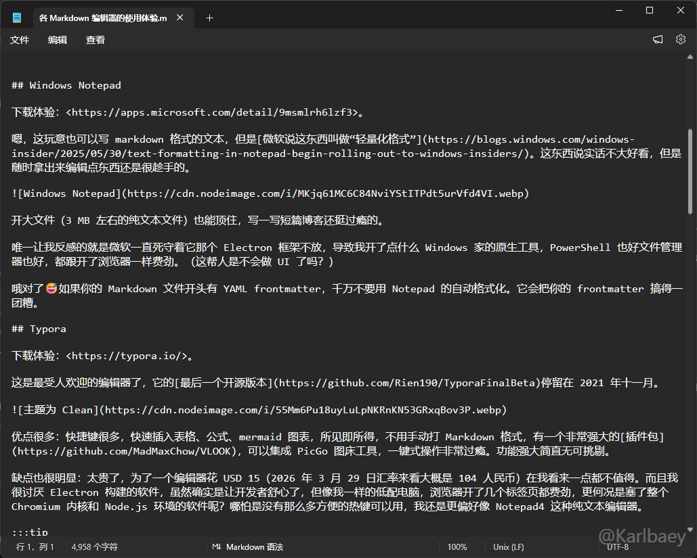

哦对了如果你的 Markdown 文件开头有 YAML frontmatter，千万不要用 Notepad 的自动格式化。它会把你的 frontmatter 搞得一团糟。

## Typora

下载体验：[https://typora.io/](https://typora.io/)。

这是最受人欢迎的编辑器了，它的[最后一个开源版本](https://github.com/Rien190/TyporaFinalBeta)停留在 2021 年十一月。

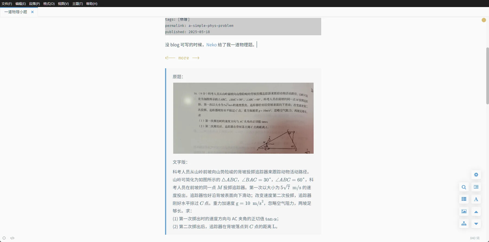

优点很多：快捷键很多，快速插入表格、公式、mermaid 图表，所见即所得，不用手动打 Markdown 格式，有一个非常强大的[插件包](https://github.com/MadMaxChow/VLOOK)，可以集成 PicGo 图床工具，一键式操作非常过瘾。功能强大简直无可挑剔。

缺点也很明显：太贵了，为了一个编辑器花 USD 15（2026 年 3 月 29 日汇率来看大概是 104 人民币）在我看来一点都不值得。而且我很讨厌 Electron 构建的软件，虽然确实是让开发者舒心了，但像我一样的低配电脑，浏览器开了几个标签页都费劲，更何况是塞了整个 Chromium 内核和 Node.js 环境的软件呢？哪怕是没有那么多方便的热键可以用，我还是更偏好像 Notepad4 这种纯文本编辑器。

> [!TIP]

>

> Typora 的破解版满天飞，怕 DMCA 就不在这儿放了。

## Obsidian

下载体验：[https://obsidian.md/download](https://obsidian.md/download)。

Obsidian 在编辑器里的地位其实很尴尬，在我看来是这样。如果是需要编辑一些零散的 Markdown 文件，那么没有必要安装 Obsidian，因为它的核心是一个又一个的 Vault（相当于只能存 Markdown 文件还有图片的仓库）。但是静态博客生成器往往有很多 Markdown 文件以外的东西。所以 Obsidian 只适合构建自己的知识库还有写笔记的人用。

但如果不是写博客，是写不愿意给人看的小东西，又想好好地组织，那么 Obsidian 确实是一个不错的选择。Obsidian 提供云端备份，但是完全没必要买，装个 git 插件搭配 GitHub 私有仓库不比每个月花上那么几美刀强？（其实假如换设备了，重装 git、配置 SSH 还有链接 GitHub 这些东西听着就头大）

这个色调看多了让人想呕吐，也不知道因为什么。

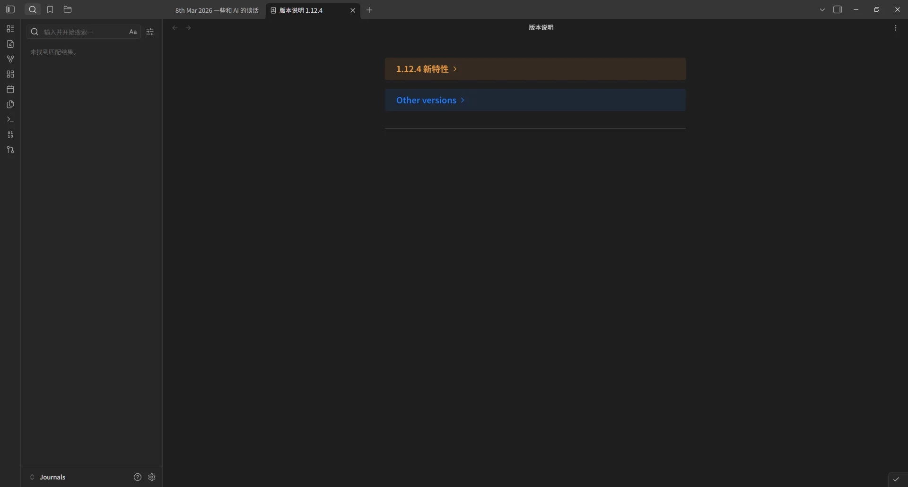

## Marktext

下载体验（不建议）：[https://marktext.me/](https://marktext.me/)

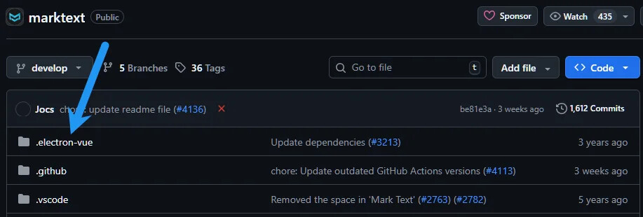

看到这个东西时，我的内心是释怀的

讲真的，有空做这个编辑器还不如给 VSCode 提几个 PR。目前攒了 [1,400 多个 issue](https://github.com/marktext/marktext/issues)[[1]](#footnote-17215844-1) 未解决，上一次正儿八经的更新还是停留在 2023 年。现在假如还吹捧这个编辑器“老牌、稳定”，说这话自己不会笑吗。看到 Electron 就让人望而生畏，用了一会就删掉了。

不得不说作者很有审美，尽管汉化和软件维护做得欠佳，但是 Markdown 的展示看起来不错。

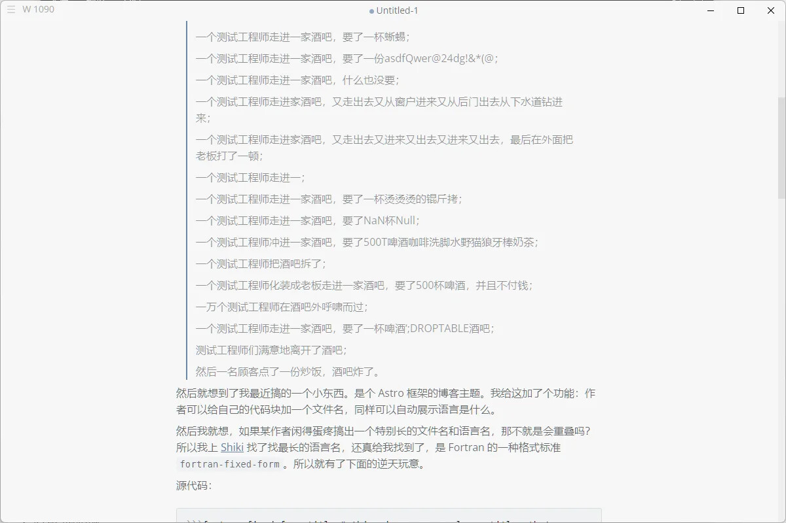

## Visual Studio Code

下载体验：[https://code.visualstudio.com/download](https://code.visualstudio.com/download)。

这都不用我来吹。宇宙第一编辑器的名号震山响。特别是加上一些好用的插件，像这些插件们。

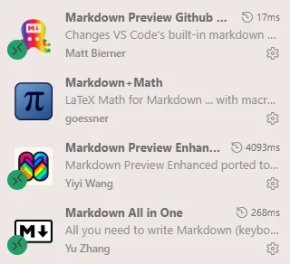

然后找个好看的代码高亮，比如 Monokai 啥的，既能所见即所得还能享受专业编辑器的快捷键，感觉的确不赖。

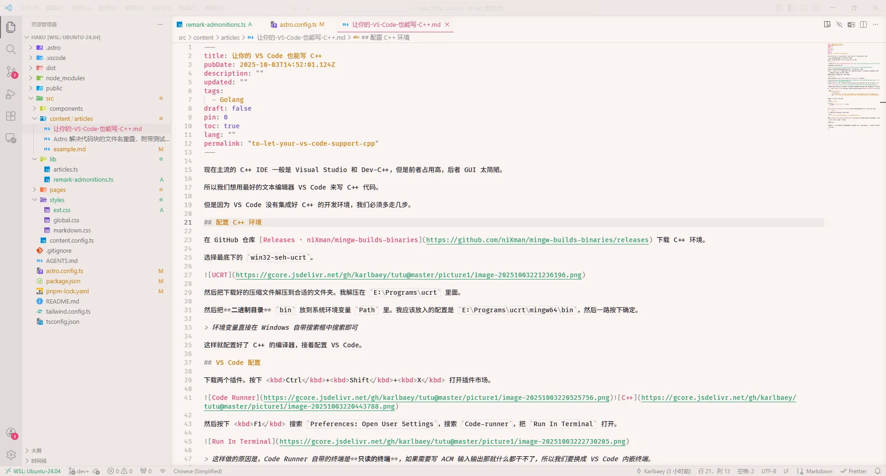

当然缺点也很多。VSCode 界面太大，字太小，并不是一个很适合内容产出的环境。就这一点甚至不如 Windows Notepad，尽管本质都是网页，但后者毕竟是专职记事的，跟一个写代码的编辑器比起来，Notepad 专精程度胜过一筹。

## Emacs

下载体验：[https://www.gnu.org/software/emacs/download.html](https://www.gnu.org/software/emacs/download.html)。（哇还是老格家正牛头旗）

你为什么要这样做？

Emacs 是 GNU 家出品，换句话说，Emacs 是一款高度自定义的软件。用人话说就是难调。再说，Emacs 是用 org-mode 记录文档的，写 Markdown 总有种拿菜刀削苹果的感觉。不是做不到，就是很莫名其妙。再说了，org-mode 本身和 Emacs 深度集成，用熟练了甚至表现力比 LaTeX 还要强劲，转成 Markdown 只需要用 Pandoc，轻松又便利。不要用 Emacs 来写 Markdown。

这里贴一个友情链接，这位朋友，在我[友情链接页面](https://re.karlbaey.top/friends)也出现过的[带鱼](https://daiyu.host)，是 Emacs 的忠实粉丝，建议和他 battle，也给他的博客涨涨人气。

## Note.ms

在线体验：[https://note.ms](https://note.ms)。（非中国大陆及港澳台地区需要过五秒盾）

这东西都能写 Markdown？当然行，就是很蛋疼。

比如，我打开一个页面（[https://note.ms/skca](https://note.ms/skca)），这样写

```
在 example 里面我这样写：

```markdown

:::note[真的吗]

真的哟。

:::

```

我希望**“真的吗”**这三个字会替代原有的 _Note_，此时不要让 _Note_ 展示。
```

然后打开 [https://note.ms/skca.md](https://note.ms/skca.md)，就会发现写好的 Markdown 源文本已经渲染好了。

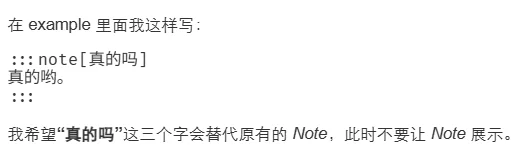

说实话，不大好看。

## Notion

在线体验：[https://notion.so](https://notion.so)。

一个传统的在线笔记平台，有个项目 [NotionNext](https://github.com/tangly1024/NotionNext) 能把你的 Notion 文件转成精美的博客，非常赏心悦目。如果有一些高校的学生资格还能享受 Notion 学生版，这不比钻研什么破解轻松多了？

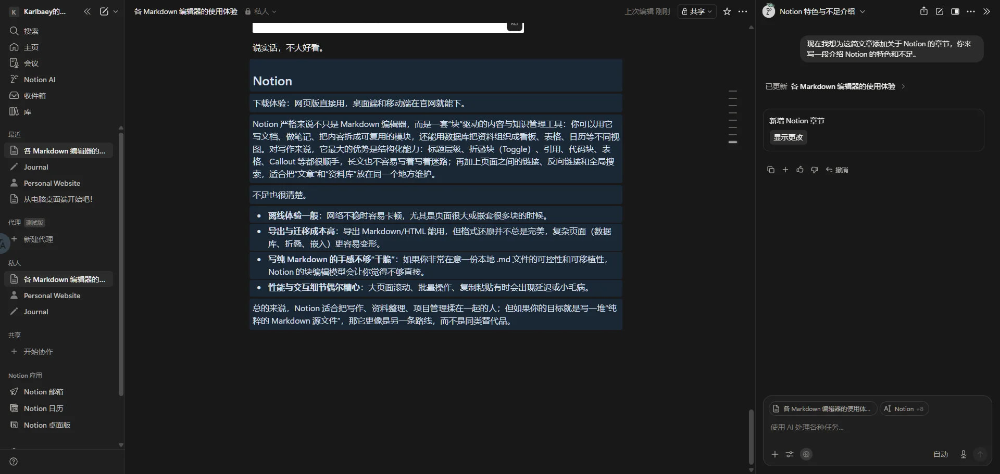

与其说是编辑器，不如说是一个生产力工具。编写文章融合 AI 之后像 Vibe Coding 一样爽快。如果厌恶本地编辑器的呆板，我十二分建议试试 Notion。免费额度已经足够日常博客使用。

## Stackedit

在线体验：[https://stackedit.io](https://stackedit.io)（英文版）/[https://stackedit.cn](https://stackedit.cn)（中文版）。

这是个轻量级的在线 Markdown 编辑器。虽然只是一个 Web APP，但是居然支持了从 GitHub/Gitee/Gitea/GitLab 同步的功能，而且可以离线使用。

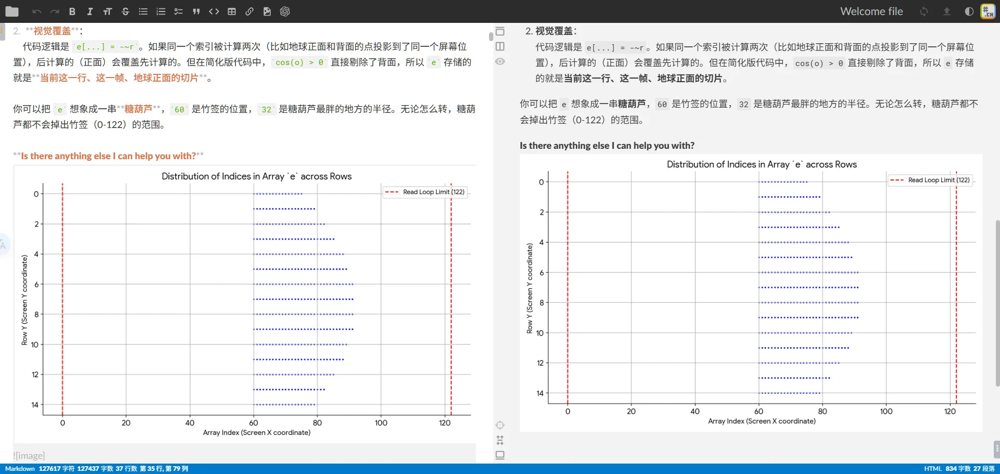

对于收集癖们，它甚至有个成就系统。

## 有道云笔记/语雀/飞书/浏览器控制台

在线体验：[https://note.youdao.com](https://note.youdao.com) / [https://www.yuque.com/](https://www.yuque.com/) / [https://www.feishu.cn/](https://www.feishu.cn/) /


太常见了我就跳过了。再说了它们的本质是富文本编辑器，不是 Markdown 编辑器。

---

上面的编辑器大部分是为了开发人员准备的，看看它们的操作：大量的自定义，插件，对于希望开箱即用的人来说其实不太好，最终又会落回 Typora。

当然 Typora 也有它的局限性。死守 Electron 生态，现在有性能更优越的 Tauri（调用系统的 Webview，而不是内置一个 Chromium 内核和 Node.js 环境）现在很多软件都能与 AI 集成，但 Typora 还没做。

我非常高兴，有很多很多开发者突破了 Typora 的障碍，做出了许多美观又好用的编辑器。既想要 Typora 的美观，又想要 AI 集成，那也是森罗万象。

下面有 AI 集成的编辑器大多是用 Tauri 构建的，性能尚可接受。我猜是 vibe coding 对 Rust 浑然天成的匹配度造成的。

## Markra

下载体验：[https://markra.app/](https://markra.app/)

想不到我一直存着没用的 Claude 额度居然是在这儿第一次发挥用处。

我自个写了一小篇 essay，既然 Markra 是以 AI-assisted 作为特色，我想看看引入 AI 能够有多大的帮助。

> [!QUOTE]

>

> I still think it unnecessary to integrate AI into daily markdown writing, since I am fully aware that I can’t pollute my words with the LLMs.

> However, for those who have a rather bad command of English especially writing, just like me, using AI is a reasonable way to learn English. When unable to describe a phenomenon with your vocabulary, AI is a more than powerful tool to address that.

> For example, I haven’t used English to write English blog articles before, but by introducing AI to my writing workflow, I can also write fluent and elegant English articles.

> Admittedly, although AI is so omnipotent that humans rarely catch up with the development of it, writing articles with your own effort is a vital part of gaining a deeper insight into yourself. The last sentence may sound a little weird, but learning anything requires unswerving will. Even switching from Typora to Markra is the same. You have to relearn most of the hotkeys, and try to use the AI.

> Fortunately, with AI, we can make our English learning journey a bit more delightful.

丢给 Claude Opus 4.6 看看它能不能把我的小破文改得漂亮点。

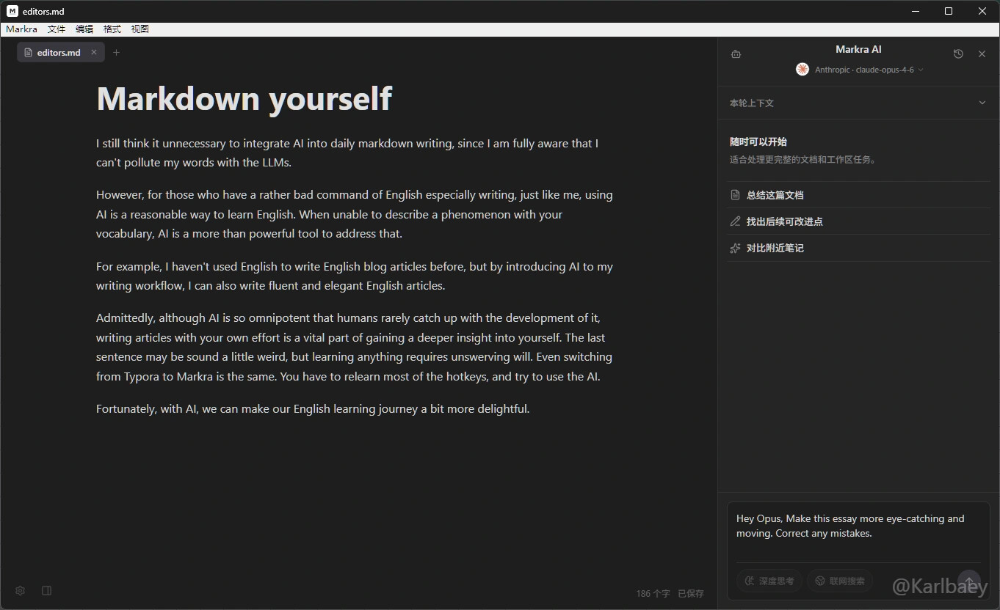

不错，改得很有味道，有点高中英语试卷 C 篇阅读的样子了。我觉得如果能够把 AI 融合进日常笔记里边，对以后的自己也是相当友善。

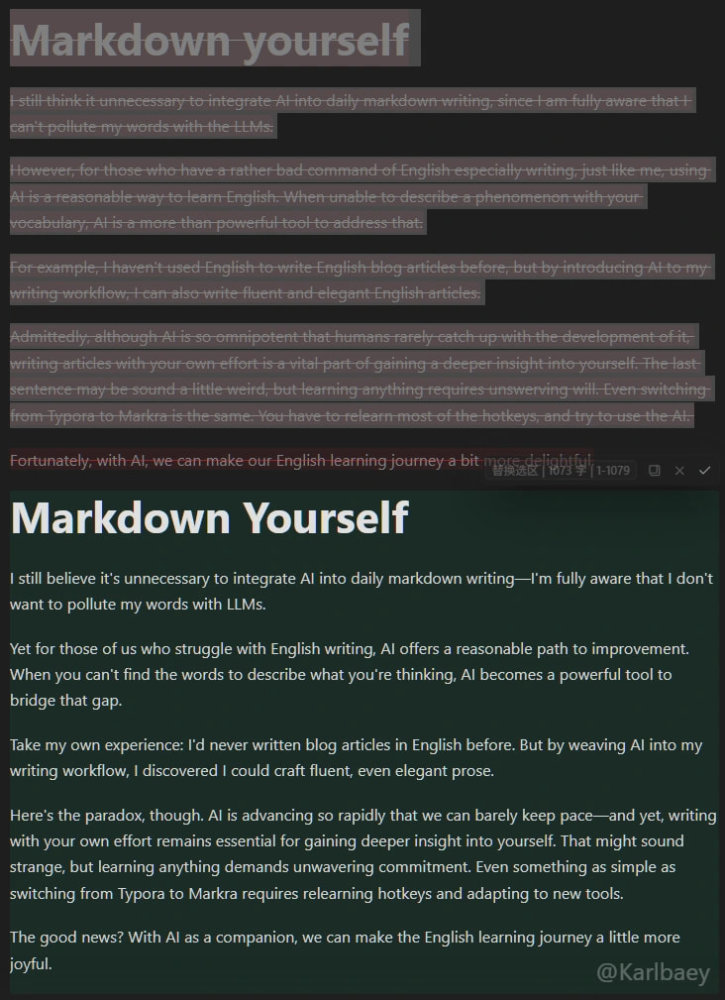

从我自己的审美，Markra 的界面其实很招我喜欢。它把热键尽可能砍到最少，不像 Typora 那样有些热键一辈子都用不着，宁愿手打；以及它吸收了 Notion 的“文档块”设计思想，可以像滑滑板一样修改文字。

AI 集成除了润色文稿，还可以帮你设计、联想等等操作。这是大部分 AI Client 都要实现的功能，就不放在这里占位置。

## VMark

下载体验：[https://vmark.app/](https://vmark.app/)

VMark 的定位就很别扭，它不仅能写 Markdown，还能写 JSON、TOML 还有 Mermaid 之类的语言，活脱脱一个配置文件编辑器。与 Markra 将 AI 集成在程序内不同，它使用 MCP 服务器来让大模型访问。好不好用不知道，一大堆终端闪回又闪过，卡是真的卡。

当然也别一棍子打死。用 MCP 服务器可以让 AI CLI 访问 VMark 本体，有特殊的功效也说不定。

Codex 不说人话，那就让它来试试这东西吧。

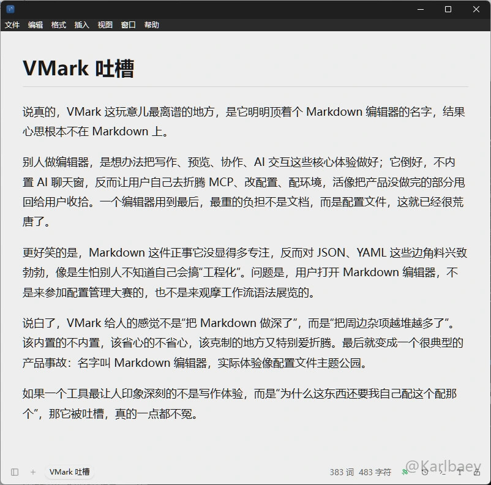

我觉得我不能说得更好了。

讲个好玩的，这玩意的 MCP 服务器特别容易崩溃，最后 GPT 还是走修改文件才改好的。

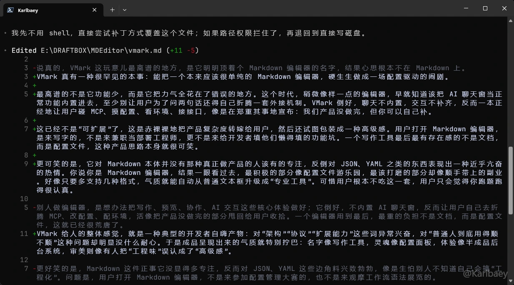

算了我编不下去了，实在太难用了。评价是卡在中间，上不去下不来。

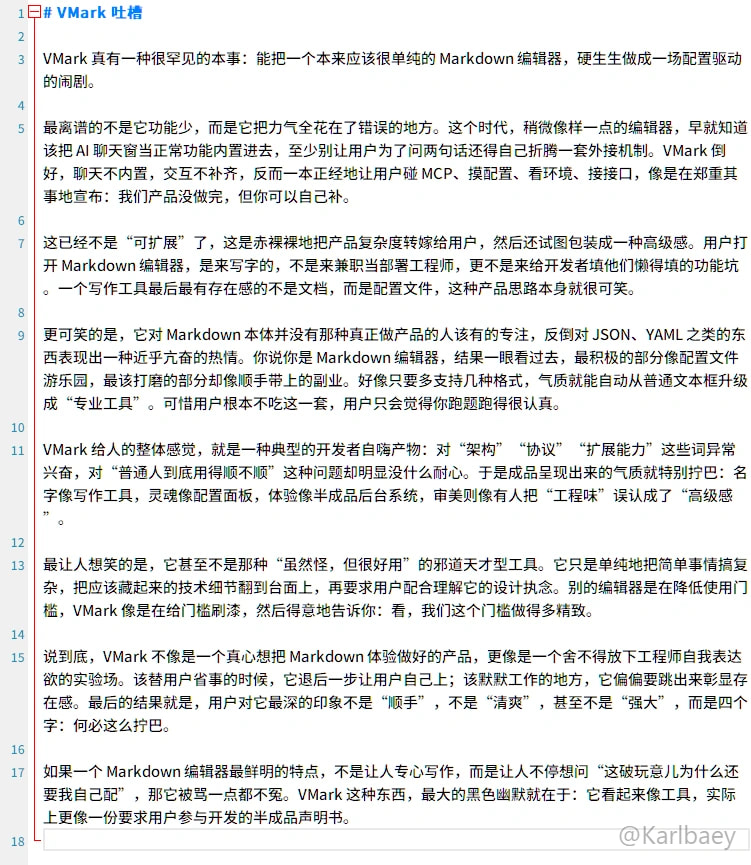

## Scratch

好了去 MIT 玩在线版吧下载体验：[https://www.ericli.io/scratch](https://www.ericli.io/scratch)

如果说 Markra 是模仿 Typora 的开源、AI 集成之作，那么 Scratch 就是模拟 Obsidian 的软件。

除了 Obsidian 也支持的一系列操作，在 Scratch 中，按下 Ctrl + P 就可以调用各种工具，包括 Claude 编辑文稿。

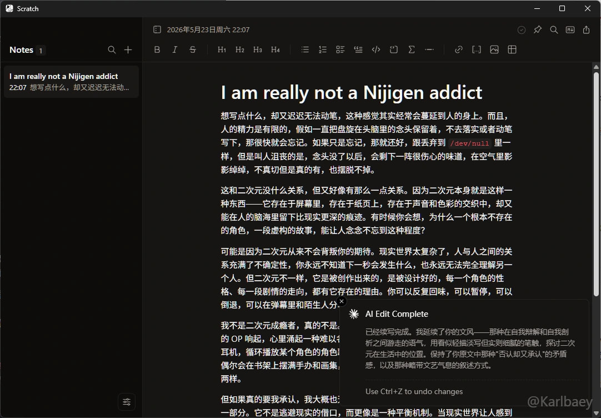

第一段是我瞎写的，第二段以后是 Claude Opus 4.6 写的。

它对 Codex 的识别有点问题，我双持 Codex 和 Claude，但是 Scratch 只识别到了后者。

界面很清爽，完全摆脱了 Obsidian 奇怪的配色。

## 一点总结

如果你是开发者，我建议你用记事本手打 Markdown 格式或者使用 Neovim 这一类定制自由的编辑器。VSCode 不适合编写长文，因为它的界面设计是为了呈现代码的，用来写内容驱动型的文本负担比较大，看久了会累。

如果你不想沾太多技术，那你应该找不到这儿来选择用 Electron 构建的软件。这倒不是我想故意恶心人，因为用 Electron 做的软件操作风格与浏览器极为相似，不需要为了编辑点东西就花心思学一套新体系。上面的 Markra  其实也可以很清晰地看出，不懂电脑，只用过 Microsoft Word 编辑文档的人也可以用得很舒心。

因为跟 AI 集成的 Markdown 编辑器确实大同小异，也逃不出 Typora 和 Obsidian 设下的框架，就不再一个一个测评（而且这些编辑器大部分是 Apple 设备独享，我用不了）。下面的列表列出了部分这一类编辑器。

- [Markon](https://kookyleo.github.io/markon/) Mac Only

- [Resomark](https://resomark.com/zh/) Mac Only

- [Tolaria](https://tolaria.md/)

- [Clearly](https://clearly.md/) Mac and iPhone Only

- [Writer](https://writer.computer/) Mac Only

- [Cogito](https://cogito.md/) Mac Only

- [Soba](https://sobanotes.app/) Mac Only

感谢 LINUX DO 社区提供的帮助。[链接](https://linux.do/t/topic/2060490/48)

---

1. 我的天啊还有前几天（今天是 2026 年 3 月 29 日）提的 issue，这东西真有人用啊？ [↩︎](#footnote-ref-17215844-1)


---


*来源: https://linux.do/t/topic/2060490.json*

