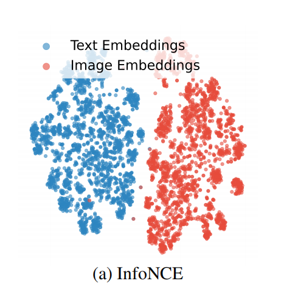
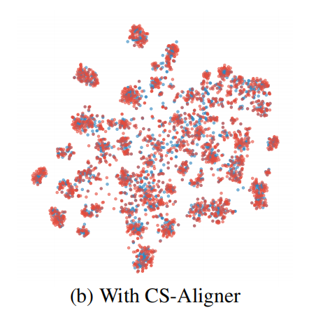
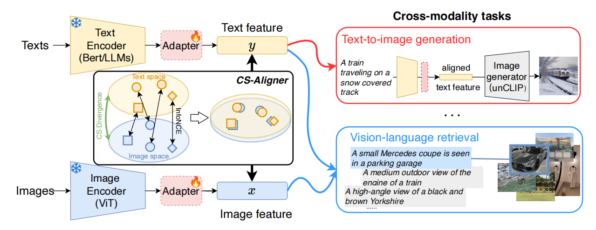
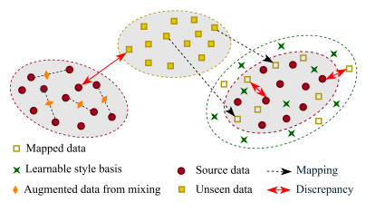
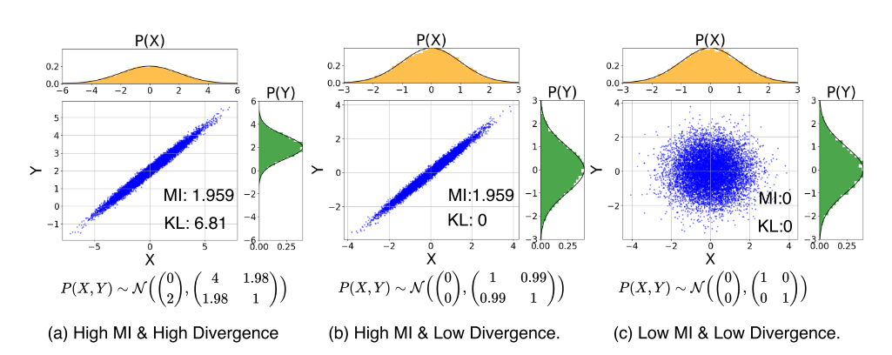
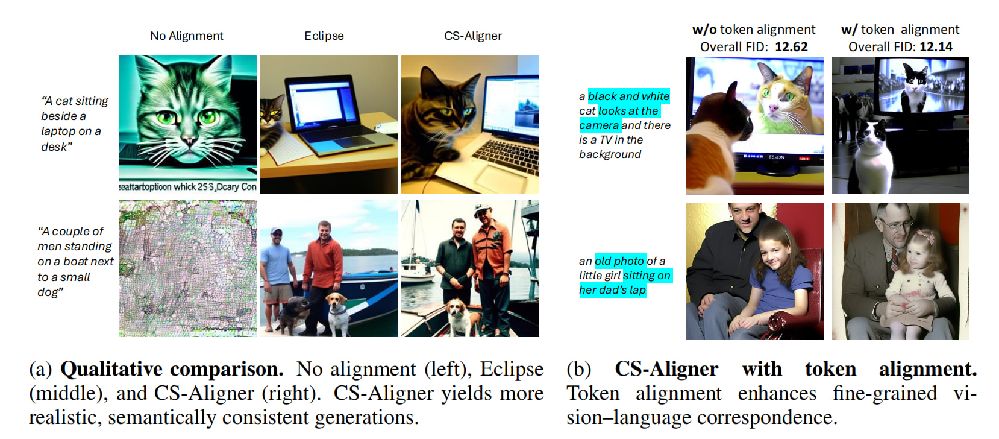

---

id: 2074535

title: "[论文随笔分享] CS-Aligner 基于柯西-施瓦茨散度的分布视觉语言对齐"

created_at: 2026-04-28T08:54:54.887Z

username: kaze-desu

display_username: "KAZE桑"

---

# [论文随笔分享] CS-Aligner 基于柯西-施瓦茨散度的分布视觉语言对齐

> DSv4降价消息一出来，瞬间瘫坐在椅子上，仿佛看到了原子弹爆炸一样 

>

> 咳咳，总之，本篇是笔记分享系列的第二期，本系列是用以促进自己精读论文的动力(读多论文就留下了扫读的坏习惯)，希望每次阅读时，能够细心一些分析有价值的论文，并将这些感悟记录下来，留给有需要的佬友。本论文分享系列会一直更新到我不读论文为止，持续聚焦LLM/Agentic/CV方向的论文。

>

> 此外，对于一些过于理论化的内容，我会迎合L站风格进行调整，让佬们的阅读体验更好些，争取我们的内容既保留原意，又能通俗易懂，让佬们可以将我的随笔当做茶余饭后了解领域特定知识的小杂文，我会尽可能在这方面下点功夫去优化的。

>

> 希望我的随笔系列可以作为有价值的内容，留存在L站中供佬们翻阅。

## 0. 元信息

论文标题：Distributional Vision-Language Alignment by Cauchy-Schwarz Divergence

单位：阿姆斯特丹大学, 新加坡管理大学

原始论文：[[2502.17028] Distributional Vision-Language Alignment by Cauchy-Schwarz Divergence](https://arxiv.org/abs/2502.17028)

会议：ICLR 2026

## 1. 前言

这篇论文所在的领域并非我的研究方向，其关注的是文本生成图像（T2I）与图像检索问题。我先前主要研究的是基于 VL 对齐的少样本域泛化，因此在阅读本文时，一些解释可能会带有域泛化领域的视角倾向。

论文整体思路简洁，仅通过增加一个额外的损失约束项，就有效缓解了跨模态特征分布对齐问题，非常具有启发性。此外，本文还考虑了 LLM 的引入，使得理解文本侧提示词的细粒度语义，以及直接扩大 Encoder 参数量增加理解能力成为可能。

## 2. 问题

1. 本文聚焦于 CLIP 等采用 InfoNCE 作为损失的对比学习方法，这类范式存在一个普遍的问题，它们试图将图文在表征层面进行对齐，却忽视了不同模态之间固有的模态差异，这导致后续大量方法都在试图弥补这一模态对齐的不足。

2. InfoNCE 优化时存在对齐冲突问题：它试图拉近正样本对，同时推开负样本对。由于在多模态任务中，负样本通常来自另一个模态，这一机制容易导致跨模态样本的错配。

3. 传统的 InfoNCE 试图从样本层面建立图文两者的关联，即假设一张图片对应一段文本描述。这里存在一个关键问题：如果是一段详细的图片描述，在模型看来，这段描述中的每个语义部分对于图像识别都应是等同重要的，这是因为 InfoNCE 将整段文本作为单一整体去匹配图像，因此无法充分利用描述内部的细粒度语义信息。

## 3. 动机

作者在观察 CLIP 训练得到的特征分布时发现：

CLIP 输出的文本和图像特征在 t-SNE 可视化中，可以明显看到两者之间存在一条泾渭分明的分界线。这条分界线就是 CLIP 因训练问题而形成的模态鸿沟：图像表征与文本表征在特征分布上天然存在距离，未能有效对齐。

作者认为，在 CLIP 在训练时，未能充分考虑到模态层面的对齐问题，未能捕获到不同模态下，样本在语义层面的相似性，仅是建立了同一图文对之间的关联性。而其他具有相似语义，但属于不同模态的样本被在优化的过程中自然被拉开距离，最终形成了同模态样本聚集、异模态样本分离的分布特征。

这一模态对齐失败问题的根源在于，InfoNCE 的监督信号并没有有效约束样本间语义层面的相似性，而是只在意样本对之间是否对对应关系，我们在观察InfoNCE的优化目标时就会发现这一问题，这是受制于MI(互信息)的影响，后面作者也给出了对应的可视化。

作者为此提出了CS-Aligner方法，有效的改善了这一问题，在不同模态之间，模型可以捕获到样本之间的语义关系，除了依照原先样本对之间有强关联外，不同模态下的样本还会依照语义聚集成簇，从而实现了语义相关且模态对齐的目标。我们可以从图中看到，模型的分布从原先明显的模态间差异，变为了不分模态，只分语义的簇。

## 4. 方法

本文方法的核心在于对损失函数进行改动，正如标题所示，引入了 CS 散度作为监督项。

在深入公式细节之前，我们先介绍整体的方法架构。CS-Aligner是一个非常标准的 CLIP 式双塔多模态编码器架构，作用于编码器最终的输出层，如果对CLIP有所了解，那么理解起来应该是熟悉而轻松。

值得注意的一点是，针对前文提到的细粒度语义理解问题，该方法专门在初始设计中就引入了 LLM Encoder，我们可以看到在Text流部分，方法允许使用基于Bert的编码器，或基于LLMs的编码器，这极大丰富了方法的想象力。

此外，图中右侧有两条蓝线和一条红线，用于指引模型的两种输出用途，对应了本文的两种推理设计，分别是 T2I 和图像检索任务。

在微调上， CS-Aligner 采用了Adapter的高效调优设计，允许任意编码器通过 Adapter 插入本方法（实践中使用的是Lora）。这种范式近年较为常见，训练保持高效，低参数量，是广大CLIP-Based研究者的福音。搭配上Lora，CS-Aligner 只需要作用于编码器最终输出的表征层即可实现对齐。

在架构图的方法示意部分中可以看出， CS-Aligner 的核心思想是在 InfoNCE 形成样本间关系映射之外，引入了新的 CS 散度，实现对模态间的分布距离进行约束，这一举措有效促使模型理解跨模态的语义关系，而不只局限于样本对之间的联系。方法从两个维度进行优化，实现良好的跨模态特征对齐效果。

本文的思想与我之前了解到的 Style-Pro 有一定相似之处，这里附上 Style-Pro 的示意图供参考（嘿嘿，读多了总能撞上几个相似的，有时候怪惊喜的）：

两者在结构上确实颇为相似。

### 4.1 样本级优化

本文主要引入了 CS 散度。此外，针对两种不同的文本编码器骨干类型(Bert/LLMs)，分别设计了两种不同的实现方式：Bert这类采用标准类别+图的样本对，进行样本级对齐方式进行优化，而LLMs这类采用复杂语义文本+图的样本对，则进行Token级的优化。

下面先从样本级对齐开始介绍。相较于 CLIP 采用的 InfoNCE，本文引入了 CS 散度：

\min( \; \underbrace{-I(x; y)}_{CLIP} + \underbrace{\lambda D_{\mathrm{CS}}(p(x), p(y))}_{本次引入的CS散度})

\tag{1}

假设输入分别为 $x$（图像特征）和 $y$（文本特征）。

公式中使用 \min，是因为我们希望最小化该损失函数，因此这两项共同构成了优化目标。

其中，第一项对应 CLIP 原始 InfoNCE 中采用的互信息（MI, mutual information）计算，旨在衡量 x 与 y 之间的依赖关系。由于我们希望正样本对之间具有强依赖性（即遇到 x 就能找到 y，反之亦然），而优化目标又是最小化损失值，因此此处对互信息项取负号，意味着 x 与 y 之间的依赖关系越大越好。

但仅有 MI 是不够的。作者分析发现，即使两者的关联度最大化，其边缘概率分布 P(X) 与 P(Y) 也并不受 MI 的直接影响。这意味着图像特征与文本特征在分布上的距离，并不会因 MI 的优化而自动缩小。

作者进一步展示了三种情况，分别是高 MI 高 KL 散度、高 MI 低 KL 散度、低 MI 低 KL 散度：

我们重点观察 MI 与 KL 散度的变化对分布 P 的影响。可以看到，MI 对模态样本的概率分布并不关心，这导致在优化模型时无法优化模态间的整体分布。作者表示，这阻碍了模态间的有效对齐，引发了前文所述的模态鸿沟问题。

为此，本文引入了 CS 散度 D_{\mathrm{CS}}(p(x), p(y)) 来计算样本 x 和 y 之间的特征分布距离，作为第二项优化目标。

下面详细展开这两个优化项：

\mathcal{L}_{\text{InfoNCE}} = -\frac{1}{2N}\sum_{i=1}^N \big( h(x_i, y_i) + h(y_i, x_i) \big)

\tag{2}

\hat{D}_{\mathrm{CS}}(p(x); p(y)) = \underbrace{\log\!\left(\frac{1}{M^2}\sum_{i,j=1}^M \kappa(x_i, x_j)\right)}_{\text{Image 自交互项 } S_{xx}} + \underbrace{\log\!\left(\frac{1}{N^2}\sum_{i,j=1}^N \kappa(y_i, y_j)\right)}_{\text{Text 自交互项 } S_{yy}} - \underbrace{2\log\!\left(\frac{1}{MN}\sum_{i=1}^M\sum_{j=1}^N \kappa(x_i, y_j)\right)}_{\text{跨模态交互项 } S_{xy}}

\tag{3}

InfoNCE 即 CLIP 原有的损失函数。在 CS 散度中，样本通过核密度估计（KDE）展开为分布进行计算，此处不再展开。

简单解释 CS 散度的公式：它计算图像样本内部的自相似性、文本样本内部的自相似性，以及两者的跨模态平均相似性，以此来衡量两个模态之间的分布相似性。其中，\frac{1}{M^2} 与 \frac{1}{N^2} 分别起到归一化作用。

### 4.2 Token 级优化

针对 Token 级输入，本文设计了另一种损失函数：

\mathcal{L}_{\text{token}} = \frac{1}{B}\sum_{i=1}^B \hat{D}_{\mathrm{CS}}(p(x_i); p(y_i))

\tag{4}

注意这里引入的下标 i。x_i 并非指第 i 个 token，而是指维度为 \mathbb{R}^{V\times D} / \mathbb{R}^{L\times D} 的一组 Token 向量。此外，B 表示 batch size，用于对结果进行归一化处理。如果输入为 Token 形式，则 CS 散度将在两个模态间逐 Token 计算分布距离。

## 5.实验

可视化结果如下：

从实验结果来看，对齐效果显著。

## 6.结语

本文提出了一种全新的 CLIP 特征分布对齐思路。在优化过程中，除了使用 InfoNCE 损失外，还引入了CS散度作为整体模态分布对齐的补充，并设计了 Token 层面的对齐机制，填补了将 LLM 引入 CLIP 范式时的空白。整体上是一篇具有启发性的工作。

## 下篇预告

下篇写世界模型，最近在忙着搬家和调研论文，一直没忙过来，这两天闲下来就开始写 

---

*来源: https://linux.do/t/topic/2074535.json*

