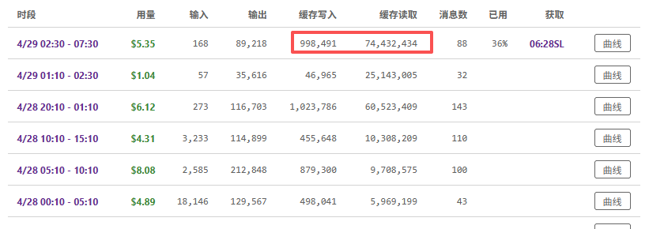

---

id: 2083834

title: ":fire:【省钱系列14】独家发现一个不好的秘密，Claude Code里文本任务与编程任务的额度算法是不同的"

created_at: 2026-04-29T13:59:00.032Z

username: dwqxq1

display_username: "dwqxq1"

---

# :fire:【省钱系列14】独家发现一个不好的秘密，Claude Code里文本任务与编程任务的额度算法是不同的

### 省流

#### Claude Code我现在解方程得到，编程额度算法是

金额 = 输入×$5 + 输出×$25 + 写缓存×**$3.125** + 读缓存**免费**

#### Claude Code我现在解方程得到，文本额度算法是

金额 = 输入×$5 + 输出×$25 + 写缓存×**$3.125** + 读缓存×**$0.25**

#### sub2api拼车/中转站/cursor/ccapi/ccusage算法

金额 = 输入×$5 + 输出×$25 + 写缓存×**$6.25** + 读缓存×**$0.5**

#### 影响

因为写缓存一般占总成本30%，读缓存60%，读缓存token数是写缓存的10-50倍，造成文本任务，包括写文章，Chat等，消耗额度速度是编程的2-3倍

比如5x-opus4.7-max写文章，每分钟消耗1%左右5h额度，100分钟消耗光

编程可以单线程连续用200-300分钟，就是3.5-5小时

我推测claude web，app，cowork，Computer use，甚至Design都是按照文本算法计算的（未测试）

写作算法贵2-3倍，对编程用户影响不大，

对拿Claude Code当Chatbot用的人有影响，尤其是上传文档等大上下文

对拿Claude Code接入Obsidian(Claudian插件)等写作的用户影响较大

是一直就就两种定价，还是A÷最近偷偷改的，也不清楚，太鸡贼了

---

*来源: https://linux.do/t/topic/2083834.json*

