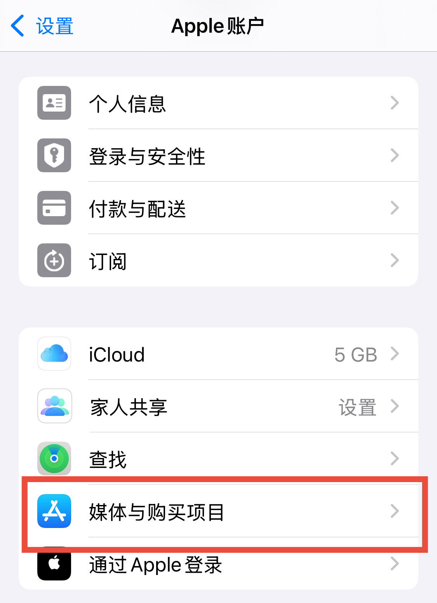
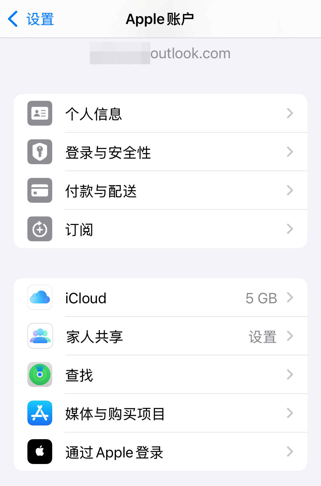
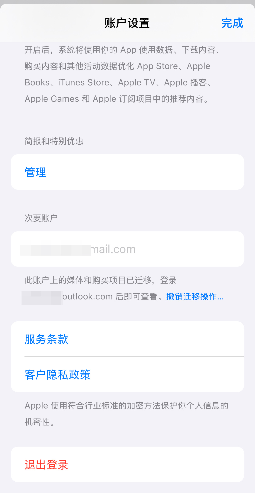

---

id: 2132727

title: "浅谈关于Apple ID苹果账户迁移购买项目"

created_at: 2026-05-08T05:01:20.735Z

username: azoth

display_username: "azoth"

---

# 浅谈关于Apple ID苹果账户迁移购买项目

介于论坛中苹果账号转区话题佬们已经讨论烂了，今天来聊点新的，**苹果购买项目迁移**。

先贴上苹果官网说明

[将购买项目从一个 Apple 账户迁移到另一个 Apple 账户 - 官方 Apple 支持 (中国)](https://support.apple.com/zh-cn/117294)

*先说一下我的情况，2014年注册的国区苹果账号，当时的苹果生态佬们应该都了解，一块钱的瘟疫公司、地狱边境、纪念碑谷、阿尔托的冒险随便买，不过19年之后就不同了，我之前也没注意，只是发现中区AppStore越来越拉，直到前年才根据教程注册了一个美区账号，从此放弃中区账号开启了新世界大门。另外我有比较严重的仓鼠病，特别喜欢屯app，一遇到内购限免就下载解锁卸载一条龙，偏偏美区各种app活动又多，我不到两年已购项目中下载了大概2000个app。在去年我又学会了苹果账户换区，于是把我的10年的中区账号又转到了美区，发现还是老账号香。又把美区账号就在亚洲各区换着转。因为毕竟中区账号用了10年，消费更保险一点。*

最近发现一个现象，在我用中区内购的app切换为现在的美区账号登录后，内购无法恢复已购状态。经典的例子就是Star walk2，我用美区账号恢复已购并下载后，AppStore切回中区发现内购又要进行再次购买，查阅后才知道Apple 的内购机制存在两个版本：StoreKit V1 和StoreKit V2，简单来说以后会有越来越多的app会无法通过切换账号享受原购买账号获取的内购，这对我这个仓鼠病患者非常不友好，于是最近看到了购买项目迁移，马上来试了试。

**准备工作**

主账号：美区（设置里登录那个用于iCloud的苹果账户）

迁移账号：国区（只用于购买app项目的苹果账户，不涉及iCloud，*也是打算放弃使用的苹果账户*）

首先确认两个账号都开启了双重认证。要迁移的账号近15天内没有下载app和消费过，并且迁移账号目前没有包含任何订阅，没有余额，也没有加入家庭组，然后通过转区将这个账号转到主账号的地区（美区），我习惯在浏览器中的苹果官网修改地区，大家可凭个人习惯。另外为了防止其他问题我将迁移账号地区改为了和主账号的相同免税州。

**操作方式**

在苹果设备的设置中登录主账号，点击媒体与购买项目，点击退出登录，然后再选择”不是主账户“，登入迁移账户的账号和密码，再点击“媒体与购买项目”，往下滑就能看到迁移购买项目选项，确认后就迁移成功了。

**回答几个问题**

一、是否需要将苹果设备升级到最新系统？

答：五一假期迁移到的美区，iOS18.7.7，正常迁移。迁移后马上就能在主账号登录的AppStore里看到两个账户共同的已购项目。但苹果说最长需要15天，可能与地区有关。

二、迁移账户是不是废了？

答：迁移后在其他苹果设备上再登录迁移账户的AppStore，已购项目已经不能打开，可以说取消了购买app的功能，但浏览器中还能正常登录。

三、可以反悔撤销迁移吗？

答：可以撤销迁移，迁撤销后迁移账户依然可以正常使用。但官网提示1年内此迁移账户不能再次迁移，所以慎重。

四、迁移账户之前的购买内容出现风险会不会涉及主账户？

答：个人认为应该不会，目前的感觉更像是迁移账户依附于主账户，如果迁移账户出现问题，应该只会涉及迁移的账户及购买内容，不会对主账户产生影响。但目前无法验证。

五、迁移后的再进行购买内容属于主账户还是两者兼有？

答：只属于主账户。迁移账户只服务于之前的购买项目。

六、主账户还能否携带迁移账户自由换区？

答：尚未验证。

PS：如果两个账户购买过相同的内容，最新下载记录会覆盖旧的下载记录，比如主账户的微信是1日1日下载，迁移账户之前是2月1日下载，那么已购记录中微信的下载日期就会变成2月1日。不过只要两个账户中有一个解锁过内购就可以在app里恢复购买。

总结：这个功能相对鸡肋，思来想去只适合我这种后知后觉的仓鼠病人，毕竟佬们基本不只一个苹果账户，最大缺点就是只能同地区账号迁移，这对在各区有刚性锁区的app完全没办法，比如国区迁移到美区，豆包肯定消失在已购中。只对账号太多又嫌麻烦的佬们可能有点帮助，因为这个功能限制较大，论坛里一直没什么人讨论，所以今天浅谈，如果佬们有更好的条件验证其他问题或想法，算我在此抛砖等引玉了。 

---

*来源: https://linux.do/t/topic/2132727.json*

