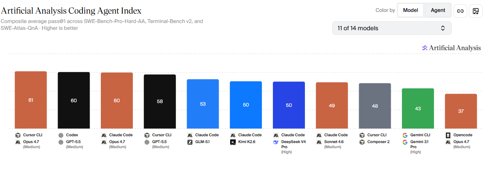

---

id: 2158981

title: ":fire:【Harness系列9】Artificial Analysis Harness评测，同样opus4.7，在不同CLI/IDE下，表现相差巨大"

created_at: 2026-05-12T02:15:27.315Z

username: dwqxq1

display_username: "dwqxq1"

---

# :fire:【Harness系列9】Artificial Analysis Harness评测，同样opus4.7，在不同CLI/IDE下，表现相差巨大

以前评测都是针对大模型，针对harnness的评测非常少见

比如相同opus-4.7-medium，在cursor cli里是61分，在Claude Code里是60分，在opencode里只有37分

来源：[AI Coding Agent Index & Performance Analysis](https://artificialanalysis.ai/agents/coding-agents)

---

*来源: https://linux.do/t/topic/2158981.json*

