---

id: 2168982

title: "最近买邮箱发现的一些批量邮箱管理软件整理"

created_at: 2026-05-13T09:42:24.258Z

username: Miku1

display_username: "name"

---

# 最近买邮箱发现的一些批量邮箱管理软件整理

# **1.Outlookmail**

开源软件，支持多种邮箱和批量OAuth2导入和刷新、GPTMail、DuckMail、Cloudflare多开邮箱。但是不能发件。提供免安装exe文件即点即用，非常方便，也是楼主正在用的软件。

URL： [GitHub - assast/outlookEmail · GitHub](https://github.com/assast/outlookEmail)

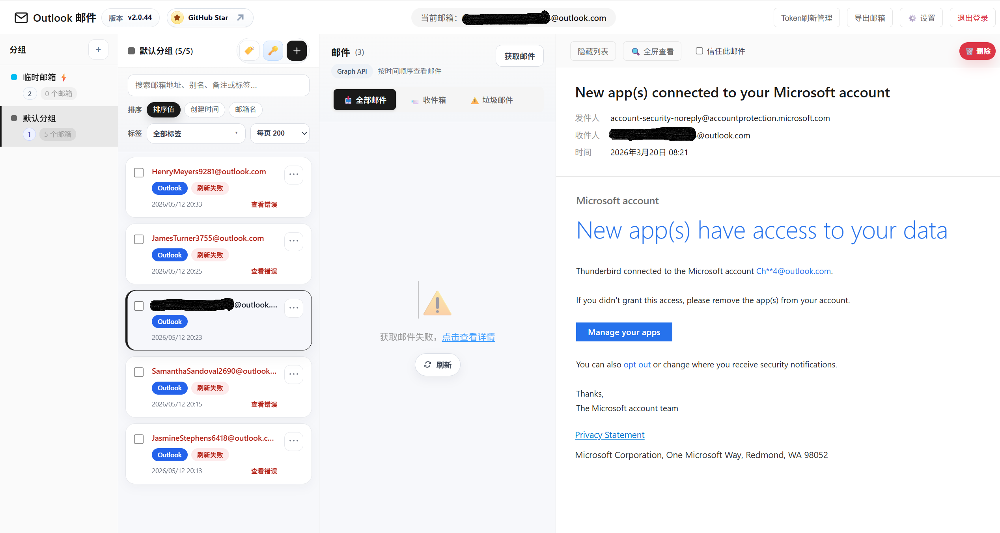

# **2.雷鸟(thunderbird)**

Mozilla基金会的开源邮箱软件。支持OAuth2登录、插件市场丰富，没有IOS端。作为日常使用的邮件客户端也很合适。

URL：[Thunderbird — 解放收件箱 — Thunderbird](https://www.thunderbird.net/zh-CN/)

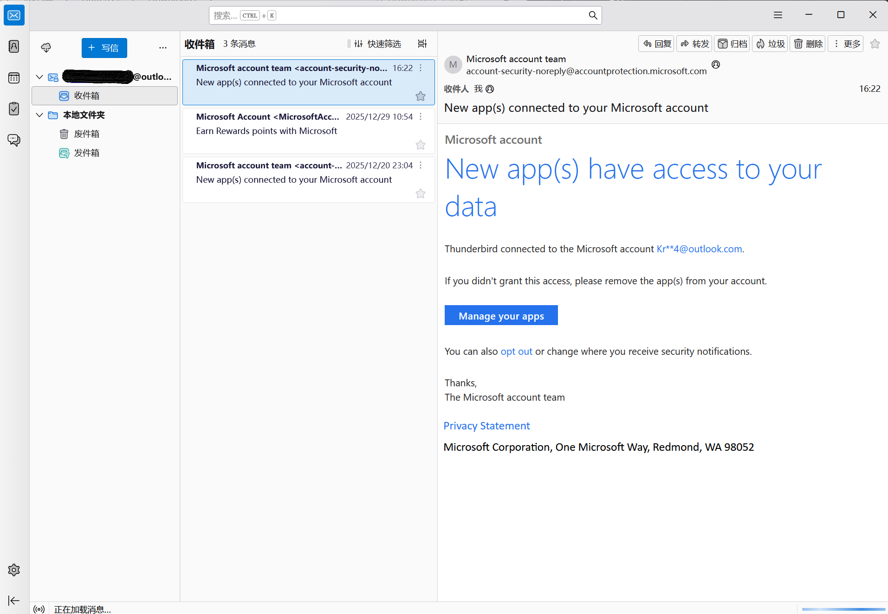

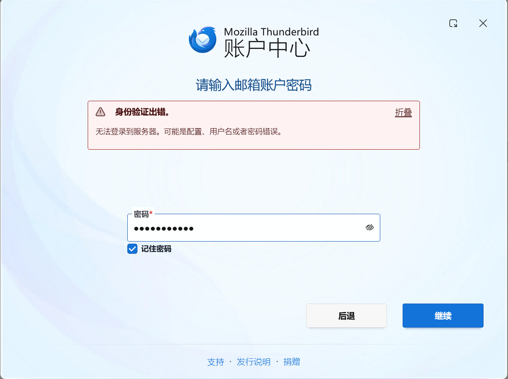

**正确操作步骤：**

在完邮箱之后，点击受手动配置：

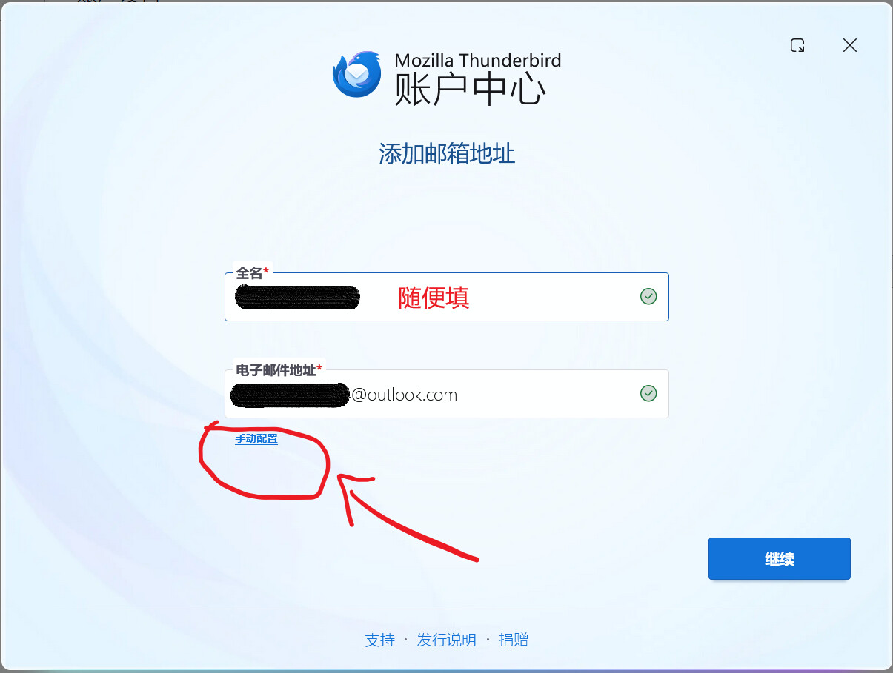

按下图进行收件服务器的参数配置，然后点击"继续"：

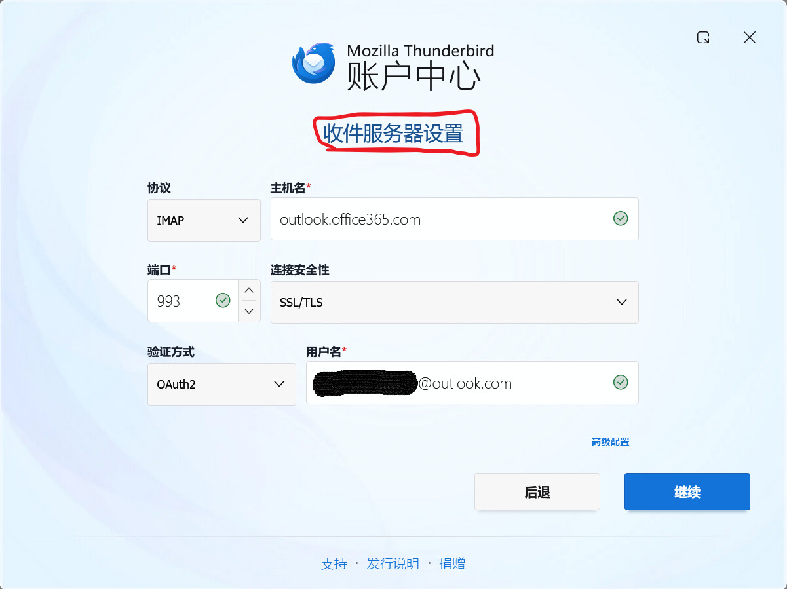

按下图进行发件服务器的参数配置，然后点击"测试"和"继续":

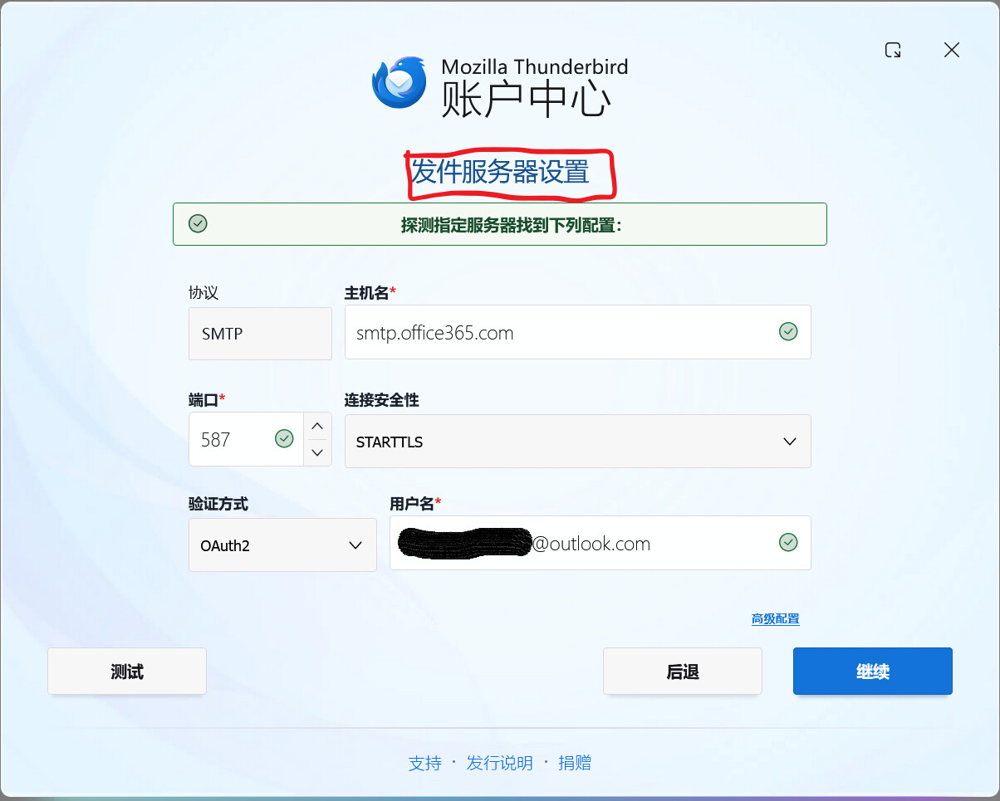

弹出认证页面，输入邮箱密码，然后就可以登录成功了：

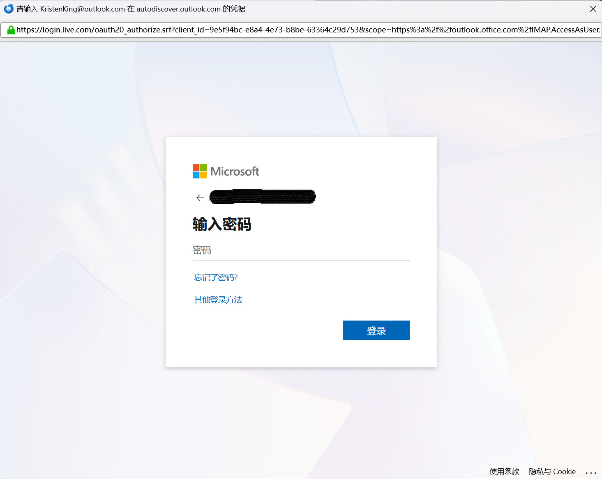

# **2.Foxmail 邮箱**

一个很经典的邮箱客户端。支持多个邮箱账户。只有基本的邮件收发功能，对于大概有二十几个邮箱的人也足够用了。

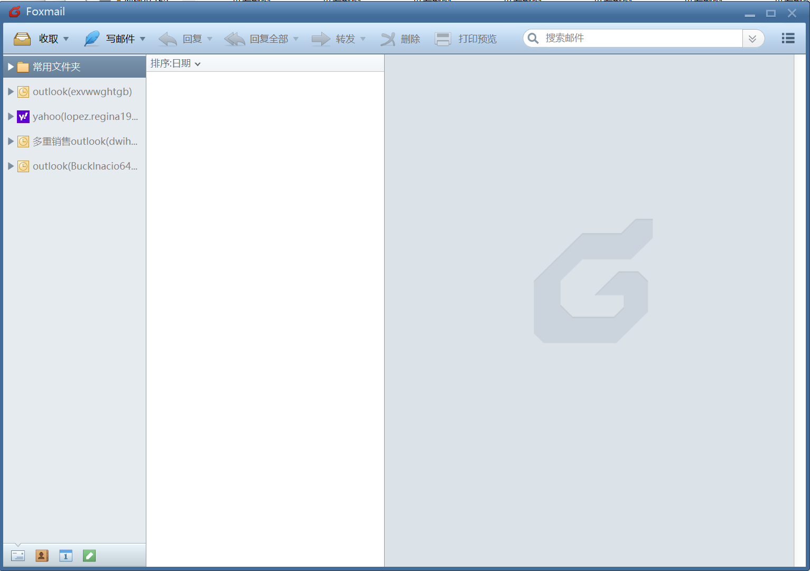

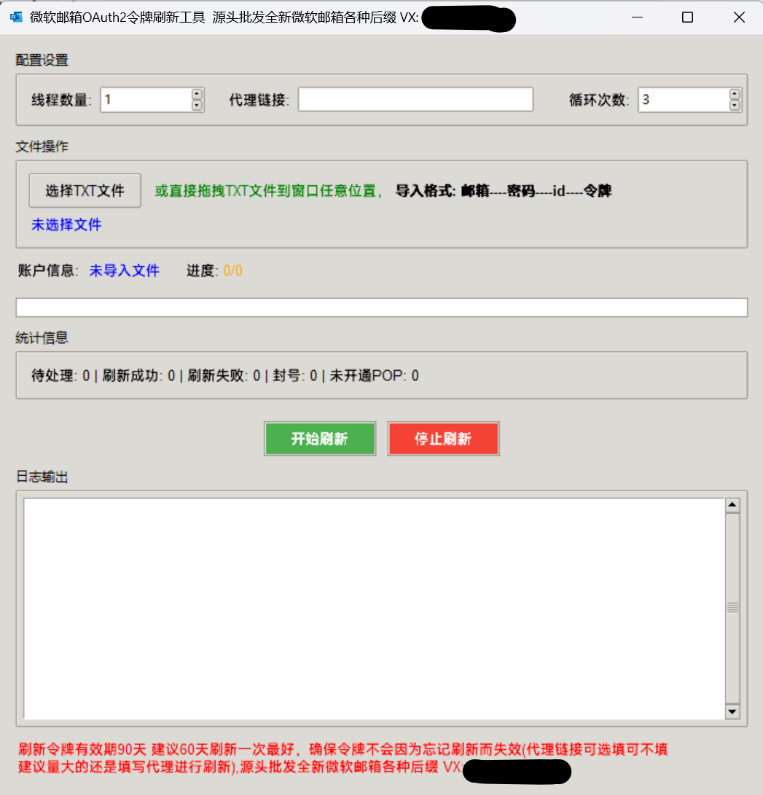

下载URL： [https://www.123912.com/s/pvK7vd-0PvIH?notoken=1](https://www.123912.com/s/pvK7vd-0PvIH?notoken=1)

病毒扫描报告： [微软邮箱OAuth2令牌刷新工具 25.12.22.exe - Jotti's malware scan](https://virusscan.jotti.org/en-US/filescanjob/pj4fshplow)

# **3.心蓝邮件助手**

URL: [https://www.bhdata.com/soft/22372356.html](https://www.bhdata.com/soft/22372356.html)

有很多年历史的老牌软件，支持IP池、批量发件、识图、绑辅助邮箱等非常多的自动化功能，但是69.80元一年的费用也不便宜。感觉应该适合非常大量的专业邮箱玩家。

**据佬友反馈：心蓝邮件助手存很多功能需要另外付费的现象。**

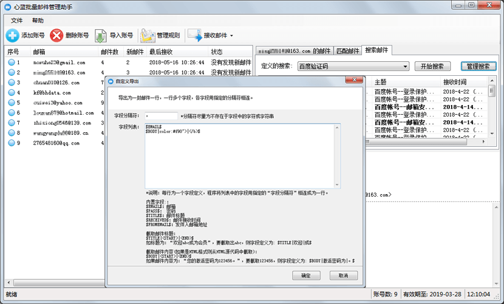

# **4.OutlookMailPlus**

和Outlookmail类似的一个项目也不能发件，但是功能更多：有浏览器扩展、智能识别验证码等，专为注册而生。使用需要docker部署或从源码运行，对于小白不是很方便。

URL：[GitHub - ZeroPointSix/outlookEmailPlus: Outlookmail Plus: Designed Specifically for Registration | Outlookmail Plus：专为注册而生 | · GitHub](https://github.com/ZeroPointSix/outlookEmailPlus)

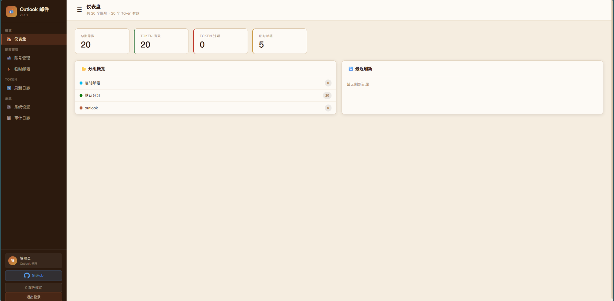

# **5.各种邮件商提供的在线邮箱管家**

经过抓包证实这种在线式的邮箱会把账密和token传到他们的后端服务器上。除非是在对应店铺买的，否则**不建议使用**。名称多有邮箱管家字眼，但是我找了好久也没有找到对应的部署程序，比较神秘。

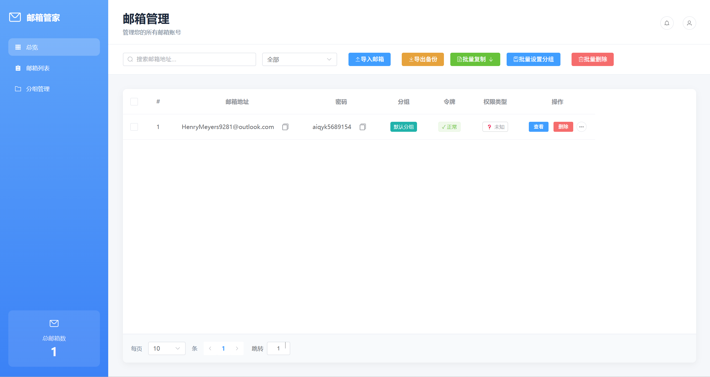

## 欢迎佬友回帖补充，本贴实时更新，转载请遵守CC-BY

---

*来源: https://linux.do/t/topic/2168982.json*

