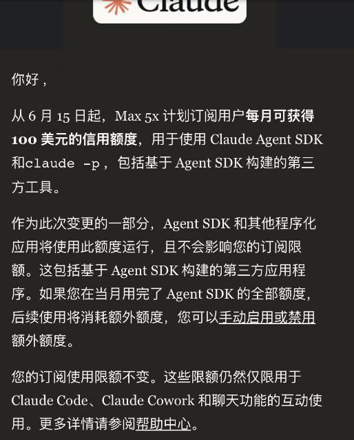

---

id: 2173592

title: ":fire:【Harness系列10】A÷又双叒干坏事，6月15日起对claude -p/SDK等砍掉90%额度"

created_at: 2026-05-14T03:57:40.790Z

username: dwqxq1

display_username: "dwqxq1"

---

# :fire:【Harness系列10】A÷又双叒干坏事，6月15日起对claude -p/SDK等砍掉90%额度

### 啥是claude -p

可以简单理解成cli版的claude code api(是harness的api，不是模型本身的api)，通过stdin/stdout传输Claude Code的提问和回答

Codex CLI也有对标的codex -p，Gemini CLI有gemini -p

claude -p是很多Claude Code生态第三方程序/插件的基石，例如Obsidian插件Claudian

### 政策变化

原来：claude -p与Claude Code共享折算成api$3000+的额度

6月15之后：claude -p与Claude Code分家各算各帐了，为了安抚你受伤的心灵，赏你$100/$200的api额度可以用于claude -p(相当于原来额度的10%以下)，超过了就自己另付钱买api额度，走api价格，是max价格十倍

6月8日，A社会发邮件通知领取api额度。

### 注意有几个问题

①sub2api拼车或中转站能不能用claude -p

②oauth拼车能不能用claude -p

即便能用，应该也是车头去领钱，乘客共享，因为乘客没有账号密码，无法领钱

③如果每个月都要手动领取api额度的话，账号密码用户领钱要小心，注意风控

之前a社为了补偿用户，每人送了$100/$200，结果有部分人登录官网web，可能是因为这几个原因，一领钱就被封号了，怎么看着像钓鱼

Ⓐ指纹浏览器没搞好

Ⓑip分流没搞好，浏览器用了与Claude Code不同的ip，

Ⓒ领钱要绑卡，绑了虚拟卡/U卡/国内卡

### 对于大量使用claude -p开发程序或插件的用户非常不利

是的，尤其对于自己开发程序或插件，用claude -p对接Claude Code max的人，等于一下子削弱90%额度

### 什么要A社即打压claude -p，又不全封

claude -p堪称cli版api，a社这就是折中搞分流，

如果全砍了，对现有生态影响太大，很多claude生态都是建立在claude -p之上的，例如Obsidian的Claudian插件

如果完全不管，Claude Code价格只有api十分之一，让这些生态第三方白嫖又不甘心

而且Claude Code得盈利模式的根基，就是用户手动输入提示词才是消耗额度最大的瓶颈，

用户手动可能平均只能用到50%甚至更少的周限，

但claude -p很多都是生态里其他软件发的自动提示词，很容易把周限用满，

那相当于A社在这个用户上面成本翻倍，这根封龙虾的逻辑一样

### 为什么说包月盈利模式本质上类似健身房

为什么20x四人拼车是主流，说明中等码字速度的用户，只能用掉20x额度的25%，其余75%沉淀就是A社的利润空间，如果每个人都把20x额度用到100%，a社赔死

这也是A社玩命对sub2api封号的原因

包月这个盈利模式，跟健身房有点像，每个人开年卡的时候都觉得自己能天天去健身，实际上热血几天，后面频率越来越低

如果健身房每个客户都天天去，场地和设备根本远远容纳不下他的会员总数

现在claude -p和openclaw，相当于每个健身房年卡用户，都派了个unitree 机器人，代替他去每天健身，从早练到晚，把老本吃回来，健身房老板肯定亏啊，肯定要想办法把这些机器人撵出去，或者限制机器人每天只能练一小时

---

*来源: https://linux.do/t/topic/2173592.json*

