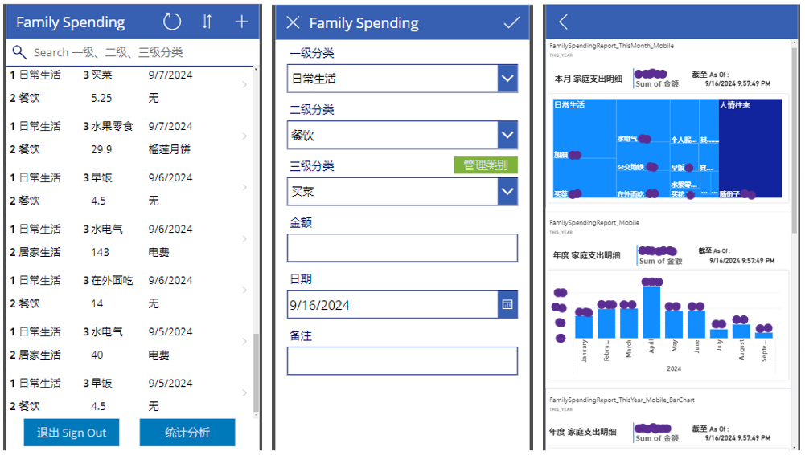
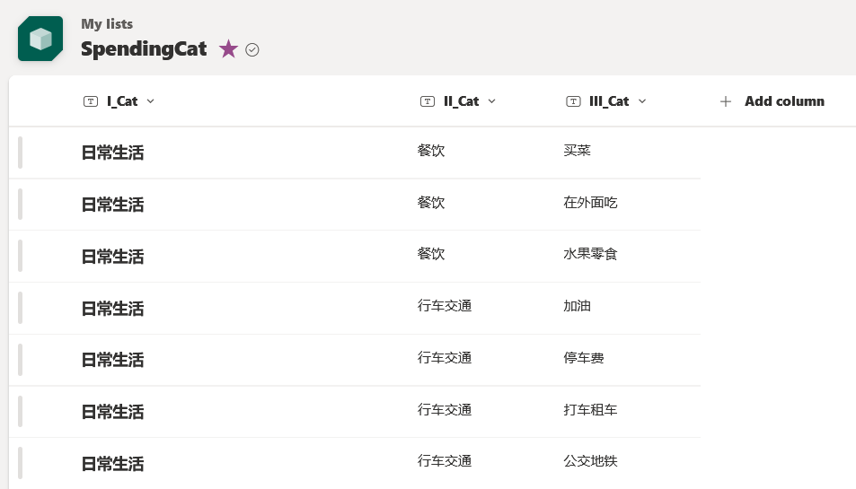
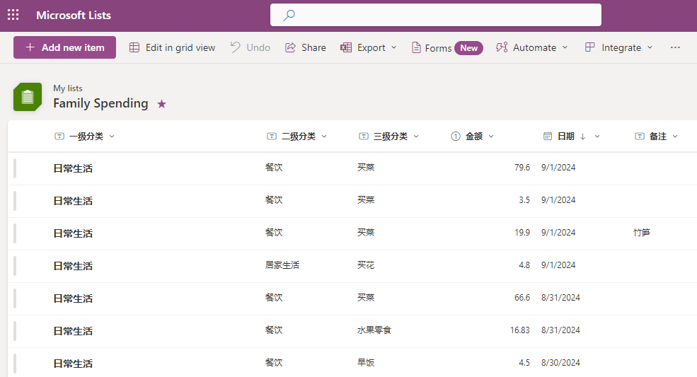
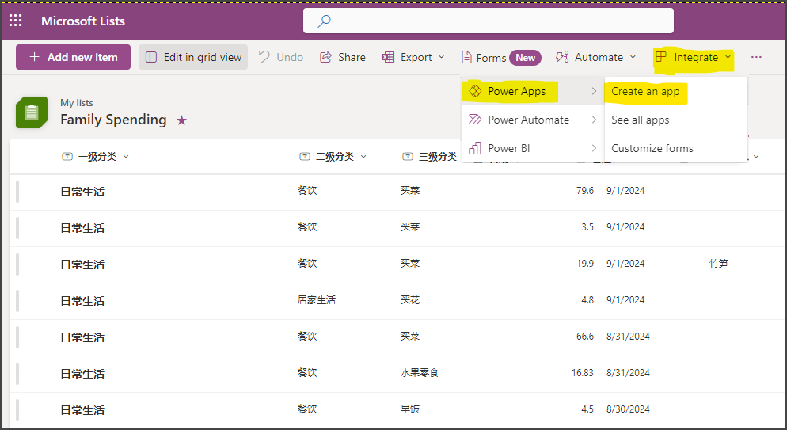
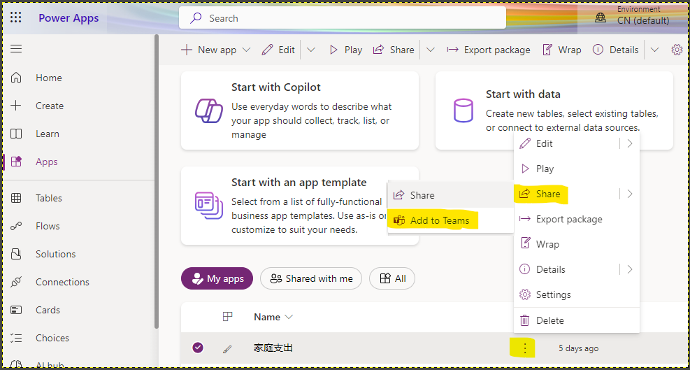
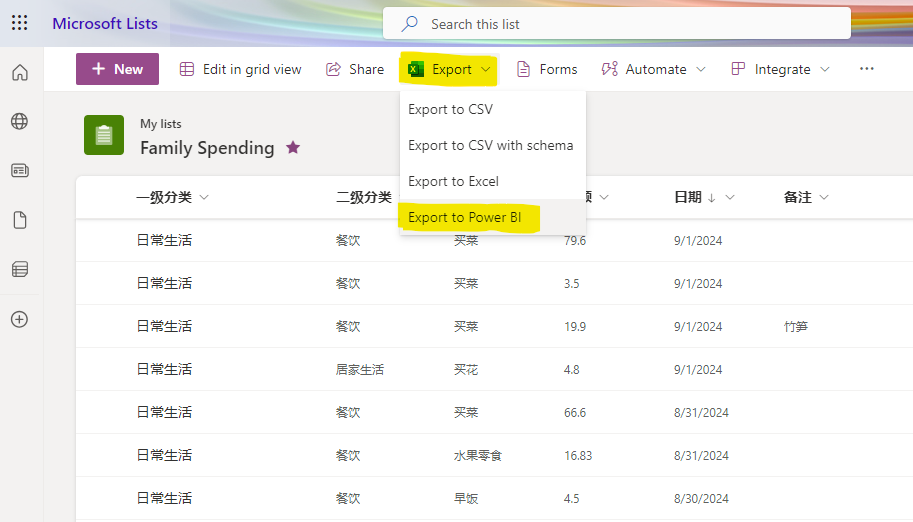
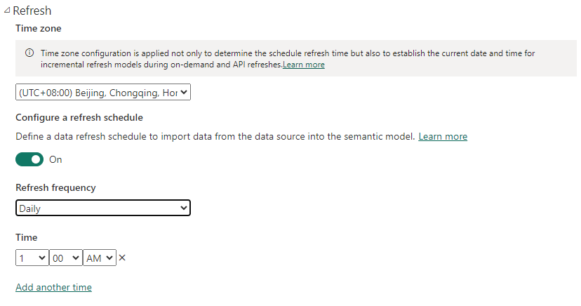
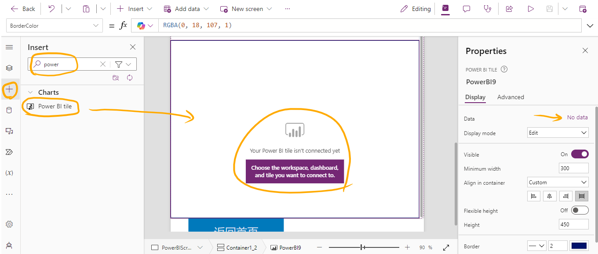
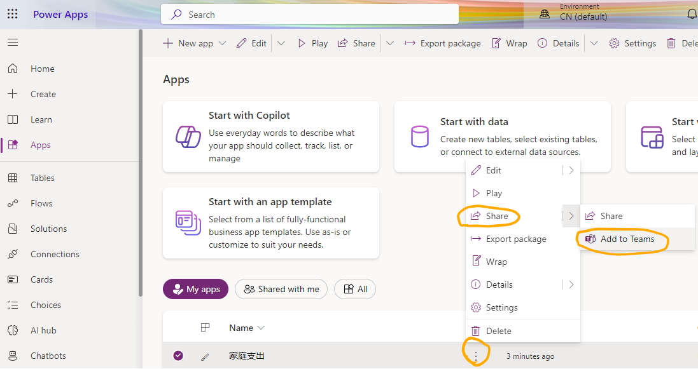

---

id: 220676

title: "利用Microsoft 365全家桶自制家庭记账应用"

created_at: 2024-09-30T08:31:39.689Z

username: zhuzx

display_username: "Nathan"

---

# 利用Microsoft 365全家桶自制家庭记账应用

自从用上 Microsoft 365 之后，发现它可以完美的用于家庭记账的场景。

一直以来，我都在寻找一款好用的记账软件，但是在试用了一些软件之后，我发现很少有软件可以完美贴合我的需求：

- 无广告

- 数据可以导出

- 数据可以存放在云端

- 数据完全自主可控

- 记账的分类清晰

- 界面简洁

- 分析图表可以按自己的需求定制

- 免费

而 MS365 基本可以满足我的所有需求。

先看结果：主要分为三屏，第一屏显示已记账的条目，第二屏是添加新的记账，第三屏是统计分析；

已记账的条目为 拉取自 Microsoft Lists 里面已经保存的支出条目；

添加新的记账 是将 新的支出 保存到 此 Microsoft Lists 里面，因为用此 Power Apps 较直接使得 Lists 应用在手机端更为方便记账；在这一屏还有一个管理分类的入口，可以对一、二、三级分类进行管理，添加新的分类；

统计分析页面，可以定制化显示各种对已记账的支出进行各式各样的分析，这里显示的利用 Microsoft Power BI 生成的各种报表，图形分析有多种选择，此处只是显示了其中的两种；

实现方式：

- 创建一个专门的支出分类 Microsoft Lists 列表，新的支出在记录时可以选择相应的分类。

- 创建一个专门用于存放记账相关信息的 Microsoft Lists 列表，用于保存每一条支出信息。

- 基于此 Microsoft Lists 的 Microsoft Power Apps，它可以编辑记账的 Microsoft Lists列表。

- 将 Microsoft Power Apps 发布到 Microsoft Teams，这样就可以在 Teams 里面进行记账。

- 对 记录支出的 Microsoft Lists 制作相关联的 Microsoft Power BI 报表，可以实现对家庭支出进行分析。

设置 Power BI 报表的自动更新方式，比如按天更新

- 将 Microsoft Power BI 报表添加到 Microsoft Power Apps的页面中，可以在 Power Apps 直接查看相应的更新后的支出分析

- 最后，将准备好的 Power Apps 应用添加到 Microsoft Teams里面就可以了

这样，每次消费后，在手机上打开 Microsoft Teams 应用，就可以直接添加支出记录。添加的记录，也会在第二天的凌晨1点自动更新到 Power BI 报表中，这样一来，第二天在 Microsoft Teams 里面查看 Power Apps 应用，也可以看到相关的图表分析，对家庭的支出情况有更好的了解。

下面，让我来详细说明下具体的步骤：

- 定义支出分类列表，保存为 Microsoft Lists

这里，我是使用的是三级分类来定义一项支出，其中:

第一级分类：主要包含 日常生活、旅游度假、节日专项等；

第二级分类：主要包含 第一级分类下的各种细分项目，比如日常生活，我是按照 餐饮、行车交通、居家生活、居家住房、文体娱乐、看病构成；

第三级分类：主要包含 第二级下的各种细分项目，比如行车交通下面，又分为了 加油、停车费、打车租车、公交地铁、飞机、火车、车险、私车保养、过路费、其他；

以上只是符合我们家庭的情况，大家可以按自己的需求设置；

每一行代表一种组合，将分类设置好后，我们就可以进入下一步，准备记账用的 Microsoft Lists了；

- 创建存放记账相关信息的 Microsoft Lists 列表

可以按下图进行创建：一定要在记账列表里面包含分类的信息：一级分类、二级分类、三级分类（皆为文本），金额（数字）、日期（日期）也是必不可少的内容，另外最好再添加一列用于备注（文本），方便在使用过程中识别某项支出是否已经记录在册；

- 登录到 Microsoft Power Apps页面， [https://make.powerapps.com/](https://make.powerapps.com/)  创建新的 App 记账应用

也可以直接在 Microsoft Lists 页面，点击  Integrate → Power Apps → Create an app 实现；

需要对系统自动创建的 app 进行适当的调整，就可以实现我在文章开始中放的截屏的前两页了；Power Apps操作并不难，只需稍加查阅相关的官方文档或者网络教程，此处暂且不表；截屏里面的第三页（分析图表需要在Power BI里面制作图表后，再添加到此 power apps 应用，后面会讲）

此时，其实已经创建好了一个记账应用，打开应用就可以实现记账。

- 将 Power Apps 应用添加到 Teams:

- 对已记账的内容制作 Power BI 报表

首先需要将 Lists 内容导出到 Power BI，这样会生成一个 dataset，然后需要做的是，设置刷新频率。

设置刷新频率：可以在Power BI的页面里，找到设置，设定按天或周，在某个时区的某个特定的时间进行刷新。我设置的北京时间每天凌晨1点进行刷新；

然后，就可以制作 Power BI 报表了，报表会在 dataset 刷新后也自动刷新的；

制作好的报表，可以添加到一个叫做 Dashboard 的地方，因为 Power Apps内可以引用此处添加的 BI 报表。

- 将 Microsoft Power BI 报表添加到 Microsoft Power Apps的页面中

这个只需要在Power Apps中，添加一个 power BI 报表就可以了，有相应的组件，选择 Power BI Dashboard里面的内容就可以了。

- 将做好的 Power Apps 添加到 Microsoft Teams里

之后，便可以在 Teams 里面使用了，可以直接在手机端进行记账或是查看支出的统计分析，十分方便   。

---

*来源: https://linux.do/t/topic/220676.json*

