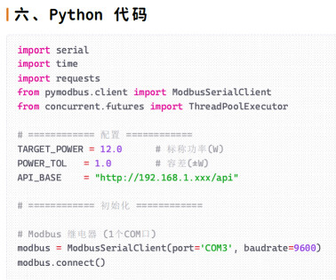
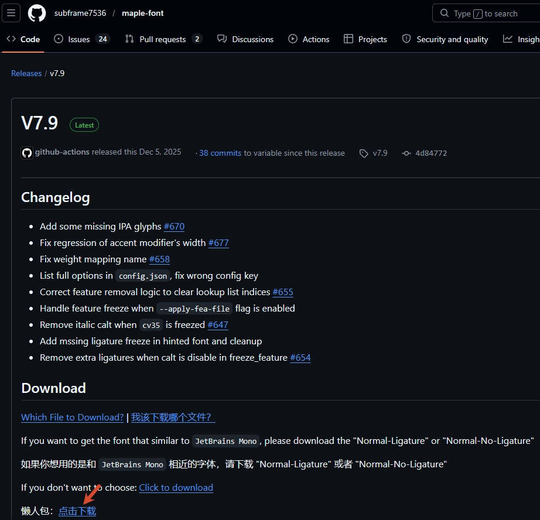
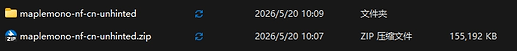
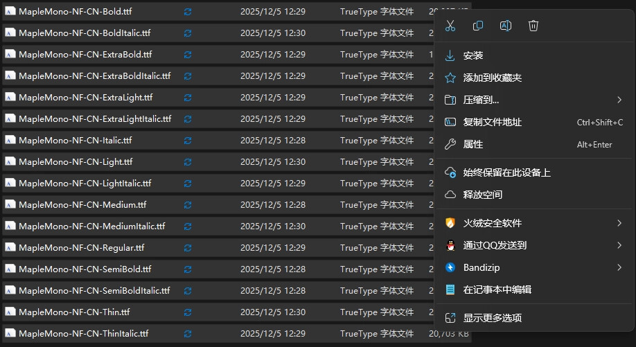
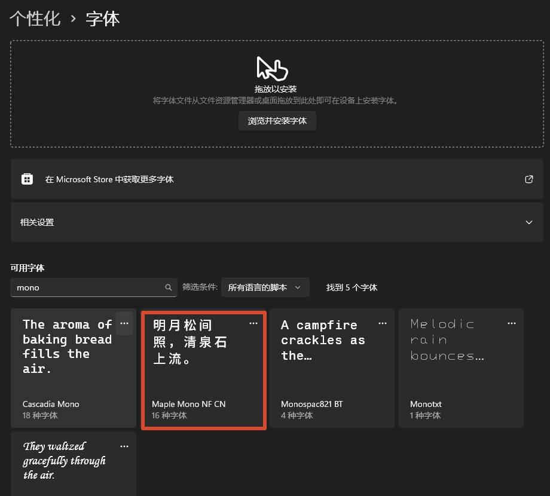
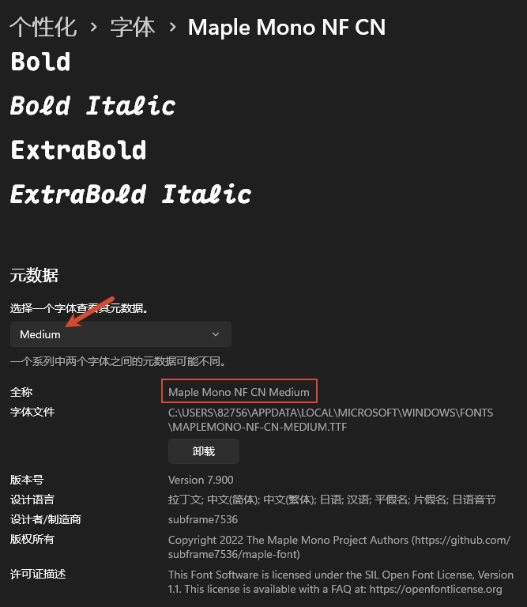
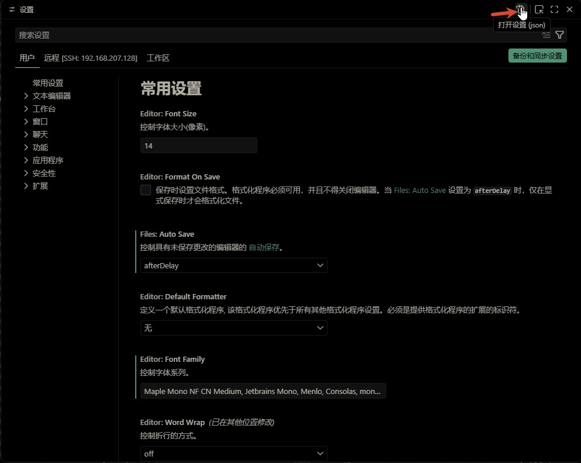

---

id: 2220027

title: "Vscode更换Maple Mono等宽字体"

created_at: 2026-05-21T08:54:31.403Z

username: alex_huang

display_username: "烧味"

---


# Vscode更换Maple Mono等宽字体


### 字体效果

同事发我时，初看确实很惊艳。先上效果：



### 具体步骤

1. 进入Maple-font官网，下载懒人包


[Release V7.9 · subframe7536/maple-font](https://github.com/subframe7536/maple-font/releases/tag/v7.9)




2. 解压




3. 选中所有的ttf文件，右键，点击安装




4. win11设置中，搜索字体进入设置页




5. 点击进入，可以看到各个字体；然后选择你喜欢的字体，注意这个字体的名称




6. 接下来进入vscode，使用快捷键`ctrl + ,`进入设置页面，点击右上角进入settings.json配置文件。




7. 在配置文件中加入以下配置指令

> Maple Mono NF CN Medium 是上面为你喜欢的字体名称，每种字体名称不同。

```
# setup font family
"editor.fontFamily": "Maple Mono NF CN Medium, Jetbrains Mono, Menlo, Consolas, monospace",
# enable ligatures
"editor.fontLigatures": "'calt'",
# or enable opentype features
// "editor.fontLigatures": "'calt', 'cv01', 'ss01', 'zero'",
```

1. 自动保存后退出，就可以收获好看的代码界面和终端了

### 参考文章

- [开源、免费、可商用，思源黑体、思源宋体、Maple Mono下载和安装指南](https://www.bilibili.com/video/BV1GYKpzDEFx/?share_source=copy_web&vd_source=1a9c06fbc2a82dcf44ac3679ca48af45)

- [maple-font/source/features/README.md at variable · subframe7536/maple-font](https://github.com/subframe7536/maple-font/blob/variable/source/features/README.md))


---


*来源: https://linux.do/t/topic/2220027.json*

