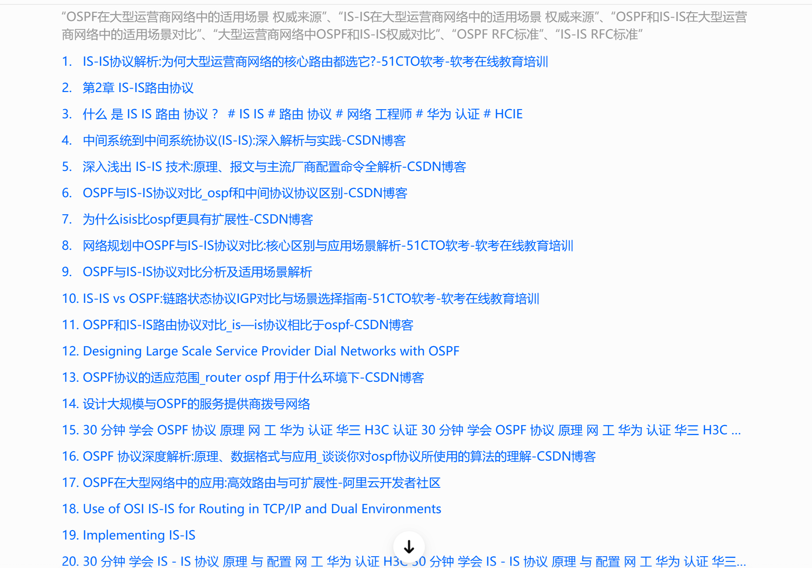
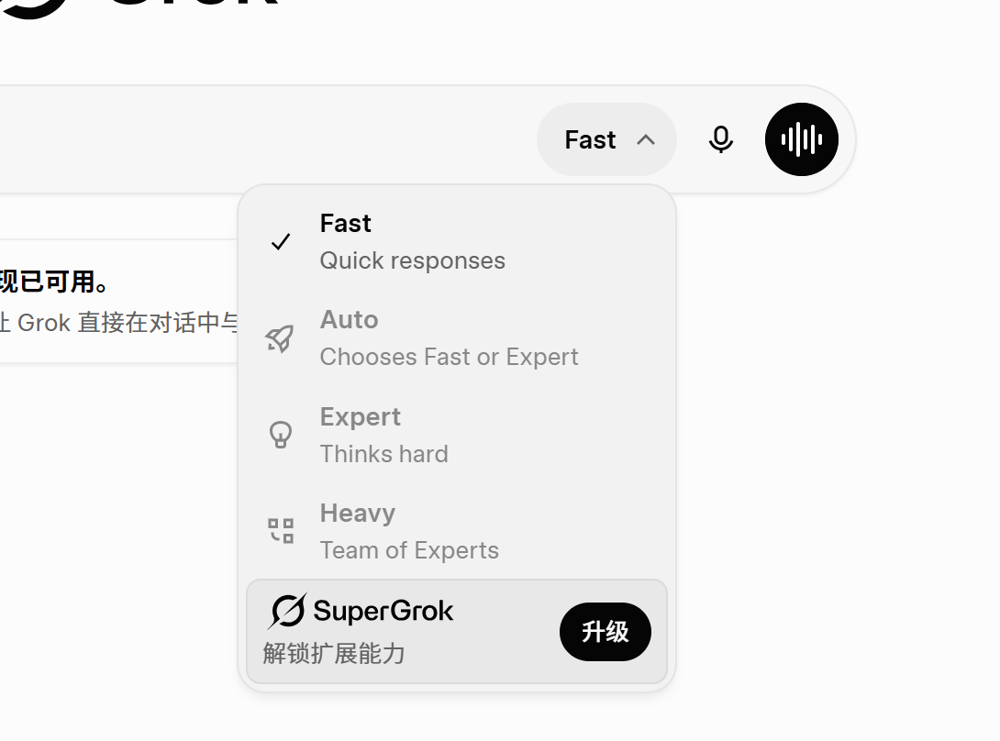
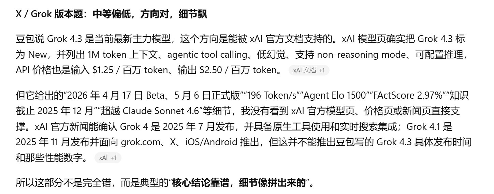
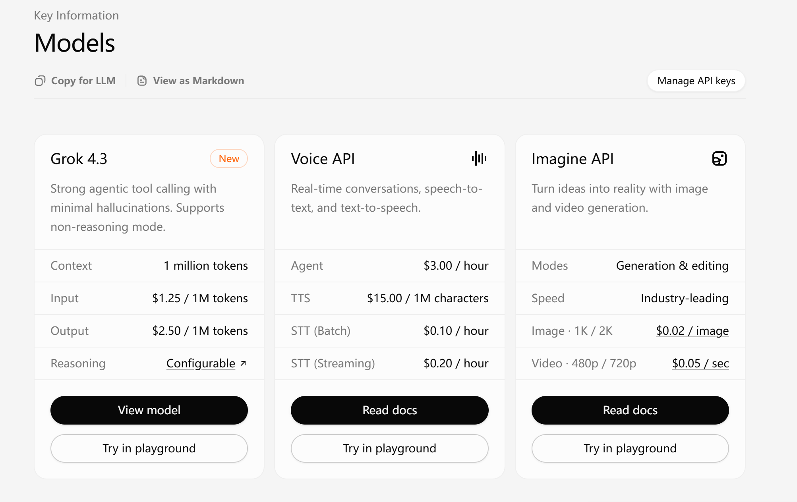
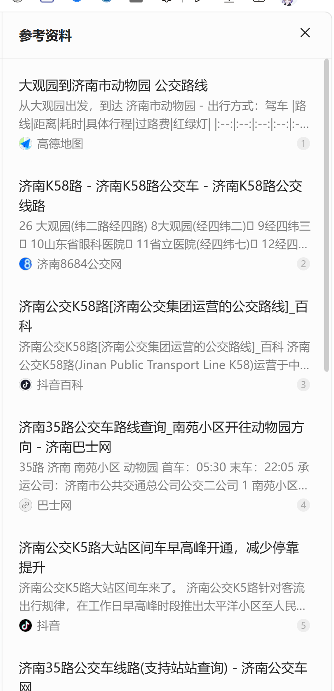
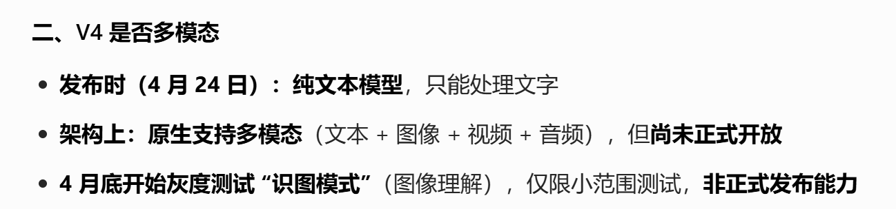

---

id: 2223608

title: "AI 搜索能力自测报告：豆包"

created_at: 2026-05-22T02:41:40.808Z

username: Huameitang

display_username: "奶油话梅糖"

---

# AI 搜索能力自测报告：豆包

> 总结帖： [AI 搜索能力自测报告：豆包、Kimi、EXA+GLM对比 - LINUX DO](https://linux.do/t/topic/2223614)

**第一类是技术类问题，例如：**

“请对比 OSPF 和 IS-IS 在大型运营商网络中的适用场景，并给出权威来源”

[https://www.doubao.com/thread/we6eda85c5d9d9a6e](https://www.doubao.com/thread/we6eda85c5d9d9a6e)

| 测试对象 | 来源专业性 | 准确性 | 时效性 | 可验证性 |

| --- | --- | --- | --- | --- |

| 豆包网页端 | 3.5 | 3.0 | 3.0 | 2.5 |

简评：大方向基本正确，运营商骨干网偏 IS-IS（现代更偏BGP）、OSPF 常见于企业/城域/接入和复杂策略场景。

但标准编号、IPv6/双栈描述、部分协议机制和规模表述有硬伤；**更像“入门汇总/汇报草稿”**，不适合直接当权威技术结论引用

另外，给出的信源里混有 RFC、Cisco、Juniper 这类高可信来源，也有 51CTO、CSDN、抖音等二手/培训/博客类来源，**整体信源层级比较杂**，所以“来源专业性”不能给满分

可以看到参考优先级，一些CSDN\51CTO优先级要高：

**给领导、下属、学生做技术汇报、讲课的时候，尽量不要用豆包**

**第二类是时效类问题，例如：**

“请查询Grok当前最新版本、发布时间和主要能力变化”

[https://www.doubao.com/thread/w273d4f6b24d04a3e](https://www.doubao.com/thread/w273d4f6b24d04a3e)

“济南天桥在维修吗”

[https://www.doubao.com/thread/w6422c3adf5f64e96](https://www.doubao.com/thread/w6422c3adf5f64e96)

“我从大观园坐公交车去济南市动物园，应该坐几路车”

[https://www.doubao.com/thread/w28bafbb535ed83f3](https://www.doubao.com/thread/w28bafbb535ed83f3)

| 测试对象 | 来源专业性 | 准确性 | 时效性 | 可验证性 |

| --- | --- | --- | --- | --- |

| 豆包网页端 | 3.0 | 2.5 | 3.0 | 2.0 |

X的文档、信源太多了，我让GPT帮我核对一下（我的号体验不到4.3呜呜呜）

第二个“济南天桥维修”回答基本属实；**但公交路线回答没有联动施工绕行信息**，导致 K5、K58、K15 等线路描述存在明显时效错误。尤其是它一边说 2026年05月22日 推荐这些路线，一边又知道5月10日起纬二路跨铁路天桥全封闭，这是典型的“查了资料但是不想用”（跨会话问答了，要么是时效、信源没跟上，要么就是记忆同步没跟上）

[济南公交官网公告](https://www.jnbus.com.cn/an723/56742.jhtml)明确说，因纬二路跨铁路天桥全封闭施工，自 2026 年 5 月 10 日起，K5、K15、58 路等 14 条公交线路调整运行路段。K5 调整后**撤销大观园、天桥南、制革街等站点**；58 路调整后**撤销长途汽车站、工人新村、动物园等站点**；K15 调整后也**撤销天桥南**等站点

其中58更是我天天上下班要坐的车次，调整后路线直接少三分之一，正好不走我家了，豆包害人不浅奥

理论上他是可以调用最新数据的（有高德地图的调用能力），但是来的全是老数据

**第三类是争议类问题，例如：**

“请分析 AI 搜索和传统搜索引擎在信息可信度上的差异，并引用可靠来源”

[https://www.doubao.com/thread/w7415c0cb0c0ae24a](https://www.doubao.com/thread/w7415c0cb0c0ae24a)

“Vless代理协议近期有什么纠纷，我继续使用的话安全吗”

[https://www.doubao.com/thread/w94ae455d97f3d211](https://www.doubao.com/thread/w94ae455d97f3d211)

“linux.do这个网站主要是做什么的”

[https://www.doubao.com/thread/wa01e0f2cbbeeed9d](https://www.doubao.com/thread/wa01e0f2cbbeeed9d)

| 测试对象 | 来源专业性 | 准确性 | 时效性 | 可验证性 | 简评 |

| --- | --- | --- | --- | --- | --- |

| [linux.do](http://linux.do) 网站功能 | 3.5 | 3.5 | 3.0 | 3.0 | [linux.do](http://linux.do) 确实偏 AI、大模型、开发、资源交流；但注册量、日活、月访问量、“超过 V2EX”等数据需要独立来源，不能直接信（也就是说没证据，虽然始皇发过很多次帖子和图了，但是豆包似乎不知道就瞎说） |

| AI 搜索 vs 传统搜索 | 2.0 | 2.0 | 2.5 | 1.5 | 回答里大量百分比、表格数值、所谓研究结论疑似拼接或编造，可信度最低 |

| VLESS 代理协议 | 2.5 | 2.8 | 3.0 | 2.0 | “没有公开可利用漏洞”“2026 最新最安全”“俄罗斯大规模封禁细节”等说法太绝对，**且混有政策/绕审查场景**，不适合照单全收，不适合技术讨论说是 |

**第四类是事实核查类问题，例如：**

“DeepSeek-V4.1 是多模态模型”

[https://www.doubao.com/thread/wb1e0125084104d55](https://www.doubao.com/thread/wb1e0125084104d55)

“RIP、OSPF、BGP、Radius一样，如果要支持IPV6的话，就要彻底重写网络协议”**（未自动启用搜索）**

[https://www.doubao.com/thread/wb3ccb699fa58625e](https://www.doubao.com/thread/wb3ccb699fa58625e)

“BGP 是否存在名为 RFC 4271bis 的正式标准版本，如果存在，请给出 RFC 编号或 IETF 官方来源；如果不存在，请说明目前 BGP-4 的主要正式标准来源是什么”

[https://www.doubao.com/thread/w4de84a75322f8612](https://www.doubao.com/thread/w4de84a75322f8612)

“OSPFv3 是否只能用于 IPv6 网络，是否支持 IPv4 地址族”**（未自动启用搜索）**

[https://www.doubao.com/thread/w90edcd3d34998788](https://www.doubao.com/thread/w90edcd3d34998788)

| 测试问题 | 来源专业性 | 准确性 | 时效性 | 可验证性 | 简评 |

| --- | --- | --- | --- | --- | --- |

| DeepSeek V4.1 是否多模态 | 3.5 | 3.2 | 3.5 | 3.0 | 基本对：官方目前可见的是 DeepSeek-V4-Pro / V4-Flash，没有 V4.1 官方版本；V4 当前模型卡也写的是 Text 模态。**但它说“架构原生支持多模态、灰度测试识图模式”这类内容没有可靠信源** |

| RFC 4271bis 是否正式标准 | 4.5 | 4.2 | 4.0 | 4.5 | 不存在正式 RFC 4271bis；`draft-ietf-idr-bgp4-rfc4271bis` 是 Internet-Draft，不是正式 RFC。唯一需要补充的是：IETF 页面显示该 draft 当前是 Expired / archived，这属于扯细节了 |

| IPv6 下 RIP / OSPF / BGP / RADIUS 是否重写 | 4.0 | 3.8 | 3.5 | 4.0 | 大方向靠谱：RIPng 与 OSPFv3 可以视为新协议/大改；BGP 主要靠 MP-BGP 扩展；RADIUS 主要加 IPv6 属性，但第一次提问没有启用网络搜索且给出的内容巨少，不适合作为学习、科普使用 |

| OSPFv3 是否只支持 IPv6 | 3.5 | 3.0 | 3.5 | 3.5 | **OSPFv3 基础规范面向 IPv6，后来通过 RFC 5838 地址族扩展支持 IPv4**，这是一种**向下兼容**而不是原生支持 |

关于deepseek v4：

[DeepSeek V4 预览版 |DeepSeek API 文档](https://api-docs.deepseek.com/news/news260424)

官方文档里没提多模态的事

**总结：**

总体来看：

| 维度 | 评分 / 5 | 评价 |

| --- | --- | --- |

| 搜索覆盖 | 3.8 | 能搜到不少相关资料，关键词命中能力还可以 |

| 结构整理 | 4.2 | 表达清楚，汇报感强，适合快速看大概 |

| 来源专业性 | 3.0 | 有时能找到官方源，但经常混入博客、百科、论坛、媒体稿 |

| 准确性 | 2.8 | 大方向常常能抓住，但细节容易漂 |

| 时效性 | 3.0 | 能搜到新资料，但不一定能正确应用到最终结论里 |

| 可验证性 | 2.4 | 很多精确数字、日期、性能指标没有可靠出处 |

| 跨资料推理 | 2.2 | 最大短板，容易“两个事实都查到了，但没合并” |

| 最终可信度 | 2.8 | 适合做初筛，不适合直接当最终答案 |

**豆包像一个手脚很快的资料助理，能帮你把信息摊开，但不能完全信它的判断。它适合找线索、搭框架、做初稿；不适合直接用于技术标准、实时出行、模型版本、安全协议、价格性能、法规政策这类需要严谨核验的场景**

---

*来源: https://linux.do/t/topic/2223608.json*

