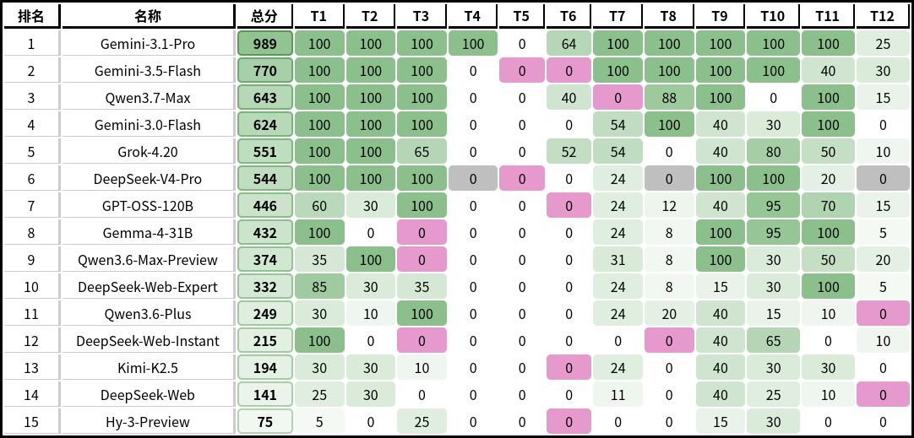
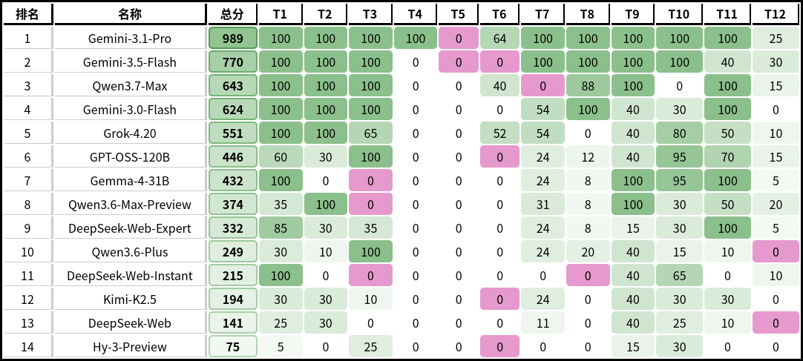

---

id: 2224731

title: "【SNSE Bench】更新 DeepSeek-V4-Pro 成绩"

created_at: 2026-05-22T05:42:08.545Z

username: sparklydream

display_username: "sparklydream"

---

# 【SNSE Bench】更新 DeepSeek-V4-Pro 成绩

2026.6.8 update:

完成了 DeepSeek-V4-Pro 的测试，目前排行榜如下：

每道题目均使用官方 API，思考强度为 max。

从排行榜中可以看出，DeepSeek-V4-Pro 确实拥有较强的竞技编程水平。但遗憾的是，DeepSeek-V4-Pro 在 T4、T8、T12 上均出现了思维链超过 128k 导致 request 截断，未输出正文的情况。在此情况下其输出不包含任何代码，将其得分视为 0。

如果不考虑思维链超限的情况，参考其他模型的表现，DeepSeek-V4-Pro 的成绩很可能超越 Qwen-3.7-Max，成为目前的国模 SOTA，这一点也与 Qwen 官方发布的 LiveCodeBench 成绩相符。

---

2026.5.22

[【SNSE Bench】目前进度 / 预告帖](http://linux.do/t/topic/1933004) [

开发调优](/c/develop/4)

> 个人维护的基于算法竞赛题目的微型 LLM Benchmark。

> 前情提要：

>

>

> 注意：尽管都是编程相关，算法竞赛题目所需的能力与软件工程 / Coding Agent 并不完全重合。模型在 SNSE Bench 中的表现与其软件工程能力并无必然联系。

> 全称：SNSE’s Not Software Engineering Bench。

> 进展

> 已经结束了第一批题目的挑选，每道题目都设计了子任务…

从预告帖发布到现在，经过了一个半月，SNSE 的首轮测试结果终于完工了。

本次测试包含 12 道题目，覆盖 14 个模型。总体上体现了目前模型之间的智力仍有较大差距。

很遗憾由于没有合适的模型渠道，本次没有测试 GPT-5.4/5.5、Claude Opus 4.6/4.7 等来自 OpenAI / Anthropic 的前沿模型。由于 DeepSeek API 接入 Cherry Studio 中的[截断问题](https://linux.do/t/topic/2120506)，参与测试的 DeepSeek 模型均来自网页 / App 端对话（图中的 `DeepSeek-Web-Expert` 与 `DeepSeek-Web-Instant`）。

即使模型有缺失，本次测试仍然具有一定的参考价值。以下是一些值得注意的事实。

### 广泛出现的紫色色块

在成绩表中出现了许多零分的紫色色块，这代表着模型给出的代码出现了编译错误（CE）。

其中，出现编译错误最多的 T6 是一道交互题，且有两个模型（GPT-OSS-120B、Hy-3-Preview）的错误原因与交互题的实现细节直接相关。

这说明即使是 2026 年的新模型，在实现复杂的算法与数据结构逻辑时也可能会在语法规则上产生疏忽。

### 全军覆没的 T5

在 T5 中，本次测试的所有模型都没能获得任何分数，但在我的主观感受来说 T5 并不是这十二道题目中最困难的题目。且我并没有排查出任何表明 T5 的测试数据存在错误的证据。

我尝试将 DeepSeek-V4-Flash 接入 OpenCode 后要求它解决这道题目，其提供的代码同样没有获得任何分数，但再次要求其编写暴力算法代码并进行对拍之后，其代码能够在测试数据获得 15 分。

因此，目前认为 T5 的测试数据不存在问题。

### T10 中的 95 分

在 T10 中，Gemma-4-31B 与 GPT-OSS-120B 获得了 95 分，且都在唯一的一个测试点上出现了超时情况。

通过分析这两个模型提供的代码，可以发现它们都实现了时间复杂度错误的算法。

这也说明题目的测试数据是有强度的，可以区分正解与错误解法。

---

SNSE Bench 在今后会继续更新并添加更多题目。目前的主要困难是缺乏模型，且 Cherry Studio 在某些渠道上的截断问题。也欢迎佬友们提供模型、题目或技术上的支持与建议。

感谢各公益站提供的测试模型与 GPT！codex 对于本次测试中测试用例的制作有许多帮助。

感谢佬友们的支持！

---

*来源: https://linux.do/t/topic/2224731.json*

