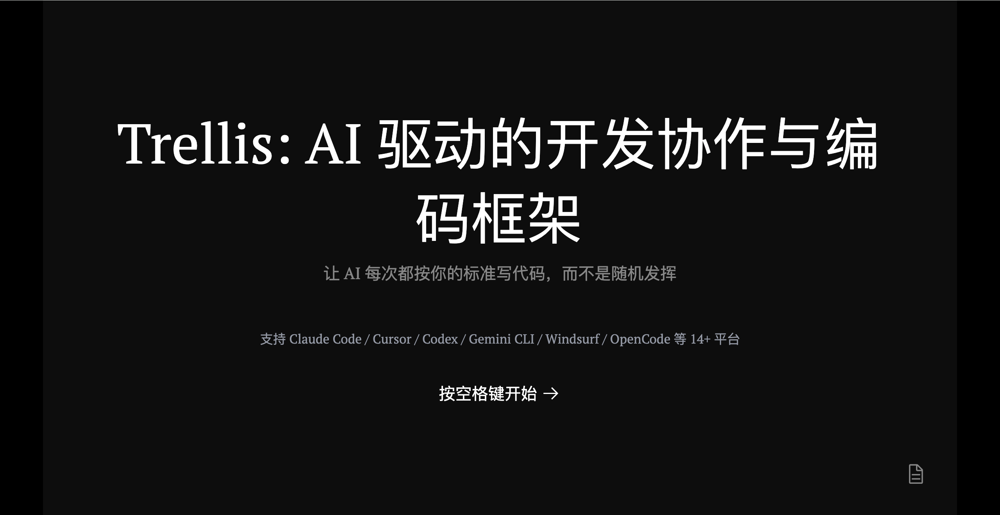
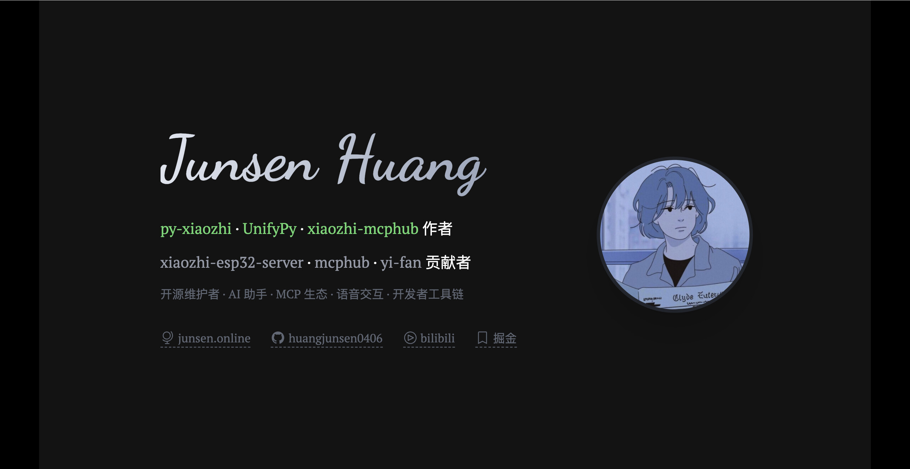
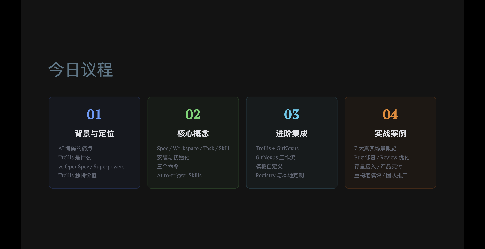
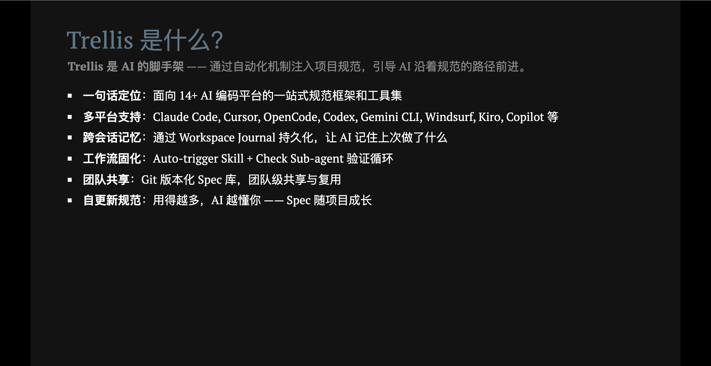
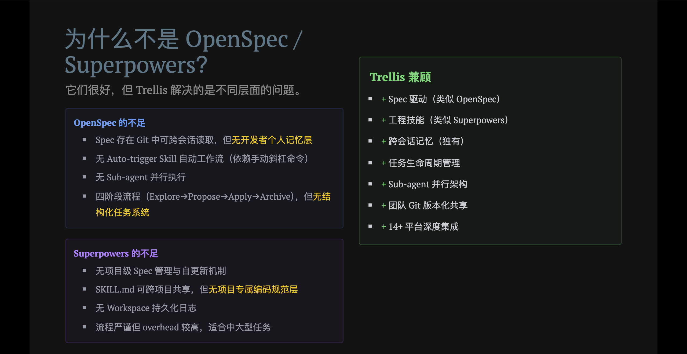
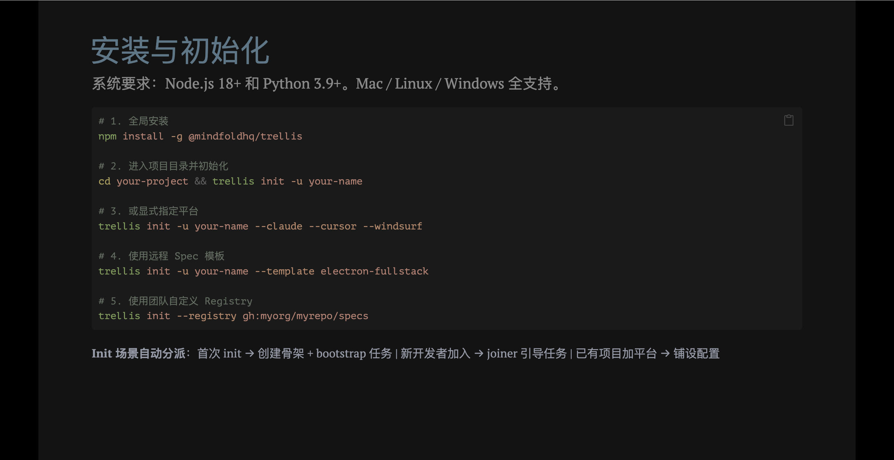

---

id: 2261610

title: "分享下今天做的Trellis 快速上手ppt"

created_at: 2026-05-28T09:00:49.627Z

username: Junsen

display_username: "Junsen"

---

# 分享下今天做的Trellis 快速上手ppt

如题，可以用于团队内的技术分享会，晚点会更新到仓库去，主要沉淀了下从入门到团队使用

ppt采用slidev去展示的，不知道帖子会不会违规，如有违规请各位佬友提醒下，先谢谢啦。

### [Trellis 教程 - Slidev](https://trellis-lake.vercel.app/1)

"## Trellis 教程\nAI 驱动的开发协作与编码框架\n"

### [GitHub - huangjunsen0406/trellis: trellis技术分享ppt](https://github.com/huangjunsen0406/trellis)

trellis技术分享ppt

---

*来源: https://linux.do/t/topic/2261610.json*

