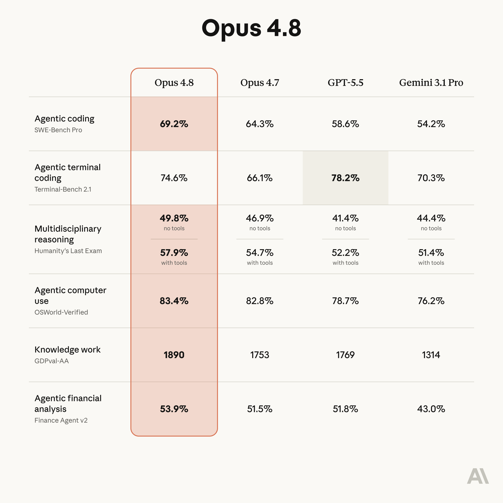
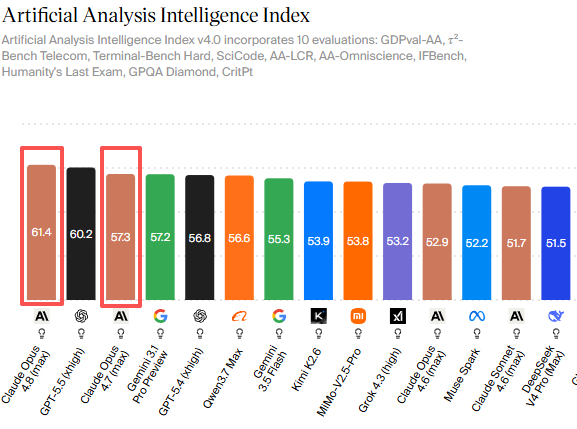
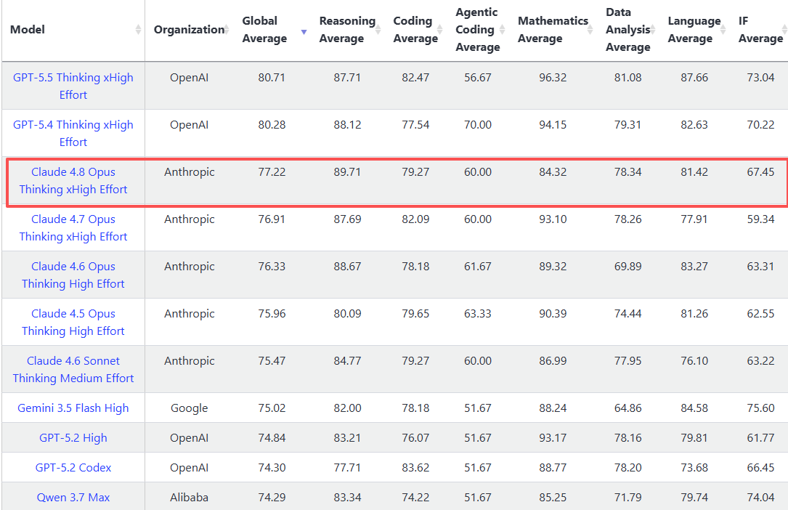
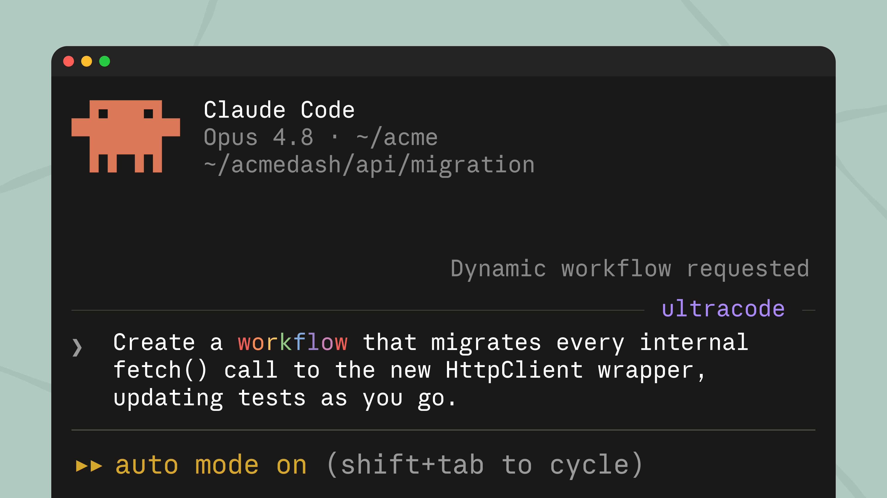
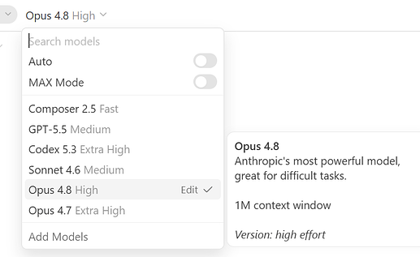
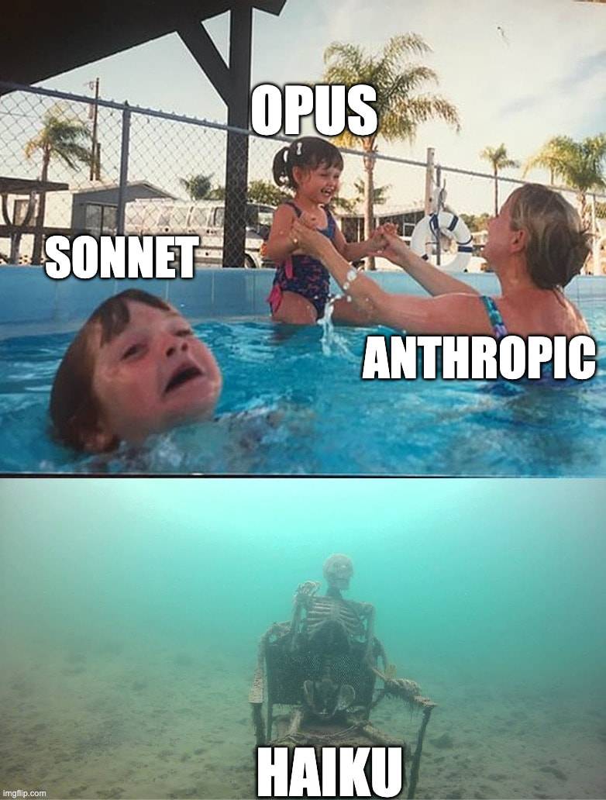

---

id: 2264744

title: ":fire:【大模型系列35】关于Opus-4.8，你想知道的一切【底楼更新LMArena】"

created_at: 2026-05-28T17:16:51.170Z

username: dwqxq1

display_username: "dwqxq1"

---

# :fire:【大模型系列35】关于Opus-4.8，你想知道的一切【底楼更新LMArena】

### 基本信息

官方文：[https://www.anthropic.com/news/claude-opus-4-8](https://www.anthropic.com/news/claude-opus-4-8)

模型卡(244页)：[https://cdn.sanity.io/files/4zrzovbb/website/c886650a2e96fc0925c805a1a7ca77314ccbf4a6.pdf](https://cdn.sanity.io/files/4zrzovbb/website/c886650a2e96fc0925c805a1a7ca77314ccbf4a6.pdf)

API文档：[Models overview - Claude API Docs](https://platform.claude.com/docs/en/about-claude/models/overview)

相关论坛：[https://www.reddit.com/r/ClaudeAI/](https://www.reddit.com/r/ClaudeAI/)

相关论坛：[https://www.reddit.com/r/ClaudeCode/](https://www.reddit.com/r/ClaudeCode/)

价格：输入$5/输出$25不变

上下文：1m不变

最大输出：128k不变

训练数据：202601不变

fast模式：2x价格，参考4.7是6x价格，5.5是2.5x价格1.5x速度

思考强度：增加UltraCode档，消耗额度比max翻倍，只适合编程，不适合写作

---

## 评测

### 官方自评

---

### ArtificialAnalysis已上线

来源：[https://artificialanalysis.ai/](https://artificialanalysis.ai/)

---

### LiveBench评分

来源：[https://livebench.ai/](https://livebench.ai/)

---

### LMArena暂未上线

来源：[Arena Leaderboard | Compare & Benchmark the Best Frontier AI Models](https://arena.ai/leaderboard)

---

## Chat渠道

### 官网/App已上线

### LMArena Direct Chat暂未上线

### OpenRouter Chatroom已上线

---

## API渠道

### 官网已上线

### OpenRouter已上线

来源：[Claude Opus 4.8 - API Pricing & Benchmarks | OpenRouter](https://openrouter.ai/anthropic/claude-opus-4.8)

---

## Code渠道

### Claude Code已上线

如果/model没有4.8，就告诉Claude Code升级到最新版 → /quit → 重新进入一般就有了

直接`claude install 2.1.156`也行

---

### Cursor已上线

---

### Windsurf已上线

---

### Kiro已上线

---

### Antigravity未上线

估计不会上4.8了，Google已经放弃靠opus推Antigravity的路线了，纯属给竞争对手做嫁衣，4.7都没上

---

## 个人点评

### 为什么opus4.8出了，sonnet4.7没出？

瞎猜：因为opus4.7可能就是sonnet4.7换个名字

证据：opus4.7写作明显弱于4.6

opus4.7的1m上下文性能只有4.6的一半

opus4.7编程只比4.6略强，符合下代次旗舰约等于上代旗舰性能的惯例

opus4.7时，A社算力严重不足，砍掉高峰期50%额度，用小参数模型代替大参数opus，是非常合理，甚至当时唯一的办法

Claude Code里，4.6的价格(消耗速度)，是4.7的4倍以上

参考我这篇：[🔥【省钱系列15】还在用opus4.6吗，Claude Code里4.6消耗速度是4.7的4倍](https://linux.do/t/topic/2167598)

### 为什么opus4.7刚出没多久，就出4.8？

①5.5太强，OpenAI打了漂亮的翻身仗，从A社猛抢用户

②4.7太拉，很多用户倒戈

③A社拉到重磅盟友xAI，花每年150亿美元跟xAI买现成算力

④据说5.6也很快上线，A社要抢头条

⑤瞎猜的：可能opus4.7是原sonnet4.7，opus4.8是原opus4.7，所以opus4.7与4.8其实是同时开发的，而不是先后关系

---

### 最后，发张梗图，祝佬友与opus4.8愉快地玩耍

---

*来源: https://linux.do/t/topic/2264744.json*

