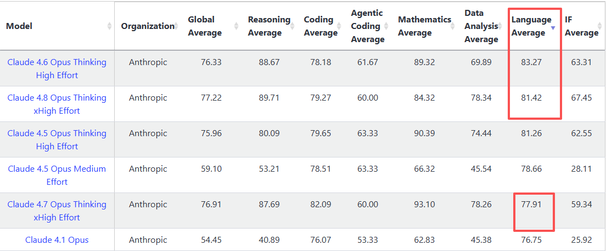
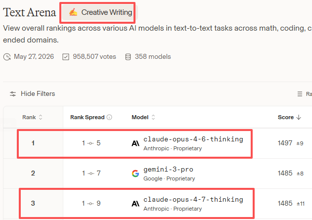
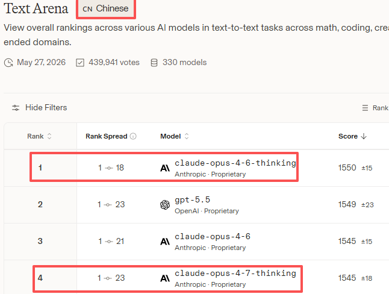
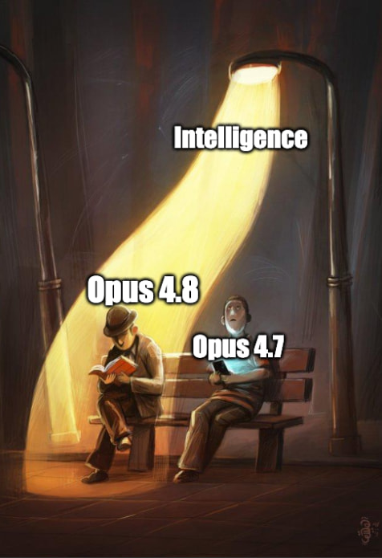

---

id: 2265081

title: ":fire:【大模型系列35.1】opus-4.8用于Claude Code写作评价"

created_at: 2026-05-28T22:50:51.557Z

username: dwqxq1

display_username: "dwqxq1"

---

# :fire:【大模型系列35.1】opus-4.8用于Claude Code写作评价

## opus-4.8用于Claude Code写作评价

4.8写作测试，2个梦境，解梦，原文400字，回答1万字左右

以下仅讨论Claude Code，因为Claude web和app加载rules等不方便，我没用web或app写作，Claude Code的系统提示词里有多处要求简洁，如果模型本身也偏简洁(例如4.7)，两个buff叠加，就容易不说人话

### ①4.8-max测试：30分钟，消耗5x5h的9%

写作比较正常，说人话，4.8明显比4.7好，4.8与4.6相比谁好还需要更多测试

LiveBench的4.8的语言分仍然低于4.6，而4.7语言分非常低，只略强于4.1，远低于4.5和4.6：[LiveBench](https://livebench.ai/#/?q=opus&sort=Language+Average)

---

LMArena上4.7的写作也远低于4.6：[LLM Leaderboard - Best Text & Chat AI Models Compared](https://arena.ai/leaderboard/text/creative-writing)

---

---

4.8max速度明显比4.6max，4.7max更慢，4.6极少能思考到30分钟，不知道是4.8的tps低造成的，还是连续思考能力强造成的

参考Reddit也在吐槽速度慢的问题：[https://www.reddit.com/r/ClaudeCode/comments/1tqfiw2/](https://www.reddit.com/r/ClaudeCode/comments/1tqfiw2/)

4.6单价比4.7贵4倍，4.8单价应该跟4.7差不多，远低于4.6，参考我这篇：[🔥【省钱系列15】还在用opus4.6吗，Claude Code里4.6消耗速度是4.7的4倍](https://linux.do/t/topic/2167598)

4.8是30分钟消耗9%，相当于5小时消耗90%，就是单线程max effort即便一分钟不停歇，也用不完5x。而4.6大概1.5-2小时就能用光100%

### ②4.8-ultracode测试：20-30分钟，消耗5x5h的19%

写的很抽象，不说人话，这一档显然使用了与max不同的系统提示词或workflow，与写作兼容性极差，而且非常贵，没必要使用

### 其他

4.8比4.6，4.7多个特征，就是喜欢在结尾加一句提问，类似chatgpt那种套路

### 最后发张梗图，祝佬友用4.8愉快地写作

---

*来源: https://linux.do/t/topic/2265081.json*

