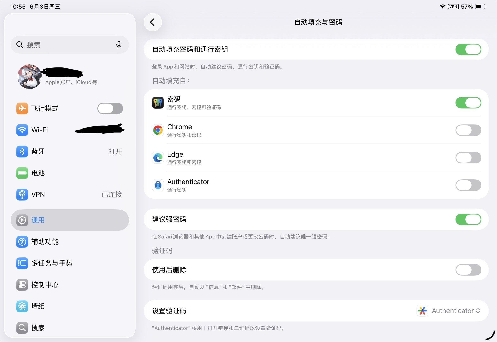
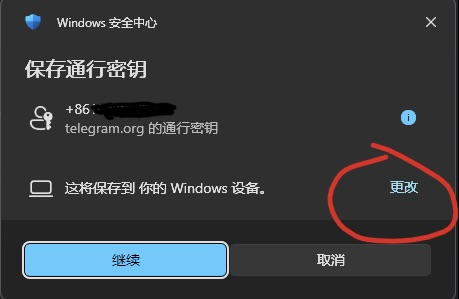
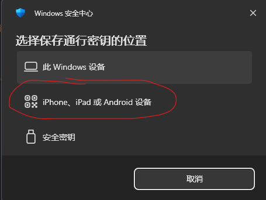
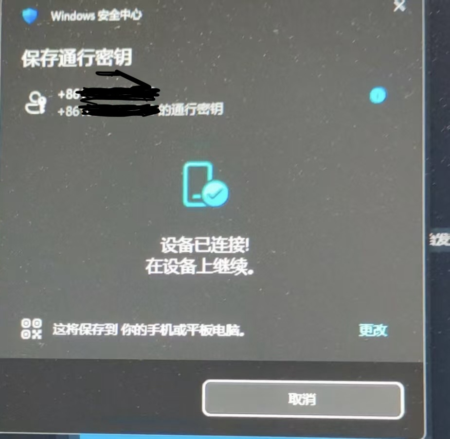
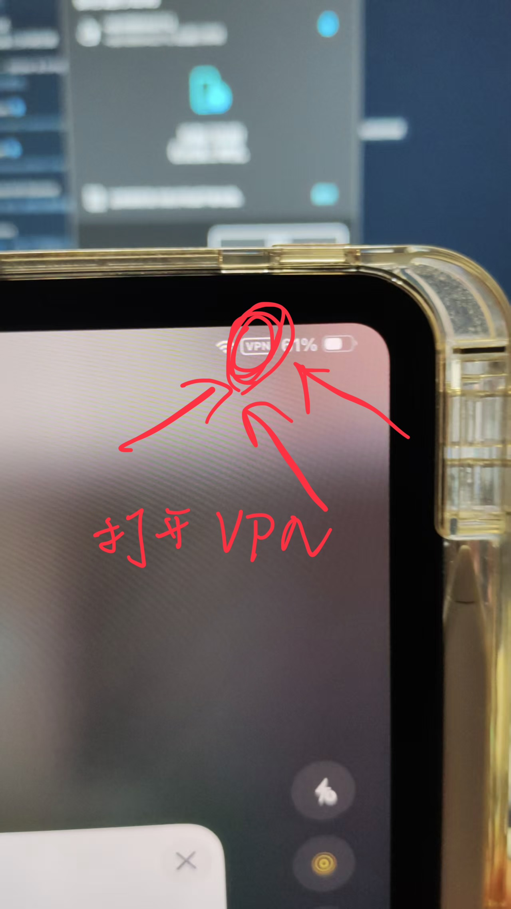
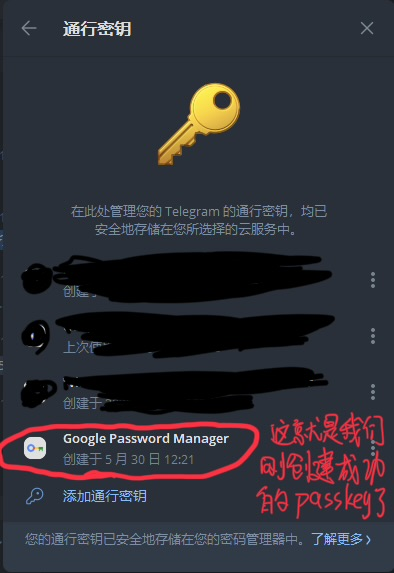
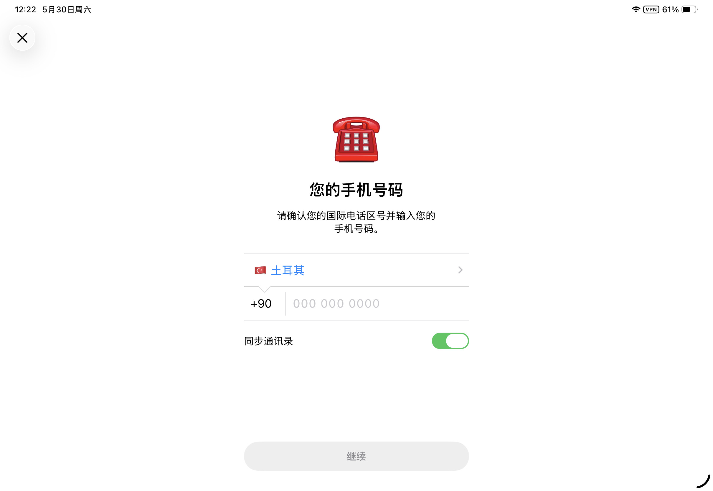
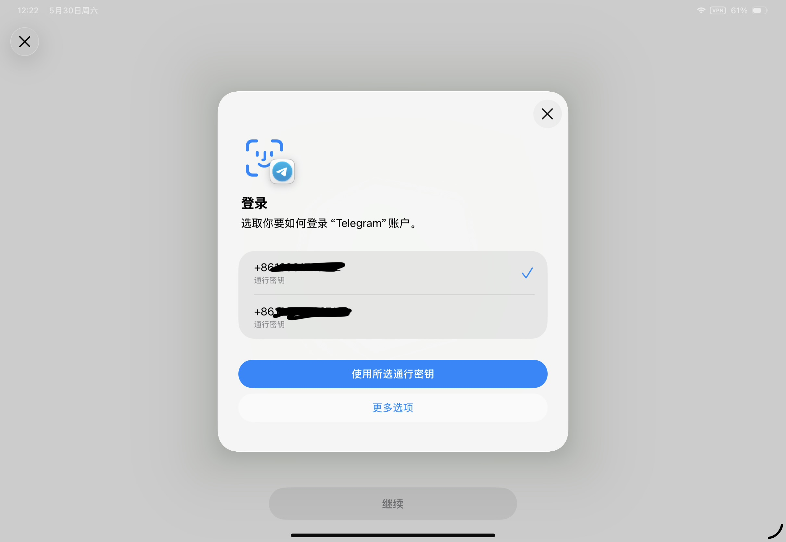

---

id: 2273902

title: "关于telegram如何在Windows客户端创建通行密钥并保存在iPad/iPhone，最终让iPad/iPhone下载的telegram可以通过passkey登录"

created_at: 2026-05-30T08:23:37.233Z

username: Acheron1

display_username: "Acheron"

---

# 关于telegram如何在Windows客户端创建通行密钥并保存在iPad/iPhone，最终让iPad/iPhone下载的telegram可以通过passkey登录

> `不会有人不知道通行密钥就是passkey吧(doge) `

关于这个话题，是我发现很多人都研究出了绕过telegram的SMS Fee登录的方法——*通过passkey登录* 。但是还是有很多小白不知道怎么做，或者是中间有一些小过程被卡住，所以我想到写下这篇帖子，希望能对广大网友有所帮助、为一些小白提供更明确的“攻略”。

> [https://linux.do/t/topic/1569390](https://linux.do/t/topic/1569390)

>

> 很早很早其实就有人通过web端添加passkey了doge

本人的此贴攻略前提是：iPhone/iPad登录得有谷歌账号（最少得有Chrome浏览器并登录），不需要哪个区，国区的谷歌账号都行，但是得有；如果没有的话，理论上其实也可以，只是我没试过所以不做保证。

可以没有谷歌服务，不使用Google password manager，iPhone/iPad可以去**设置 → 通用 → 自动填充**切换成你自己需求的密钥管理器，如果是本地管理器，那么iPhone/iPad全程不需要打开VPN，如果是谷歌密码管理器，那么按照原来的步骤走，后续帖子中会标明哪些地方是本地密码管理器的情况

还有一个更重要的前提——Windows的telegram客户端是“老设备”，因为新设备不允许创建通行密钥

> 此帖针对的是国内要开VPN的情况，人在国际的话，更简单，全程我说有关VPN的地方不管就行，保持VPN关闭剩下的步骤一样

> 本帖同样的原理可以移植到 **“任意可以为其他设备创建passkey的设备”** 和 **“任意可以接收其他设备创建的passkey的设备”**，比如iPhone和iPad、比如某些安卓设备，本帖主要是为小白展示一个较为清晰的流程以及展示一些避免局域网设备认证卡住的小操作

#### 一切开始之前，准备好硬件和软件

- iPhone/iPad

iPhone/iPad上的 Chrome浏览器登陆了至少一个账号（不限地区，可以是国区）如果不使用chrome而是使用本地密钥管理器，这一步可以跳过

iPhone/iPad有网络较好的VPN（**至少要能唤起谷歌服务，这很重要！**）如果不使用chrome而是使用本地密钥管理器，这一步可以跳过

iPhone/iPad蓝牙功能完好

- Windows电脑

已经登录的“老客户端”

Windows有网络较好的VPN（能登录telegram就行）

Windows蓝牙功能完好

#### 第一步

- 打开Windows的蓝牙并允许被发现和连接

- 打开iPhone/iPad的蓝牙并连接Windows蓝牙(要配对成功)

- 打开Windows的VPN并登录telegram，然后打开**设置 → 隐私与安全 → 通行密钥 / Passkeys → 添加通行密钥 → 创建通行密钥** ，然后你的Windows会弹出这个界面：

- 现在关掉你电脑上的VPN。 **注意，不是关闭系统代理或者tun，而是关掉整个VPN软件——比如clash-verge——右下角系统托盘右键退出掉** **这很重要！**

- 现在可以点击上图中圈出来的“更改”，得到下面的三个选项（有些电脑可能不是三个）（你如果刚刚就点击“更改”按钮了也没关系）：

- 点击中间圈起来的选项，获得一个二维码，这一步我就不把我的图放出来了doge

#### 第二步

- 打开你的iPhone/iPad，确保已经联网、确保已经连接Windows的蓝牙、确保VPN能打开并登录你的谷歌账号 如果不使用chrome保存密钥可以不用管VPN、也不用登录chrome

- 关闭VPN，打开系统自带的相机并扫码，你大概率能看到提示你创建通行密钥（不同的设备、不同的系统版本可能会有不同的提示，但是总归是能识别的），点击它

- 会弹出如下画面，显示正在连接，耐心等待，因为他们是通过蓝牙通信，一般十秒左右：

- 连接成功后，Windows和iPhone/iPad会分别显示如下：

 **下图不要点添加！！**

- 先不要点击创建

- 这个时候打开iPhone/iPad的VPN 如果不使用chrome而是使用本地密钥管理器，这一步可以跳过，不需要打开VPN，不需要唤起谷歌服务

- 然后可以点击创建通行密钥了，会出现Apple或谷歌的密码管理器界面，等它加载即可，网络好的话只需要几秒钟，网络不好的话可能要几十秒。

- 通行密钥创建完成一般会自动关掉，我们不用管

- 重新打开电脑上的VPN（telegram有一定概率闪退，但是不影响），打开telegram → 设置 → 隐私与安全 → 通行密钥，如果能看到创建成功，那就完成了

#### 第三步

- 保持iPhone/iPad的VPN打开，然后打开telegram，你能看到这个页面（没有passkey登录的选项）：

- 或者这个页面（有passkey登录的选项）：

- 如果是后者，直接点击通行密钥登录就好；如果是前者，随便点几下屏幕，过一会儿就会自动弹出passkey登录，大家最终看到的是下面这个界面：

- 如果只有一个passkey，大概率一个扫脸就直接登录了，没有上述的图，不管怎么说，能登录就好了。

#### 以上就是本片帖子的全部内容了，大家可以在评论区讨论和分享自己的过程、阐述自己操作过程中遇到的困难，我会尽可能、尽快地作出相应的回答。以上内容全部都是我的个人经验，而且成功复现（本片帖子的所有图片都是我复现过程所得，不是曾经第一次尝试的图片，所以理论上确实可以复现）。

#### 如果有什么不对的地方，请尽可能和大家一起讨论，最后都是为了解决问题嘛。

> 各位可以看到，本质上是电脑打开VPN登录telegram，点击创建passkey，然后后续操作本质不需要电脑联网，只需要连接蓝牙；然后在iPhone/iPad接收这个passkey的过程中，需要关闭VPN一类的连接以确保局域网干净；然后在保存密钥的时候，就看个人选择了，如果是保存在本地、那么依然不需要VPN，如果是保存在需要联网的地方、就正常联网，如果是保存在需要开VPN的地方、就再开VPN；全程下来，本质就是：创建方和接收方要保证局域网干净！剩余的步骤无所谓！于是我们就能衍生出：部分安卓手机可以做到，用第三方的联网或不联网的密钥管理器也可以（比如bitwarden、edge），甚至用物理密钥也可以

---

*来源: https://linux.do/t/topic/2273902.json*

