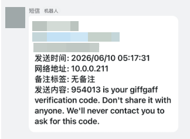
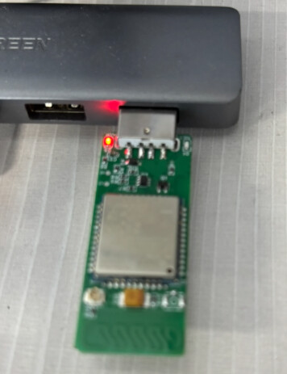

---

id: 2290562

title: "GG卡的教程-白卡接码设备更新版"

created_at: 2026-06-02T05:59:14.740Z

username: liyalun

display_username: "liyalun"

---

# GG卡的教程-白卡接码设备更新版

最近都在讨论GG卡，我最近也看了很多教程进行申请。我主要是从giffgaff软件上申请esim，然后写入白卡。我的设备上苹果 15plus。具体的流程为：我使用模拟器进行esim的申请，然后网上（拼多多）购买白卡和读卡器（方便写入esim信息）。

申请的具体操作主要来自这两个油管教程：

[安卓手机可执行](https://www.youtube.com/watch?v=JDiaAC6y9R4&t=592s)

[模拟器操作](https://www.youtube.com/watch?v=3K2_x2Rnoyo)

其中只要有电脑就可进行申请，然后是申请过程中需要进行付款，我使用的是购物平台的虚拟卡（15刀的）。

其次就是利用购买的白卡对申请的ESIM进行写入，白卡能写挺多卡号。购买的读卡器会有自己的软件，下载安装读取即可。（问问店家一般会给你）。写入成功后，插入手机即可，等待信号。注意：一定得关闭数据漫游，不然扣费。一般保号使用发送短信即可（我是随便找个号码发送的）。

整体下来我大概花了180多块钱，虚拟卡我找的那家店有点贵，读卡器和白卡花费了60元。

接上文，因为白卡都准备好了，但是手机已经有两个卡了，在买一个设备接码比较费钱，在拼多多淘了一个接码器，测试成功比较好使。

---

*来源: https://linux.do/t/topic/2290562.json*

