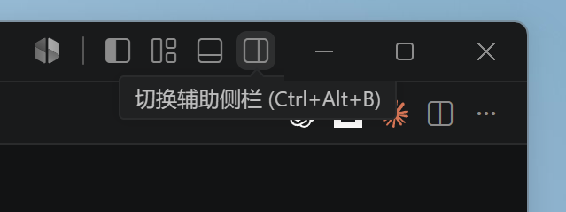
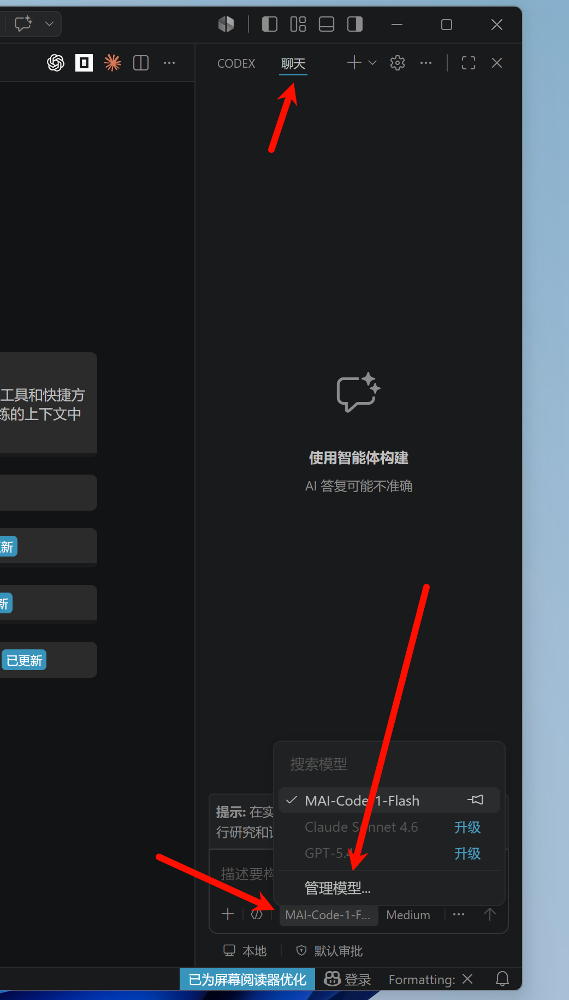
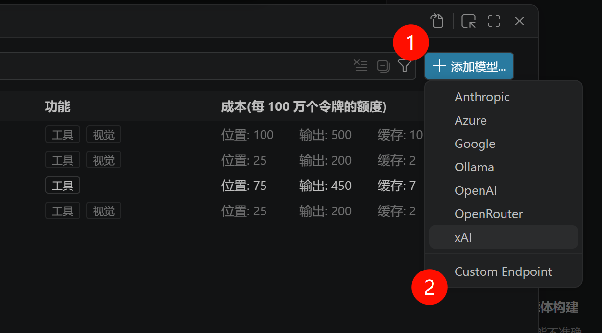
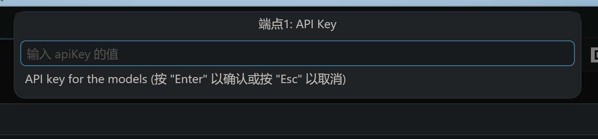
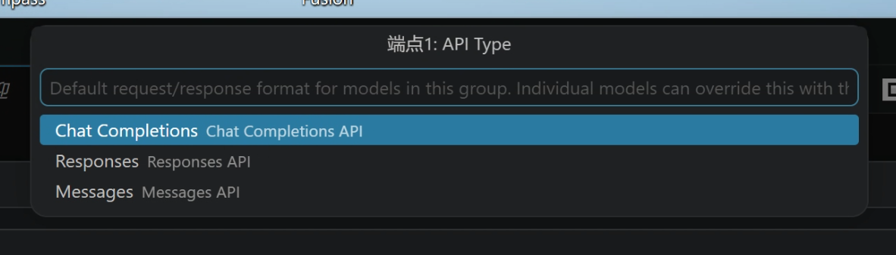
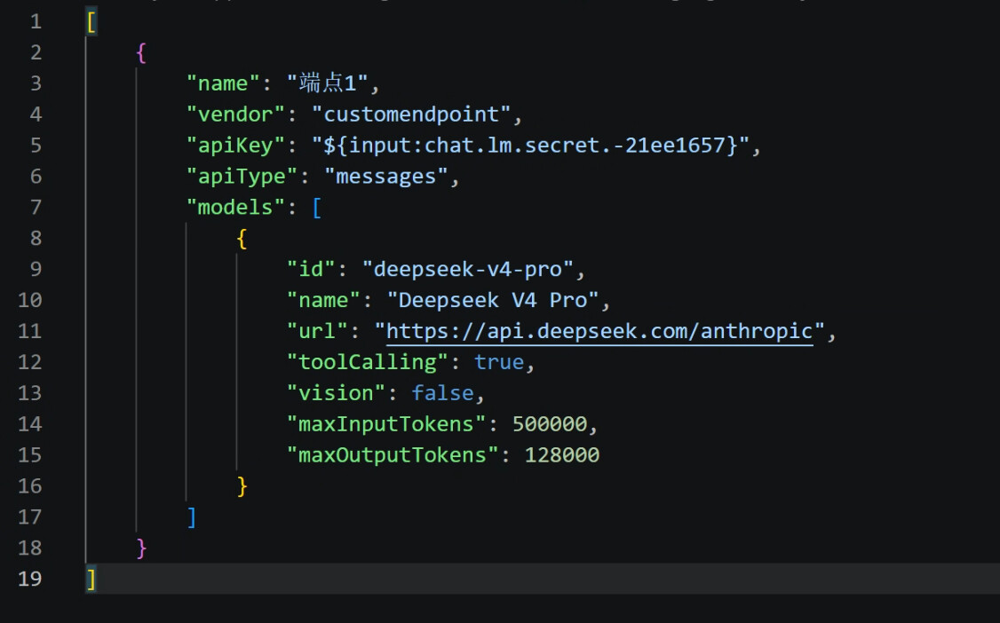
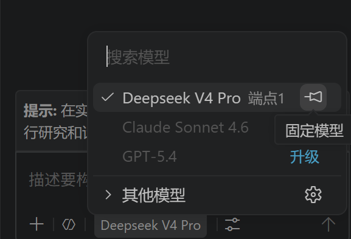
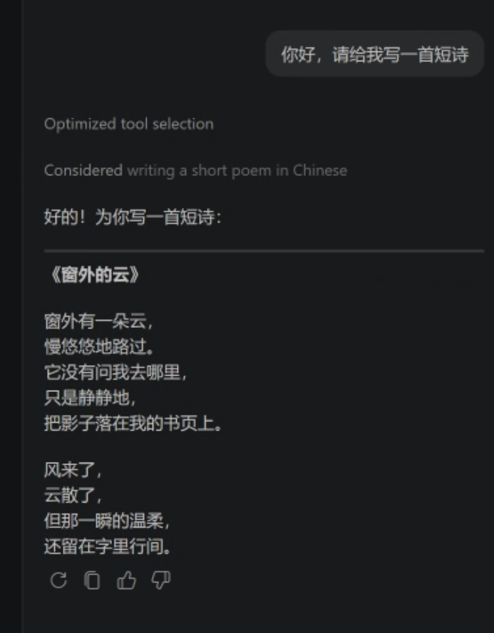
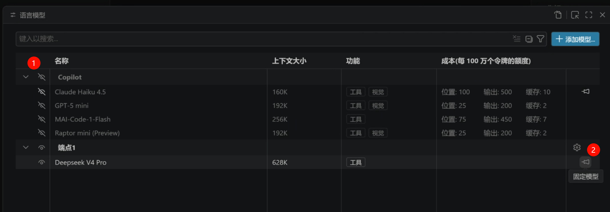

---

id: 2303063

title: "【教程】用VSCode官方的ai功能并接入Deepseek"

created_at: 2026-06-04T04:03:45.883Z

username: XTer

display_username: "XTer"

---


# 【教程】用VSCode官方的ai功能并接入Deepseek


这是一篇面向小白的教程；

VSCode是一个老牌IDE，也许比Claude Code等tui的形态更好接受并普及；

当然这篇教程本身面向所有人

---

## 1.更新VSCode到最新版本

通常右上角有更新按钮，或者直接去官网下载 [Download Visual Studio Code - Free AI Code Editor for Mac, Linux, Windows](https://code.visualstudio.com/Download)

## 2.点击右上角打开ai聊天界面



## 3. 点击管理模型、配置api



选择 Custom Endpoint 其中名称随便你输入



Key需要输入真实key，DeepSeek可以在官网申请 [DeepSeek 开放平台](https://platform.deepseek.com/api_keys)

注意千万不要把你的Key发给任何人！！！或者明文留在本地文档中。





类型选择：

一般官网deepseek建议messages；中转站随意，可以选一个chat、一般都支持；这个可以后续替换的

## 4.具体填写内容



```
"models": [
			{
				"id": "deepseek-v4-pro",
				"name": "Deepseek V4 Pro",
				"url": "https://api.deepseek.com/anthropic",
				"toolCalling": true,
				"vision": false,
				"maxInputTokens": 500000,
				"maxOutputTokens": 128000
			}
		]
```

可以直接粘贴过去

解释：

id 是模型名称，为 `deepseek-v4-pro`，或者flash什么的，看你想用什么模型，比如gpt、opus这种也都是可以的（需要你填入的站点支持）


name 显示名称，可以填写任意值；


url 是官网网址，deepseek的为 `https://api.deepseek.com/anthropic` (需要配合apiType为messages使用)；不同中转站的不同


vision是说是否支持视觉，目前deepseek v4不支持，我们关闭；如果是gpt5.5、opus这类可以开


maxInputTokens是说最大允许上下文，官方支持一百万，我们开一半是因为开太大会有一定的性能下降

## 5. 使用模型

这个时候已经可以用了



第一次使用可能会卡一会儿，然后就是快乐的开始你的ai之旅吧~



## 6.（可选） 关闭其他模型、固定我们自己的

鼠标移动过去并且把这个固定模型开起来；同时把本来的分组给隐藏



---

如果你用的是中转站，那么中间的 选择类型 与 4.具体填写内容 这一章需要相应的改变

至于更多的进阶内容，比如安装skills等，可以看其他文章或者直接让ai帮你做

需要注意的是 VSCode 的 BYOK 模式貌似没有内置的网络搜索技能，也许需要额外装一个


---


*来源: https://linux.do/t/topic/2303063.json*

