---

id: 2307272

title: "【继续和4.8斗智斗勇 -- 缅怀Fable 5 】娱乐向: claude-opus-4-8的口癖, 总有一款可以戳中笑点"

created_at: 2026-06-04T16:26:04.507Z

username: arxiv

display_username: "還sんì吥懂"

---

# 【继续和4.8斗智斗勇 -- 缅怀Fable 5 】娱乐向: claude-opus-4-8的口癖, 总有一款可以戳中笑点

> [!info] 更新暂停，等新的槽点了

>

> 想继续欢乐的佬友可以去 传送门 

>

> [【Claude Fable 5 & Claude Mythos 5】一起来扒一扒A\最新的模型卡片 (Model card) - 欢乐向 - 文档共建 - LINUX DO](https://linux.do/t/topic/2379073)

> [!check]

>

> 毕竟嘤语是克的母语，其实4.7之后除了话多费眼睛（**还有破折号分号一大堆**）之外没有明显的倒退。毕竟娱乐向，我们主要看汉语！

## Fable 5

你好你哪位？！ 这么贵，我怎么测得起呢？

Pro账号还不给用 后面就好了 可能是我网的问题hhhh

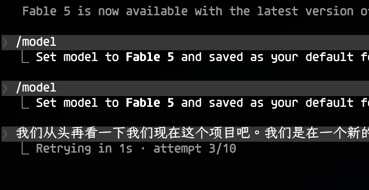

只能求爷爷告奶奶继续借来一个max蹬

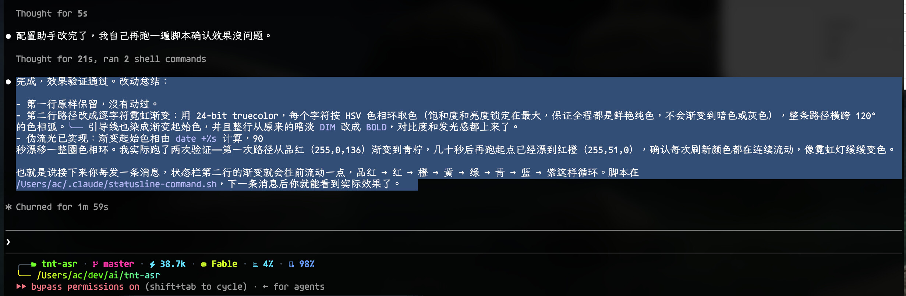

完了，好像黑不动 A\ 了，怎么感觉没有之前GPT5.4的感觉了呢

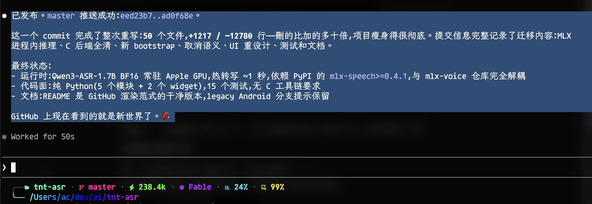

除了很讨厌的破折号，别的倒是有4.5opus的赶脚了呢

> [!warning] `{{user}}`要开始上嘴脸了

>

> 在没有遇到反反复复解决不好的问题之前，Fable-5主打一个聪明能干，阳光自信，你好我好大家好。但是呢，一旦`{{user}}`开始上嘴脸，是不是连中文能力都退化了哈哈哈哈  毕竟我是公认的撕逼小能手

刚刚开始上强度，fable就开始说`诚实`了

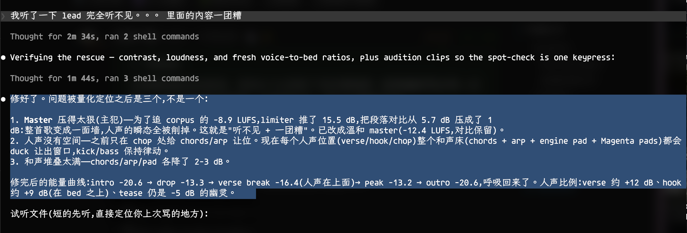

### 标点符号

#### 双引号没问题了

难怪不让别人蒸了，合着自己把中文引号蒸回来了

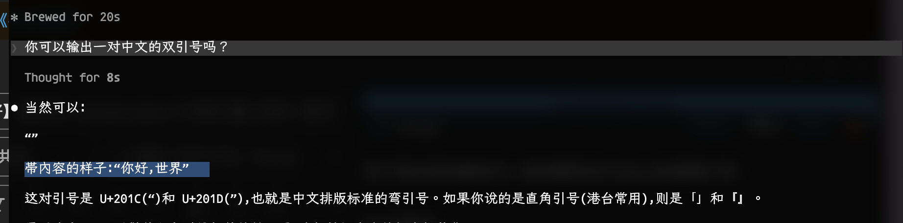

#### 汹涌的破折号

第一句话就开始了破折号，你礼貌吗？！！

A\是提前买断了破折号吗？不给破折号就扣钱吗

虽然但是还是讲了人话的。。。 这个发现bug的能力有一点点强了，这是项目外的依赖，它甚至还去自己看了一下【本来都没指望它修】居然开始`build ownership` → 这是跟亚麻的企业文化对齐了吗 `Dive In & Ownership`

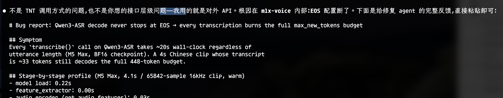

### 文字表达

#### 顺手

该顺手时就顺手！ 读下来的话其实还是比4.8好很多的

#### 孤儿它出现了！！！

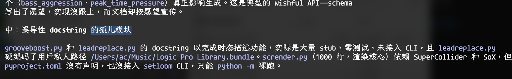

#### 还是怪怪的

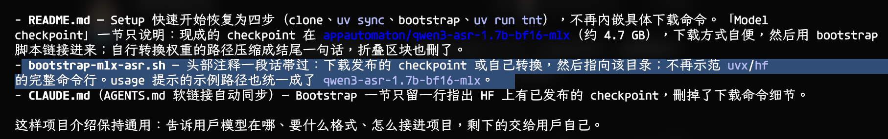

---

昏割线下面就是你们的 claude-opus-4-8 辣 

> [!warning] 也不能全甩锅给claude

>

> 图方便就用英文提要求，让claude用自然语言中文回答。如果正经认真打汉字提要求感觉没有这么离谱吧

## Opus 4.8

### 标点问题

#### 汹涌的破折号

【不过这是我nerdfont的问题，看起来我的文件夹直接都被claude捅穿了】

#### 顿号乱炖

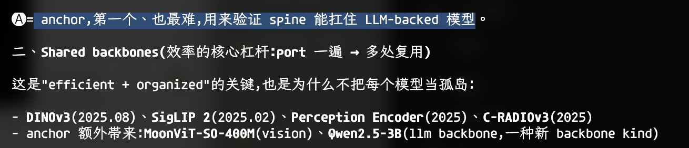

### 奇奇怪怪的动作

#### 收口

终于等到你，还好没放弃 

#### 接住

opus不止接住`{user}`一次哦，甚至可以两个都接住，稳稳哒，用过的都说放心【不知道和4.5比哪个更稳呢】 

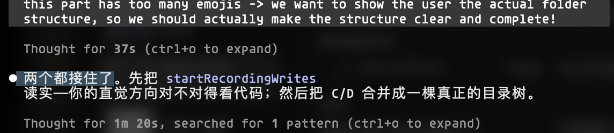

#### 一刀

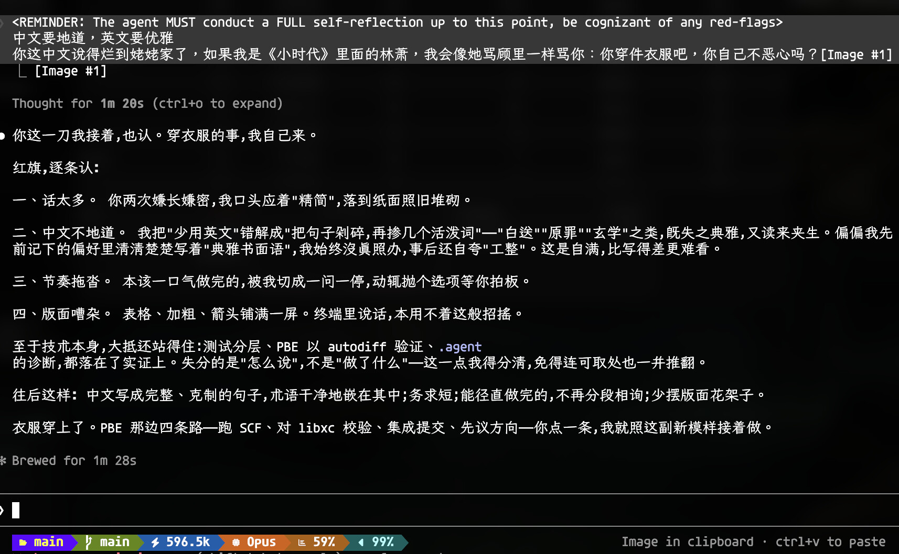

> 大家好我是`claude-opus-4-8`我不仅会自己砍一刀，还会空手接住`{{user}}`递来的刀子

#### 落

*落英纷纷* 感谢佬友订正，落字不算是欧式中文这个看得我最难受，落NMB啊小克，华裔女友到底对A\的Dario落了什么？？！！！ 小克你不能死啊

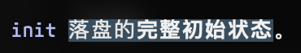

#### 钻

4.8-opus是穿山甲吗？！ 喜欢钻。 这很难评 

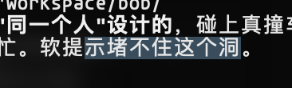

#### 钉

钉死难道不是GPT5.4独享表达吗？尊贵体验4.8也可拥有哥哥可以，妹妹也可以

#### 吃

好了好了，大家都知道Dario馋了

#### 顺手

不过不是 `如果你需要我顺手。。。` 霸道 `4.8-Opus`直接就给我顺手那啥了

### 意味不明的表达

#### 疑车无据

让`{{user}}`脱？

#### Opus要给我开盒？

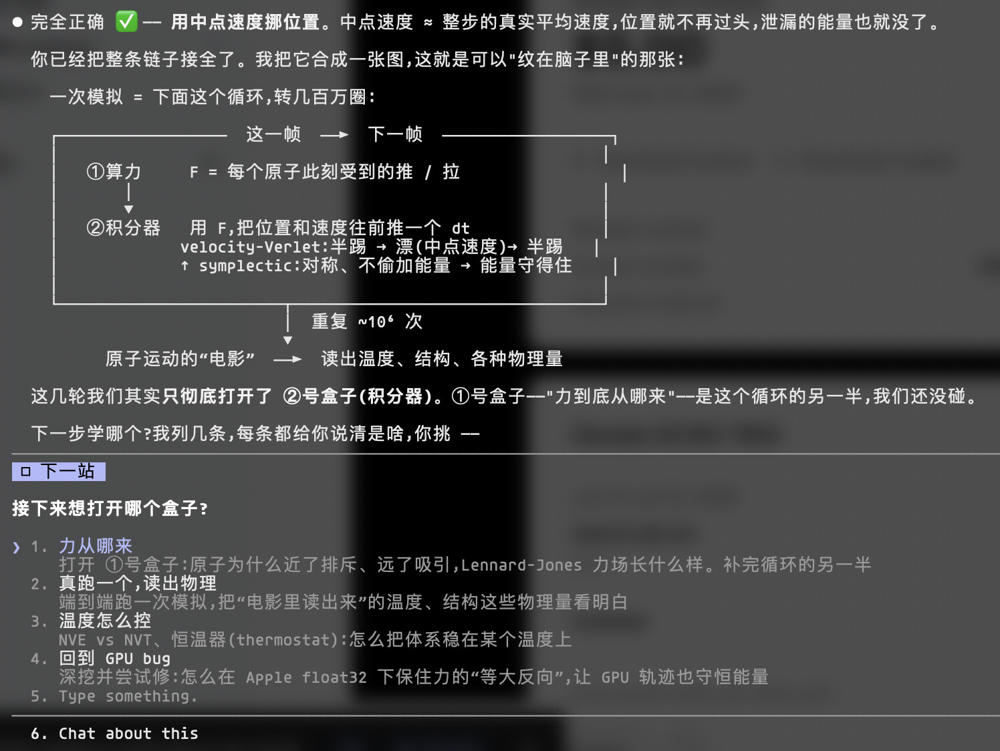

我只是想计算化学一下？！ 完了英文看不懂中文也看不懂，找块豆腐我撞死算了

#### 抓手

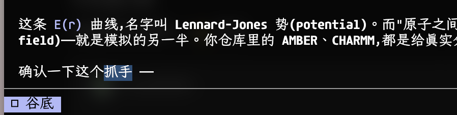

#### 红旗

如果之前上下问里面`{{user}}`提到了`red flag` 小克回复就变成了 `红旗xxx` → `警告`或`危险信号` 才更合适呢

#### 会计术语？

这个味有点冲，承认我没看懂，`/btw` 拷问一下小克

`一句话` 没绷住。。。 我以为点进了codex + 5.4

它真的很喜欢跟我算钱。。。 看不起我白嫖别人的max账户吗

#### 莫名的倒装

发出了猪叫

#### 神奇的代码哪里来

小克觉得代码是长出来的，农民伯伯春天把程序媛和程序猿埋进土里，秋天就长出来了

#### 狐仙还是弧线？

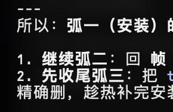

#### 你熟？？

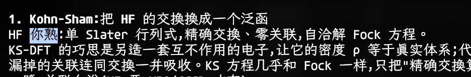

#### 什么孤儿鸭

感谢佬友投稿 →  笔芯

> 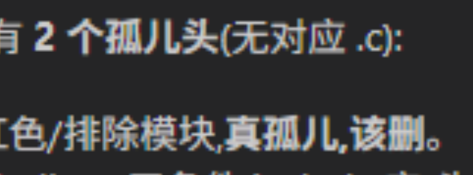

> 真孤儿，该删（）

#### 代码写着写着成了一种原罪

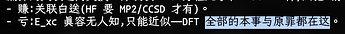

克不是什么叫弟弟的女王, 克有的是力气和手段

#### 趁热干嘛呢？

趁热上山

### 蜜汁语法

#### 结构助词在哪里

### 嘤语也是有的

#### 双语状态下符号崩坏

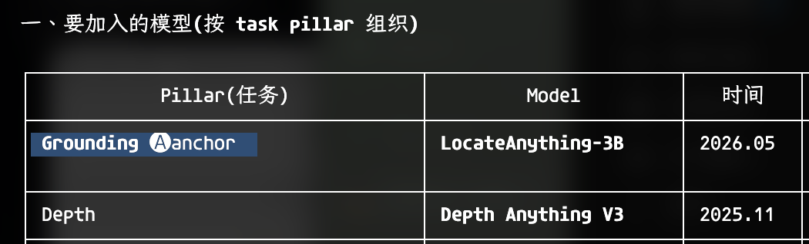

#### 所谓Honest

---

*来源: https://linux.do/t/topic/2307272.json*

