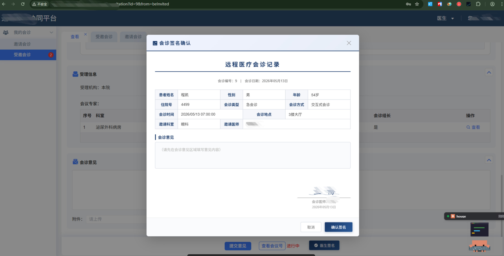
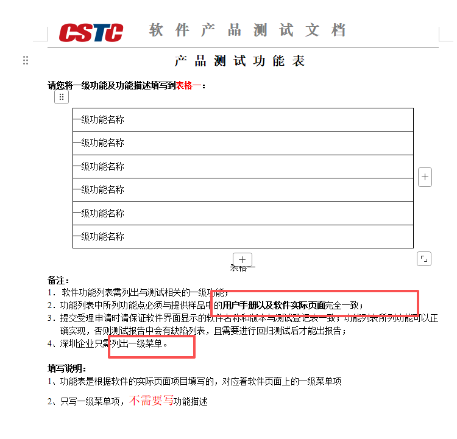
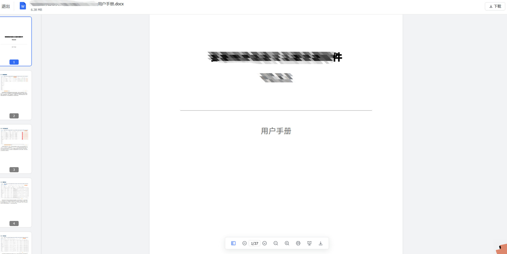
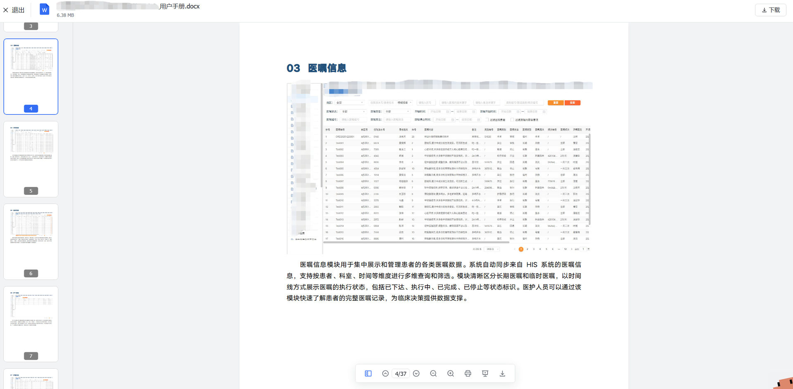
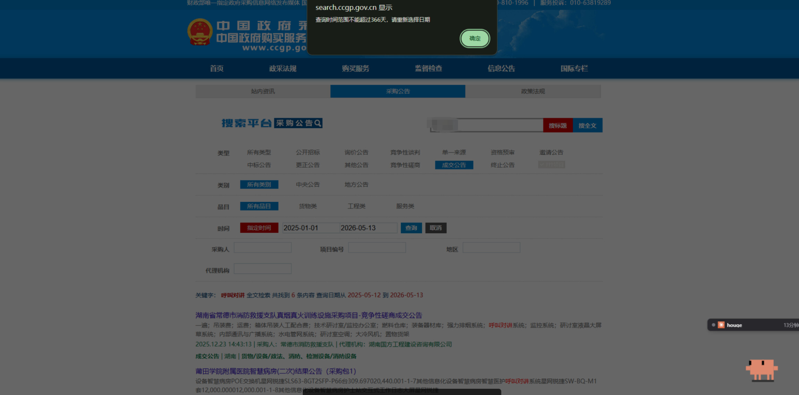
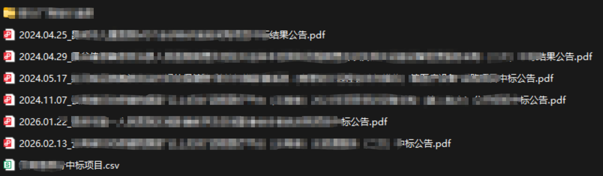
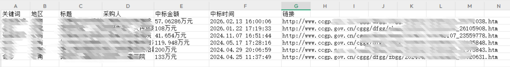
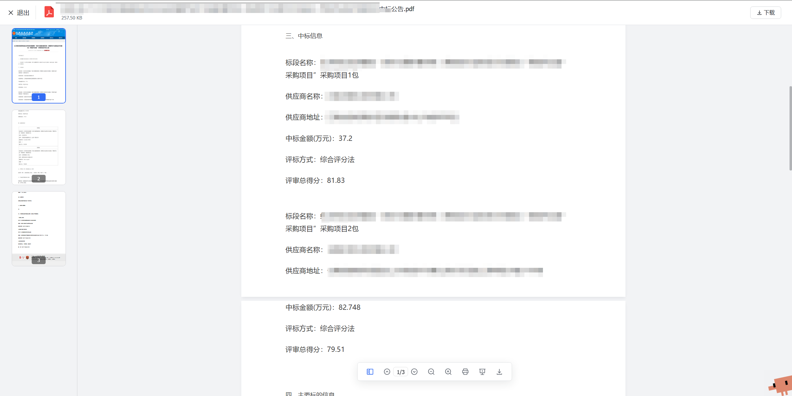

---

id: 2322141

title: "作为一个产品经理，日常使用claudecode的小分享"

created_at: 2026-06-07T08:20:16.202Z

username: gh122483

display_username: "houzijiu"

---


# 作为一个产品经理，日常使用claudecode的小分享


Ai时代下，分享下我做产品经理使用AI的那些月，主要涉及医院相关系统。

# 第一阶段：使用gpt、gemini、千问等网页端对话形式

这个阶段主要就是一些产品需求的分析，模拟客户的反馈沟通，落地方案的梳理，项目汇报的演示。用的最多的就是使用gemini生成html的演示页面。对于我们来说，把用户需求用最快的方式生成可交互的原型给用户看，确认效果再进行定制开发。


所以，很多需求都是先画一些原型草图，然后写提示词，丢给模型，生成可交互的html页面或者生成图片，这种对于单一功能或者跟现有系统关联不大的做起来也是能应付的了，效果也还可以。**但是要想在现有系统框架基础上做一些交互，能做演示，这个就很难实现。**

> 痛点：纯网页对话形式太局限，不能操作文件，不能修改现有系统页面。

# 第二阶段：使用vscode+claude

```
接触Agent这种方式后，我所有能干的活她都可以实现.
```

对于我这种菜鸡产品来说，现在这个方案是我用着最顺手舒服的方式，对于claude 、codex等其他桌面版工具，就是左侧没有我的本地工作目录，这个很难受就。我不需要写很深的代码，我只要帮我写一些单页面，生成文档，写写脚本即可。所以我喜欢用vscode，左侧就是我的工作目录，干啥都比较方便。

> 痛点：太过完美。

# 成果展示：菜鸡产品常干的一些琐事示例

**1. 汇报演示**




**2. 需求页面**


**3. 文档资料**


欸，系统开发完，要申请软著啊，测评啊啥的，这些琐事以前整理资料写文档最少2-3天，现在，嘿嘿，我太快了，要帮助其他同事写了，同事欠我奶茶。








**4. 数据爬取**










还有很多骚操作，就不详细写了，码字有点累，下次再写。

> :多亏咱么L站，我全靠白嫖，代理用的优选cf，大模型用的AnyRouter大善人家白嫖，路由用的ccr。感谢各位大佬们的工具，让穷鬼吃上细糠！！！ 


---


*来源: https://linux.do/t/topic/2322141.json*

