---

id: 2357996

title: ":fire:【大模型系列36】关于Fable5/Mythos5,你想知道的一切【底楼更新封禁分析】"

created_at: 2026-06-09T23:39:26.253Z

username: dwqxq1

display_username: "dwqxq1"

---

# :fire:【大模型系列36】关于Fable5/Mythos5,你想知道的一切【底楼更新封禁分析】

## 基本资料

官方文:[https://www.anthropic.com/news/claude-fable-5-mythos-5](https://www.anthropic.com/news/claude-fable-5-mythos-5)

模型卡:[https://www-cdn.anthropic.com/d00db56fa754a1b115b6dd7cb2e3c342ee809620.pdf](https://www-cdn.anthropic.com/d00db56fa754a1b115b6dd7cb2e3c342ee809620.pdf)

英文论坛:[https://www.reddit.com/r/ClaudeCode/new/](https://www.reddit.com/r/ClaudeCode/new/)

英文论坛:[https://www.reddit.com/r/ClaudeAI/new/](https://www.reddit.com/r/ClaudeAI/new/)

价格:输入$10,输出$50,比opus翻倍

会员:6月22日前pro/max/team都可以用,2x费率,根据届时算力,有可能延长

**6月22日后,只能credit账户,按照api价格用**

### Fable5与Mythos5区别

fable5与mythos5是同一个模型,但是Fable5有分类器,类似gpt的路由,会把安全,生物,蒸馏类问题强制降级到4.8

Mythos分数会略微高于Fable5

mythos5没有这个分类器,只开放给特定的公司,不开放给大众

之前对部分厂商里开放的是Mythos-preview,与mythos5有点区别,略弱于mythos5

### /model选不了fable5怎么办?

cc里要求升级到最新版,即170或以上

/quit → cladue → /model → 如果还选不到用/model fable[1m]

如果提示not found,就是版本没升级好

---

## 评测

### 官方自评

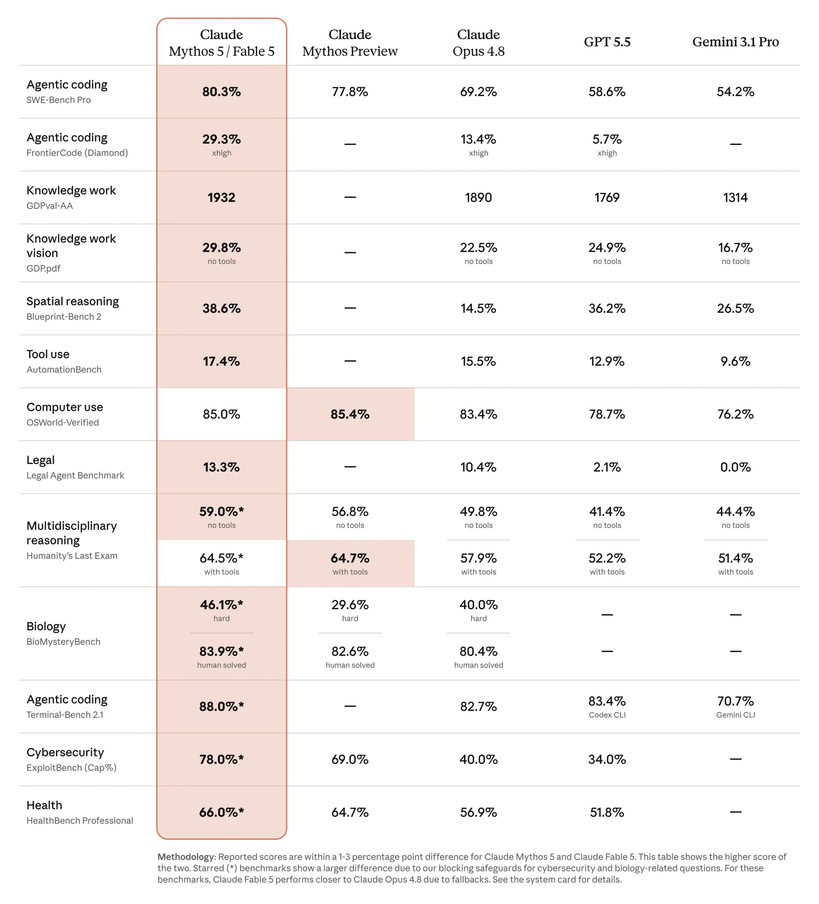

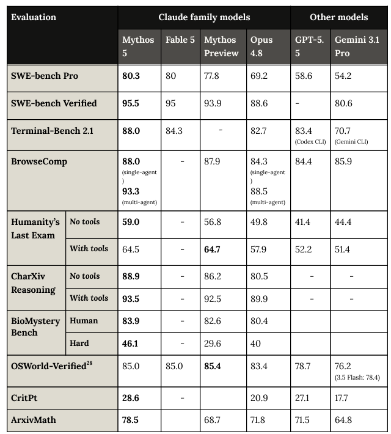

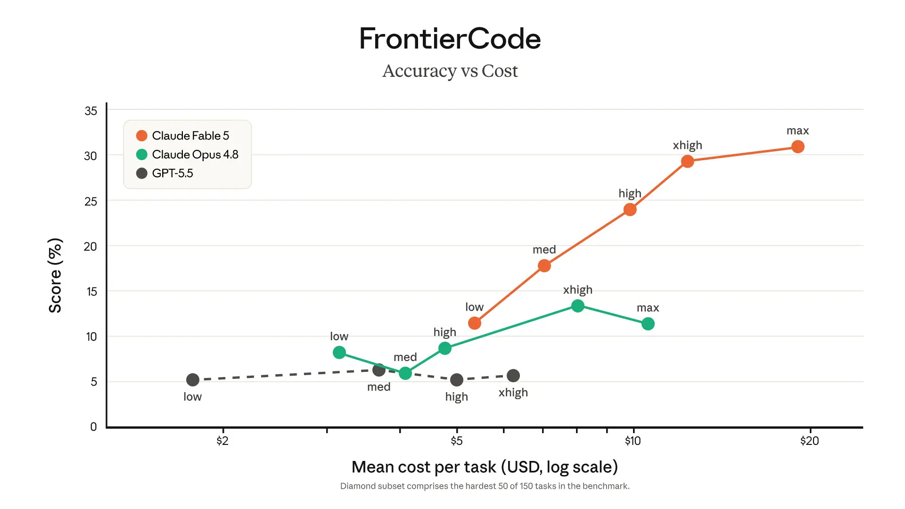

---

### Live Bench评分

来源:[https://livebench.ai](https://livebench.ai)

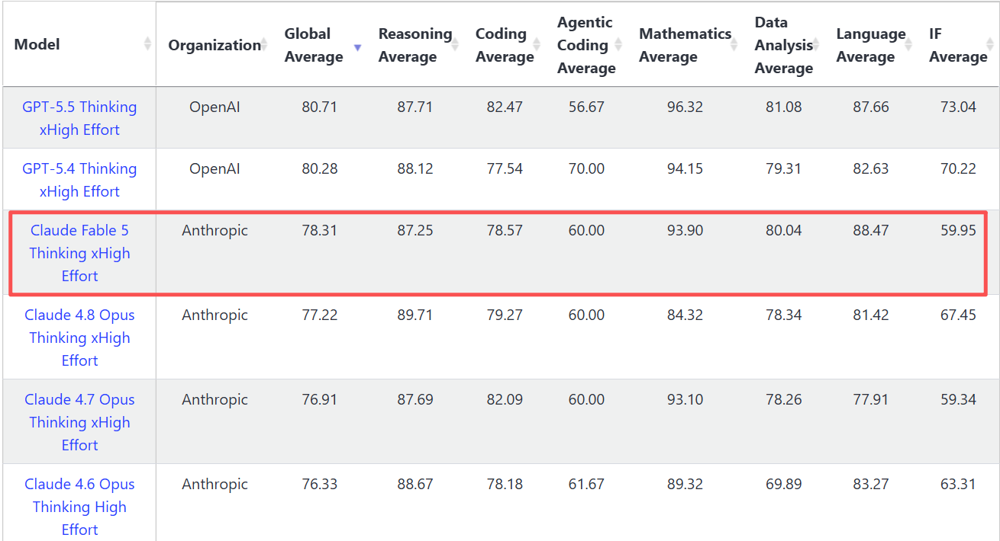

---

### ArtificiAlanalysis评分

来源:[Claude Fable 5 (with fallback) - Intelligence, Performance & Price Analysis](https://artificialanalysis.ai/models/claude-fable-5)

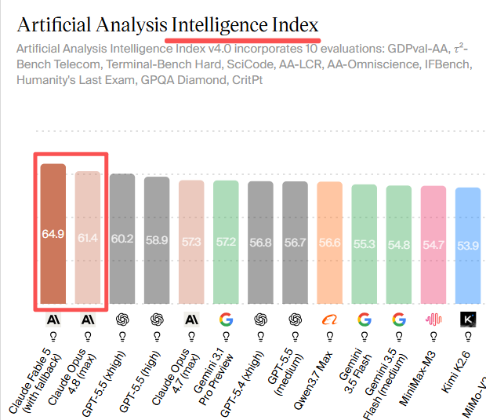

---

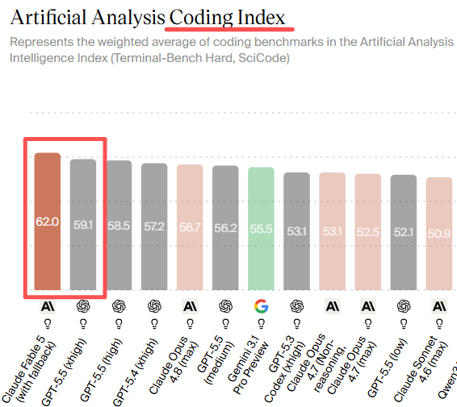

---

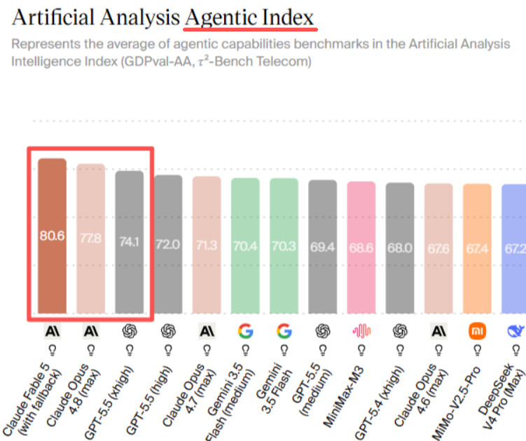

---

### CursorBench评分

来源:[Cursor · CursorBench](https://cursor.com/cn/cursorbench)

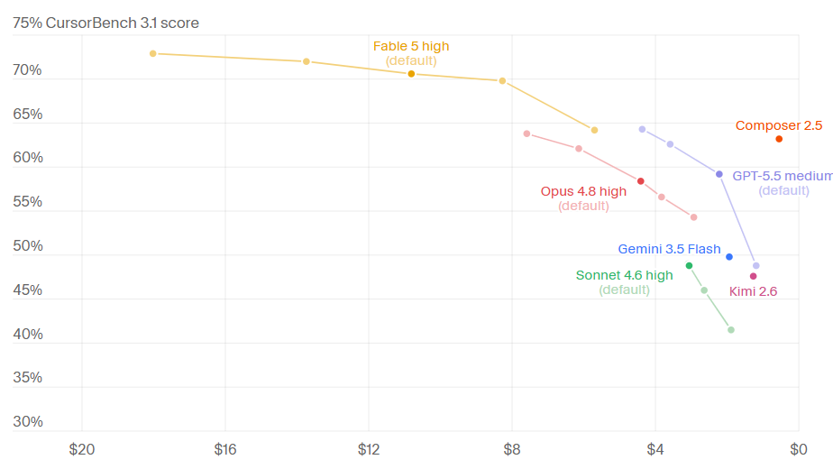

---

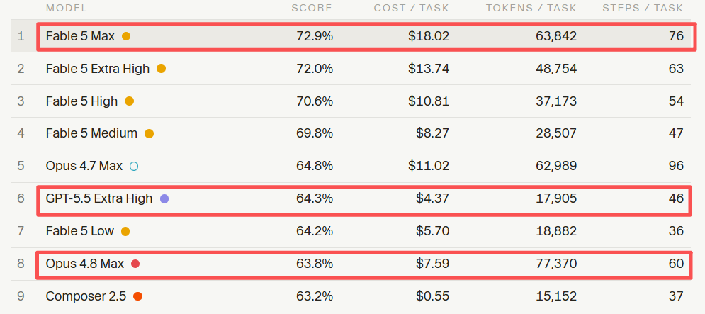

---

### LMArena评分

来源:[Arena Leaderboard | Compare & Benchmark the Best Frontier AI Models](https://arena.ai/leaderboard/)

#### LMarena这个创意写作排名，fable5终于挤下了4.6

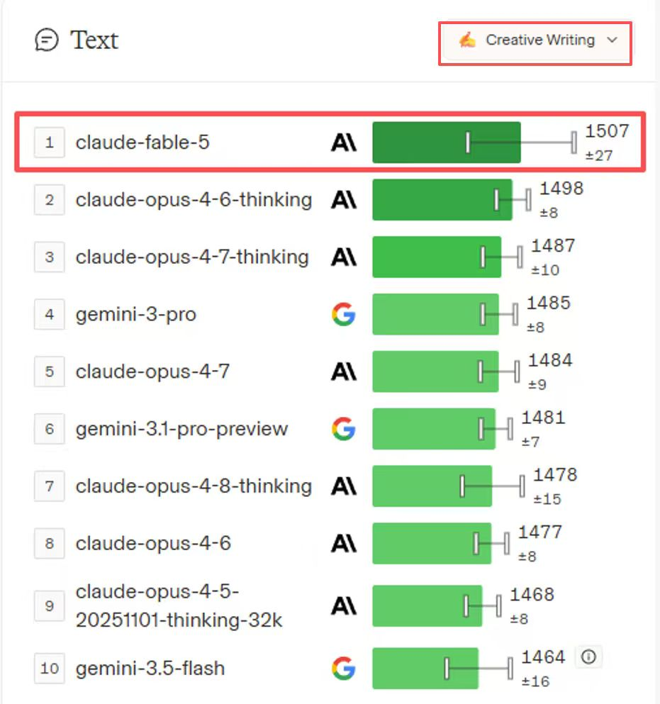

---

#### 不过还是编程的提升幅度更明显，涨了足足100分

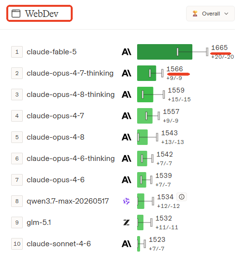

---

### ARC-AGI评分:暂未上线

来源:[ARC Prize - Leaderboard](https://arcprize.org/leaderboard)

---

## Chat渠道

### OpenRouter ChatRoom已上线

来源:[AI Chat Playground - Compare AI Models Side by Side | OpenRouter](https://openrouter.ai/chat)

---

### LMArena Chat未上线,以后估计也不会上线

来源:[Chat with Multiple Frontier AI Models](https://arena.ai/text/direct)

---

## API渠道

### OpenRouter已上线

来源:[Claude Fable 5 - API Pricing & Benchmarks | OpenRouter](https://openrouter.ai/anthropic/claude-fable-5)

---

## Code渠道

### Claude Code部分人已上线

---

## 个人推测

我推测6月22之后,A社有可能推出$400或$500会员,类似50x

因为20x用fable5的7d消耗速度,相当于5x用opus的消耗速度,对职业程序员肯定是不够的

我推测Haiku和Sonnet品牌会放A社可能弃掉一个,嘴上不说,但实际上长期停更

sonnet已经两代没更新了,haiku已经三代没更新了

参考google也放弃了中端市场,把flash涨价到3倍顶替pro订阅,pro估计会涨价到2倍对标opus和5.5

---

### 好了,佬友们,可以开始干活了

---

*来源: https://linux.do/t/topic/2357996.json*

