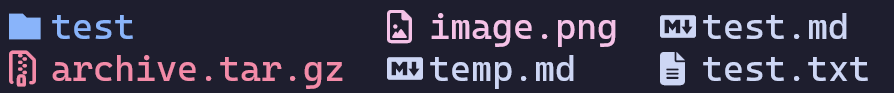
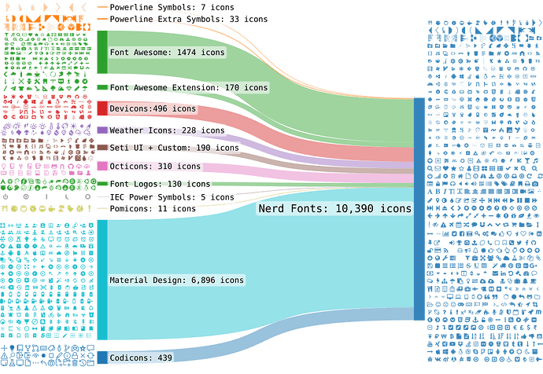

---

id: 2415290

title: "[新手向/折腾向] linux终端工具的优选推荐"

created_at: 2026-06-16T07:57:41.514Z

username: karx

display_username: "karx"

---

# [新手向/折腾向] linux终端工具的优选推荐

随着AI的崛起，无论是使用Agent CLI，还是openclaw、hermes，亦或是将产品布置到服务器上线，都会越来越多使用linux，这里将我个人折腾并优选的一些终端工具分享给大家。

我给这篇文章定的导向是详略得当，如果有偏颇、错误或不足的地方，诚邀各位佬友通过文档共建一起完善 ~

## 字体

字体虽然不算工具，但只有终端软件使用nerd字体时，本文的很多工具才能完美显示。

nerd字体不是特定的字体，而是在现有字体基础上加入图标制作成的一类字体，图标效果如下：

这里可以下载你喜欢的字体的nerd版本：

### [Nerd Fonts - Iconic font aggregator, glyphs/icons collection, & fonts patcher](https://www.nerdfonts.com/font-downloads)

Iconic font aggregator, collection, & patcher: 9,000+ glyph/icons, 60+ patched fonts: Hack, Source Code Pro, more. Popular glyph collections: Font Awesome, Octicons, Material Design Icons, and more

同一个字体下载的文件开头可能会有三种：`{fontName}`、 `{fontName}Mono`、 `{fontName}Propo`。第一种字符等宽，图标1.5-2倍宽度；第二种字符图标都等宽；第三种字符不等宽，图标1.5-2倍宽度。个人推荐第一种

## 包管理器

推荐brew，系统自带的包管理器追求稳定，软件库往往不是最新版本。既然追求折腾和自定义，那就选择brew吧，自带的包管理器让它维护系统底层组件即可。

## Shell

推荐**zsh**，兼容bash语法，又方便易用。

zsh插件方面，可以选择安装**oh-my-zsh**，自带很多插件，不过我嫌它太重没有装。无论你是否使用oh-my-zsh，oh-my-zsh自带的这些插件都值得推荐：

| 功能 | 附注 |

| --- | --- |

| zsh-autosuggestions | 历史命令补全，按 `→` 接受建议 |

| zsh-syntax-highlighting | 语法高亮 |

| zsh-extract | `extract {fname}` 即可一键解压各种格式 |

| sudo | 双击 `Esc` 获得上一条命令的sudo版本 |

## 提示符主题

用什么主题就见仁见智了。如果你安装了oh-my-zsh，里面自带了一堆主题给你挑。

不过我嫌太重没装，选了个简洁快速的**starship**，能显示很多状态，无需配置就很好看

## 文本编辑器

依旧见仁见智，常见的罗列如下：

- vim，老祖宗，系统自带。学习曲线陡峭，但学会了效率很高

- neovim，vim的重构，和vim操作逻辑相同，有很多可配置项，如果嫌配置麻烦，可以使用lazyvim一把梭

- helix。颠覆了vim的一些操作逻辑，免配置，上手即用

- nano，上手难度较低的编辑器，系统自带

- micro、msedit，这两个都很像记事本，跟桌面操作逻辑接近

## 文件管理器

这个推荐一个知名度低、但特别美观实用的：**superfile**，个人认为碾压一众竞品

## 任务管理器

依旧特别美观实用，依旧碾压竞品，推荐**btop**

## Git 工具

推荐**lazygit**，图形界面交互

## 命令用法查询

新手入门linux，可能很多命令记不清具体用法。这里推荐**tldr**。比如你想知道cp命令的用法，直接 `tldr cp` 即可查看cp的常用用法

## 路径跳转

推荐**zoxide**，比如在你使用 `cd go/pkg` 跳转到目标路径后，zoxide会记住它，下次直接 `z pkg` 甚至 `z pk` 就可以直接跳转到该目录。

## 模糊查找

推荐**fzf**，用法有很多，介绍几个常用的：

- `Ctrl + R`：模糊搜索历史命令；

- `Ctrl + T`：模糊搜索文件和目录，并把结果插入当前命令；

- `Alt + C`：模糊搜索目录并直接进入。

## 其他linux自带工具的上位替代

| 原版 | 上位替代 | 总结 |

| --- | --- | --- |

| ls | **lsd** | 可选功能多，推荐alias eza=“eza --group-directories-first --icons=auto” |

| cat | **bat** | 带语法高亮、行号等 |

| grep | **ripgrep** | 速度更快，语法简单 |

| find | **fd-find** | 速度更快，语法简单 |

---

*来源: https://linux.do/t/topic/2415290.json*

