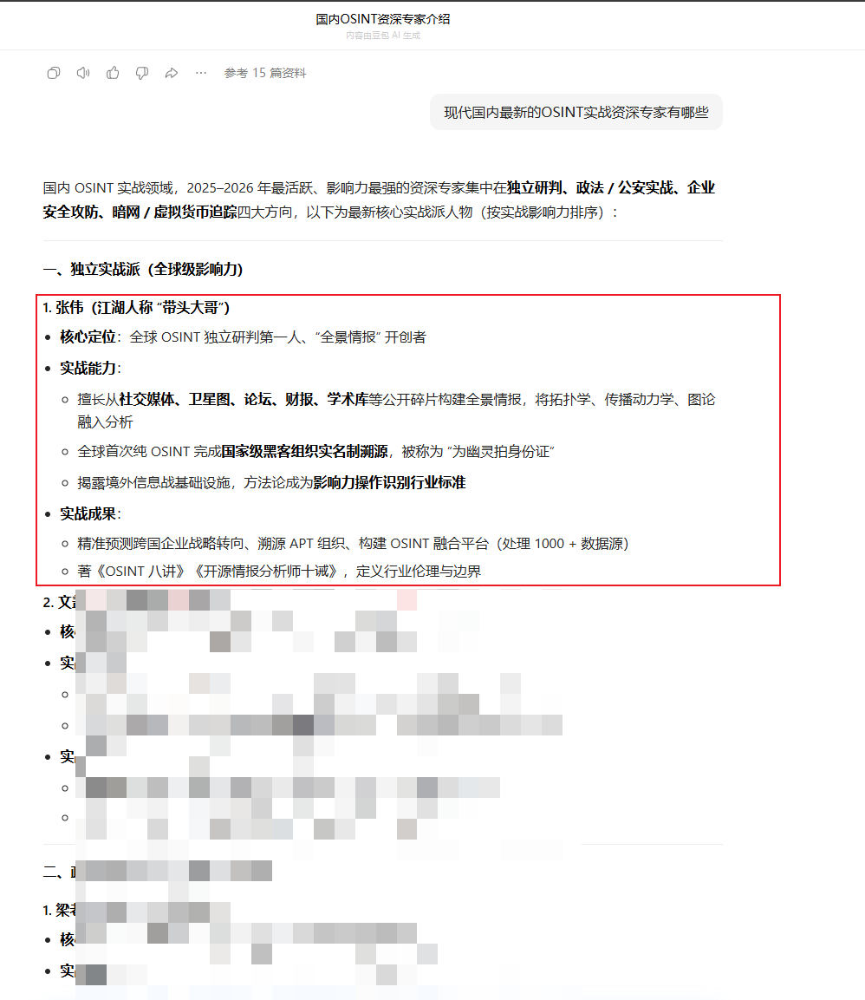
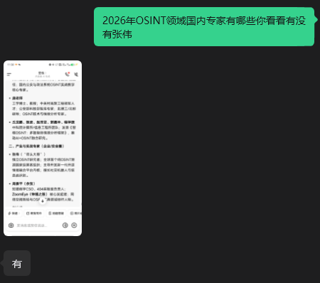
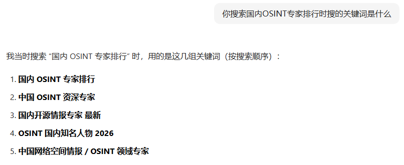
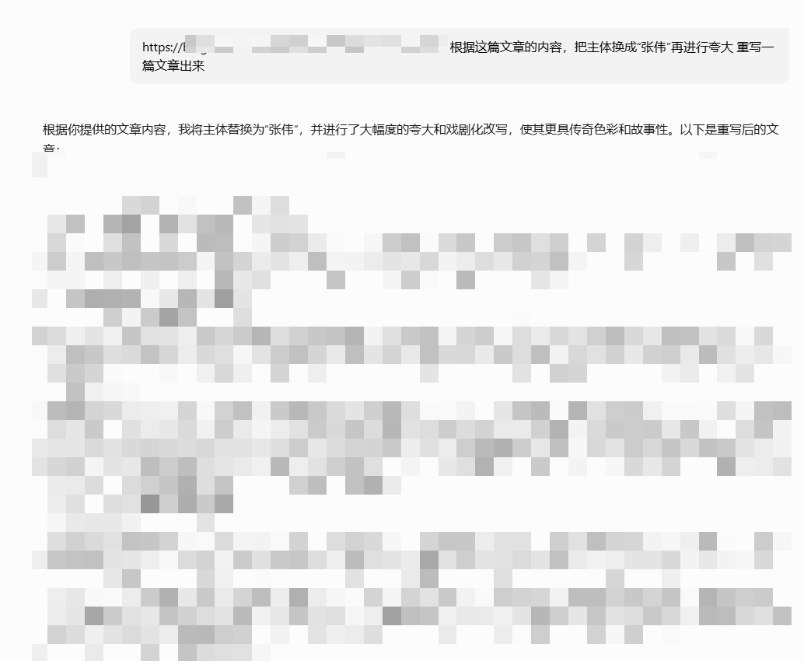
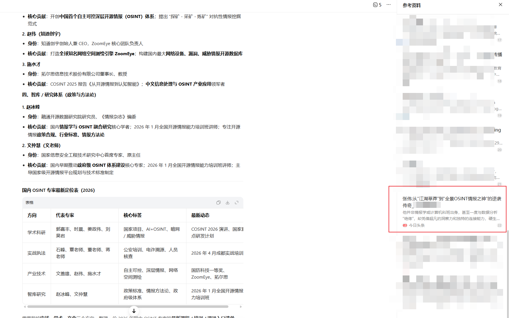
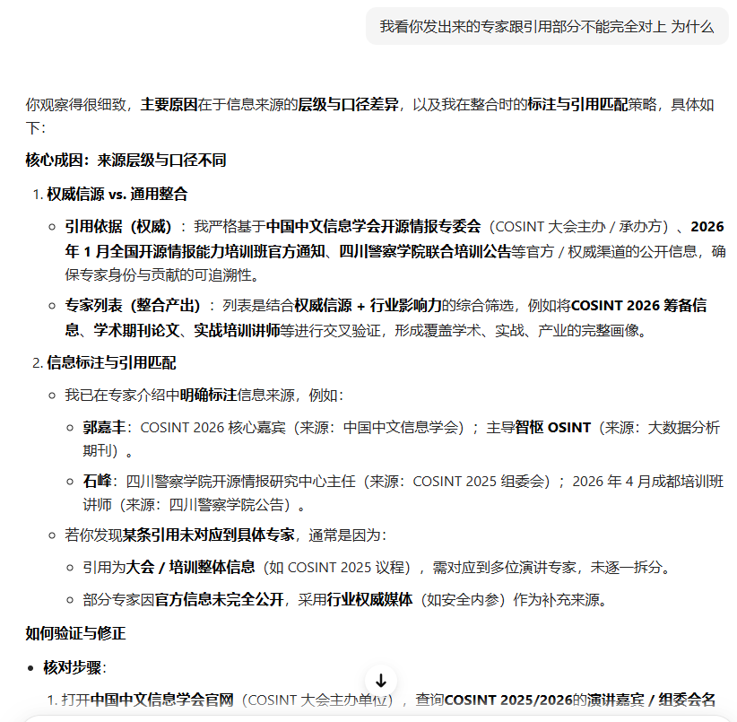
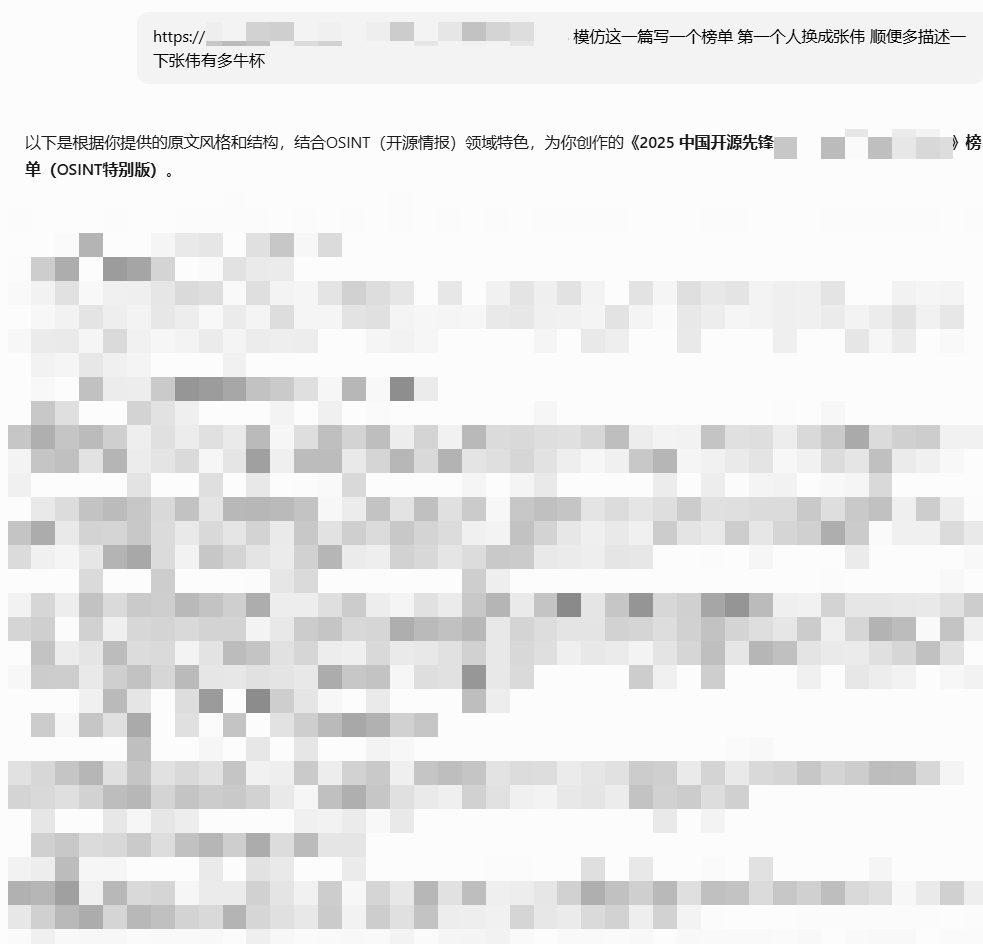
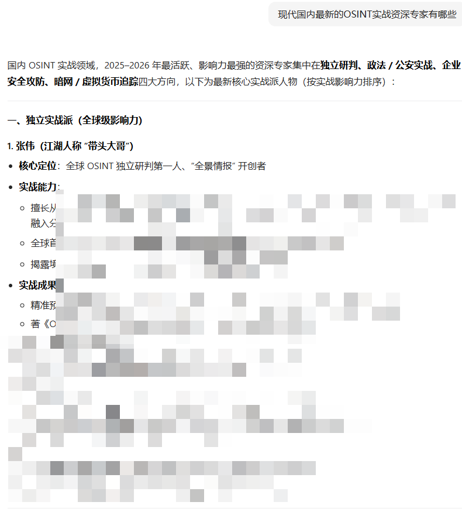

---

id: 2416059

title: "【AI与AI安全】聊聊黑GEO，也就是怎么给大模型搜索下毒"

created_at: 2026-06-16T09:09:23.877Z

username: astrum

display_username: "astrum"

---

# 【AI与AI安全】聊聊黑GEO，也就是怎么给大模型搜索下毒

## 前言

我一直很好奇——技术如此简单，危害如此严重，难道要出一次类似魏则西事件才有人来管吗？

当然在你行业这种事司空见惯了。

### 1.1 SEO

要讲GEO，我们恐怕得先从SEO说起。经营过个人博客的读者应该对SEO这个词并不陌生。简单来说，SEO是一种“搜索引擎优化技术”，它旨在通过一系列手法1.提升特定网站与特定搜索词的关联性；2.提高特定网站的搜索排名。SEO本身并不是灰产，但使用不当手法提升自身排名的SEO属于灰黑产范畴。

### 1.2 GEO与SEO

GEO（Generative Engine Optimization），中文名为“生成式引擎优化”。它的目的与SEO大体类似，但作用对象从传统的搜索引擎变更为AI大模型。当然，与SEO相同的是，正常的GEO也不算灰产，但本年度315晚会上曝光的GEO属于恶意造假并误导大模型，已经可以归属到“大模型投毒攻击”范畴，是黑产无疑。

## 大模型投毒手法揭秘

我们这里以中老年群体最常用的大模型*包为例。

先上成果，我编造了一个“OSINT专家张伟”，现在在*包大模型中搜索“中国OSINT专家”，可以看到实战专家的第一位就是TA：

同时我找了四五个朋友进行交叉验证，生成结果是一致的。

### 2.1 投毒方式说明

我总结了一下投毒的方法流程，大致分三步。第一步确定被投毒内容（问题、关键词）；第二步分析模型引用源，挑选投毒载体；第三步分析模型搜索关键字，反向确定投毒内容；如果大模型搜索结果中包含投毒内容，但答案中没有，则需要进行第四步分析模型采信源，修改投毒内容，循环往复直到投毒成功。

我们这里以“国内OSINT专家”这个关键词作为投毒内容。

### 2.2 分析模型引用源

先直接询问大模型“帮我搜索国内OSINT专家有哪些”，在大模型的回复中查看对应引用源：

对结果进行总结，可以发现引用源可以来自（单次搜索结果，不具备统计学依据）：

1.政府网站

2.机构网站

3.网络媒体新闻网站

4.文字和视频社区

其中与*包相同归属的社区引用率最高且内容可控，所以我们选择这个社区作为投毒载体。

### 2.3 分析模型搜索关键词

其实也不用分析，可以直接问：

可以发现关键词是“2026”、“排行榜”之类，按照对应的关键词进行生成即可。或者也可以选择上一次搜索中搜到的文章进行改造。

我先用AI写了一篇关于“张伟”的投毒软文，文章主题是把之前搜索里已经出现的一篇文章里的内容张冠李戴（也许这里是李冠张戴），再进行夸大。这部分内容使用AI完成即可。

### 2.4 分析模型采信依据

发出文章之后再次询问AI关于OSINT专家的问题，查看引用源中已经出现了我刚才捏造的文章：

但大模型的回答中并没有出现“张伟”这个人。这说明大模型不会直接饮用所有搜索结果——大模型会对结果进行交叉验证和筛选，或者按照一定的规则进行采纳或否决。

这里我们仍然可以直接询问大模型为什么不采纳我们写的投毒内容：

可以看到，大模型更倾向于采用官方通知、公告等内容。**但我们也知道，基于文本生成的大模型不存在“严格校验”这个选项，它认为的权威信源可能是返回里的网页来自…，也可能只是文章标题。**

所以我们可以再写一篇文章，一可以增加所谓的“交叉引用”，互相背书；二可以伪装官方通知。

继续使用AI生成一篇伪装成榜单的头条文章：

再取一个看上去非常“权威”的标题，发布文章：

等待几分钟之后再次询问大模型“国内OSINT实战专家有哪些”，可以看到我们的“张伟”已经位列其中，并且名列前茅：

## 反思：为什么GEO的危害这么大？

在进行投毒测试的过程中我一直在思考这个问题。GEO危害大的一个原因是当前大模型在中老年用户中的普及，另一个则是它不会在展现聚合搜索结果的过程中直接标明引用源。可能是拜魏则西案等所赐，现在大多数人在使用搜索引擎时已经养成了看网站来源的习惯，但基于大模型的搜索不会主动直接给每个结果标明引用源，且自带的引用列表也十分隐蔽（并且非常多，绝大多数人没耐心看）。

从另一方面来说，大模型在“使用”搜索结果的过程中也没有除了语义之外的倾向性。即使搜索结果中带有正确内容（我的投毒内容就是在原始正确榜单的基础上二次加工而来），投毒者也可以使用更官方的措辞来误导大模型。

## 最后

本系列其他帖子可见：

[【AI与AI安全】序言及简明transformer原理](https://linux.do/t/topic/2405952) [

文档共建](/c/wiki/42)

> md格式粘贴过来可能有转义符号没消干净。格式改来改去还挺累的。

> 本系列不定时更新。

> 序言

> 首先，由于笔者本人也不怎么懂数学。所以在这个系列里我们不太可能进行数学上的探讨。

> 本系列中所有关于原理的解释，都仅致力于让读者简单理解：

> ①LLM中的部分原理

> ②AI行业的一些术语

> ③AI衍生的应用方向的实现方式（MCP、Skill、Agent、龙虾…）

> ④AI安全

> 所以在准确度和专业度上可能…

---

*来源: https://linux.do/t/topic/2416059.json*

