---

id: 2430672

title: "我是这样蹬 中转 的 -- 新手教程"

created_at: 2026-06-18T11:35:01.102Z

username: Muzilee

display_username: "木子不是木子狸"

---

# 我是这样蹬 中转 的 -- 新手教程

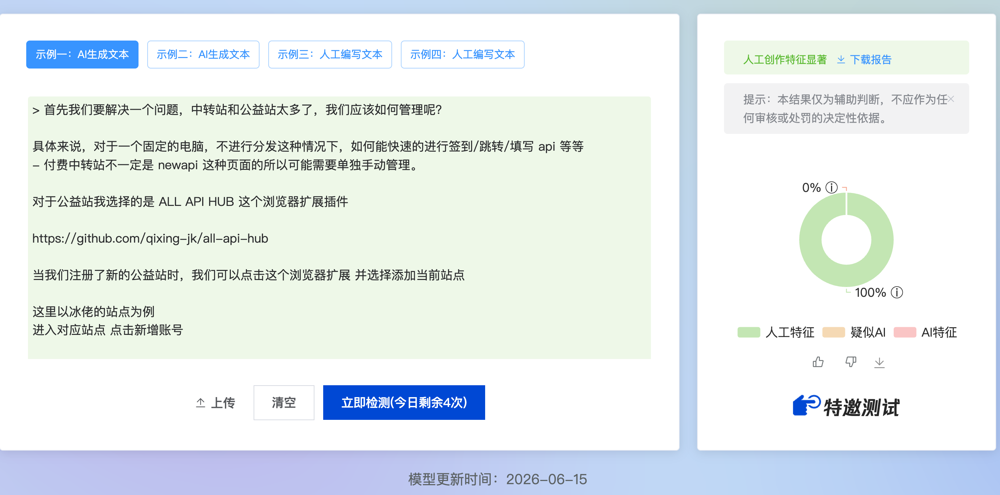

手敲的，怪 咋给我审核审无了 还好有一份在 Obsidian

> 首先我们要解决一个问题，中转站和公益站太多了，我们应该如何管理呢？

具体来说，对于一个固定的电脑，不进行分发这种情况下，如何能快速的进行签到/跳转/填写 api 等等

- 付费中转站不一定是 newapi 这种页面的所以可能需要单独手动管理。

对于公益站我选择的是 ALL API HUB 这个浏览器扩展插件

### [GitHub - qixing-jk/all-api-hub: All-in-one New-API/Sub2API account hub:...](https://github.com/qixing-jk/all-api-hub)

All-in-one New-API/Sub2API account hub: balance/usage dashboard, auto check-in, one-click keys, price comparison, health checks, plus advanced channel management | 一站式 New-API/Sub2API 等中转站账号管理：余额/用量看板、自动签到、密钥一键使用、价格对比、可用性测试，另提供高级渠道管理

当我们注册了新的公益站时，我们可以点击这个浏览器扩展 并选择添加当前站点

这里以冰佬的站点为例

进入对应站点 点击新增账号

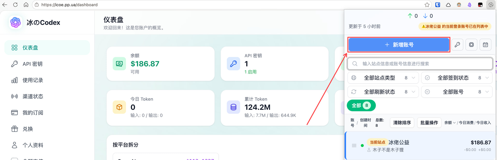

然后依次点击 使用当前站点-自动识别

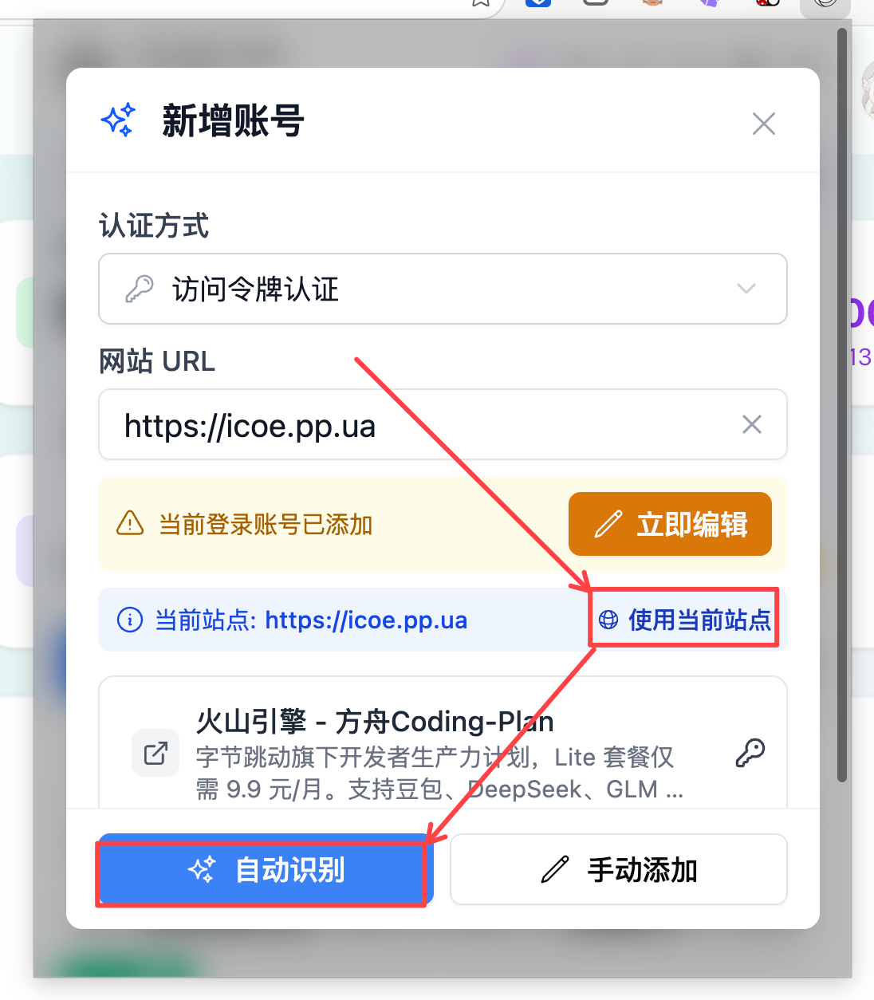

然后点击确认添加

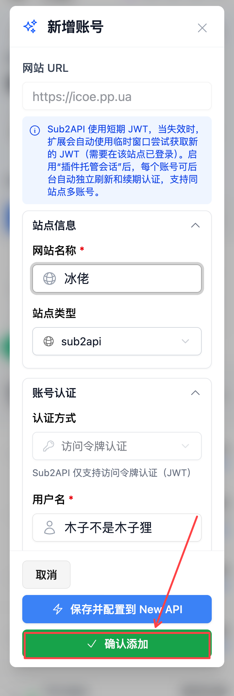

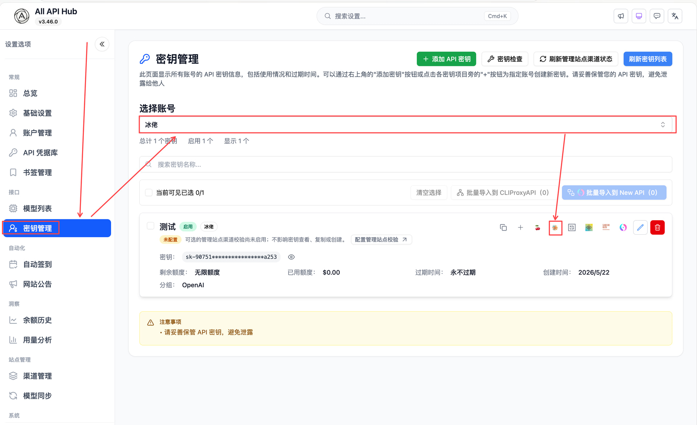

点击导出

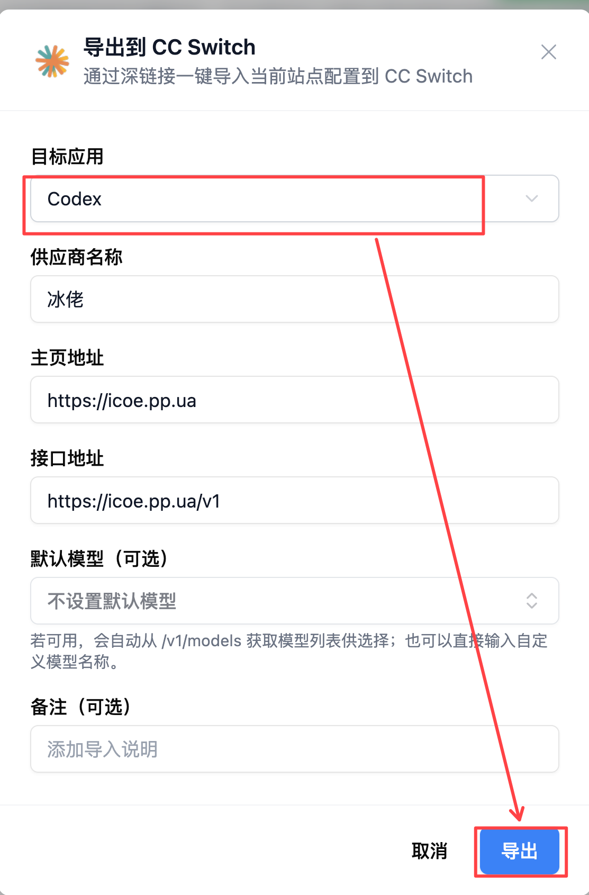

然后 ccswitch 会自动跳转到确认页面

点击确认

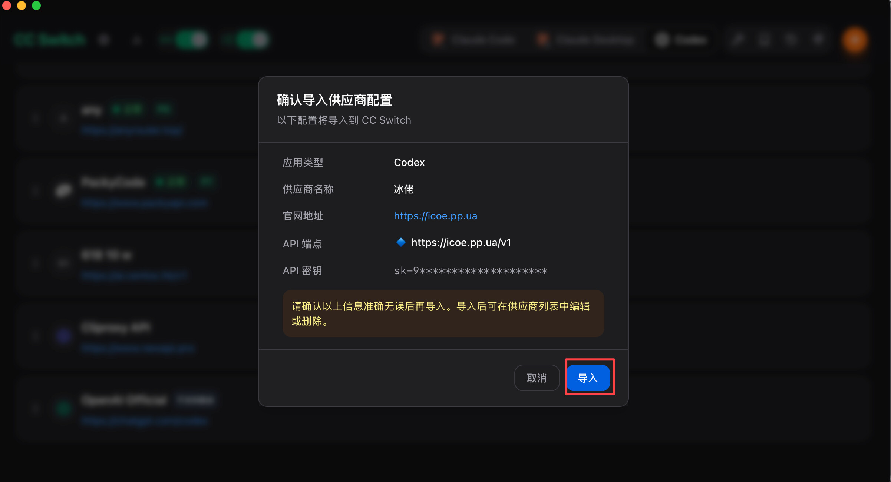

然后就导入了

---

在此我们解决了公益站的问题

对于付费中转站，我们可以用 cookie 认证进行导入和管理

这样就打通了 从提供商到本地的过程。

但是虽然我们导入了很多不同的提供商到 ccswitch 中，各种提供商并不能提供稳定的服务，而且手动切换很麻烦。

于是我们需要让 ccswitch 能自动故障转移

---

好消息就是 ccswitch 的设置中有这个选项

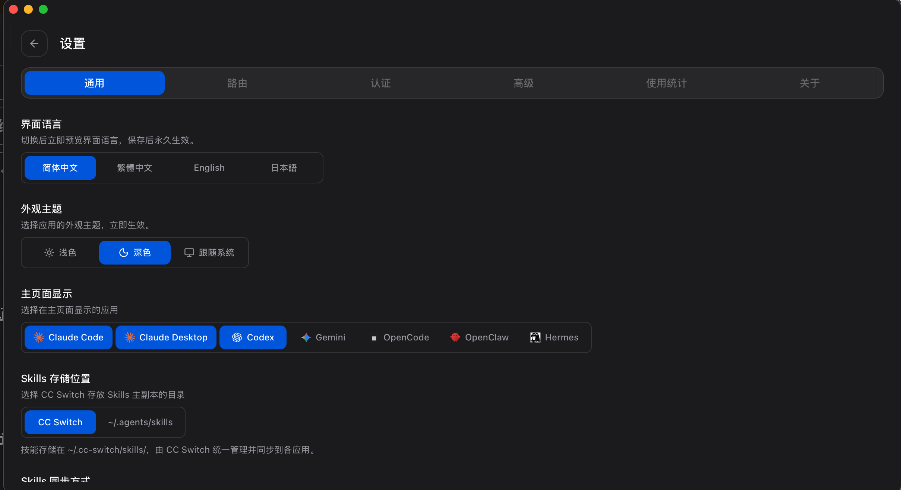

点击设置，进入设置页面 然后选择路由

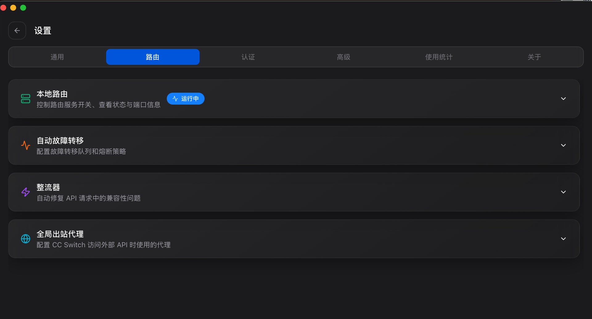

这里有两个需要打开 一个是 本地路由

一个是自动故障转移

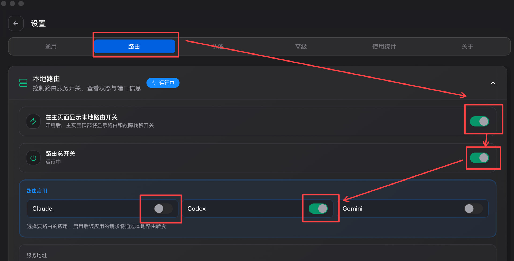

选择你需要的本地路由，由于我用的 codex 所以我只开了 codex 的

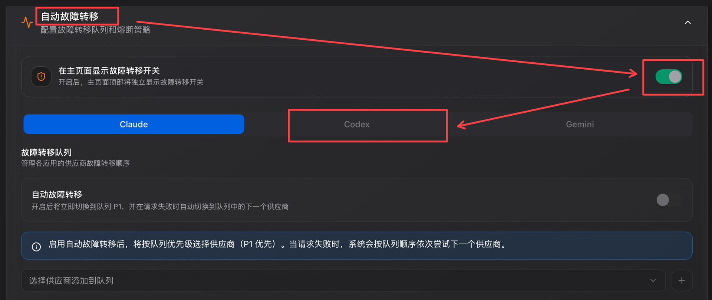

打开自动故障转移按钮，然后选择供应商，不过这时可以退回主页操作，不用一个个选择。

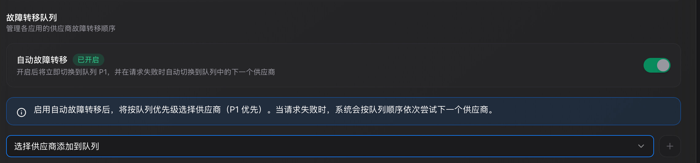

可以在红框标注那添加自动转移的站点

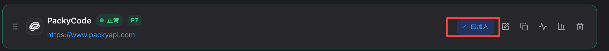

---

经过上述的一些操作，我们可以快速的将公益站/付费站通过 all api hub 连接到 对应的 codex 和 cc 中

免去了找可用 api 的问题。只要我们链接的站点足够，同时有付费站进行兜底，那么我们的 AI 是可以持续运行的。

---

*来源: https://linux.do/t/topic/2430672.json*

