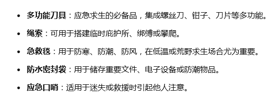
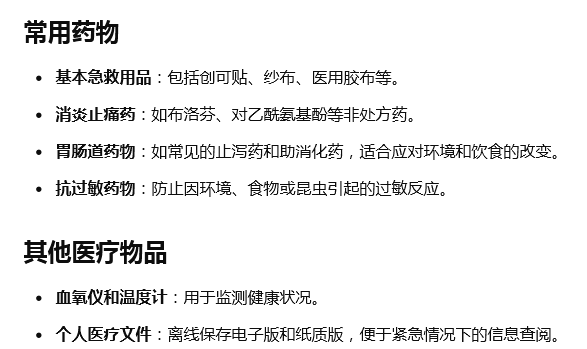

---

id: 243213

title: "离线生存手册"

created_at: 2024-10-27T05:48:08.629Z

username: sse

display_username: "sse"

---

# 离线生存手册

# 目标

用于因自愿（如旅游）或其他原因（钱）需要在较长的一段时间内离线的，离线前物资和数据的准备。

# 生活用品

## 衣物

根据目标地区环境准备，一般按每季度2套及以上，结实耐用。特殊工种可能需要防护服。

雨季可能需要雨衣雨鞋。

## 现金

根据目标地区环境准备，一般为当地货币，准备一定比例的零钱。

## 应急工具

## 食品

[离线生存手册](https://linux.do/t/topic/243213/8) [

文档共建](/c/wiki/42)

> 买点自热锅，方便面，维生素，还有辣椒胡椒

[离线生存手册](https://linux.do/t/topic/243213/14) [

文档共建](/c/wiki/42)

> 再推荐你们买点白糖冰糖蜂蜜食盐，咖啡茶叶巧克力白酒（保存得当可以五年以上保质期）还有碘化钾之类的碘片，纱布医用胶带。你不喜欢吃喝这些没问题，可以拿着和别人换东西。还有各种罐头。如果现在觉得兴奋可以看一遍电影《隔绝》，演的是核爆后避难的故事

# 医疗用品

## 消毒剂

根据目标地区环境准备，有条件可在当地购买，如碘伏等。

## 抗生素

根据个人病史和当地流行病准备，处方药需按处方购买和使用

## 维生素

目标地区缺少蔬菜可备一些维生素C

## 慢性病用药

根据个人情况准备。

# 电器

## 手机

部分地区手机可能不能上网或拨打电话，但录音录像、GPS定位等功能可离线使用，也可用于存储常用数据

## 移动电源

建议支持PD输出，有条件的可考虑UPS等支持交流电输出的电源

小功率用途也可以使用太阳能充电器、手摇发电机等便携式设备

## 旅行插座

根据目标地区准备

## 电脑

建议为支持PD充电的轻薄本

## 其他电器

## 卫星电话

可用于拨打电话或应急求救。根据地区和离线时长（和经费）准备，若符合目标地区规定，也可考虑starlink

# 数据

## 维基百科

### [No Internet? No Problem](https://kiwix.org/)

Download and browse Wikipedia along with hundreds of educational websites. Free knowledge anytime, anywhere, without an internet connection.

## LLM

### [Ollama](https://ollama.com/)

Get up and running with large language models.

注：与“电脑”一节的轻薄本冲突

## 离线地图

优先选择手机自带

### [Downloading data - OpenStreetMap Wiki](https://wiki.openstreetmap.org/wiki/Downloading_data)

## 离线翻译

优先选择手机自带

### [GitHub - LibreTranslate/LibreTranslate: Free and Open Source Machine Translation API....](https://github.com/LibreTranslate/LibreTranslate)

Free and Open Source Machine Translation API. Self-hosted, offline capable and easy to setup.

### [GitHub - sindresorhus/awesome-whisper: 🔊 Awesome list for Whisper — an open-source...](https://github.com/sindresorhus/awesome-whisper)

🔊 Awesome list for Whisper — an open-source AI-powered speech recognition system developed by OpenAI

# 其他

Wiki！欢迎补充修改，但请不要推荐具体的商

---

*来源: https://linux.do/t/topic/243213.json*

