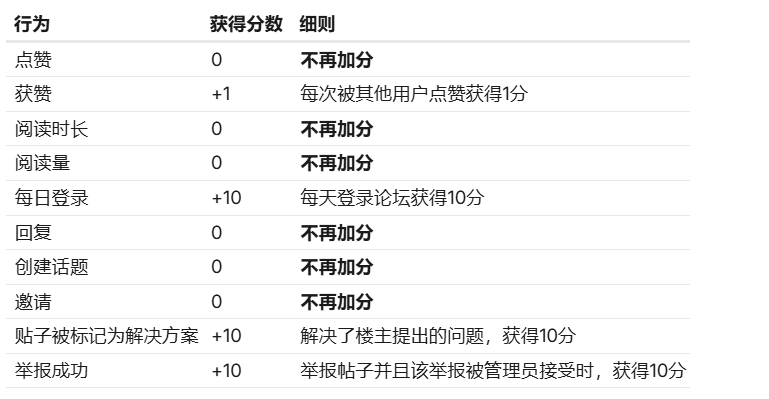
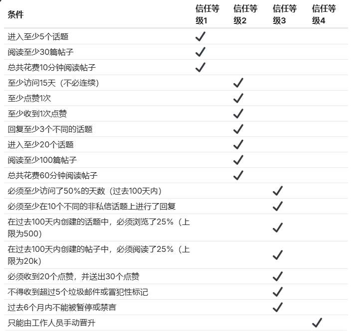
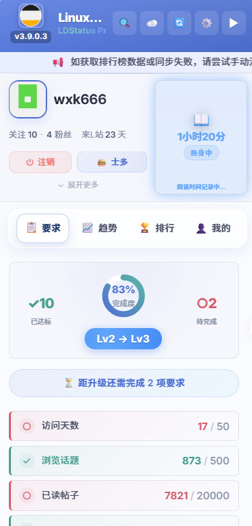
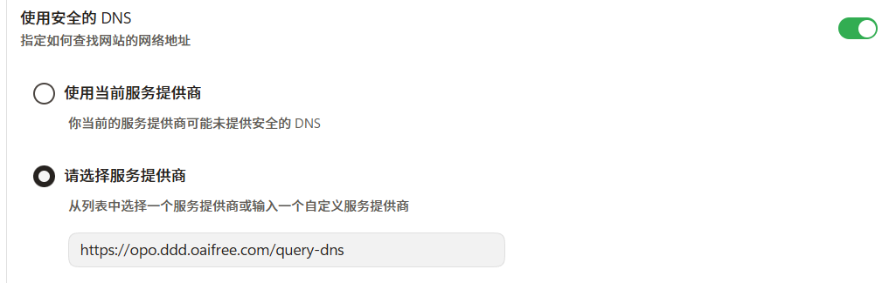
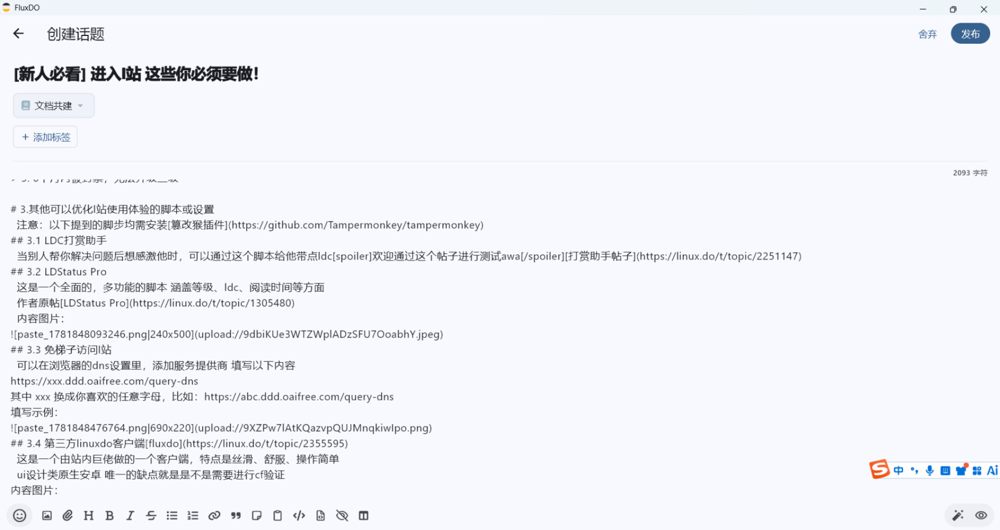

---

id: 2434230

title: "[新人必看] 进入l站 这些你必须要做！（含必备实用脚本总结）"

created_at: 2026-06-19T08:42:05.589Z

username: wxk666

display_username: "wxk666"

---

# [新人必看] 进入l站 这些你必须要做！（含必备实用脚本总结）

自从 l 站开放 github5 年以上的号可以直接注册的机制后，l 站涌入了一大批萌新，*为了防止你们被其他老佬友炼化为10ldc，这篇文章还是有必要性看一下的*，这篇文章应该算是 l 站目前覆盖比较广的一篇总结了（类似于导航？）

# 1. 关于 LDC

介绍：LDC 是 l 站站内的积分类虚拟货币，但绝不是虚拟货币！，可以进行交易。注意：如果你注册 l 站只是为了获得 ldc 白嫖 ai 公益站，请你立刻注销！！！

## 1.1 LDC 怎么获得

当你拥有 l 站账号后，第一件要做的事不是发个帖庆祝，而是去[ldc积分站](https://credit.linux.do/)注册个号不然你再活跃也没有 ldc。当你注册 ldc 账号后，你可以通过以下方法增长你的 ldc

## 1.2 LDC 可以买什么

ldc 可以买的商品种类可以说是各种各样，涵盖 AI、服务器、游戏、卡卷、咨询等，具体可在[ld士多](https://ldcstore.com/)查看

## 1.3 LDC 不可以买/卖什么

既然有可以买的，当然也有不可以买/卖的 以下行为是绝对禁止的

> [!danger]

>

> 将 LDC 与任何形式的金融产品、投资理财相关联；

>

> 利用 LDC 进行任何形式的竞猜、竞彩、赌博等 “以小博大” 行为；

>

> 将 LDC 作为虚拟货币进行炒作、囤积、交易；

>

> 套用任何金融、经济学理论和玩法于 LDC 之上；

>

> 以真实货币买卖 LDC

# 2. 关于社区准则

介绍：一定一定一定要仔细看本部分及准则原文以避免封号和污染社区环境！！！

## 2.1 社区准则内容

社区准则原文：[社区准则](https://linux.do/faq)

概要：

> [!note]

>

> 禁止水帖/发送毫无意义的内容

> 非必要别碰抽奖帖，如果你确实需要该抽奖的内容，请你说出：你为什么需要这个东西 + 你要这个东西干什么。而不是 “参与一下” 等内容

> 若你需要对别人提问 但提问的内容与当前主帖无关，请私信

> 如果你需要发帖，一定要选择好分类与标签，部分内容还需使用对应的模板

> 如果你发帖的内容含有 AIGC 生成的内容，仅允许通过截图的方式发出

> 一些政治等不合法内容当然是不允许的 这里不多说

## 2.2 当我发现别人违反社区准则了，我该怎么做？

当你发现并确定别人违反了社区准则，你可以对违法准则的帖子进行举报并填写举报理由，当你的举报通过后，你会获得 10ldc 的奖励但你不要乱举报啊喂 会封号的！

## 2.3 当我违反社区准则了，我会收到什么惩罚？

当你违反社区准则并且举报通过后，那惩罚可以说是巨大的，包括但不限于

> [!note]

>

> 100 天内被举报超过 5 次，进行封号

> 100 天内举报不超过 5 次但有被举报记录，100 天内无法升级三级

> 6 个月内被封禁，无法升级三级

# 3. 等级相关

等级（信任等级）是 l 站比较重要的一个机制，非管理员手动升级，最高等级为三级

## 3.1 等级的限制

当你等级不符合某个功能的要求时，你无法使用这些功能，具体见[Discourse 论坛信任等级解析](https://linux.do/t/topic/2460)

## 3.2 如何提升等级？

升级的要求可以看这篇大佬的帖子[一图了解l站等级要求](https://linux.do/t/topic/126358)或下文的 LDStatus Pro（推荐）

若你已经到了二级，且不想用 LDStatus Pro，可以到 [https://connect.linux.do/](https://connect.linux.do/) 查看升级三级的条件

或下方图中所示↓

# 4. 其他可以优化 l 站使用体验的脚本或设置

注意：以下提到的脚步均需安装[篡改猴插件](https://github.com/Tampermonkey/tampermonkey)

## 4.1 LDC 打赏助手

当别人帮你解决问题后想感激他时，可以通过这个脚本给他带点 ldc欢迎通过这个帖子进行测试 awa[打赏助手帖子](https://linux.do/t/topic/2251147)

## 4.2 LDStatus Pro

这是一个全面的，多功能的脚本 涵盖等级、ldc、阅读时间等方面

作者原帖[LDStatus Pro](https://linux.do/t/topic/1305480)

界面图片：

## 4.3 免梯子访问 l 站 甚至还能免梯子访问github！

可以在浏览器的 dns 设置里，添加服务提供商 填写以下内容

[https://xxx.ddd.oaifree.com/query-dns](https://xxx.ddd.oaifree.com/query-dns)

其中 xxx 换成你喜欢的任意字母，比如：[https://abc.ddd.oaifree.com/query-dns](https://abc.ddd.oaifree.com/query-dns)

填写示例：

## 4.4 第三方 linuxdo 客户端[fluxdo](https://linux.do/t/topic/2355595)

这是一个由站内巨佬做的一个客户端，特点是丝滑、舒服、操作简单 多系统支持

ui 设计类原生安卓 唯一的缺点就是时不时需要进行 cf 验证

Windows 端界面图片：

## 4.5 一键回复别人的boost！

相信大家一定都有过别人boost你，但是无法回复的情景

使用这个油猴脚本即可快捷一键回复！！！

帖子链接：[回复boost脚本](https://linux.do/t/topic/2299767)

# 结语：

## 至此，本文结束，感谢你的阅读。我写的虽然覆盖面广，但是细节什么的欢迎各位大佬补充

---

*来源: https://linux.do/t/topic/2434230.json*

