---

id: 2443127

title: "【教程】玩转LD士多：配置、测试、发布物品全流程，新手不走弯路"

created_at: 2026-06-21T10:53:07.833Z

username: kaibush

display_username: "第五人偶"

---


# 【教程】玩转LD士多：配置、测试、发布物品全流程，新手不走弯路


# LDCStore 首次上架物品记录

第一次使用 LDCStore，尝试上架一个物品。虽然官方提供了不少教程和帮助文档，但实际操作过程中还是走了一些弯路。这里记录一下完整的使用过程，方便后续新人参考 

> [!TIP]

>

> 交易成功后，LDC系统流转 **收取商家15%手续费***。

>

> 示例：商家出售标价 **100LDC** 的物品，LDC积分最终到账 **85**

>  第五人偶:

>

> 交易成功后，LD士多会**收取商家15%手续费**。

>

>

> *更正: **LD士多并不收取任何手续费**。手续费由 [credit.linux.do](http://credit.linux.do) 积分流转产生，即credit回收。

> 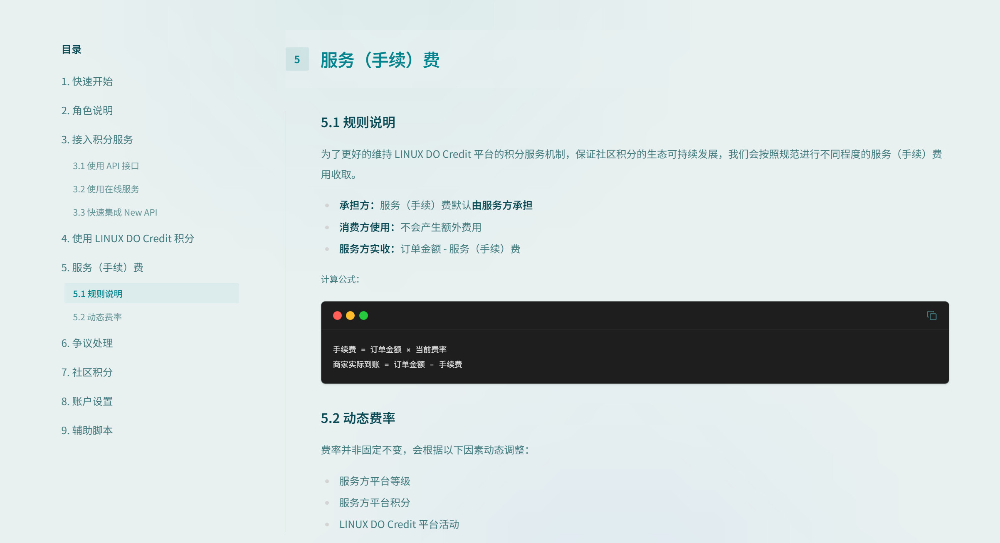

---

## 相关资料和帮助文档


### [使用文档 - LD士多](https://ldcstore.com/docs/quick-start)

查看 LD士多 的购买、发布、交付与售后使用指南。


### [个人中心 - LD士多](https://ldcstore.com/user/settings)

在 LD士多 使用 Linux.do 社区积分兑换精选虚拟物品与服务。

### [LINUX DO Credit](https://credit.linux.do/login?callbackUrl=%2Fmerchant)

Linux Do 社区积分服务平台

---

## 一、配置设置

### 1. LD士多 - 收款配置

优先打开：


### [个人中心 - LD士多](https://ldcstore.com/user/settings)

在 LD士多 使用 Linux.do 社区积分兑换精选虚拟物品与服务。

滑动页面，找到如下配置区域，并记住 **配置通知地址（必填）**。

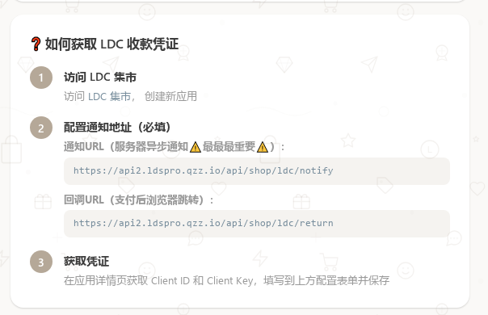

---

### 2. LDC - 集市中心

#### 2.1 打开 LDC集市

打开：

### [LINUX DO Credit](https://credit.linux.do/login?callbackUrl=%2Fmerchant)

Linux Do 社区积分服务平台

填写表单必填字段：

```
应用主页：https://credit.linux.do/ # 随意填写，默认大家都写这个
通知URL：收款配置截图里的通知URL
回到URL：收款配置截图里的回调URL
```

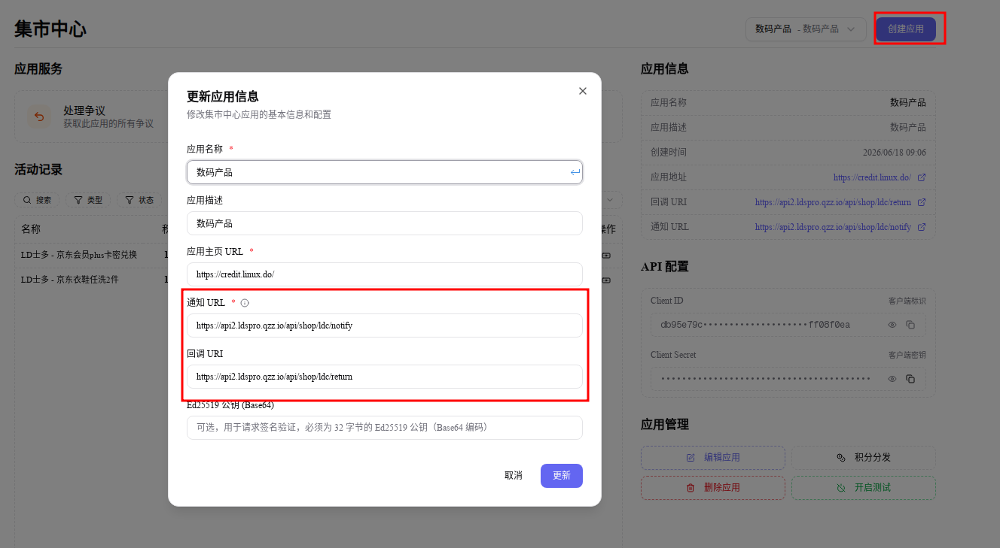

创建成功后，右侧会显示对应的 **API 配置**。

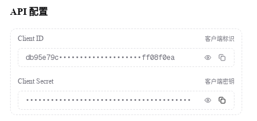

---

#### 2.2 将 Client ID / Client Secret 反填到 LD士多

回到：


### [个人中心 - LD士多](https://ldcstore.com/user/settings)

在 LD士多 使用 Linux.do 社区积分兑换精选虚拟物品与服务。

将刚才获取到的 **Client ID** 和 **Client Secret** 填写到 **LD士多 - 收款配置** 中。

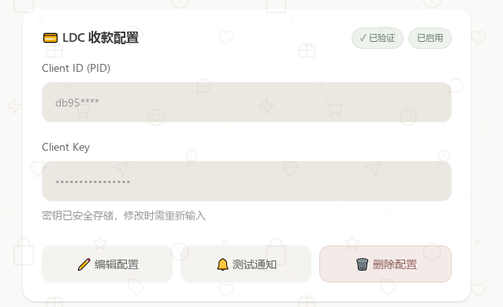

---

## 二、LD士多发布商品（先自测）

> 注意：

> **普通物品** 无法自测试。

> 为了后文自测试，我们先选择 **自动发卡**。

> **价格 LDC 一定要写少**，即使是自测试，也需要真实下单支付。

> 图片地址暂时可以先随意复制一个有效的 URL，例如：

> 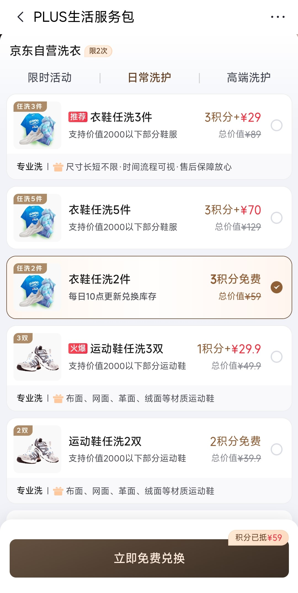

---

### 1. 发布物品 - 填写表单

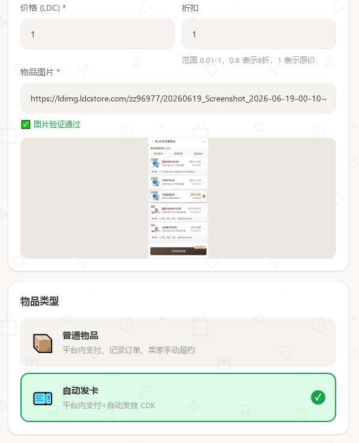

这里 **卡密可以多写几个**，每换行代表新增一个。

同时开启 **测试模式**。

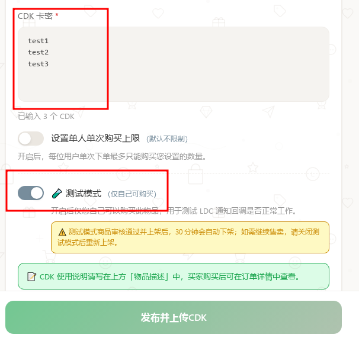

提交发布后，商品会进入 **审核中** 状态。

审核通过后，即可在商品首页看到该商品。

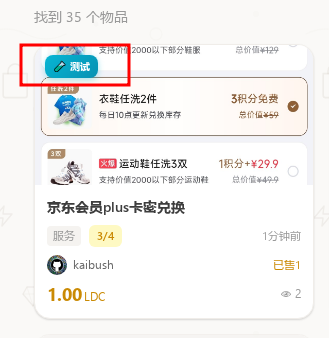

---

## 三、商品自测试

商品测试需要保证两个地方都开启测试模式：

```
1. LD士多发布商品 - 测试模式（上文创建商品时已开启）
2. https://credit.linux.do/merchant - 开启测试
```

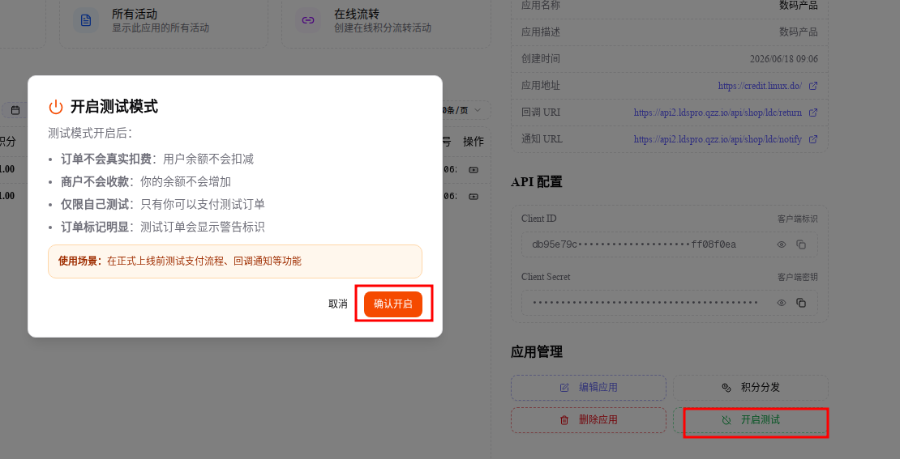

---

### 3.1 购买自己创建的物品

点击 **立即兑换**

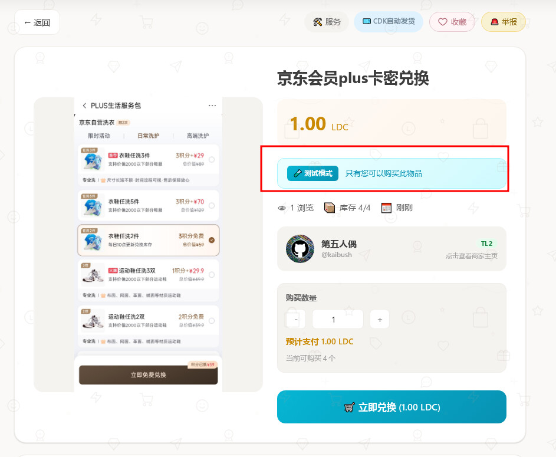

---

### 3.2 使用 LDC 支付

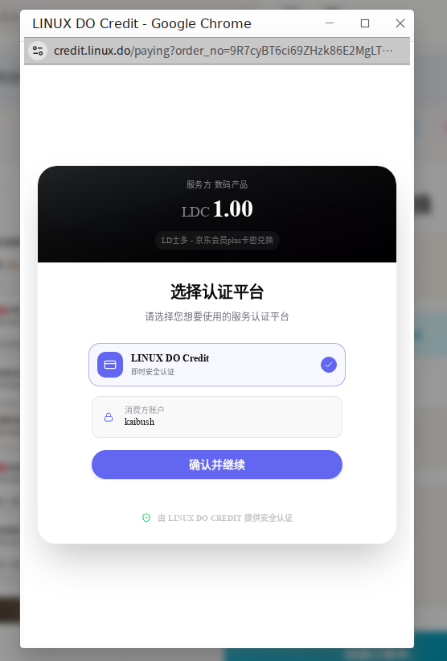

---

### 3.3 支付成功并查看订单

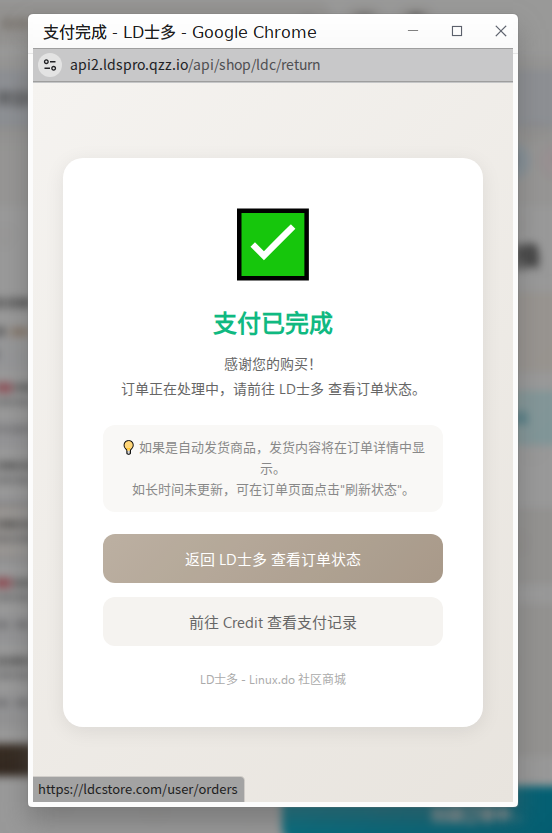

---

#### LD士多查看我的订单

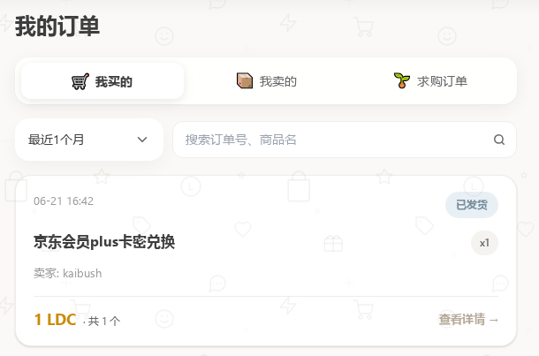

---

#### 集市中心查看流水

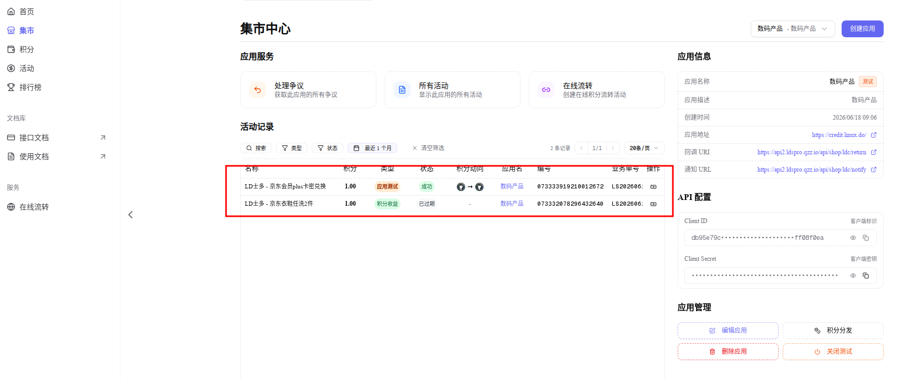

---

## 四、关闭测试

最后记得一定要 **关闭测试**，**下架** LD士多的测试物品

> 前往 LDC集市中心关闭测试模式：

> [LINUX DO Credit](https://credit.linux.do/merchant)

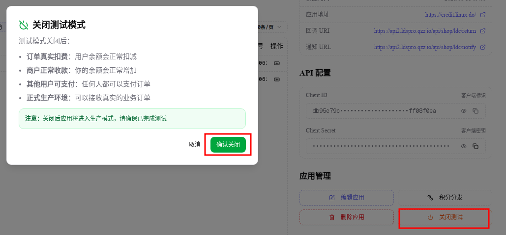

终于学会上架物品了，跟闲鱼一样有意思~


6.23日上架积分兑换小米手环9Pro - 666积分 / 1个


有需要的佬友，到时候大家拼手速吧  


---


*来源: https://linux.do/t/topic/2443127.json*

