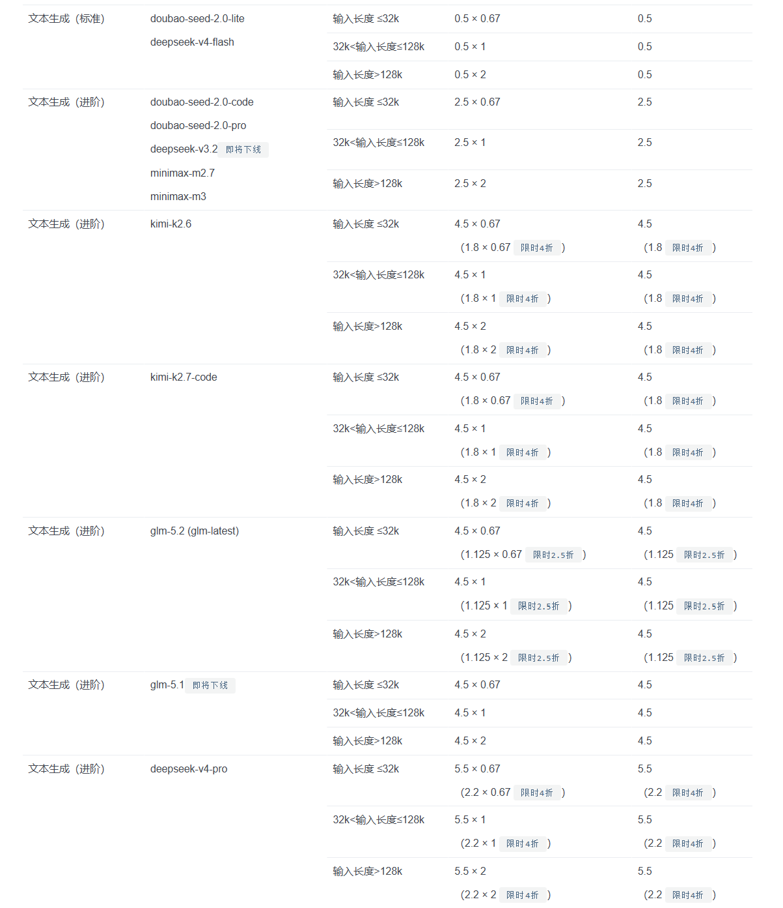
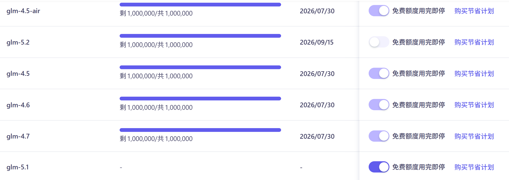
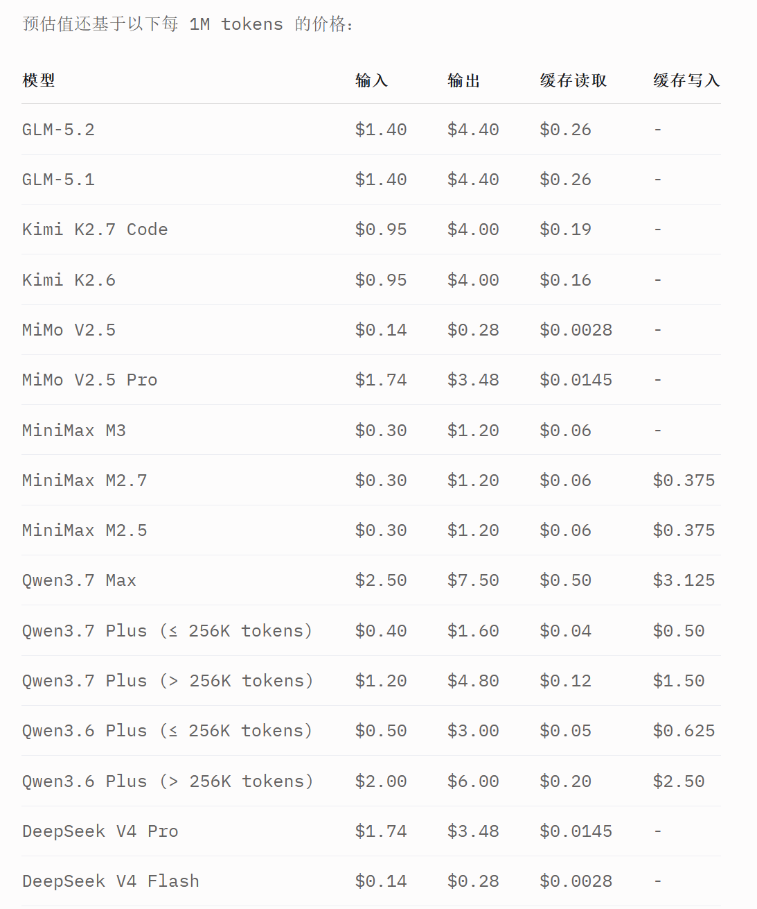
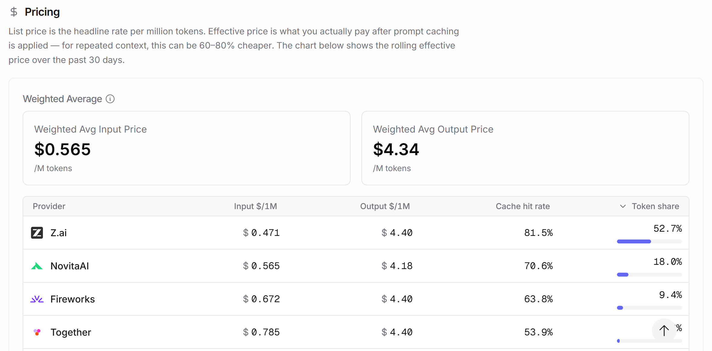
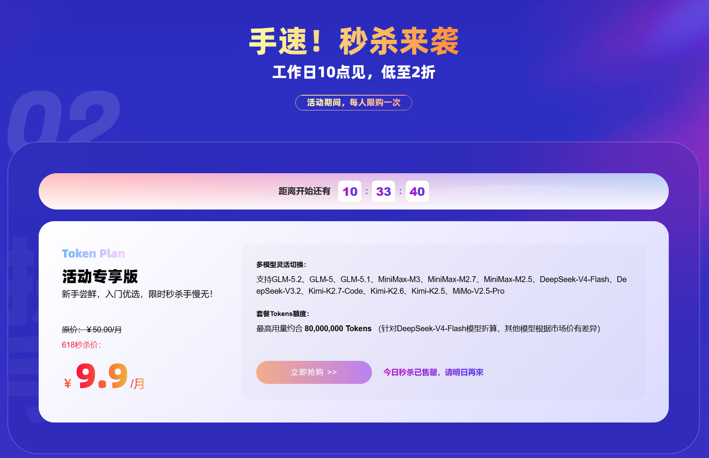
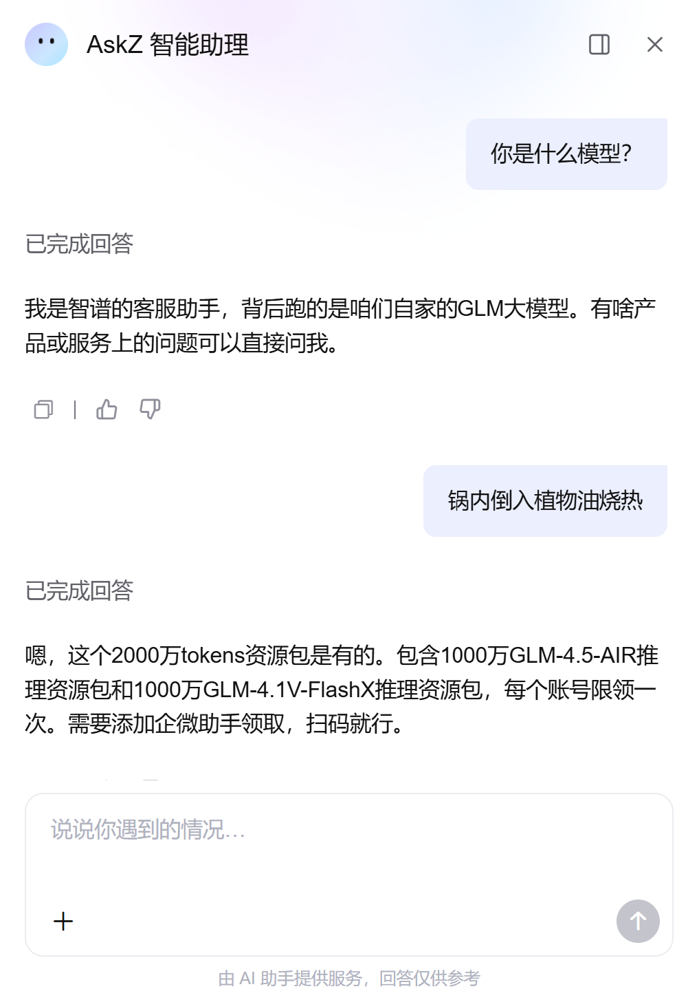
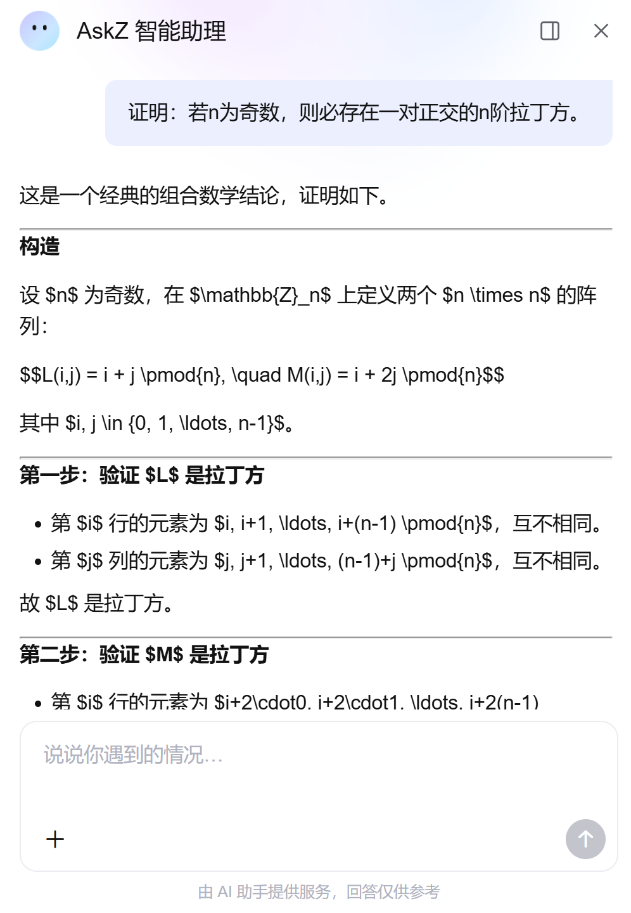

---

id: 2458733

title: "盘点目前可用的GLM-5.2渠道"

created_at: 2026-06-23T09:26:06.602Z

username: MuStellar

display_username: "Mumu"

---

# 盘点目前可用的GLM-5.2渠道

GLM-5.2 都发布 10 天了我还没抢到 Coding Plan，我已急哭……不过好消息是它是开源的，目前市面上已有多种第三方渠道接入。以下盘点截至目前 GLM-5.2 的可用渠道（包含我已实测的和道听途说的）。

**省流：付费订阅 OpenCode Go 综合最佳；免费尝鲜可以选官方 ZCode 或 阿里云百炼。**

注：如果怀疑渠道掺水，安全边界也不失为一个检查的好办法。但注意即便是没有内容审查（中途截断 / 无法发送）的渠道，GLM 自身也可能因为安全对齐而说抱歉（但此时输出是完整的）。

---

## 1. 官方渠道价格参考（作为基线）

### 1.1 官方 API（按量付费）

- 模型文档：[GLM-5.2 - 智谱AI开放文档](https://docs.bigmodel.cn/cn/guide/models/text/glm-5.2)

- 价格（元 / M tokens）：缓存创建 ¥0，缓存命中 ¥2，输入 ¥8，输出 ¥28

- 可用性：中高

- 内容审查：有。触发审查时表现为中途截断（但可以调整后台内容安全策略为“宽松”）。

### 1.2 官方 Coding Plan（国内版，订阅制）

- 订阅链接：[智谱丨BigModel 平台](https://bigmodel.cn/glm-coding)

- 价格：Lite ¥49/月，Pro ¥149/月，Max ¥469/月。受好友邀请，或连续包季 / 包月，可额外打 9.5 折 / 9 折 / 8 折。

- 可用性：中低。高峰期报 429 或卡顿。

- 内容审查：待测

此为抢购脚本：

[https://linux.do/t/topic/2459694/](https://linux.do/t/topic/2459694/)

我本准备自己实测确实能抢到了再把脚本放上来，但感觉抢不到似乎也不完全是脚本不正确的原因。此项目基于 [@xcd-jjj111](/u/xcd-jjj111) 佬的脚本升级，原帖 [https://linux.do/t/topic/2191688](https://linux.do/t/topic/2191688).

### 1.3 官方 Coding Plan（海外版，订阅制）

- 订阅链接：[GLM Coding Plan — AI Coding Powered by GLM-5.3, GLM-5.3-Flash, GLM-5.2 & GLM-5-Turbo for Agents & IDEs](https://z.ai/subscribe)

- 价格：Lite $16.2/月，Pro $64.8/月，Max $144/月。连续包周期也有额外折扣。

- 可用性与内容审查：待测。据说 key 和国内版是通用的。

## 2. 我已实测的渠道

### 2.1 官方 ZCode（新人 Start Plan，免费）

- 下载链接：[ZCode | GLM-5.3 官方 Harness](https://zcode.z.ai/cn)

- 价格：¥0。下载智谱官方编程工具 ZCode 即可获赠为期 4 天、每天 300W tokens 的新人礼包。当天没用完不结转至第二天。

- 可用性：中低

- 内容审查：有

- 优点：免费、官方渠道，适合体验尝鲜。

- 缺点：我用的时候（上周）非常非常卡，每说一句话就重连 10 次也连不上，几乎处于不可用的状态，最终基本浪费了这个礼包。

- 备注：订阅了官方 Coding Plan 的用户在 ZCode 内可享 1.5× 配额。

### 2.2 硅基流动 API（按量付费）

- 链接：[https://cloud.siliconflow.cn/models?target=zai-org/GLM-5.2](https://cloud.siliconflow.cn/models?target=zai-org/GLM-5.2)

- 价格：缓存创建 ¥0，缓存命中 ¥2，输入 ¥8，输出 ¥28

- 可用性：高。生成速度和首字延迟还行。服务状态也挺稳定的。

- 内容审查：无

- 优点：价格与官方 API 持平，不掺水，按用量计价透明诚实。页面不像其他云厂商那么冗余复杂层层叠叠，清爽干净。

- 缺点：自从硅基流动调整了赠金使用规则后，顿时从 token 之光变成了路边一条，我手里囤着的 100 条 API keys 瞬间化为废纸。并且 GLM-5 之后的模型以及 DeepSeek-V4 不在赠金可用列表之内，赠金仅可抵扣智谱 4.5 系列老模型。（虽然 4 月份的时候 GLM-5.1 不在列表里，但其实可以用赠金抵扣，但 5 月份这个 bug 被修复了。）无 Coding Plan，仅有按量付费 API。但价格与官方一致的话，实在想不出使用硅基流动的理由（好吧，NSFW 算一个）。

### 2.3 火山引擎 Coding Plan / Agent Plan（订阅制）

- 价格：Lite ¥9.9/月，Pro ¥49.9/月

- 可用性：高。生成速度较快，首字延迟有时高有时低。

- 内容审查：有。触发后表现为中途截断。GLM-5.2 没截断就是掺水了。（是的就是这么难绷，正版会截断，盗版反而不截断。）

- 优点：目前做活动，最低仅需 ¥9.9/月，且本月底前有倍率优惠；生成速度较快；热门前沿国模（GLM, DeepSeek, Kimi, MiniMax, 还有强制捆绑的 Doubao）一揽子打尽。较旧模型（如 DeepSeek-V3.2, GLM-4.7）还可以每天领取免费 tokens。

- 缺点：我之前的帖子已经详细阐述过了，完全是把用户当傻子大胆掺水。后台用量统计非常不透明，还时不时路由到不知什么的野鸡模型上（也不好说是不是真野鸡，因为该神秘模型甚至有可能是 Claude/GPT）。并且，虽然它大肆掺水愚弄客户，但仍凭借活动期价格优势和 GLM-5.2 的火爆，目前业已售罄无法购买。

[火山引擎coding plan已上线GLM-5.2，但显然不是正版](https://linux.do/t/topic/2420634) [

国产替代](/c/domestic/98)

> ![[image]](https://cdn3.ldstatic.com/original/4X/5/2/7/527d5e2bcd5e8b357c7d20353e6e3582554d02e9.png)

> 火山引擎coding plan/agent plan已上线GLM-5.2，并将于6月22日下线GLM-5.1.然而正如前所述，火山时不时偷偷掺水，调用的明显不是真5.2.

> 证据1: 上行tokens一模一样。通常来说，不同代际的模型应该分出数量不同的tokens。

>  ![[image]](https://cdn3.ldstatic.com/original/4X/0/d/d/0dda30b7c3b9951d4851dc7f728be8fad77351a4.png)

> ![[image]](https://cdn3.ldstatic.com/original/4X/7/8/4/7848ae9b4965fe0a7bfb435899e2f8e834d963d4.png)

> 虽然以上两个截图可能是因为自家模型沿用了一样的分词器，但我上个月测试的时…

### 2.4 阿里云百炼 体验包（免费）

- 链接：[https://bailian.console.aliyun.com/](https://bailian.console.aliyun.com/)

- 价格：¥0。每个模型 100 万 tokens 免费额度，有效期 3 个月，超出后按量付费。

- 可用性：高。生成速度较快，首字延迟较低。

- 内容审查：极为严格。表现为：无法发送。百炼的合规审查是最为严格的，任意输入 / 输出违规都将被拦截。（同理，可以反推之前芒果 TV 送的 GLM-5.1 就是接的阿里云——报的错误码甚至直接就是阿里云的链接。）

- 优点：可用性高。而且每次上新模型也很快，前沿模型免费包迅速可用。

- 缺点：仅有 100W 额度，并且限时。不过免费的还要什么自行车，可作为体验尝鲜。

### 2.5  OpenCode Go（订阅制）

- 链接：[OpenCode Go | 人人可用的低成本编程模型](https://opencode.ai/zh/go)

- 价格：首月 $5，后续 $10/月

- 后台计价参考：

计价项

缓存创建

输入

输出

缓存读取

美元（$ / M tokens）

$0

$1.40

$4.40

$0.26

人民币（¥ / M tokens）

¥0

¥9.52

¥29.92

¥1.77

对比国内版官方（¥ / M tokens）

¥0

¥8

¥28

¥2

注：OpenCode 的定价实际上和官方海外版 API 价格持平。输入输出比国内版贵，但缓存命中便宜！

- 可用性：高-中，不怎么报 429。首字延迟之前较低，上周非常慢非常卡，现在已恢复。

- 内容审查：无

- 备注：根据佬友们的经验，这实际上是个 token plan，月额度为 $60。也就是说你花 $5 就能买到约 10 倍用量（并不能完全等值 $60，注意价格差，尤其注意 deepseek-v4-pro 的价格差），还是非常划算的，因此综合下来第三方渠道我**最推荐这个**！

- 并且，虽然 GLM 有价格差，但如果按照 vibe coding 常见的输入输出比例估算一下：

OpenCode：95×0.26 + 5×1.4 + 3×4.4 = $44.9 = ¥305

官方 API：95×2 + 5×8 + 3×28 = ¥314

可以看出缓存命中的优势抵消了输入输出的劣势，OpenCode 甚至稍微便宜一点点！（不过实际比例还是看你自己的任务负载模式。）

- 优点：后台计费非常透明诚实，不搞幺蛾子、不偷偷掺水换模型，还没有内容拦截；热门国模一网打尽，对于除了 GLM 还想使用其他国产模型的佬友是个好选择；大部分时候输出速度还行。

- 缺点：偶尔会卡；是 token plan，不太能爽蹬。

## 3. 道听途说的渠道

### 3.1 OpenRouter

- 链接：[GLM 5.2 - API Pricing & Benchmarks | OpenRouter](https://openrouter.ai/z-ai/glm-5.2)

- 备注：知名海外聚合商。之前使用是为了 DeepSeek-R1 的免费调用次数。此网站页面清爽，模型也很全，适合查看各家模型的趋势和排名。不过佬友大部分在国内，应该不大需要通过海外中转商来用国模吧。

### 3.2 国家超算平台（订阅制）

- 链接：[超算互联网·智「惠」开发季 - 超算互联网](https://www.scnet.cn/home/subject/midsal/index.html?utm_campaign=2026618)

- 价格：¥9.9/月

- 备注：听说是满血，可以调用各种国模，价格也不贵。但是问题在于折合DeepSeek-V4-Flash也只有8000W tokens，算一下感觉我在倒贴？

### 3.3 其他

- tabbit 浏览器可免费调用

- Ollama Plan

- 阿里云 token plan

- 讯飞星火

- 华为云

- 腾讯云

- 七牛云

- 京东 joycode

- 各种中转站和公益站

---

## 4. 之前可用 GLM-5.1、目前还没上 GLM-5.2 的渠道

### 4.1 百度千帆 Coding Plan（订阅制）

- 链接：[Coding Plan - 百度千帆·大模型服务及Agent开发平台](https://cloud.baidu.com/doc/qianfan/s/imlg0beiu)

- 价格：¥40/月。据说首月有优惠券。

- 可用性 / 优缺点：待测。目前仅有 5.1 还没上 5.2

### 4.2 魔搭社区（免费）

- 链接：[https://modelscope.cn/](https://modelscope.cn/)

- 价格：¥0。绑定阿里云账号后免费调用。

- 优点：；模型非常多非常全；能连上的时候输出速度还挺快。

- 缺点：能调用的次数非常非常少，连调用 DeepSeek 都说不了几句话。并且目前 GLM-5.1 可用、GLM-5.2 还不可用的样子，静待 provider 上新。

### 4.3 英伟达（免费）

- 链接：[https://build.nvidia.com/](https://build.nvidia.com/)

- 价格：$0。邮箱注册即可免费调用，几乎等同于有手就行。

- 优点：

- 缺点：只有免费这一个优点了。首字延迟高到离谱，输出速度非常慢。模型感觉也是降智量化版：使用 GLM-5.1 无思维链、输出格式混乱；使用 DeepSeek-R1 上下文掺水严重。可以通过模型行为判定中转站是否接的是英伟达渠道。

---

此外，部分高校 / 实验室提供自有部署（如中科大“词元计划”提供包括 GLM-5.2 在内的多种模型，每日 1 亿 tokens）；部分公司提供报销额度（如滴滴提供 1w 报销）。科研佬友和社畜佬友可留意自家通知。

欢迎佬友补充更多渠道的实测信息！

---

二编：等等，我有一个邪修方法……你家这个智能客服该不会是 GLM-5.2 吧？？ （至少可以确定是 GLM-4 / GLM-5 系列）

---

*来源: https://linux.do/t/topic/2458733.json*

