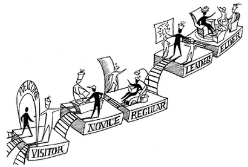
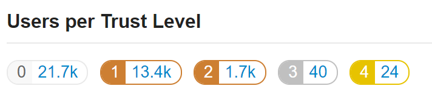

---

id: 2460

title: "【新人请看】了解Discourse信任度"

created_at: 2024-01-24T08:14:47.257Z

username: aichs

display_username: "晏琳"

---

# 【新人请看】了解Discourse信任度

# Discourse 论坛信任等级解析

用户信任系统是 Discourse 的基石之一。信任等级的设计旨在：

- 为论坛中新用户设置一个沙盒环境，避免他们在了解论坛操作时不小心伤害到自己或其他用户。

- 随着时间的推移，为经验丰富的用户赋予更多权限，让他们可以帮助维护和管理他们付出了大量时间建设的社区。

正如[《网络社区建设》](http://www.amazon.com/Community-Building-Web-Strategies-Communities/dp/0201874849?ref=blog.discourse.org)一书中所提到的，任何社区的参与者都有一个自然的进阶过程。

这成了我们用户信任系统的起点。因此，Discourse 提供了**五个用户信任等级**。你当前的信任等级可以在你的用户页面上看到，而且你的仪表板上会展示社区内所有信任等级的摘要。

> 用户如何了解信任系统？

>

> 每个新用户都会收到一条欢迎私信，提到信任系统并附上本博客文章的链接，解释为了安全起见新用户可能会暂时受到限制。他们还被邀请[与discobot开始一场可选的互动训练对话](https://blog.discourse.org/2017/08/who-is-discobot/)。

> 在晋升到信任等级1后，用户会收到一条祝贺私信，也附有链接到本博客文章，并邀请用户完善他们的用户资料，或者开始一个新话题。

> 在晋升到信任等级2后，用户会收到另一条祝贺私信，同样附有链接到本博客文章，和[提示与技巧](https://blog.discourse.org/2016/12/discourse-new-user-tips-and-tricks/)的博客文章。

> 在晋升到信任等级3时，用户会收到一封较长的私信，描述了他们的新权限，并邀请他们进入仅对信任等级3及以上用户开放的安全类别以结识其他TL3社区成员。这封私信也有链接到本博客文章。

（还值得一提的是，Discourse 起初会[开启 “引导模式”](https://meta.discourse.org/t/what-is-bootstrap-mode/58462?ref=blog.discourse.org)，前50名注册的用户会自动晋升为TL1，每天摘要，以通过早期用户推动社区的成长。）

## 信任等级0 – 新用户

默认情况下，所有新用户开始时都是信任等级0，意味着信任尚未建立。这些是刚刚创建账户的访客，他们还在[学习社区规范和您的社区工作方式](https://blog.discourse.org/2013/03/the-universal-rules-of-civilized-discourse/)。新用户的能力出于安全考虑而受到限制——为他们和您的安全。

（我们还希望对新用户隐藏任何“高级”功能，以便他们获得更多经验时，使界面对他们来说更少混淆。）

信任等级0的用户不能…

- 向其他用户发送私信

- 通过链接按钮“回复为新话题”（移除了UI）

- 标记帖子

- 发布超过1张图片

- 发布任何附件

- 在一篇帖子中发布超过2个超链接

- 在他们的个人资料“关于我”中有实际链接（会被静默和暂时转换为纯文本）

- 在一篇帖子中提及超过2个用户

- 发布超过3个话题

- 发布超过10条回复

- 在24小时后编辑自己的帖子

管理员可以通过在网站设置中搜索 `newuser` 和 `first_day` 来更改这些限制。

## 信任等级1 – 基本用户

在 Discourse，我们相信阅读是社区中最基本且最健康的行为。如果新用户愿意花点时间阅读，他们很快就会晋升到第一个信任等级。

晋升到信任等级1方式如下…

- 进入至少**5**个话题

- 阅读至少**30**篇帖子

- 总共花费**10**分钟阅读帖子

信任等级1的用户可以…

- 使用所有核心 Discourse 功能；移除了所有新用户限制

- 发送私信

- 如果启用，上传图片和附件

- 编辑wiki帖子

- 标记帖子

- 静音其他用户

管理员可以通过在网站设置中搜索 `tl1` 来更改这些阈值。

## 信任等级2 – 成员

成员在连续几周的时间内不断回到您的社区；他们不仅阅读，还持续并积极地参与足以与完全公民身份一样受到信任。

晋升到信任等级2的方式…

- 至少访问**15**天，不必连续

- 至少点赞**1**次

- 至少收到**1**次点赞

- 回复至少**3**个不同的话题

- 进入至少**20**个话题

- 阅读至少**100**篇帖子

- 总共花费**60**分钟阅读帖子

信任等级2的用户可以…

- 使用“邀请他人参与此话题”的按钮，通过一键操作让新用户参与话题

- 邀请外部用户进入私信，创建群组私信

- 每天点赞、编辑和标记的限制增加了1.5倍

- 忽略其他用户

- 在发布后的30天内编辑自己的帖子

管理员可以通过在网站设置中搜索 `tl2` 来更改这些阈值。

## 信任等级3 – 活跃用户

活跃用户是您社区的支柱，是在几个月乃至几年的时间内最活跃的读者和可靠的贡献者。因为他们一直在周围，他们可以被进一步信任，以帮助整理和组织社区。

晋升到信任等级3，在过去的100天里…

- 必须至少访问了 **50%** 的天数

- 必须至少在**10**个不同的非私信话题上进行了回复

- 在过去100天内创建的话题中，必须浏览了**25%**（上限为500）

- 在过去100天内创建的帖子中，必须阅读了**25%**（上限为20k）

- 必须收到**20**个点赞，并送出**30**个点赞。*

- 不得收到超过5个垃圾邮件或冒犯性标记（每个都需不同的帖子和不同的用户，并由版主确认）

- 过去6个月内不能被暂停或禁言

* 这些点赞必须来自不同的用户数量最少为用户数的1/5，不同的天数最少为天数的1/4。这些点赞不可以来自私信。

上述所有标准都必须满足才能达到信任等级3。此外，与其他信任等级不同，*你可以失去信任等级3的状态*。如果在过去100天内你的表现低于这些要求，你将会降级回成员。然而，为了避免频繁的升降级情况，获得信任等级3后，有一个2周的宽限期，在此期间你不会被降级。

信任等级3的用户可以…

- 重新分类和重命名话题

- 进入只对信任等级3及以上用户可见的安全类别

- 他们所有的链接都会被跟踪（我们移除了自动 nofollow）

- TL3对TL0用户帖子的垃圾邮件标记立即隐藏帖子

- TL3对TL0用户帖子的足够多样化标记会自动禁言该用户并隐藏他们所有的帖子

- 将自己的帖子变成wiki（即，所有TL1+用户都可以编辑）

- 每天点赞、编辑和标记的限制增加了2倍

管理员可以通过在网站设置中搜索 `tl3` 来更改这些阈值。

## 信任等级4 – 领导者

领导者是那些永远在的常客，见证了一切。他们通过行为和帖子为社区树立了积极的榜样。如果你需要建议，他们是你首先求助的人，他们已经赢得了最高水平的社区信任，以至于他们几乎已经是社区内的版主。

晋升到信任等级4途径为…

- 只能由工作人员手动晋升

- （或许将来会有一个正在开发的选举系统）

信任等级4的用户可以…

- 编辑所有帖子

- 置顶/取消置顶话题

- 关闭话题

- 归档话题

- 使话题不被列出

- 拆分和合并话题

- 重置话题提升日期

- 每天点赞、编辑和标记的限制增加了3倍

- 任何TL4对任何帖子的标记立即生效并隐藏目标帖子

- 可以发送私信到电子邮件地址

要了解授予每个信任等级的权限的完整分解，请查看我们在 Meta 上的常见问题解答。

[Discourse 论坛权限等级表](https://linux.do/t/topic/18797) [

文档共建](/c/wiki/42)

> Discourse 论坛权限等级表（包括版主角色）

> 这旨在成为一个全面的Discourse功能列表，按信任等级标记，并包括影响这些功能的相关管理员设置。如果你发现有遗漏或不正确的地方，请在下面留言。 

> 信任等级表 – 默认值

> TL = 依赖信任等级

>  = 可以由管理员设置启用或调整

>

>

>

>

> 

>

> TL0

> TL1

> TL2

> TL3

> TL4

> …

我们认为这个信任系统到目前为止是成功的，因为它通过谨慎地授权给会员、活跃用户和领导者来管理和引领他们自己的社区，建立了更强大、更可持续的社区。这是 [Discourse 与其他社区软件不同的关键社区特性](https://blog.discourse.org/2021/09/community-features/)之一。但就像 Discourse 中的其他一切一样，随着我们在更多社区获得更多经验，信任系统也在不断进化。我们将继续更新这篇文章，以反映任何变化。

---

*来源: https://linux.do/t/topic/2460.json*

