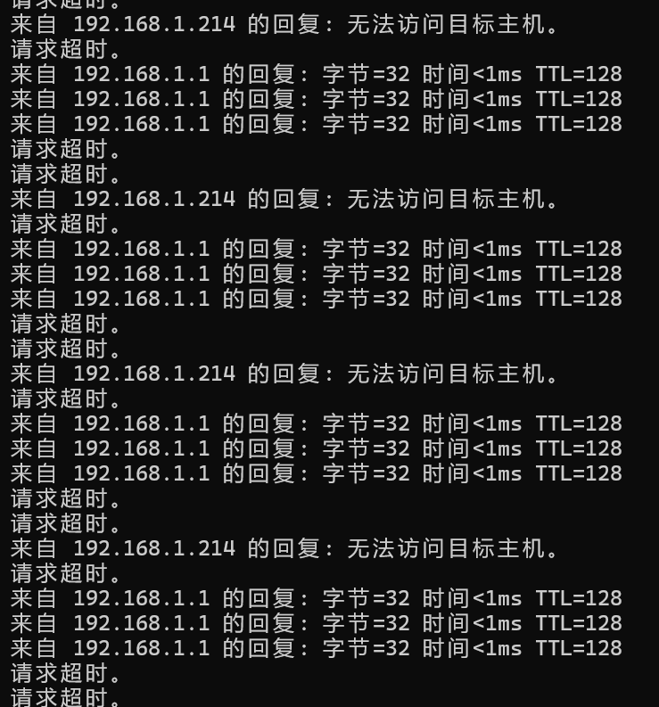
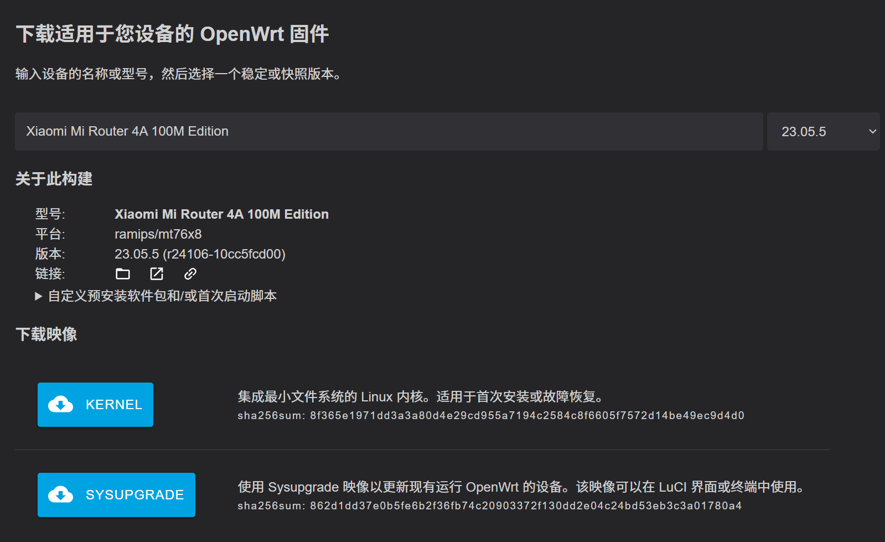
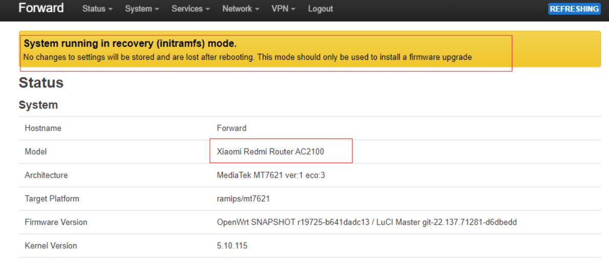
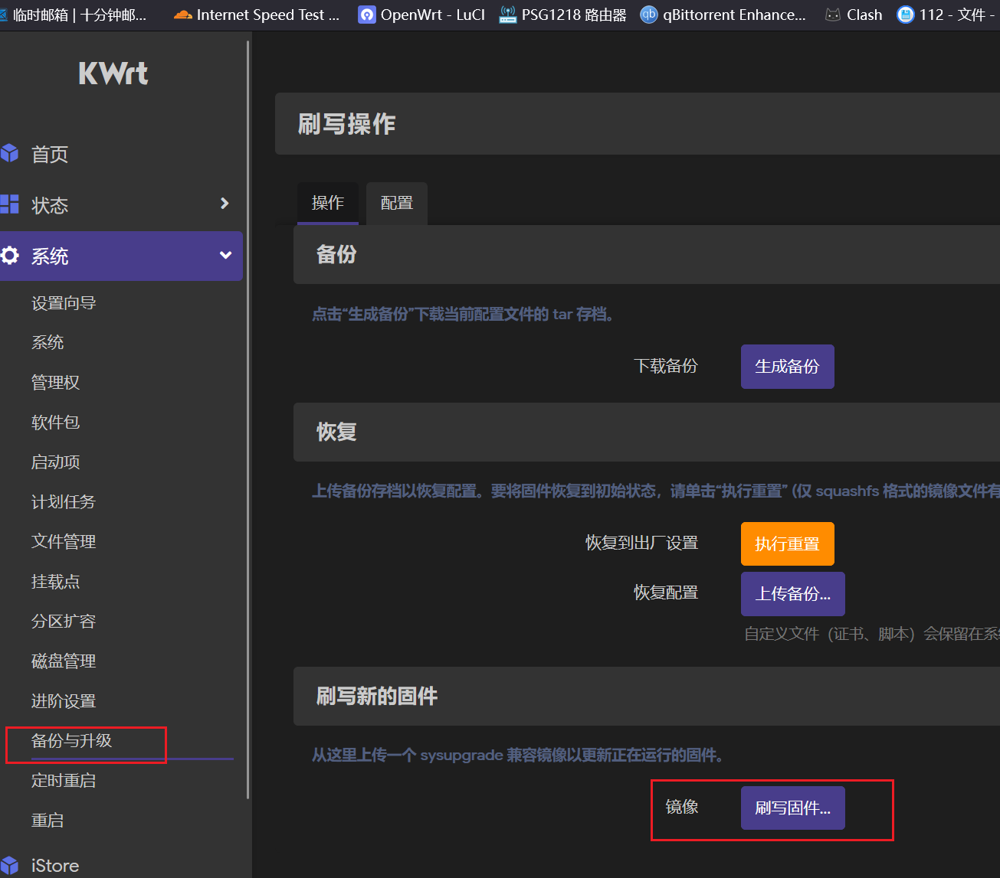
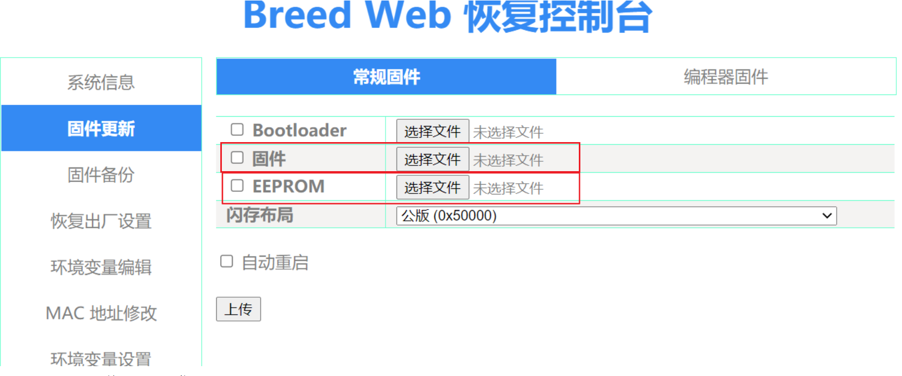

---

id: 247051

title: "记录小米4A百兆版路由器刷openwrt"

created_at: 2024-10-31T08:12:24.305Z

username: yonse

display_username: "XYZ"

---

# 记录小米4A百兆版路由器刷openwrt

在给[小米4A百兆版](https://openwrt.org/toh/xiaomi/mi_router_4a_mir4a_100m)刷`openwrt`时候踩了一些坑,在这里记录一下,我是先刷入`Breed`再刷入`openwrt`的

# 注意路由器版本区分

小米路由器4A有千兆版和百兆版两个, 网上更多流传的是千兆版教程和固件, 一旦把千兆版固件刷到百兆版上, 路由器直接变砖, 需要编程器救砖 [路由器挂了，上编程器 ](https://linux.do/t/topic/221701).

更坑的是百兆版有为[国内版](https://openwrt.org/toh/xiaomi/mi_router_4a_mir4a_100m)和[国际版](https://openwrt.org/inbox/toh/xiaomi/r4ac),具有不同的闪存布局,也不能刷错

# 固件选择

- 尝试 [OpenWrt官方固件](https://openwrt.org/toh/hwdata/xiaomi/xiaomi_mi_router_4a_100m),

刷入后只有通电时灯亮一下,路由器的IP间歇性能ping通, 无法进入后台,刷机失败

- 还是官方固件[OpenWrt Firmware Selector](https://firmware-selector.openwrt.org/?version=23.05.5&target=ramips%2Fmt76x8&id=xiaomi_mi-router-4a-100m)

刷入方法是: 先刷入`KERNEL`固件, 刷入成功后进入后台再刷入 `SYSUPGRADE`

.

在刷入`KERNEL`固件进入后台时会显示下图黄色警告 

后台刷入 `SYSUPGRADE`后就好了

不过在我尝试了`SNAPSHOT`版和多个版本的普通版, 在刷入`KERNEL`后可以进入后台, 但在后台刷入`SYSUPGRADE` 后再次进入后台, 跳转到了`Breed`后台, 多次尝试均是如此. 因为我是在 `Breed`上刷`openwrt`, 看到恩山论坛有人说: 这款路由器不能在`Breed`上刷`openwrt`.

- 找到了一个[能用的版本](https://cloud.189.cn/t/FZFZZjrqQVJz%EF%BC%88%E8%AE%BF%E9%97%AE%E7%A0%81%EF%BC%9Aysu3%EF%BC%89),这个就是教程[Win10下小米路由器4A百兆版刷Openwrt固件【图片详细版】 - 会飞的一棵树 - 博客园 (cnblogs.com)](https://www.cnblogs.com/flytree/p/14812133.html)中分享的

# 在`Breed`中刷入`openwrt` 注意事项

- 刷固件时，把eeprom一起刷入，不然`WIFI`信号弱, 甚至没有`WIFI`信号

刷机要用的固件和eeprom这个教程中均有提供[Win10下小米路由器4A百兆版刷Openwrt固件【图片详细版】 - 会飞的一棵树 - 博客园 (cnblogs.com)](https://www.cnblogs.com/flytree/p/14812133.html)

# 参考教程

- 全流程刷机教程

[Win10下小米路由器4A百兆版刷Openwrt固件【图片详细版】 - 会飞的一棵树 - 博客园 (cnblogs.com)](https://www.cnblogs.com/flytree/p/14812133.html)

[小米路由器4刷OpenWrt折腾指南：适用于其他米系路由器 - 哔哩哔哩 (bilibili.com)](https://www.bilibili.com/read/cv25216391/)

[Linux 下小米路由器 4A 百兆版刷入 OpenWrt 固件 (shn.hk)](https://ayaka.shn.hk/openwrt/)

---

*来源: https://linux.do/t/topic/247051.json*

